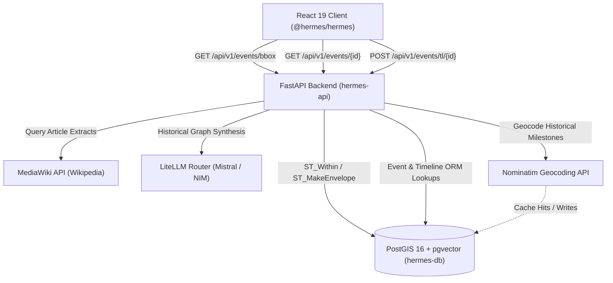
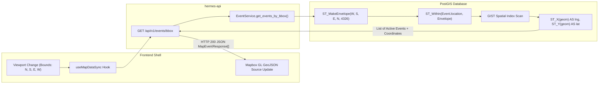
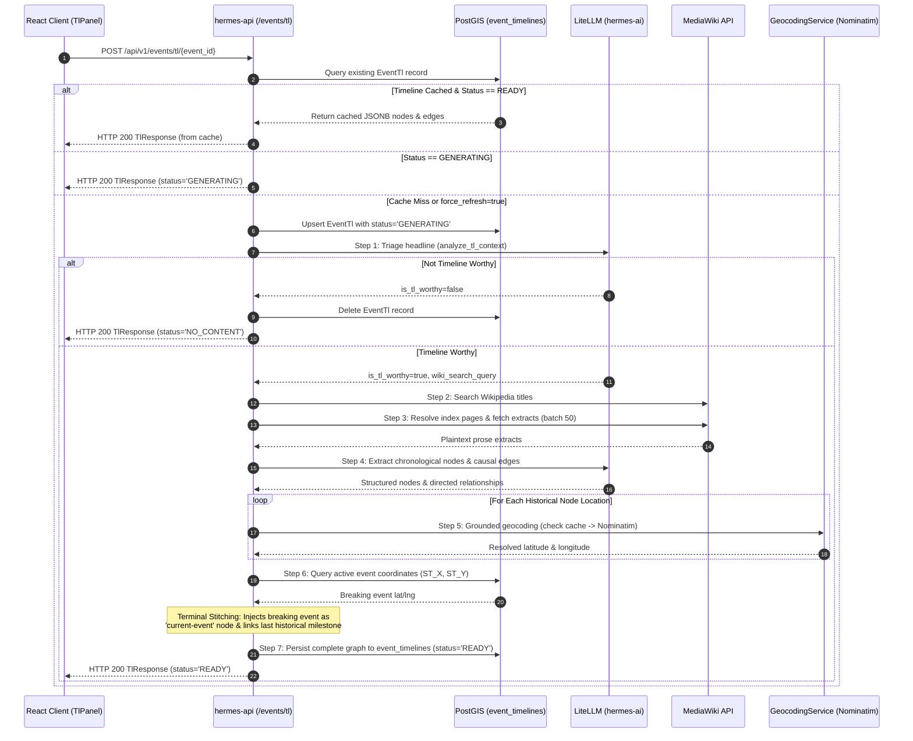

# Hermes API Service

`hermes-api` is the high-performance, stateless REST backend and on-demand historical causality synthesis engine for Project Hermes. Built with **Python 3.14+** and **FastAPI**, it serves real-time spatial intelligence to the React 19 frontend shell (`apps/hermes` and `@hermes/map`) by querying PostGIS spatial indexes and orchestrating multi-stage AI historical timeline graphs.

---

## Table of Contents

- [Architectural Overview](#architectural-overview)
- [Design Decisions & Engineering Rationale ("The Why")](#design-decisions--engineering-rationale-the-why)
- [System Architecture & Interaction Graphs](#system-architecture--interaction-graphs)
  - [High-Level System Topology](#high-level-system-topology)
  - [Spatial Bounding-Box Query Flow](#spatial-bounding-box-query-flow)
  - [Historical Timeline Synthesis Pipeline](#historical-timeline-synthesis-pipeline)
- [REST API Reference](#rest-api-reference)
  - [Root Health Check](#1-root-health-check)
  - [Event List Query](#2-event-list-query)
  - [Spatial Bounding-Box Viewport Query](#3-spatial-bounding-box-viewport-query)
  - [Event Detail Inspection](#4-event-detail-inspection)
  - [On-Demand Timeline Synthesis](#5-on-demand-timeline-synthesis)
  - [Standard Error Envelope](#standard-error-envelope)
- [Lifespan Lifecycle & Dependency Injection](#lifespan-lifecycle--dependency-injection)
- [Configuration & Environment Variables](#configuration--environment-variables)
- [Codebase Structure](#codebase-structure)
- [Developer Runbook & CLI Commands](#developer-runbook--cli-commands)

---

## Architectural Overview

Within the Project Hermes monorepo, `hermes-api` operates strictly as a **read and synthesis service**. It does not perform autonomous RSS ingestion, vector embeddings generation, or scheduled time decay — those background lifecycle processes are isolated in the standalone CLI service `hermes-worker`.

```text
┌────────────────────────────────────────────────────────────────────────┐
│                          Hermes Monorepo Scope                         │
│                                                                        │
│   ┌──────────────────┐               ┌─────────────────────────────┐   │
│   │   apps/hermes    │ (HTTP/REST)   │       apps/hermes-api       │   │
│   │ (React Frontend) ├──────────────►│    (FastAPI REST Service)   │   │
│   └──────────────────┘               └──────────────┬──────────────┘   │
│                                                     │                  │
│                      ┌──────────────────────────────┼──────────────┐   │
│                      │                              │              │   │
│                      ▼                              ▼              ▼   │
│             ┌─────────────────┐            ┌─────────────────┐     │   │
│             │ libs/hermes-db  │            │ libs/hermes-ai  │     │   │
│             │ (PostGIS Models │            │ (LLM & Geocode  │     │   │
│             │   & Migrations) │            │     Clients)    │     │   │
│             └────────┬────────┘            └────────┬────────┘     │   │
│                      │                              │              │   │
└──────────────────────┼──────────────────────────────┼──────────────┘   │
                       │                              │                  │
                       ▼                              ▼                  │
             ┌─────────────────┐            ┌───────────────────┐        │
             │   PostgreSQL    │            │  External Cloud   │        │
             │ (PostGIS 16 +   │            │ (LiteLLM/NIM,     │        │
             │   pgvector)     │            │  MediaWiki,       │        │
             │                 │            │  Nominatim)       │        │
             └─────────────────┘            └───────────────────┘        │
```

---

## Design Decisions & Engineering Rationale ("The Why")

### 1. 12-Factor Statelessness & Scheduler Isolation
- **The Problem**: In modern microservice deployments (e.g. AWS ECS Fargate, Kubernetes), container instances scale horizontally behind an Application Load Balancer. Running cron loops or ingestion tasks inside the API process (such as `APScheduler` or FastAPI background tasks) causes event-loop starvation during intensive network/CPU spikes and triggers duplicate scheduled executions across replicas without complex distributed locking.
- **The Decision**: `hermes-api` contains **zero background schedulers or ingestion loops**. All RSS scraping, embedding generation, and score decay run exclusively in `hermes-worker`. This keeps `hermes-api` completely stateless, enabling instant container boot times, minimal memory footprints, and effortless horizontal auto-scaling.

### 2. Externalized Data Layer (`libs/shared/hermes-db`)
- **The Problem**: Duplicate ORM model definitions across backend apps (`hermes-api` and `hermes-worker`) lead to schema drift, disjoint migration trees, and maintenance friction.
- **The Decision**: All SQLAlchemy 2.0 declarative models (`Event`, `Article`, `EventTl`, `GeocodeCache`, `Source`), GeoAlchemy2 geometries, and Alembic migrations live in `libs/shared/hermes-db`. `hermes-api` imports models and services directly, maintaining a single source of truth across the monorepo.

### 3. Grounded Geocoding Shield
- **The Problem**: Large Language Models regularly hallucinate spatial coordinates or generate imprecise latitude/longitude values when extracting historical events from prose.
- **The Decision**: The API never prompts the LLM for coordinates. Instead, the LLM extracts named entities (`location_name`), which are resolved against Nominatim via `GeocodingService` and cached in PostgreSQL (`geocode_cache`). Coordinates are strictly grounded in real-world geospatial databases.

### 4. CORS Exception Handler Workaround (`_cors_headers`)
- **The Problem**: In Starlette/FastAPI, custom exception handlers registered via `@app.exception_handler(...)` build `JSONResponse` objects directly within Starlette's `ExceptionMiddleware`. When exceptions are thrown, Starlette's outer `CORSMiddleware` may be bypassed on error response pathways, stripping standard `Access-Control-Allow-Origin` headers. Web browsers then report an opaque "CORS Network Error" instead of revealing the underlying HTTP 404, 422, or 500 error body.
- **The Decision**: Every custom error handler registered in `core/errors.py` explicitly injects origin headers via `_cors_headers(request)`, guaranteeing that browser clients can always inspect error details.

### 5. Non-Blocking Async Architecture
- **The Decision**: `hermes-api` strictly utilizes asynchronous I/O across every layer:
  - Database access: `asyncpg` via SQLAlchemy 2.0 Async engine.
  - External HTTP: `httpx.AsyncClient` with custom timeouts.
  - LLM calls: Async LiteLLM client router.
  No blocking synchronous calls (`requests.get`, `time.sleep`) are permitted.

---

## System Architecture & Interaction Graphs

### High-Level System Topology



---

### Spatial Bounding-Box Query Flow

When the user pans or zooms the map on the frontend, `@hermes/map` emits a debounced bounding-box query to populate events within the visible viewport.



---

### Historical Timeline Synthesis Pipeline

When a user opens the timeline drawer (`TlPanel`) for an event, the API executes an on-demand causality pipeline:



---

## REST API Reference

All routes are mounted under the configurable prefix `settings.API_BASE_PATH` (default: `/api/v1`).

### 1. Root Health Check

Checks if the server process is alive and accepting requests.

- **Endpoint**: `GET /`
- **Response**: `200 OK`
```json
{
  "message": "hermes is running..."
}
```

---

### 2. Event List Query

Retrieves a ranked list of events ordered by descending `trending_score`.

- **Endpoint**: `GET /api/v1/events/`
- **Query Parameters**:
  | Parameter | Type | Required | Default | Description |
  | :--- | :--- | :--- | :--- | :--- |
  | `status` | `string` | No | `ACTIVE` | Filter by status (`ACTIVE`, `STALE`, `ARCHIVED`). |
  | `scope` | `string` | No | `null` | Filter by scope (`GLOBAL`, `REGIONAL`, `LOCAL`). |
  | `limit` | `integer`| No | `50` | Maximum items to return (`1` to `200`). |

- **Response**: `200 OK` (`list[EventResponse]`)
```json
[
  {
    "id": "3fa85f64-5717-4562-b3fc-2c963f66afa6",
    "ai_headline": "UN Security Council Convenes Emergency Session on Red Sea Navigation",
    "category": "POLITICS",
    "category_color": "#3B82F6",
    "location_name": "New York, USA",
    "trending_score": 9.5,
    "article_count": 4,
    "status": "ACTIVE",
    "first_reported_at": "2026-10-13T08:30:00Z",
    "last_updated_at": "2026-10-13T11:15:00Z"
  }
]
```

---

### 3. Spatial Bounding-Box Viewport Query

Queries PostGIS spatial index (`ST_Within`) for active events situated within the specified geographic coordinates. Returns flattened latitude and longitude coordinates suitable for direct Mapbox GL feature creation.

- **Endpoint**: `GET /api/v1/events/bbox`
- **Query Parameters**:
  | Parameter | Type | Range | Description |
  | :--- | :--- | :--- | :--- |
  | `north` | `float` | `[-90, 90]` | Northern latitude boundary. |
  | `south` | `float` | `[-90, 90]` | Southern latitude boundary. |
  | `east` | `float` | `[-180, 180]`| Eastern longitude boundary. |
  | `west` | `float` | `[-180, 180]`| Western longitude boundary. |

- **Response**: `200 OK` (`list[MapEventResponse]`)
```json
[
  {
    "id": "3fa85f64-5717-4562-b3fc-2c963f66afa6",
    "ai_headline": "UN Security Council Convenes Emergency Session on Red Sea Navigation",
    "category": "POLITICS",
    "category_color": "#3B82F6",
    "location_name": "New York, USA",
    "latitude": 40.7128,
    "longitude": -74.0060,
    "trending_score": 9.5,
    "article_count": 4
  }
]
```

---

### 4. Event Detail Inspection

Retrieves augmented details for a specific event, including its AI summary and all linked underlying news articles.

- **Endpoint**: `GET /api/v1/events/{event_id}`
- **Path Parameters**:
  | Parameter | Type | Description |
  | :--- | :--- | :--- |
  | `event_id` | `UUID` | Unique identifier of the target event. |

- **Response**: `200 OK` (`EventDetailResponse`)
```json
{
  "id": "3fa85f64-5717-4562-b3fc-2c963f66afa6",
  "ai_headline": "UN Security Council Convenes Emergency Session on Red Sea Navigation",
  "ai_summary": "Diplomats gathered at the UN Headquarters following recent incidents affecting commercial shipping lanes. Representatives called for maritime stability and immediate de-escalation.",
  "category": "POLITICS",
  "category_color": "#3B82F6",
  "location_name": "New York, USA",
  "trending_score": 9.5,
  "article_count": 2,
  "status": "ACTIVE",
  "first_reported_at": "2026-10-13T08:30:00Z",
  "last_updated_at": "2026-10-13T11:15:00Z",
  "articles": [
    {
      "id": "7c9e6679-7425-40de-944b-e07fc1f90ae7",
      "title": "Security Council addresses maritime corridor tensions",
      "url": "https://example.com/news/security-council-meeting",
      "published_at": "2026-10-13T08:15:00Z"
    },
    {
      "id": "8d1e2233-1122-3344-5566-778899aabbcc",
      "title": "Global envoys seek resolution on Red Sea shipping security",
      "url": "https://example.com/news/envoys-red-sea-resolution",
      "published_at": "2026-10-13T09:00:00Z"
    }
  ]
}
```

- **Error Responses**:
  - `404 Not Found`: If `event_id` does not exist.

---

### 5. On-Demand Timeline Synthesis

Generates or retrieves a historical causality graph connecting past Wikipedia events to the current breaking incident.

- **Endpoint**: `POST /api/v1/events/tl/{event_id}`
- **Path Parameters**:
  | Parameter | Type | Description |
  | :--- | :--- | :--- |
  | `event_id` | `UUID` | Unique identifier of the target event. |
- **Query Parameters**:
  | Parameter | Type | Default | Description |
  | :--- | :--- | :--- | :--- |
  | `force_refresh` | `boolean` | `false` | When true, invalidates existing cached timeline and regenerates the graph. |

- **Response**: `200 OK` (`TlResponse`)
```json
{
  "status": "READY",
  "message": null,
  "tl_summary": "Historical milestones outlining regional maritime security developments culminating in modern international oversight.",
  "generated_at": "2026-10-13T11:20:00Z",
  "nodes": [
    {
      "id": "a1b2c3d4-e5f6-7890-abcd-ef1234567890",
      "date": "1982-12-10",
      "headline": "Adoption of the UN Convention on the Law of the Sea",
      "summary": "UNCLOS established comprehensive legal frameworks governing international waters and transit passages.",
      "location_name": "Montego Bay, Jamaica",
      "latitude": 18.4762,
      "longitude": -77.8939,
      "category_color": null
    },
    {
      "id": "current-event",
      "date": "2026-10-13",
      "headline": "UN Security Council Convenes Emergency Session on Red Sea Navigation",
      "summary": "Diplomats gathered at the UN Headquarters following recent incidents affecting commercial shipping lanes.",
      "location_name": "New York, USA",
      "latitude": 40.7128,
      "longitude": -74.0060,
      "category_color": "#3B82F6"
    }
  ],
  "edges": [
    {
      "source_node_id": "a1b2c3d4-e5f6-7890-abcd-ef1234567890",
      "target_node_id": "current-event",
      "relationship": "led to"
    }
  ]
}
```

- **Possible Status Values**:
  - `READY`: Synthesis complete; graph contains historical nodes, edges, and terminal event node.
  - `GENERATING`: Synthesis currently underway in another concurrent request.
  - `NO_CONTENT`: Event was triaged as routine news or no relevant Wikipedia chronologies exist.
  - `FAILED`: External provider error or extraction failure.

---

### Standard Error Envelope

All HTTP errors returned by the API conform to the structured `ErrorResponseSchema`:

```json
{
  "err_code": "EVENT_NOT_FOUND",
  "err_msg": "The requested event could not be found.",
  "details": {
    "event_id": "3fa85f64-5717-4562-b3fc-2c963f66afa6"
  }
}
```

#### Standard Error Codes
| HTTP Status | Error Code (`err_code`) | Scenario |
| :--- | :--- | :--- |
| `400` | `BUSINESS_LOGIC_ERROR` | Business rule violation. |
| `404` | `EVENT_NOT_FOUND` | Event UUID does not match any existing record. |
| `422` | `VALIDATION_ERROR` | Pydantic query or payload validation failure (e.g. invalid latitude). |
| `500` | `TIMELINE_GENERATION_ERROR` | Unexpected failure during timeline synthesis. |
| `500` | `UNEXPECTED_SERVER_ERROR` | Unhandled internal exception. |
| `502` | `WIKIPEDIA_SEARCH_ERROR` | MediaWiki upstream API request failure. |
| `503` | `HTTP_ERROR` | Timeline synthesis service unavailable due to missing credentials. |

---

## Lifespan Lifecycle & Dependency Injection

### Lifespan Protocol (`src/hermes_api/main.py`)
FastAPI's `@asynccontextmanager` manages the application lifecycle:

1. **Startup**:
   - Initializes PostgreSQL connection pool via `init_db(db_url=settings.db_url)`.
   - Validates LLM credentials (`LLM_API`, `LLM_MODEL`). If absent, logs a non-fatal warning allowing spatial queries to proceed while gracefully failing timeline synthesis requests with HTTP 503.
2. **Shutdown**:
   - Orderly closes the connection pool via `await close_db()`.

### Dependency Injection Pipeline
Routers never manage database sessions directly:
```python
# Database session injection
async def get_event_service(db: AsyncSession = Depends(get_db)) -> EventService:
    return EventService(db)

# Route definition
@router.get("/", response_model=list[EventResponse])
async def get_events(
    event_service: EventService = Depends(get_event_service)
):
    ...
```
This architecture facilitates unit testing by allowing `app.dependency_overrides[get_db]` substitution without requiring real database connections.

---

## Configuration & Environment Variables

Settings are managed via `pydantic-settings` (`core/config.py`). Configuration loads hierarchically from `.env`, `.env.<ENV>`, `.env.local`, and `.env.<ENV>.local`.

| Variable | Type | Default | Description |
| :--- | :--- | :--- | :--- |
| `APP` | `str` | `hermes` | Application identifier. |
| `ENV` | `str` | `development` | Deployment environment (`development`, `production`, `test`). |
| `API_PORT` | `int` | *Required* | HTTP port for the Uvicorn listener (e.g. `8000`). |
| `VERSION` | `str` | `1.0.0` | Semantic API version. |
| `API_BASE_PATH` | `str` | `/api/v1` | URL prefix for all API routes. |
| `DB_HOST` | `str` | `localhost` | PostgreSQL host. |
| `DB_PORT` | `int` | `5432` | PostgreSQL port. |
| `DB_USER` | `str` | `postgres` | Database username. |
| `DB_PASSWORD` | `str` | *Required* | Database password. |
| `DB_NAME` | `str` | `hermes` | Database database name. |
| `LLM_API` | `str` | `""` | Primary LLM API key (e.g. Mistral API key). |
| `LLM_MODEL` | `str` | `""` | Primary model identifier (e.g. `mistral/ministral-8b-latest`). |
| `LLM_API_1` | `str` | `None` | Secondary fallback LLM API key (e.g. NVIDIA NIM). |
| `LLM_MODEL_1` | `str` | `None` | Secondary fallback model (e.g. `nvidia_nim/meta/llama-3.1-70b-instruct`). |
| `EMBED_API` | `str` | `""` | Embedding model API key. |
| `EMBED_MODEL` | `str` | `""` | Embedding model identifier (e.g. `nvidia_nim/nvidia/nemotron-3-embed-1b`). |
| `RPM_LIMIT` | `int` | `26` | Token-bucket rate limit for primary LLM calls. |
| `EMBED_RPM_LIMIT` | `int` | `90` | Token-bucket rate limit for embedding calls. |
| `NOMINATIM_USER_AGENT` | `str` | `Hermes...` | Custom User-Agent header for OpenStreetMap Nominatim. |
| `CORS_ORIGINS` | `list[str]` | `["*"]` | Allowed CORS origins for browser security. |

---

## Codebase Structure

```text
apps/hermes-api/
├── AGENTS.md                   # AI Agent architectural context and design tradeoffs
├── README.md                   # Comprehensive developer documentation (this file)
├── Dockerfile                  # Multi-stage container definition (dev & production)
├── project.json                # Nx project configuration and task targets
├── pyproject.toml              # uv dependencies, ruff lint rules, and pytest config
├── src/
│   └── hermes_api/
│       ├── __init__.py
│       ├── main.py             # FastAPI entrypoint, lifespan, CORS, and router registration
│       ├── api/
│       │   └── v1/
│       │       ├── __init__.py
│       │       ├── router.py   # Aggregated v1 API router with standardized responses
│       │       ├── events.py   # Viewport (/bbox), event list, and detail endpoints
│       │       └── tl.py       # On-demand timeline synthesis endpoint (/events/tl)
│       ├── core/
│       │   ├── config.py       # Pydantic Settings and database connection URL builder
│       │   ├── constants.py    # Predefined event categories and fixed pin hex colors
│       │   ├── errors.py       # Custom exception handlers with _cors_headers injection
│       │   ├── exceptions.py   # Domain exceptions (AppException, EventNotFoundException, etc.)
│       │   └── logger.py       # Centralized standard logging configuration
│       ├── schemas/
│       │   ├── errors.py       # Standard ErrorResponseSchema model
│       │   └── events.py       # Pydantic v2 response schemas (MapEventResponse, TlResponse)
│       ├── services/
│       │   ├── ai_service.py   # Facade delegating timeline extraction to hermes-ai
│       │   ├── tl_service.py   # Timeline orchestration pipeline & terminal stitching
│       │   └── wikipedia_service.py # MediaWiki search, index page sorting, batch extracts
│       └── utils/
│           └── db.py           # Database transaction helpers
└── tests/
    ├── conftest.py             # Mock environment variables for testing
    ├── test_main.py            # Lifespan startup and shutdown unit tests
    ├── test_events_api.py      # Bbox, event detail, and timeline endpoint integration tests
    ├── test_tl_service.py      # Orchestration pipeline and terminal stitching tests
    ├── test_ai_service.py      # AiService facade tests
    ├── test_wikipedia_service.py # MediaWiki search and index parsing unit tests
    ├── test_rate_limiter.py    # Token-bucket rate limiter tests
    └── test_geocoding_service.py # Geocoding cache and resilience tests
```

---

## Developer Runbook & CLI Commands

All commands should be executed from the **workspace root**:

### 1. Start Development Server
Runs FastAPI in development mode with live hot-reloading on port 8000:
```bash
npx nx serve hermes-api
```
*(Direct alternative: `uv run --directory apps/hermes-api fastapi dev src/hermes_api/main.py --port 8000 --reload`)*

### 2. Run Database Migrations
Applies the latest Alembic database migrations from `hermes-db`:
```bash
npx nx run hermes-api:migrate
```

### 3. Run Test Suite
Executes the Pytest test suite with code coverage reports:
```bash
npx nx test hermes-api
```
*(Direct alternative: `uv run --directory apps/hermes-api pytest tests/`)*

### 4. Code Quality & Linting
Run Ruff linter and code formatting:
```bash
# Check for lint issues
npx nx lint hermes-api

# Auto-format codebase
npx nx run hermes-api:format
```

### 5. Dependency Management
Sync Python dependencies using `uv`:
```bash
npx nx run hermes-api:sync
```

### 6. Container Execution (Docker)
Build and run the containerized service locally:
```bash
# Build development image
docker build -t hermes-api:dev -f apps/hermes-api/Dockerfile --target development .

# Run development container
docker run -p 8000:8000 --env-file apps/hermes-api/.env.local hermes-api:dev
```
