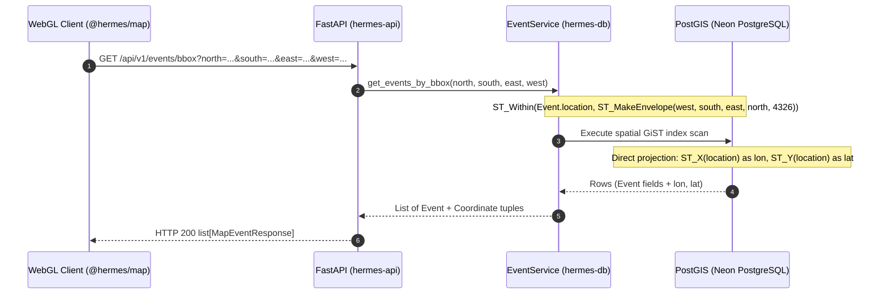
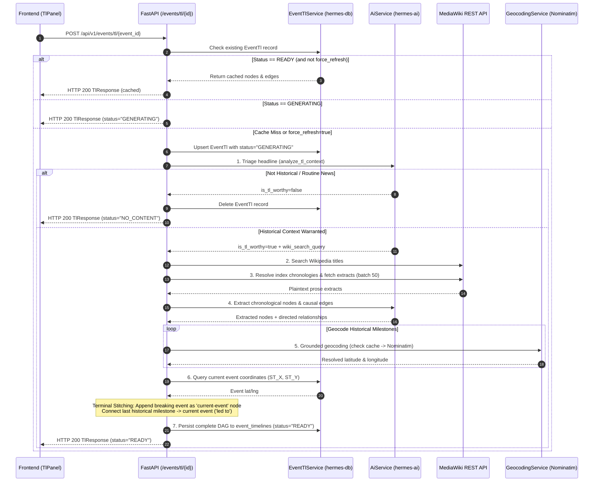
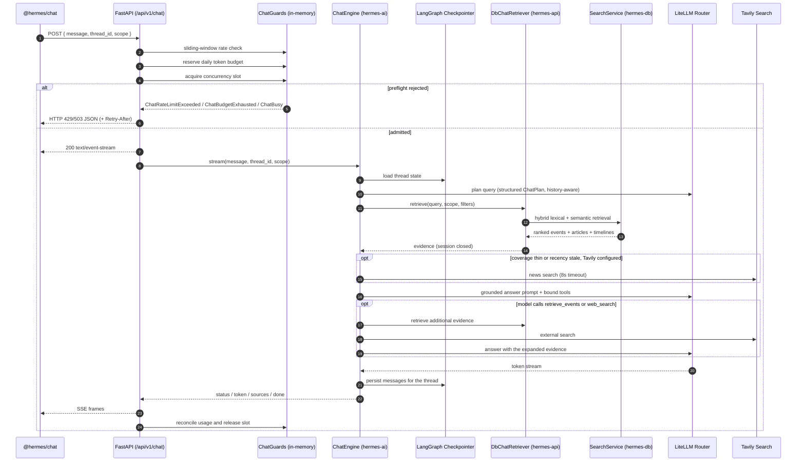
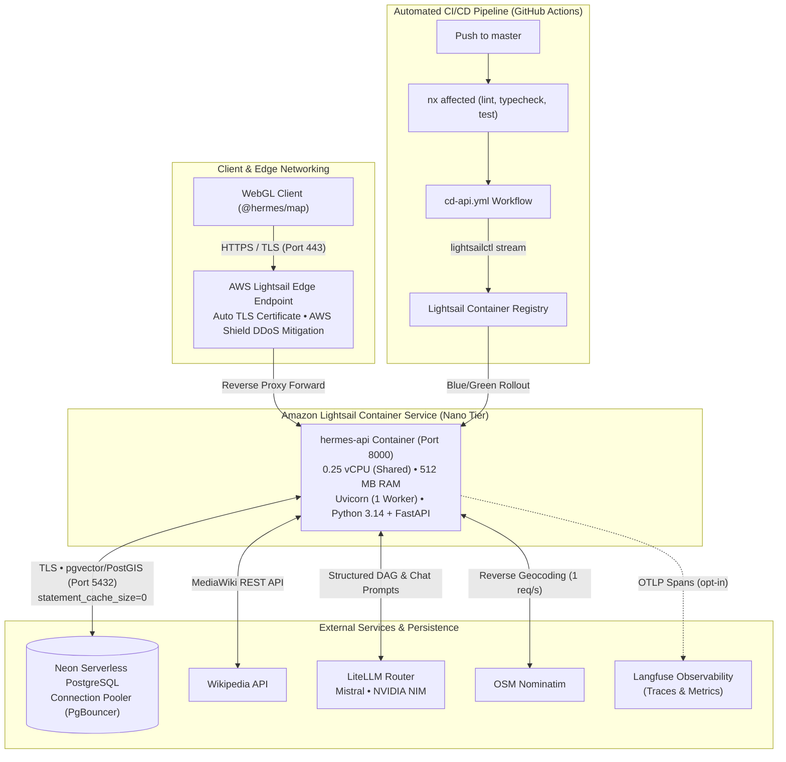
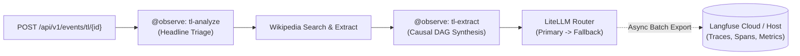

# Hermes API — Architecture & Design Rationale

This document details the architectural decisions, design tradeoffs, execution pipelines, and production characteristics of [`apps/hermes-api`](../README.md).

---

## 1. Application Role & Architectural Boundaries

`hermes-api` is the REST API, conversational RAG service, and on-demand historical timeline synthesis engine of Project Hermes. It serves as the read-optimized bridge connecting PostgreSQL/PostGIS persistence to client applications ([`apps/hermes`](../../hermes), [`libs/map`](../../../libs/map), and [`libs/chat`](../../../libs/chat)).

### Key Architectural Decisions ("The Why")

- **Scheduler Isolation**:
  - *The Why*: In production, the API runs as a managed container service on **Amazon Lightsail**. Executing background ingestion loops, RSS polling, or score decay inside the API process causes Python `asyncio` event-loop starvation during network-intensive scraping spikes.
  - *The Boundary*: `hermes-api` executes **zero background schedulers or ingestion loops**. All RSS feed harvesting, embedding generation, and time decay are isolated to [`apps/hermes-worker`](../../hermes-worker). This lets the API boot rapidly and scale without lock contention.
  - *Process-local state*: Chat conversation memory and chat guardrails live in process memory. A restart clears both. The client keeps its transcript in `localStorage`, and `ChatRuntime` accepts any LangGraph `BaseCheckpointSaver`, so durable memory is a composition-root decision rather than an API contract change.
- **Externalized Persistence Layer**:
  - *The Why*: Maintaining ORM models across multiple backend packages invites schema drift and disjoint migration trees.
  - *The Boundary*: All SQLAlchemy 2.0 ORM models ([`Event`](../../../libs/shared/hermes-db/src/hermes_db/models/event.py), [`Article`](../../../libs/shared/hermes-db/src/hermes_db/models/article.py), [`EventTl`](../../../libs/shared/hermes-db/src/hermes_db/models/event_tl.py), [`Source`](../../../libs/shared/hermes-db/src/hermes_db/models/source.py), [`GeocodeCache`](../../../libs/shared/hermes-db/src/hermes_db/models/geocode_cache.py)) and Alembic migrations reside exclusively in [`libs/shared/hermes-db`](../../../libs/shared/hermes-db). `hermes-api` imports models and services directly and never declares local ORM schemas.
- **Strict Dependency Injection**:
  - Route handlers in [`api/v1/`](../src/hermes_api/api/v1) never instantiate database sessions or business services directly; they consume them via FastAPI `Depends()` (`get_db`, `get_event_service`, `get_tl_service`). This decouples request routing from persistence mechanics and allows test mocking via `dependency_overrides`.

---

## 2. Spatial Viewport Query Pipeline

The spatial bounding-box endpoint (`GET /api/v1/events/bbox`) handles high-frequency map viewport synchronization from `@hermes/map`.



### Performance & Memory Mechanics

1. **Sub-10ms Spatial Index Scan**: PostGIS executes an R-tree search over the spatial GiST index (`idx_events_location`), testing candidate geometries using `ST_Within(location, ST_MakeEnvelope(west, south, east, north, 4326))`.
2. **Direct Coordinate Projection**: Rather than deserializing Well-Known Binary (WKB) geometry objects in Python, the query projects `ST_X(Event.location)` and `ST_Y(Event.location)` directly in SQL. This strips binary geometry deserialization overhead and transmits native floating-point coordinates directly to Pydantic serialization.
3. **Partial Index Filtering**: Inactive events are excluded using PostGIS partial indexes (`status = 'ACTIVE'`), keeping the working set small and bounded.

---

## 3. Timeline Engine Orchestration Pipeline

The timeline synthesis endpoint (`POST /api/v1/events/tl/{event_id}`) constructs an on-demand historical causal DAG linking past historical events to the current breaking incident:



### Step-by-Step Processing Stages

1. **Intelligent Triage**: An LLM filter ([`AiService.analyze_tl_context`](../src/hermes_api/services/ai_service.py)) inspects the headline to assess whether it represents a structural historical event (`is_tl_worthy`) and generates a targeted Wikipedia search query. This prevents API latency and token spend on transient, non-historical news.
2. **Wikipedia Index Resolution & Batch Extraction**:
   - [`wikipedia_service.py`](../src/hermes_api/services/wikipedia_service.py) queries the MediaWiki API.
   - If an index page is detected (e.g. chronological annual timelines), it enumerates and chronologically sorts sub-pages before retrieving extracts in bounded batches (`explaintext=1`, up to 50 pages per batch).
3. **Graph Synthesis**: LiteLLM processes the extracted prose into structured milestones (`date`, `headline`, `summary`) and directed causal relationships (`"led to"`, `"triggered"`, `"escalated"`).
4. **Grounded Geocoding Shield**: Extracted historical locations are geocoded using [`GeocodingService`](../../../libs/shared/hermes-ai/src/hermes_ai/services/geocoding.py) (backed by the PostgreSQL `geocode_cache` table and OpenStreetMap Nominatim with token-bucket rate limiting). The LLM is never permitted to fabricate coordinates.
5. **Terminal Node Stitching**:
   - The breaking event's coordinates are retrieved from PostGIS.
   - A terminal node (`id="current-event"`) is appended to the graph with its category color.
   - A synthetic edge connects the final historical milestone to the current event with the relationship `"led to"`.
6. **State Machine & Idempotency**:
   - Status transitions (`GENERATING` $\rightarrow$ `READY` / `NO_CONTENT` / `FAILED`) are tracked in the `event_timelines` table.
   - Concurrent requests received while an AI generation is in flight receive an immediate `GENERATING` status response, preventing redundant LLM inference passes.
   - Clients bypass cache by supplying `?force_refresh=true`.

---

## 4. Conversational RAG Pipeline (`POST /api/v1/chat`)

The chat endpoint answers natural-language questions about events in a selected scope and streams the answer over Server-Sent Events (SSE). Conversation turns are checkpointed per `thread_id` by LangGraph; the baseline deployment uses a process-local `InMemorySaver`, and the client sends only the new message and the current scope.



### Conversation Memory & Tools

- `ChatEngine` compiles a LangGraph `StateGraph` over `ChatState`, which extends `MessagesState`. Only `messages` survives between turns; per-turn channels (`plan`, `retrieval`, `web_results`, `extra_evidence`, `degraded`, `usage`) are reset by the plan node using `Overwrite`.
- The graph shape is `START -> plan -> retrieve -> (search | generate) -> [tools -> generate] -> finalize -> END`. The planner and answer model both read prior text turns from the checkpointed messages; assistant history has citation markers stripped.
- `thread_id` is the checkpointer key. `retry=true` removes the trailing user turn with `RemoveMessage` before re-running it.
- `retrieve_events` and `web_search` are bound only on the generation node. They return `Command` updates that append evidence to the graph state and answer the tool call. `ToolNode` turns tool failures into `ToolMessage`s, and the graph recursion limit is 12.
- The checkpoint saver is the memory boundary. The current deployment runs chat memory in process: at startup the API attempts an `AsyncPostgresSaver` when a checkpoint URL is configured, calls `setup()`, and falls back to `InMemorySaver` with a warning if initialization fails. Chat still works after a fallback, but memory does not survive a restart. `ChatRuntime` and `ChatEngine` accept any `BaseCheckpointSaver`, so durable memory can be enabled without changing the HTTP contract.

### Scope Resolution & Retrieval

- The request `scope` is a discriminated union: `event` (one `event_id`, bypasses hybrid ranking), `viewport` (a bounding box split at the antimeridian when needed), or `global`.
- `DbChatRetriever` bridges `hermes-ai`'s `ChatRetriever` protocol to `SearchService`. It opens a short-lived `AsyncSessionLocal` per retrieval, loads the ranked events plus linked articles and ready timeline nodes, then closes the session **before** answer generation starts. No database session is held during streaming.
- Lexical and semantic candidate branches are built directly over `Event` columns so the weighted `idx_events_fts` GIN index is used; semantic search uses the pgvector embedding column. Fusion uses reciprocal rank fusion with bounded recency/trending boosts. When the embedding call fails, retrieval degrades to lexical-only and reports `semantic_unavailable`.
- Tavily is consulted by the search node when local coverage is thin or recency-stale. The answer model may also call the `web_search` tool when the supplied evidence is insufficient. Failures degrade to a local-only answer with `web_unavailable`.

### SSE Contract

`POST /api/v1/chat` returns `text/event-stream` with `Cache-Control: no-cache`, `Connection: keep-alive`, and `X-Accel-Buffering: no`. Event order:

```text
status(accepted) -> status(planning) -> status(retrieving)
  -> [status(searching)] -> status(generating)
  -> [status(retrieving) | status(searching)] -> status(generating)
  -> token* -> status(finalizing) -> sources -> done
```

- Each `data:` payload carries a `type` matching the event name.
- `status.stage` is forwarded verbatim and drives the UI waiting label before the
  first token. Tool invocations re-emit `retrieving` or `searching` before the
  model resumes `generating`.
- `sources` contains only the sources actually cited, deduplicated in first-citation order.
- `done` reports provenance counts, coverage, usage, `web_used`, and `degraded` flags.
- `error` is terminal and may replace `done` after the stream opens (`RETRIEVAL_FAILED`, `MODEL_TIMEOUT`, `STREAM_TIMEOUT`, `MODEL_FAILED`, `INTERNAL_ERROR`, `CHAT_BUSY`).
- Preflight failures (validation, rate, budget, concurrency, disabled chat) are JSON responses with the standard error envelope before the stream opens.
- Keepalive comments (`: keepalive`) are emitted at most every 10 seconds while a stage is pending. On disconnect the generator stops, closes the source iterator, releases the concurrency slot, and reconciles the budget with known usage.

### Guards and Kill Switch

All guards live in `ChatGuards` and are process-local, matching the single-worker Phase 1 deployment:

- **Per-client sliding window** keyed by a salted SHA-256 hash of the resolved client IP. `X-Forwarded-For` is trusted only when `TRUST_PROXY_HEADERS=true`.
- **Daily token budget** with a pre-planning reservation (`ceil(prompt_chars / 4) + CHAT_MAX_OUTPUT_TOKENS`) reconciled to reported usage, or to the estimate when usage is unavailable after generation starts. `CHAT_DAILY_TOKEN_BUDGET=0` disables accounting.
- **Concurrency semaphore** with a bounded queue wait. A timeout returns `503 CHAT_BUSY`.

`CHAT_ENABLED=false`, or missing chat model credentials, makes `ChatRuntime.from_settings` return `None`. The lifespan stores `None` in `app.state.chat_runtime`, every chat request returns `503 CHAT_UNAVAILABLE`, and the map and timeline endpoints continue to work. No frontend redeploy is required for this rollback.

---

## 5. Cloud Infrastructure & Production Hosting (Amazon Lightsail)

`hermes-api` is deployed as a managed container service on **Amazon Lightsail Container Services** (`hermes-api`).



### Compute Sizing & Memory Mechanics ("The Why")

The production workload is hosted on the **Nano tier** (`0.25 vCPU`, `512 MB RAM`):

- **Single-Worker Concurrency (`--workers 1`)**:
  In [`Dockerfile`](../Dockerfile), the production entrypoint configures `--workers ${WORKERS:-1}`. Because FastAPI is built on `asyncio` and `uvloop`, a single process handles 50–100 concurrent I/O-bound requests (database lookups, external HTTP calls) without blocking. Running a single worker eliminates the memory overhead of multi-process duplication.
- **Strict Memory Envelope**:
  - *Baseline Idle Footprint*: ~160 MB (Python 3.14 runtime, FastAPI, Pydantic-core, SQLAlchemy 2.0, `asyncpg`, GeoAlchemy2).
  - *Active Viewport Queries (`GET /events/bbox`)*: Transmits native coordinate projections with transient Pydantic validation (~185 MB total).
  - *Peak Timeline Synthesis (`POST /events/tl/{id}`)*: Batch processing of 50 Wikipedia articles and causal DAG construction bursts memory to ~270 MB.
  - *Safety Buffer*: Leaves ~240 MB (47%) of unused RAM, guaranteeing stability against Linux Out-Of-Memory (`OOMKilled`) termination in an environment without host swap.

### Edge Ingress & Zero-Downtime Deployments

- **Managed Edge Ingress**: Incoming requests arrive via AWS's managed ingress gateway with automated TLS certificates and AWS Shield Standard DDoS mitigation. Port `8000` remains internal to the service container.
- **Health Gated Blue/Green Rollouts**:
  - The health check endpoint [`GET /`](../src/hermes_api/main.py) returns `{"message": "hermes is running..."}` (HTTP 200).
  - When a new deployment is triggered, Lightsail spins up the candidate container revision in parallel.
  - Only when the new revision satisfies the health check does the edge load balancer cut over live traffic, draining the old container with **zero dropped requests**.
  - If a container fails to boot or pass health checks, Lightsail cancels the rollout and leaves the existing deployment untouched.

### Secret Isolation & Dynamic CI/CD Pipeline

The deployment pipeline defined in [`.github/workflows/cd-api.yml`](../../../.github/workflows/cd-api.yml) separates build credentials from runtime configuration:
- **Secret Source Precedence**: Runtime values are read from the `HERMES_API_PROD_ENV` repository secret when it is populated (a newline-delimited `KEY=VALUE` block). This is the current source of truth for database credentials (`DB_*`), AI keys (`LLM_*`, `EMBED_*`), chat settings, and Langfuse keys.
- **Configuration Carry-Forward**: If `HERMES_API_PROD_ENV` is empty, the workflow calls `aws lightsail get-container-services` for `hermes-api` and reuses the active container environment, then checks deployment history as a fallback. This preserves a hand-managed Lightsail configuration without failing a deploy.
- **No Repository Credentials**: The workflow itself contains no database or provider secrets; only AWS credentials, the region, and the runtime environment block are supplied through GitHub secrets.
  ```bash
  CURRENT_ENV=$(aws lightsail get-container-services \
    --region ap-southeast-2 \
    --service-name hermes-api \
    --query 'containerServices[0].currentDeployment.containers.*.environment | [0]' \
    --output json)
  ```
- **Direct Registry Streaming**: The workflow installs the official `lightsailctl` plugin, builds the image with `--target production`, and streams layers directly into Lightsail's private container registry before creating a new deployment revision.

### Neon PostgreSQL Integration (PgBouncer)

- **Transaction-Level Pooling**: Neon uses PgBouncer to manage serverless connection scaling.
- **Statement Cache Disabling**: `asyncpg` prepared statement caching conflicts with transaction-mode connection poolers. The application sets `connect_args={"statement_cache_size": 0}` in [`libs/shared/hermes-db`](../../../libs/shared/hermes-db).
- **Enforced SSL**: Outbound connections enforce encrypted communication (`query["ssl"] = "require"` in [`Settings.db_url`](../src/hermes_api/core/config.py)) whenever connecting to non-local database hosts.

---

## 6. CORS Exception Handling Architecture

In Starlette and FastAPI, custom exception handlers registered via `@app.exception_handler(...)` construct `JSONResponse` objects directly inside Starlette's `ExceptionMiddleware`.

```text
Incoming Request -> CORSMiddleware -> ExceptionMiddleware -> Route Handler
                                            │
                                            ▼ (Exception raised)
Custom Handler catches error -> constructs JSONResponse
                                            │
                                            ▼ (Bypasses outer CORSMiddleware headers)
                                    Raw Error Sent to Browser
                                            │
                                            ▼
                           Browser logs: "CORS Network Error"
```

### The Workaround (`_cors_headers`)
Because error responses can bypass outer `CORSMiddleware` header decoration, custom handlers in [`core/errors.py`](../src/hermes_api/core/errors.py) explicitly call `_cors_headers(request)` to inject:
- `Access-Control-Allow-Origin: *` (or matching client origin)
- `Access-Control-Allow-Credentials: true`
- `Access-Control-Allow-Methods: *`
- `Access-Control-Allow-Headers: *`

This guarantees that browser clients can always inspect error details (such as `404 Not Found` or `422 Unprocessable Entity`) instead of receiving generic browser CORS errors.

---

## 7. Lifespan & Resilience Guarantees

- **Lifespan Management**: Application startup and teardown are governed by an `@asynccontextmanager` in [`main.py`](../src/hermes_api/main.py). Database connection pools are bound via `init_db()` on boot and cleanly closed via `close_db()` on SIGTERM/SIGINT.
- **Graceful LLM Degradation**: When `LLM_API` or `LLM_MODEL` credentials are missing at boot, the server logs a warning and remains operational for spatial queries. Any calls to `/api/v1/events/tl/{id}` fail gracefully with `HTTP 503 Service Unavailable`, preventing total service failure. Chat follows the same rule: `ChatRuntime.from_settings` returns `None` and `/api/v1/chat` responds `503 CHAT_UNAVAILABLE` without affecting the map.
- **Pure Asynchronous I/O**: Every I/O operation is strictly non-blocking:
  - Database access: `asyncpg` via SQLAlchemy 2.0 Async engine.
  - External HTTP: `httpx.AsyncClient` with timeouts.
  - LLM routing: Async LiteLLM client router.

---

## 8. Observability & Langfuse Tracing

`hermes-api` integrates **Langfuse v3** through `libs/shared/hermes-ai` to provide end-to-end trace observability, latency tracking, and LLM token usage monitoring.



### Architectural Decisions ("The Why")

1. **Process Singleton Registration**:
   The Langfuse SDK client is initialized within [`LlmService.__init__`](../../../libs/shared/hermes-ai/src/hermes_ai/services/llm.py) using `Langfuse(public_key=..., secret_key=..., base_url=...)` if `tracing_enabled=True`. This registers the SDK singleton for `@observe` decorators and establishes OpenTelemetry tracer plumbing without per-request allocation overhead.

2. **Instrumented Spans**:
   - `tl-analyze`: Generated by `TlExtractor.analyze`, measuring the latency and decision logic of event headline triage.
   - `tl-extract`: Generated by `TlExtractor.extract`, tracing Wikipedia prose analysis, milestone node structuring, and causal edge inference.
   - Both spans explicitly configure `capture_input=False` and `capture_output=False` to prevent sensitive prompt content and raw article text from persisting to telemetry backends.

3. **Opt-in Activation & Graceful Degradation**:
   Tracing is active only if both `LANGFUSE_PUBLIC_KEY` and `LANGFUSE_SECRET_KEY` are populated. In environments without Langfuse credentials, the system runs with zero tracing overhead. No exceptions are raised if telemetry endpoints are unreachable.

4. **Chat Content Masking**:
   Chat calls reuse the same `LlmService` client. When `LANGFUSE_MASK_CONTENT=true` (default), a key-based `mask` function redacts `input`, `output`, `content`, `messages`, `prompt`, `answer`, `snippet`, and `web_query`, and an export-stage `mask_otel_spans` hook scrubs raw OTel attributes such as `langfuse.observation.input/output`, `gen_ai.prompt`, and `gen_ai.completion`. Model names and timings remain observable.

5. **Guaranteed Flush on Lifespan Teardown**:
   FastAPI's lifespan shutdown sequence invokes `AiService.client.close()` -> `LlmService.aclose()`, which executes `get_client().flush()`. This drains in-flight span batches before Uvicorn shuts down the worker process, guaranteeing telemetry integrity during deployments or container recycling. The chat runtime owns its own `HermesAi` instance; `ChatRuntime.aclose()` flushes chat traces during the same lifespan teardown.
