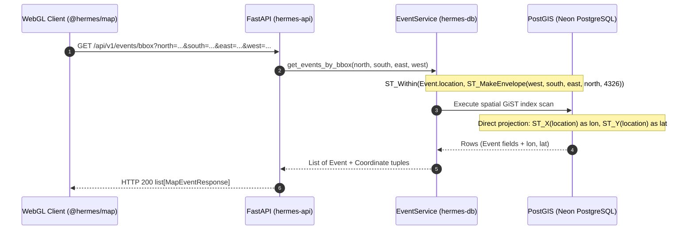
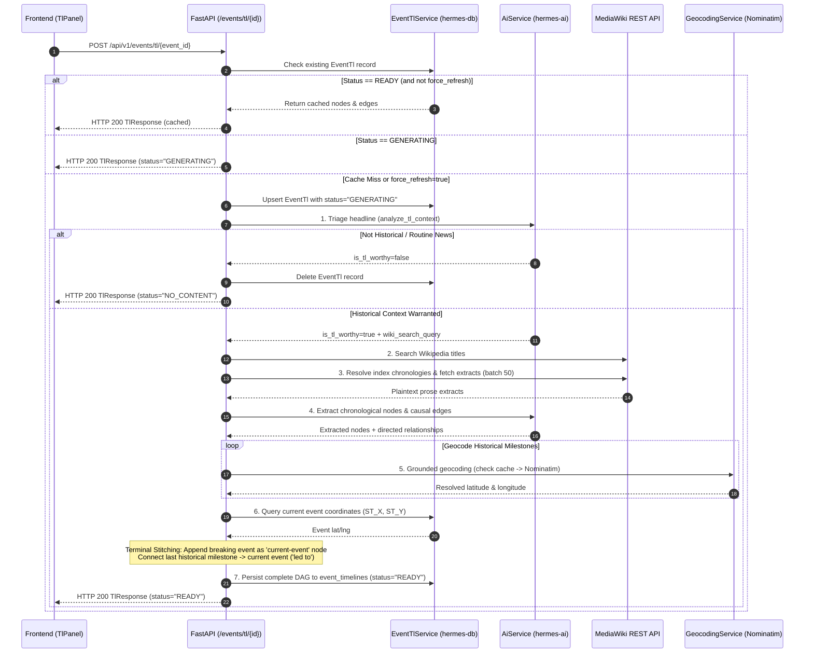
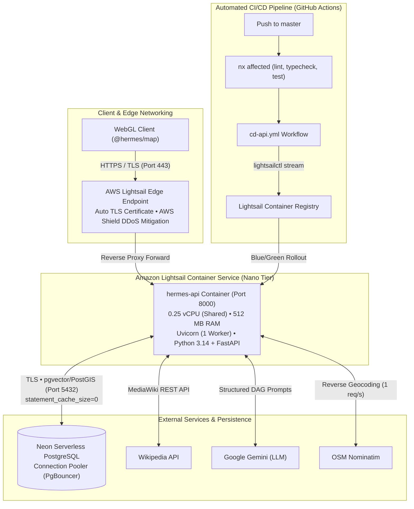

# Hermes API — Architecture & Design Rationale

This document details the architectural decisions, design tradeoffs, execution pipelines, and production characteristics of [`apps/hermes-api`](file:///home/pavan/proj/hermes/hermes/apps/hermes-api).

---

## 1. Application Role & Architectural Boundaries

`hermes-api` is the stateless REST API and on-demand historical timeline synthesis engine of Project Hermes. It serves as the read-optimized bridge connecting PostgreSQL/PostGIS persistence to client applications ([`apps/hermes`](file:///home/pavan/proj/hermes/hermes/apps/hermes) and [`libs/map`](file:///home/pavan/proj/hermes/hermes/libs/map)).

### Key Architectural Decisions ("The Why")

- **12-Factor Statelessness & Scheduler Isolation**:
  - *The Why*: In production, the API runs as a managed container service on **Amazon Lightsail**. Executing background ingestion loops, RSS polling, or score decay inside the API process causes Python `asyncio` event-loop starvation during network-intensive scraping spikes.
  - *The Boundary*: `hermes-api` executes **zero background schedulers or ingestion loops**. All RSS feed harvesting, embedding generation, and time decay are isolated to [`apps/hermes-worker`](file:///home/pavan/proj/hermes/hermes/apps/hermes-worker). This allows `hermes-api` to remain strictly stateless, boot rapidly, and scale horizontally without distributed lock contention.
- **Externalized Persistence Layer**:
  - *The Why*: Maintaining ORM models across multiple backend packages invites schema drift and disjoint migration trees.
  - *The Boundary*: All SQLAlchemy 2.0 ORM models ([`Event`](file:///home/pavan/proj/hermes/hermes/libs/shared/hermes-db/src/hermes_db/models/event.py), [`Article`](file:///home/pavan/proj/hermes/hermes/libs/shared/hermes-db/src/hermes_db/models/article.py), [`EventTl`](file:///home/pavan/proj/hermes/hermes/libs/shared/hermes-db/src/hermes_db/models/event_tl.py), [`Source`](file:///home/pavan/proj/hermes/hermes/libs/shared/hermes-db/src/hermes_db/models/source.py), [`GeocodeCache`](file:///home/pavan/proj/hermes/hermes/libs/shared/hermes-db/src/hermes_db/models/geocode_cache.py)) and Alembic migrations reside exclusively in [`libs/shared/hermes-db`](file:///home/pavan/proj/hermes/hermes/libs/shared/hermes-db). `hermes-api` imports models and services directly and never declares local ORM schemas.
- **Strict Dependency Injection**:
  - Route handlers in [`api/v1/`](file:///home/pavan/proj/hermes/hermes/apps/hermes-api/src/hermes_api/api/v1) never instantiate database sessions or business services directly; they consume them via FastAPI `Depends()` (`get_db`, `get_event_service`, `get_tl_service`). This decouples request routing from persistence mechanics and allows test mocking via `dependency_overrides`.

---

## 2. Spatial Viewport Query Pipeline

The spatial bounding-box endpoint (`GET /api/v1/events/bbox`) handles high-frequency map viewport synchronization from `@hermes/map`.



### Performance & Memory Mechanics

1. **Sub-10ms Spatial Index Scan**: PostGIS executes an R-tree search over the spatial GiST index (`idx_events_location`), testing candidate geometries using `ST_Within(location, ST_MakeEnvelope(west, south, east, north, 4326))`.
2. **Direct Coordinate Projection**: Rather than deserializing Well-Known Binary (WKB) geometry objects in Python, the query projects `ST_X(Event.location)` and `ST_Y(Event.location)` directly in SQL. This strips binary geometry deserialization overhead and transmits native floating-point coordinates directly to Pydantic serialization.
3. **Partial Index Filtering**: Inactive events are excluded using PostGIS partial indexes (`status = 'ACTIVE'`), keeping the working set small and bounded.

---

## 3. Timeline Engine Orchestration Pipeline

The timeline synthesis endpoint (`POST /api/v1/events/tl/{event_id}`) constructs an on-demand historical causal DAG linking past historical events to the current breaking incident:



### Step-by-Step Processing Stages

1. **Intelligent Triage**: An LLM filter ([`AiService.analyze_tl_context`](file:///home/pavan/proj/hermes/hermes/apps/hermes-api/src/hermes_api/services/ai_service.py)) inspects the headline to assess whether it represents a structural historical event (`is_tl_worthy`) and generates a targeted Wikipedia search query. This prevents API latency and token spend on transient, non-historical news.
2. **Wikipedia Index Resolution & Batch Extraction**:
   - [`wikipedia_service.py`](file:///home/pavan/proj/hermes/hermes/apps/hermes-api/src/hermes_api/services/wikipedia_service.py) queries the MediaWiki API.
   - If an index page is detected (e.g. chronological annual timelines), it enumerates and chronologically sorts sub-pages before retrieving extracts in bounded batches (`explaintext=1`, up to 50 pages per batch).
3. **Graph Synthesis**: LiteLLM processes the extracted prose into structured milestones (`date`, `headline`, `summary`) and directed causal relationships (`"led to"`, `"triggered"`, `"escalated"`).
4. **Grounded Geocoding Shield**: Extracted historical locations are geocoded using [`GeocodingService`](file:///home/pavan/proj/hermes/hermes/libs/shared/hermes-ai/src/hermes_ai/services/geocoding.py) (backed by the PostgreSQL `geocode_cache` table and OpenStreetMap Nominatim with token-bucket rate limiting). The LLM is never permitted to fabricate coordinates.
5. **Terminal Node Stitching**:
   - The breaking event's coordinates are retrieved from PostGIS.
   - A terminal node (`id="current-event"`) is appended to the graph with its category color.
   - A synthetic edge connects the final historical milestone to the current event with the relationship `"led to"`.
6. **State Machine & Idempotency**:
   - Status transitions (`GENERATING` $\rightarrow$ `READY` / `NO_CONTENT` / `FAILED`) are tracked in the `event_timelines` table.
   - Concurrent requests received while an AI generation is in flight receive an immediate `GENERATING` status response, preventing redundant LLM inference passes.
   - Clients bypass cache by supplying `?force_refresh=true`.

---

## 4. Cloud Infrastructure & Production Hosting (Amazon Lightsail)

`hermes-api` is deployed as a managed container service on **Amazon Lightsail Container Services** (`hermes-api`).



### Compute Sizing & Memory Mechanics ("The Why")

The production workload is hosted on the **Nano tier** (`0.25 vCPU`, `512 MB RAM`):

- **Single-Worker Concurrency (`--workers 1`)**:
  In [`Dockerfile`](file:///home/pavan/proj/hermes/hermes/apps/hermes-api/Dockerfile#L45), the production entrypoint configures `--workers ${WORKERS:-1}`. Because FastAPI is built on `asyncio` and `uvloop`, a single process handles 50–100 concurrent I/O-bound requests (database lookups, external HTTP calls) without blocking. Running a single worker eliminates the memory overhead of multi-process duplication.
- **Strict Memory Envelope**:
  - *Baseline Idle Footprint*: ~160 MB (Python 3.14 runtime, FastAPI, Pydantic-core, SQLAlchemy 2.0, `asyncpg`, GeoAlchemy2).
  - *Active Viewport Queries (`GET /events/bbox`)*: Transmits native coordinate projections with transient Pydantic validation (~185 MB total).
  - *Peak Timeline Synthesis (`POST /events/tl/{id}`)*: Batch processing of 50 Wikipedia articles and causal DAG construction bursts memory to ~270 MB.
  - *Safety Buffer*: Leaves ~240 MB (47%) of unused RAM, guaranteeing stability against Linux Out-Of-Memory (`OOMKilled`) termination in an environment without host swap.

### Edge Ingress & Zero-Downtime Deployments

- **Managed Edge Ingress**: Incoming requests arrive via AWS's managed ingress gateway with automated TLS certificates and AWS Shield Standard DDoS mitigation. Port `8000` remains internal to the service container.
- **Health Gated Blue/Green Rollouts**:
  - The health check endpoint [`GET /`](file:///home/pavan/proj/hermes/hermes/apps/hermes-api/src/hermes_api/main.py#L52-L54) returns `{"message": "hermes is running..."}` (HTTP 200).
  - When a new deployment is triggered, Lightsail spins up the candidate container revision in parallel.
  - Only when the new revision satisfies the health check does the edge load balancer cut over live traffic, draining the old container with **zero dropped requests**.
  - If a container fails to boot or pass health checks, Lightsail cancels the rollout and leaves the existing deployment untouched.

### Secret Isolation & Dynamic CI/CD Pipeline

The deployment pipeline defined in [`.github/workflows/cd-api.yml`](file:///home/pavan/proj/hermes/hermes/.github/workflows/cd-api.yml) enforces the **Principle of Least Privilege**:
- **Zero Secret Sprawl**: Database credentials (`DB_PASSWORD`, `DB_USER`) and third-party AI keys (`LLM_API`, `EMBED_API`) are **not** stored in GitHub Secrets. They are configured once directly in the AWS Lightsail Console.
- **Dynamic Configuration Carry-Forward**:
  During deployment, GitHub Actions uses the AWS CLI to extract the active environment configuration:
  ```bash
  CURRENT_ENV=$(aws lightsail get-container-services \
    --region ${{ secrets.AWS_REGION }} \
    --service-name hermes-api-service \
    --query 'containerServices[0].currentDeployment.containers."hermes-api".environment' \
    --output json)
  ```
  The workflow injects the existing `CURRENT_ENV` JSON block into the new deployment payload, updating only the image reference tag. This allows credential rotation directly in AWS without modifying repository settings or CI/CD code.
- **Direct Registry Streaming**: The workflow installs the official `lightsailctl` plugin, which builds the image with `--target production` and streams layers directly into Lightsail's private container registry.

### Neon PostgreSQL Integration (PgBouncer)

- **Transaction-Level Pooling**: Neon uses PgBouncer to manage serverless connection scaling.
- **Statement Cache Disabling**: `asyncpg` prepared statement caching conflicts with transaction-mode connection poolers. The application sets `connect_args={"statement_cache_size": 0}` in [`libs/shared/hermes-db`](file:///home/pavan/proj/hermes/hermes/libs/shared/hermes-db).
- **Enforced SSL**: Outbound connections enforce encrypted communication (`query["ssl"] = "require"` in [`Settings.db_url`](file:///home/pavan/proj/hermes/hermes/apps/hermes-api/src/hermes_api/core/config.py#L63-L76)) whenever connecting to non-local database hosts.

---

## 5. CORS Exception Handling Architecture

In Starlette and FastAPI, custom exception handlers registered via `@app.exception_handler(...)` construct `JSONResponse` objects directly inside Starlette's `ExceptionMiddleware`.

```text
Incoming Request -> CORSMiddleware -> ExceptionMiddleware -> Route Handler
                                            │
                                            ▼ (Exception raised)
Custom Handler catches error -> constructs JSONResponse
                                            │
                                            ▼ (Bypasses outer CORSMiddleware headers)
                                    Raw Error Sent to Browser
                                            │
                                            ▼
                           Browser logs: "CORS Network Error"
```

### The Workaround (`_cors_headers`)
Because error responses can bypass outer `CORSMiddleware` header decoration, custom handlers in [`core/errors.py`](file:///home/pavan/proj/hermes/hermes/apps/hermes-api/src/hermes_api/core/errors.py) explicitly call `_cors_headers(request)` to inject:
- `Access-Control-Allow-Origin: *` (or matching client origin)
- `Access-Control-Allow-Credentials: true`
- `Access-Control-Allow-Methods: *`
- `Access-Control-Allow-Headers: *`

This guarantees that browser clients can always inspect error details (such as `404 Not Found` or `422 Unprocessable Entity`) instead of receiving generic browser CORS errors.

---

## 6. Lifespan & Resilience Guarantees

- **Lifespan Management**: Application startup and teardown are governed by an `@asynccontextmanager` in [`main.py`](file:///home/pavan/proj/hermes/hermes/apps/hermes-api/src/hermes_api/main.py). Database connection pools are bound via `init_db()` on boot and cleanly closed via `close_db()` on SIGTERM/SIGINT.
- **Graceful LLM Degradation**: When `LLM_API` or `LLM_MODEL` credentials are missing at boot, the server logs a warning and remains operational for spatial queries. Any calls to `/api/v1/events/tl/{id}` fail gracefully with `HTTP 503 Service Unavailable`, preventing total service failure.
- **Pure Asynchronous I/O**: Every I/O operation is strictly non-blocking:
  - Database access: `asyncpg` via SQLAlchemy 2.0 Async engine.
  - External HTTP: `httpx.AsyncClient` with timeouts.
  - LLM routing: Async LiteLLM client router.
