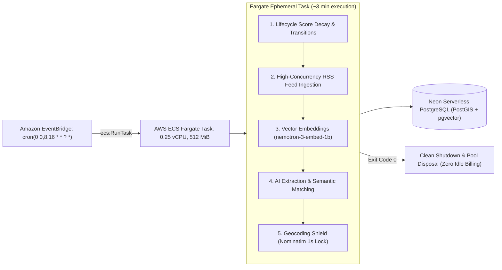
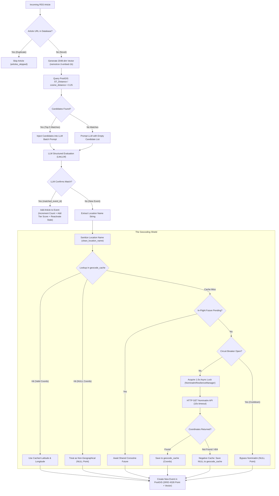

# Hermes Ingestion & Lifecycle Worker

The `hermes-worker` is the autonomous, headless ingestion and data lifecycle worker for Project Hermes. It is responsible for continuously monitoring global RSS news feeds, generating semantic vector representations, performing database-side vector deduplication, orchestrating structured AI extractions, resolving geographic coordinates through a rate-limited geocoding shield, and managing organic event lifecycle decay.

The worker operates completely decoupled from [`hermes-api`](file:///home/pavan/proj/hermes/apps/hermes-api), ensuring that computationally intensive RSS parsing, high-dimensional vector embeddings, and LLM inference never block client map queries or starve the REST API event loop.

---

## 1. System Architecture & Cloud Orchestration

In production, `hermes-worker` is deployed as an **ephemeral, serverless batch container** on **AWS ECS Fargate**, triggered 3 times daily by **Amazon EventBridge**. It adheres strictly to the 12-factor application methodology: the container starts, initializes its database connection pool, executes stale/archive decay and RSS sync pipelines, flushes all commits to Neon PostgreSQL, disposes of its database connections, and terminates cleanly (`exit code 0`).



### Production Cloud Specifications

| Component | Specification | Description & Rationale |
| :--- | :--- | :--- |
| **Compute Engine** | **AWS ECS Fargate** | Serverless Linux container execution on the `hermes-cluster` cluster. |
| **vCPU / Memory** | **`0.25 vCPU` (256 units), `512 MiB` RAM** | Sized for low-footprint async I/O. Memory is conserved by processing in batches of 10 articles. |
| **Network Configuration** | **AWS Default VPC, Public Subnet, Public IP enabled** | Outbound internet egress is required to contact Amazon ECR, Neon Database, external RSS feeds, LiteLLM providers, and OpenStreetMap Nominatim. |
| **Recurring Trigger** | **Amazon EventBridge (`hermes-worker-cron`)** | Schedule: `cron(0 0,8,16 * * ? *)` (00:00, 08:00, 16:00 UTC daily — every 8 hours). |
| **Container Registry** | **Amazon ECR** | Built via GitHub Actions ([`cd-worker.yml`](file:///home/pavan/proj/hermes/.github/workflows/cd-worker.yml)) tagged as `:latest` and `:${{ github.sha }}`. |
| **Target Database** | **Neon Serverless PostgreSQL 16** | Spatial database with `postgis` and `pgvector` extensions; SSL connection mode enforced (`ssl=require`). |
| **Entrypoint Command** | `uv run hermes-worker run-all` | Runs lifecycle maintenance first, followed by incremental sync of all due RSS sources. |

### Zero-Idle Cost Rationale

Running a traditional, 24/7 background worker VM or resident container costs between $15.00 and $45.00 per month in idle compute. In contrast, `hermes-worker` processes ~350 global articles in **2.5 to 3.5 minutes per run**:

$$\text{Monthly Runtime} = 3 \text{ runs/day} \times 3.5 \text{ min} \times 30 \text{ days} = 315 \text{ minutes} \approx 5.25 \text{ hours/month}$$

At AWS Fargate Linux rates ($0.04048 per vCPU-hour, $0.004445 per GB-hour):
- **vCPU cost**: $5.25 \text{ hrs} \times 0.25 \text{ vCPU} \times \$0.04048 = \$0.053$
- **Memory cost**: $5.25 \text{ hrs} \times 0.5 \text{ GB} \times \$0.004445 = \$0.012$
- **Total Compute Cost**: **< $0.07 / month**

---

## 2. Ingestion Pipeline Architecture

The end-to-end ingestion lifecycle is coordinated by [`SyncService`](file:///home/pavan/proj/hermes/apps/hermes-worker/src/hermes_worker/services/sync.py) and [`run_lifecycle`](file:///home/pavan/proj/hermes/apps/hermes-worker/src/hermes_worker/services/lifecycle.py).

```mermaid
stateDiagram-v2
    [*] --> InitDbLifespan: CLI Entrypoint (run-all)
    
    state InitDbLifespan {
        InitEngine --> VerifyConnection
        VerifyConnection --> SyncSourcesCatalog
    }
    
    InitDbLifespan --> LifecycleMaintenance
    
    state LifecycleMaintenance {
        DecayScores: Apply 10% Score Decay
        ActiveToStale: Transition Active to Stale (> 24h)
        StaleToArchive: Transition Stale to Archived (> 48h)
        DecayScores --> ActiveToStale
        ActiveToStale --> StaleToArchive
    }
    
    LifecycleMaintenance --> QueryDueSources
    
    state IngestionPipeline {
        direction TB
        FetchFeeds: Parallel HTTP Fetch (httpx AsyncClient)
        FilterUrls: Dedup Against Database (article_url_exists)
        SliceBatches: Slice into Batches of 10
        ComputeEmbeddings: Generate 2048-dim Vectors (nemotron-3-embed-1b)
        VectorSearch: PostGIS HNSW Cosine Distance (distance < 0.25)
        LlmExtraction: AI Metadata Extraction & Consensus (LiteLLM)
        GeocodeLocation: Ground Coordinates via Nominatim Shield
        CommitTransaction: Atomic PostGIS & Article Insertion
        
        FetchFeeds --> FilterUrls
        FilterUrls --> SliceBatches
        SliceBatches --> ComputeEmbeddings
        ComputeEmbeddings --> VectorSearch
        VectorSearch --> LlmExtraction
        LlmExtraction --> GeocodeLocation
        GeocodeLocation --> CommitTransaction
    }
    
    QueryDueSources --> IngestionPipeline
    IngestionPipeline --> UpdateLastFetched
    UpdateLastFetched --> CloseDbPool: Dispose AsyncEngine
    CloseDbPool --> [*]: Exit Code 0
```



---

## 3. Deduplication & The Geocoding Shield

To achieve high extraction accuracy while strictly obeying external rate limits and minimizing LLM token consumption, `hermes-worker` combines vector pre-filtering with a grounded geocoding shield:



---

## 4. Architectural Decisions & Tradeoffs ("The Why")

### 1. 12-Factor Run-and-Die vs. In-Process Schedulers (APScheduler / Celery)
* **The Problem**: In-process schedulers keep Python runtimes resident indefinitely. When parsing thousands of unstructured XML feeds with C-extensions (`feedparser`, `libxml`), memory leaks and fragmented heaps accumulate. Furthermore, if the worker crashes mid-loop, internal schedulers risk zombie threads or silent failures.
* **The Solution**: An ephemeral CLI architecture (`hermes-worker run-all`). The operating system completely reclaims memory upon process exit, database connections are torn down cleanly, and job scheduling, retry policies, and alerting are delegated to native cloud infrastructure (Amazon EventBridge and ECS Fargate).

### 2. Embed BEFORE Extract (Token Economics & Latency)
* **The Problem**: Passing batches of full articles to a generative LLM and asking it to cross-compare every article against all active events requires an $O(N \times M)$ token overhead. For 350 articles against 50 active events, this easily exceeds context windows and burns millions of unnecessary tokens per day.
* **The Solution**: Articles are embedded *first* into 2048-dimensional vectors using `nvidia/nemotron-3-embed-1b`. PostGIS executes an ultra-fast HNSW cosine distance query (`Event.embedding.cosine_distance(emb) < 0.25`). Only the top 5 semantically similar events are passed into the LLM prompt as candidate matches. The LLM simply confirms whether an article belongs to an existing event or represents a new incident.

### 3. Strict Batch Sizing (`ARTICLE_BATCH_SIZE = 10`)
* **The Problem**: Processing articles one-by-one introduces high HTTP latency overhead and rapidly exhausts RPM (Requests Per Minute) quotas. Conversely, packing 25+ articles into a single prompt degrades LLM attention, increases schema extraction failures, and leads to cross-article hallucination.
* **The Solution**: Slicing article queues into batches of 10 provides the ideal balance: optimal GPU throughput on the inference provider, high extraction fidelity, and predictable execution windows.

### 4. Grounded Geocoding vs. AI Coordinate Hallucination
* **The Problem**: Generative LLMs routinely hallucinate latitude and longitude coordinates, placing incidents in oceans, incorrect hemispheres, or arbitrary capital cities.
* **The Solution**: The LLM is restricted to extracting location *names* (e.g., `"Kyiv, Ukraine"`). Spatial grounding is performed deterministically by OpenStreetMap's Nominatim service, and stored as PostGIS `POINT` geometries (SRID 4326).

### 5. OpenStreetMap Nominatim Shield & Negative Caching
* **1.0-Second Lock**: OSM Acceptable Use Policy strictly forbids requests exceeding 1 req/sec. [`NominatimResilienceManager`](file:///home/pavan/proj/hermes/libs/shared/hermes-ai/src/hermes_ai/services/geocoding.py) enforces this through an `asyncio.Lock()`.
* **Negative Caching**: Non-geographic phrases extracted by the model (e.g., `"global markets"`, `"cyber realm"`) cannot be geocoded. The worker caches these as `NULL` coordinates in `geocode_cache`, permanently preventing redundant external HTTP calls on future runs.
* **In-Flight Future Coalescing**: If multiple articles in a batch reference the same location (e.g., three separate reports from `"Tehran"`), an in-flight future ensures only one HTTP request is dispatched.
* **Circuit Breaker**: If Nominatim returns HTTP 429 across retries, the circuit breaker opens for 120 seconds to prevent temporary or permanent IP bans.

### 6. Graceful Async Database Pool Shutdown
* **The Problem**: Serverless databases like Neon PostgreSQL terminate idle or dangling client connections aggressively. A CLI process exiting via `sys.exit()` without closing its SQLAlchemy `AsyncEngine` connection pool leaves dangling socket connections.
* **The Solution**: The [`db_lifespan()`](file:///home/pavan/proj/hermes/apps/hermes-worker/src/hermes_worker/core/lifespan.py) async context manager wraps all command handlers. On entry, it initializes `init_db(settings.db_url)`; on exit (including cancellations or unhandled exceptions), it invokes `await close_db()`, which calls `await engine.dispose()`, cleanly severing all pooled connections before process termination.

---

## 5. The 5 Core Pipeline Stages

### Stage 1: High-Concurrency RSS Fetching
* Handled by [`fetch_feed`](file:///home/pavan/proj/hermes/apps/hermes-worker/src/hermes_worker/services/fetchers/rss.py).
* Asynchronously queries configured news feeds using `httpx.AsyncClient` with a 30-second timeout, custom User-Agent, and redirect following.
* Parses XML payloads using `feedparser`, extracting headlines, permalinks, summaries, publication timestamps, and full HTML/encoded article bodies.
* Truncates long content to 500 words to conserve LLM context windows while preserving crucial lead paragraphs.

### Stage 2: Embeddings & Semantic Candidate Retrieval
* Evaluates non-duplicate articles through `nvidia/nemotron-3-embed-1b` via [`HermesAiClient.gen_embeddings`](file:///home/pavan/proj/hermes/libs/shared/hermes-ai/src/hermes_ai/client.py) (initialized via [`create_ai_client`](file:///home/pavan/proj/hermes/apps/hermes-worker/src/hermes_worker/core/ai.py)).
* Queries the `events` table via [`EventService.get_active_events_by_embeddings`](file:///home/pavan/proj/hermes/libs/shared/hermes-db/src/hermes_db/services/event.py) using `pgvector` half-precision cosine distances (`cosine_distance < 0.25`).
* Collects up to 5 matching active event candidates per article to supply context to the LLM.

### Stage 3: AI Extraction & Consensus Scoring
* Uses LiteLLM via [`EventExtractor`](file:///home/pavan/proj/hermes/libs/shared/hermes-ai/src/hermes_ai/extractors/events.py) to parse articles in batches of 10.
* Generates a structured JSON envelope containing:
  * `ai_headline`: Short, tactical headline.
  * `ai_summary`: Objective 2-3 sentence situation summary.
  * `category`: One of the predefined domains (`Conflict`, `Economy`, `Politics`, `Technology`, etc.).
  * `category_color`: Domain color hex code.
  * `location_name`: Grounded physical location string.
  * `matched_event_id`: ID of an existing event if the article reports on an ongoing incident.
* **Consensus Update**: When an article matches an existing event, [`EventService.add_article_to_event`](file:///home/pavan/proj/hermes/libs/shared/hermes-db/src/hermes_db/services/event.py) increments `article_count`, adds credibility score weight (`TIER_1` = +3.0, `TIER_2` = +2.0, `TIER_3` = +1.0, `TIER_4` = +0.5), updates timestamps, and reactivates `STALE` events to `ACTIVE`.

### Stage 4: Grounded Geocoding Shield
* Cleans the extracted location string (stripping parenthetical comments, abbreviations, and unlocatable phrases via [`clean_location_name`](file:///home/pavan/proj/hermes/libs/shared/hermes-ai/src/hermes_ai/services/geocoding.py)).
* Queries `geocode_cache` to eliminate outbound requests for previously resolved coordinates or known unlocatable strings.
* If not cached, queries OpenStreetMap Nominatim with strict 1.0s pacing, exponential backoff, and circuit breaker protection.
* Constructs PostGIS `geometry(Point, 4326)` coordinate representations.

### Stage 5: Time Decay & State Transitions
* Handled by [`run_lifecycle`](file:///home/pavan/proj/hermes/apps/hermes-worker/src/hermes_worker/services/lifecycle.py).
* Applies a -10% multiplier to all active event trending scores:
  $$\text{trending\_score}_{\text{new}} = \text{trending\_score}_{\text{current}} \times 0.90$$
* Transitions events whose `last_updated_at` exceeds the cutoff:
  * `ACTIVE` $\rightarrow$ `STALE` after 24 hours without new reporting sources.
  * `STALE` $\rightarrow$ `ARCHIVED` after 48 hours without new reporting sources.

---

## 6. Configuration & Environment Variables

Settings are managed via Pydantic v2 [`Settings`](file:///home/pavan/proj/hermes/apps/hermes-worker/src/hermes_worker/core/config.py) loading from `.env` and `.env.local` files:

| Variable | Type | Default | Description |
| :--- | :--- | :--- | :--- |
| `APP` | `str` | `"hermes-worker"` | Application identifier for logging. |
| `ENV` | `str` | `"development"` | Execution environment (`development`, `production`). |
| `VERSION` | `str` | `"1.0.0"` | Worker release version. |
| `DB_HOST` | `str` | `"localhost"` | PostgreSQL hostname (e.g., Neon endpoint host). |
| `DB_PORT` | `int` | `5432` | PostgreSQL port. |
| `DB_USER` | `str` | `"postgres"` | Database user. |
| `DB_PASSWORD` | `str` | *Required* | Database user password. |
| `DB_NAME` | `str` | `"hermes"` | Database name. |
| `LLM_API` | `str` | `""` | Primary LLM API key (e.g., Mistral or NVIDIA NIM). |
| `LLM_MODEL` | `str` | `""` | Primary model identifier (e.g., `mistral/mistral-small-latest`). |
| `LLM_API_1` | `str \| None` | `None` | Secondary fallback LLM API key. |
| `LLM_MODEL_1` | `str \| None` | `None` | Secondary fallback LLM model identifier. |
| `EMBED_API` | `str` | `""` | Primary embedding service API key. |
| `EMBED_MODEL` | `str` | `""` | Primary embedding model (e.g., `nvidia/nemotron-3-embed-1b`). |
| `EMBED_API_1` | `str \| None` | `None` | Secondary fallback embedding API key. |
| `EMBED_MODEL_1` | `str \| None` | `None` | Secondary fallback embedding model identifier. |
| `RPM_LIMIT` | `int` | `26` | Token-bucket rate limit for LLM calls (req/min). |
| `EMBED_RPM_LIMIT` | `int` | `90` | Token-bucket rate limit for embedding calls (req/min). |
| `NOMINATIM_USER_AGENT` | `str` | `"HermesGeospatialNews/1.0..."` | Required custom User-Agent for OpenStreetMap Nominatim. |
| `RSS_FETCH_INTERVAL_MIN`| `int` | `15` | Default minimum interval between source sync cycles. |
| `SYNC_INTERVAL_MIN` | `int` | `360` | Global fallback sync cadence in minutes. |
| `EVENT_STALE_HOURS` | `int` | `24` | Hours of inactivity before an `ACTIVE` event becomes `STALE`. |
| `EVENT_ARCHIVE_HOURS` | `int` | `48` | Hours of inactivity before a `STALE` event becomes `ARCHIVED`. |

---

## 7. Execution Commands

All commands should be executed from the **monorepo root**:

### Nx Monorepo Targets

| Target | Command | Description |
| :--- | :--- | :--- |
| **Batch Run All** | `npx nx run hermes-worker:run-all` | Executes lifecycle decay/transitions followed by due RSS ingestion and exits. |
| **Run CLI** | `npx nx run hermes-worker:run` | Launches the worker CLI entrypoint (prints available subcommands). |
| **Run Tests** | `npx nx test hermes-worker` | Executes the Pytest suite with code coverage reports. |
| **Run Linter** | `npx nx lint hermes-worker` | Runs Ruff static analysis and PEP rule verification. |
| **Format Code** | `npx nx format hermes-worker` | Formats Python code using Ruff formatter. |
| **Sync Deps** | `npx nx run hermes-worker:sync` | Synchronizes Python virtual environment dependencies via `uv`. |

### Direct CLI Subcommands

When executing directly inside the Python virtual environment via `uv`:

```bash
# Execute full pipeline (lifecycle decay + incremental RSS sync)
uv run hermes-worker run-all

# Force sync all sources regardless of their last_fetched_at interval
uv run hermes-worker run-all --force

# Execute only the RSS ingestion pipeline
uv run hermes-worker run-sync

# Force sync only the RSS ingestion pipeline
uv run hermes-worker run-sync --force

# Execute only the lifecycle decay and status transitions
uv run hermes-worker run-lifecycle
```

---

## 8. Testing & Verification

The worker contains comprehensive unit and integration test coverage across all pipeline subsystems:

```bash
# Run worker test suite
npx nx test hermes-worker

# Run tests directly with coverage
uv run pytest apps/hermes-worker/tests/ --cov=apps/hermes-worker/src
```

### Test Suite Structure

* [`test_cli.py`](file:///home/pavan/proj/hermes/apps/hermes-worker/tests/test_cli.py): CLI argument parsing, subparser command routing, and lifespan initialization.
* [`test_config.py`](file:///home/pavan/proj/hermes/apps/hermes-worker/tests/test_config.py): Pydantic settings loading, SSL connection string formatting, and default fallbacks.
* [`test_rss.py`](file:///home/pavan/proj/hermes/apps/hermes-worker/tests/test_rss.py): HTTP client mock responses, XML parsing, article truncation, and date normalization.
* [`test_ai.py`](file:///home/pavan/proj/hermes/apps/hermes-worker/tests/test_ai.py): Embedding generation, structured metadata extraction, and fallback model routing.
* [`test_sync.py`](file:///home/pavan/proj/hermes/apps/hermes-worker/tests/test_sync.py): End-to-end sync pipeline orchestration, duplicate filtering, candidate injection, and event creation.
* [`test_lifecycle.py`](file:///home/pavan/proj/hermes/apps/hermes-worker/tests/test_lifecycle.py): Trending score decay calculation and `ACTIVE` &rarr; `STALE` &rarr; `ARCHIVED` status transitions.
* [`test_geocoding.py`](file:///home/pavan/proj/hermes/apps/hermes-worker/tests/test_geocoding.py): Nominatim geocoding shield, name sanitization, and positive/negative caching.
* [`test_rate_limiter.py`](file:///home/pavan/proj/hermes/apps/hermes-worker/tests/test_rate_limiter.py): Token-bucket rate limiter pacing under concurrent coroutine load.
