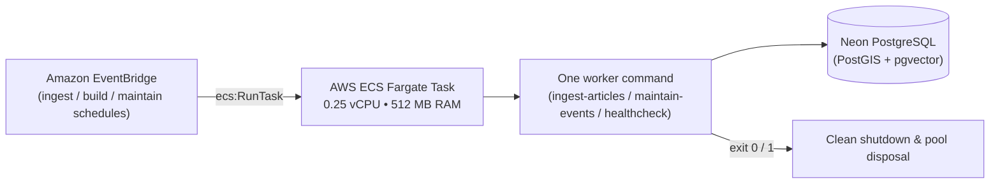

# Hermes Ingestion & Lifecycle Worker (`hermes-worker`)

[](https://www.python.org/)
[](https://aws.amazon.com/fargate/)
[](https://aws.amazon.com/eventbridge/)
[](https://postgis.net)
[-blue?style=flat)](https://github.com/pgvector/pgvector)
[](https://langfuse.com)

`hermes-worker` is the autonomous, headless ingestion and data lifecycle worker for Project Hermes. Built as a batch CLI in **Python 3.14+**, it fetches global news feeds, builds incident-level events, resolves coordinates through a grounded geocoding shield, and maintains event and thread lifecycle state.

The worker operates completely decoupled from [`apps/hermes-api`](../hermes-api), ensuring that compute-heavy XML parsing, embeddings, and LLM inference never contend with client map queries.

---

## Operational Model

In production, `hermes-worker` runs as an **ephemeral, serverless batch container** on **AWS ECS Fargate** and is invoked by **Amazon EventBridge** on separate schedules for article ingestion, event construction, and maintenance.



### Key Architectural Invariants

- **12-Factor Run-and-Die Execution**: Contains zero internal loops, cron daemons, or long-lived background schedulers (e.g. Celery or APScheduler). The container boots on demand, executes one command, tears down database pools, and terminates cleanly (`sys.exit(0)` on success, `sys.exit(1)` on error).
- **Connection Lifespan Management**: Every database-backed CLI handler executes within [`db_lifespan()`](src/hermes_worker/core/lifespan.py). On startup it binds connection pools via `init_db(settings.db_url)`; on teardown it invokes `close_db()`, ensuring all connections are disposed before exit. `audit-sources` is network-only and skips database initialization.
- **Claim-Based Work Queue**: Articles transition through `NEW -> ANALYZING -> LABELED -> CLUSTERED`, with `FAILED` for exhausted retries. Claims use `UPDATE ... FOR UPDATE SKIP LOCKED` and are owned by the stage transaction.
- **Bounded Work**: Every stage works in bounded batches. Never accumulate all feeds, articles, or events in memory.
- **Grounded Geocoding Shield**: Enforces OpenStreetMap Nominatim's 1 req/s usage policy via a token-bucket rate limiter. Results are cached in `geocode_cache`, with non-locatable terms permanently stored as negative cache entries (`latitude=NULL`, `longitude=NULL`).

> [!NOTE]
> For stage flowcharts, command cadence, and schema details, see [apps/hermes-worker/docs/architecture.md](docs/architecture.md).

---

## CLI Commands & Targets

All tasks can be executed via Nx targets or directly through `uv`:

| Action | Nx Target | Direct CLI Command | Description |
| :--- | :--- | :--- | :--- |
| **Ingest Articles** | `npx nx run hermes-worker:ingest-articles` | `uv run hermes-worker ingest-articles` | Syncs the source registry, fetches due feeds, and writes the deduplicated article ledger. Add `--force` to ignore fetch intervals. |
| **Audit Sources** | `npx nx run hermes-worker:audit-sources` | `uv run hermes-worker audit-sources` | Probes configured feeds and one sample article each. Read-only and never writes the source config. |
| **Maintain Events** | `npx nx run hermes-worker:maintain-events` | `uv run hermes-worker maintain-events` | Requeues abandoned article claims and applies event score decay / status transitions. |
| **Healthcheck** | `npx nx run hermes-worker:healthcheck` | `uv run hermes-worker healthcheck` | Verifies database connectivity, claim-queue schema, queue depth, and stale claims. Read-only. |
| **Reset DB** | `npx nx run hermes-worker:reset-db` | `uv run hermes-worker reset-db --yes` | Drops local database objects only, guarded by an environment/host check. Never use against production. |

The `build-events` command is added with its stages in a later phase. There is no feature flag and no parallel legacy pipeline.

---

## Pipeline Status (Phase 2)

Phase 1 established the worker job kernel and the article claim queue. Phase 2 adds the ingestion ledger:

1. **Job Runtime**: `jobs/context.py`, `jobs/runner.py`, and `jobs/locks.py` provide the stage protocol, per-run LLM budget, ordered stage execution, and advisory locking.
2. **Article Claim Queue**: `jobs/queue.py` claims, marks, fails, and requeues articles with `FOR UPDATE SKIP LOCKED`.
3. **Ingestion**: `ingest-articles` syncs the source registry, fetches due feeds with bounded concurrency, applies the freshness window, and inserts canonicalized rows with conflict handling.
4. **Source Registry**: direct publisher feeds are preferred, Google News feeds remain as fallback for blocked publishers, and paywalled sources use `SUMMARY_ONLY` labels.
5. **Maintenance**: `maintain-events` requeues stale claims and applies the existing `ACTIVE -> STALE -> ARCHIVED` event lifecycle transitions.
6. **Healthcheck**: `healthcheck` verifies the claim columns, source feed metadata, URL identity index, expanded `ingeststatus` constraint, partial claim index, and queue depth.

Article labeling, clustering, description, scoring, and thread maintenance land in later phases. Production remains on `master` until the cutover phase.

---

## Configuration & Environment Variables

Settings are managed via `pydantic-settings` in [`core/config.py`](src/hermes_worker/core/config.py):

| Variable | Default | Description |
| :--- | :--- | :--- |
| `DB_HOST` | `localhost` | PostgreSQL host endpoint. |
| `DB_PORT` | `5432` | PostgreSQL port. |
| `DB_USER` | `postgres` | Database username. |
| `DB_PASSWORD` | *Required* | Database user password. |
| `DB_NAME` | `hermes` | Database name. |
| `LLM_API` | `""` | Primary LLM API key. |
| `LLM_MODEL` | `""` | Primary LLM identifier. |
| `LLM_API_1` / `LLM_MODEL_1` | `None` | Optional fallback LLM route. |
| `EMBED_API` | `""` | Embedding service API key. |
| `EMBED_MODEL` | `""` | Embedding model identifier. |
| `EMBED_API_1` / `EMBED_MODEL_1` | `None` | Optional fallback embedding route. |
| `RPM_LIMIT` | `26` | Token-bucket rate limit for LLM calls (req/min). |
| `EMBED_RPM_LIMIT` | `90` | Token-bucket rate limit for embedding calls (req/min). |
| `NOMINATIM_USER_AGENT` | `Hermes...` | Custom User-Agent header for OpenStreetMap Nominatim. |
| `EVENT_STALE_HOURS` | `24` | Hours of inactivity before an `ACTIVE` event transitions to `STALE`. |
| `EVENT_ARCHIVE_HOURS` | `48` | Hours of inactivity before a `STALE` event transitions to `ARCHIVED`. |
| `ARTICLE_CLAIM_BATCH_SIZE` | `50` | Maximum articles claimed or requeued per run. |
| `ARTICLE_CLAIM_STALE_MINUTES` | `30` | Age at which a claim is considered abandoned and requeued. |
| `ARTICLE_MAX_ATTEMPTS` | `3` | Claim attempts before an article is marked `FAILED`. |
| `ARTICLE_MAX_AGE_HOURS` | `72` | Drop feed entries older than this window. |
| `ARTICLE_FUTURE_SKEW_HOURS` | `2` | Clamp publisher timestamps further in the future than this. |
| `SOURCE_FETCH_CONCURRENCY` | `5` | Maximum concurrent source fetches per ingest run. |
| `MAX_LLM_CALLS_PER_RUN` | `120` | Hard per-run structured LLM call budget. |
| `LABEL_MODEL` / `LABEL_API` | `None` | Optional label-task override; falls back to `LLM_MODEL` / `LLM_API`. |
| `ADJUDICATE_MODEL` / `ADJUDICATE_API` | `None` | Optional adjudication-task override; falls back to `LLM_MODEL` / `LLM_API`. |
| `DESCRIBE_MODEL` / `DESCRIBE_API` | `None` | Optional describe-task override; falls back to `LLM_MODEL` / `LLM_API`. |
| `LANGFUSE_PUBLIC_KEY` | `""` | Langfuse project public key. When set with secret key, activates trace observability. |
| `LANGFUSE_SECRET_KEY` | `""` | Langfuse project secret key. Required alongside public key to enable tracing. |
| `LANGFUSE_HOST` | `https://cloud.langfuse.com` | Langfuse ingestion base URL (also accepts alias `LANGFUSE_BASE_URL`). |

---

## Observability & Tracing (Langfuse)

`hermes-worker` integrates with [Langfuse](https://langfuse.com) via `libs/shared/hermes-ai`:

- **Opt-in Activation**: Enabled automatically when both `LANGFUSE_PUBLIC_KEY` and `LANGFUSE_SECRET_KEY` are provided. If omitted, jobs run normally without tracing overhead.
- **Structured Completion**: LLM stages use `complete_json(...)` with schema repair and process-local `LlmUsage` accounting (calls, input/output tokens, repairs).
- **Service & Environment Tags**: Traces are tagged with `["hermes-worker", ENV]` to isolate worker telemetry from API traffic and distinguish local runs from production.
- **Critical Flush-on-Exit**: `JobContext.aclose()` calls `LlmService.aclose()` before process exit so buffered trace events are flushed on ephemeral Fargate teardown.

---

## Development Runbook

All commands are executed from the workspace root:

```bash
# Fetch due feeds and write the article ledger
npx nx run hermes-worker:ingest-articles

# Probe every configured feed without writing to the database
npx nx run hermes-worker:audit-sources

# Requeue stale article claims and apply event lifecycle transitions
npx nx run hermes-worker:maintain-events

# Check database connectivity, schema, queue depth, and stale claims
npx nx run hermes-worker:healthcheck

# Run worker test suite (Pytest with coverage)
npx nx test hermes-worker

# Run Ruff linter
npx nx lint hermes-worker

# Format code with Ruff
npx nx run hermes-worker:format

# Sync Python virtual environment dependencies via uv
npx nx run hermes-worker:sync
```
