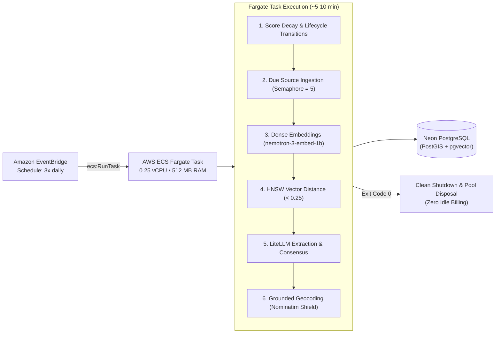

# Hermes Ingestion & Lifecycle Worker (`hermes-worker`)

[](https://www.python.org/)
[](https://aws.amazon.com/fargate/)
[](https://aws.amazon.com/eventbridge/)
[](https://postgis.net)
[-blue?style=flat)](https://github.com/pgvector/pgvector)

`hermes-worker` is the autonomous, headless ingestion and data lifecycle worker for Project Hermes. Built as a batch CLI in **Python 3.14+**, it monitors global news feeds (RSS, GDELT, and news sitemaps), computes dense vector embeddings, performs database-side vector deduplication via PostGIS HNSW indexing, resolves coordinates through a grounded geocoding shield, and manages event decay and status transitions.

The worker operates completely decoupled from [`apps/hermes-api`](file:///home/pavan/proj/hermes/apps/hermes-api), ensuring that compute-heavy XML parsing, high-dimensional vector embeddings, and LLM inference never contend with client map queries.

---

## Operational Model & Cloud Topology

In production, `hermes-worker` runs as an **ephemeral, serverless batch container** on **AWS ECS Fargate** in region `ap-southeast-2` (Sydney), orchestrated 3 times daily by **Amazon EventBridge** (`cron(0 0,8,16 * * ? *)`):



### Key Architectural Invariants

- **12-Factor Run-and-Die Execution**: Contains zero internal loops, cron daemons, or long-lived background schedulers (e.g. Celery or APScheduler). The container boots on demand, executes `hermes-worker run-all`, tears down database pools, and terminates cleanly (`sys.exit(0)` on success, `sys.exit(1)` on error). Process exit guarantees complete OS memory reclamation.
- **Connection Lifespan Management**: Every CLI handler executes within [`db_lifespan()`](file:///home/pavan/proj/hermes/apps/hermes-worker/src/hermes_worker/core/lifespan.py). On startup, it binds connection pools via `init_db(settings.db_url)`; on teardown, it invokes `close_db()`, ensuring all connections are disposed before exit.
- **Memory Bounded on Fargate**: With only 512 MB RAM allocated to the task, incoming articles are parsed and processed in bounded batches (`ARTICLE_BATCH_SIZE = 10`) under a bounded concurrency semaphore (`asyncio.Semaphore(5)`).
- **Embed Before Extract**: Embeds articles first using `nvidia_nim/nvidia/nemotron-3-embed-1b` and performs an HNSW cosine distance search on PostGIS (`halfvec_cosine_ops` $< 0.25$) before invoking an LLM. Only candidate matches are passed to the model, eliminating expensive $O(N^2)$ pairwise token overhead.
- **Grounded Geocoding Shield**: Enforces OpenStreetMap Nominatim's 1 req/s usage policy via a token-bucket rate limiter. Results are cached in `geocode_cache`, with non-locatable terms permanently stored as negative cache entries (`latitude=NULL`, `longitude=NULL`).

> [!NOTE]
> For detailed pipeline flowcharts, cost calculations ($< $0.07/month), and memory bounds analysis, see [apps/hermes-worker/docs/architecture.md](docs/architecture.md).

---

## CLI Commands & Targets

All tasks can be executed via Nx targets or directly through `uv`:

| Action | Nx Target | Direct CLI Command | Description |
| :--- | :--- | :--- | :--- |
| **Run All** | `npx nx run hermes-worker:run-all` | `uv run hermes-worker run-all` | Full batch pass: applies score decay and lifecycle transitions, then syncs due news feeds. |
| **Sync Only** | `npx nx run hermes-worker:run-sync` | `uv run hermes-worker run-sync` | Ingests due sources only. Add `--force` to ignore `last_fetched_at` intervals. |
| **Lifecycle Only** | `npx nx run hermes-worker:run-lifecycle` | `uv run hermes-worker run-lifecycle` | Executes score decay calculation and transitions events (`ACTIVE` $\rightarrow$ `STALE` $\rightarrow$ `ARCHIVED`). |

---

## Ingestion Pipeline Stages

1. **Lifecycle Decay & State Progression**: Applies hourly exponential decay factor ($2^{-1/18}$) to all active event trending scores. Transitions events past 24 hours of inactivity from `ACTIVE` $\rightarrow$ `STALE`, and past 48 hours to `ARCHIVED`.
2. **Concurrent Source Fetching**: Queries sources due for fetching (`last_fetched_at + interval <= now`) across RSS, GDELT, and sitemaps using `httpx.AsyncClient` with custom User-Agent headers.
3. **Database URL Deduplication**: Skips articles whose canonical URLs already exist in the `articles` table.
4. **Vector Embeddings & HNSW Search**: Slices novel articles into batches of 10, generates 2048-dimensional dense vectors, and queries PostGIS for active events within cosine distance $< 0.25$.
5. **LLM Extraction & Consensus**: Prompts LiteLLM (`mistral/ministral-8b-latest` with `nvidia_nim/openai/gpt-oss-20b` fallback) with the article and candidate events to extract structured metadata or corroborate an existing incident.
6. **Grounded Geocoding**: Resolves extracted entity location names via Nominatim with positive and negative caching.
7. **Atomic Persistence**: Persists new events with PostGIS `POINT` geometries and embeddings, or attaches new articles to existing events, updates article counts, and recalculates velocity and Shannon diversity scores.

---

## Configuration & Environment Variables

Settings are managed via `pydantic-settings` in [`core/config.py`](file:///home/pavan/proj/hermes/apps/hermes-worker/src/hermes_worker/core/config.py):

| Variable | Default | Description |
| :--- | :--- | :--- |
| `DB_HOST` | `localhost` | PostgreSQL host endpoint. |
| `DB_PORT` | `5432` | PostgreSQL port. |
| `DB_USER` | `postgres` | Database username. |
| `DB_PASSWORD` | *Required* | Database user password. |
| `DB_NAME` | `hermes` | Database name. |
| `LLM_API` | `""` | Primary LLM API key (e.g. Mistral). |
| `LLM_MODEL` | `""` | Primary LLM identifier (e.g. `mistral/ministral-8b-latest`). |
| `LLM_API_1` | `None` | Fallback LLM API key. |
| `LLM_MODEL_1` | `None` | Fallback LLM identifier (e.g. `nvidia_nim/openai/gpt-oss-20b`). |
| `EMBED_API` | `""` | Embedding service API key. |
| `EMBED_MODEL` | `""` | Embedding model identifier (`nvidia_nim/nvidia/nemotron-3-embed-1b`). |
| `RPM_LIMIT` | `26` | Token-bucket rate limit for LLM calls (req/min). |
| `EMBED_RPM_LIMIT` | `90` | Token-bucket rate limit for embedding calls (req/min). |
| `NOMINATIM_USER_AGENT` | `Hermes...` | Custom User-Agent header for OpenStreetMap Nominatim. |
| `EVENT_STALE_HOURS` | `24` | Hours of inactivity before an `ACTIVE` event transitions to `STALE`. |
| `EVENT_ARCHIVE_HOURS` | `48` | Hours of inactivity before a `STALE` event transitions to `ARCHIVED`. |

---

## Development Runbook

All commands are executed from the workspace root:

```bash
# Execute batch pipeline locally (lifecycle decay + incremental sync)
npx nx run hermes-worker:run-all

# Force sync all sources regardless of last fetched timestamps
uv run hermes-worker run-sync --force

# Run worker test suite (Pytest with coverage)
npx nx test hermes-worker

# Run Ruff linter
npx nx lint hermes-worker

# Format code with Ruff
npx nx run hermes-worker:format

# Sync Python virtual environment dependencies via uv
npx nx run hermes-worker:sync
```
