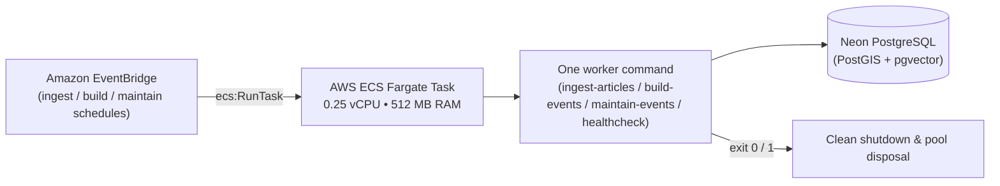

# Hermes Ingestion & Lifecycle Worker (`hermes-worker`)

[](https://www.python.org/)
[](https://aws.amazon.com/fargate/)
[](https://aws.amazon.com/eventbridge/)
[](https://postgis.net)
[-blue?style=flat)](https://github.com/pgvector/pgvector)
[](https://langfuse.com)

`hermes-worker` is the autonomous, headless ingestion and data lifecycle worker for Project Hermes. Built as a batch CLI in **Python 3.14+**, it fetches global news feeds, builds incident-level events, resolves coordinates through a grounded geocoding shield, and maintains event and thread lifecycle state.

The worker operates completely decoupled from [`apps/hermes-api`](../hermes-api), ensuring that compute-heavy XML parsing, embeddings, and LLM inference never contend with client map queries.

---

## Operational Model

In production, `hermes-worker` runs as an **ephemeral, serverless batch container** on **AWS ECS Fargate** and is invoked by **Amazon EventBridge** on separate schedules for article ingestion, event construction, and maintenance.



### Key Architectural Invariants

- **12-Factor Run-and-Die Execution**: Contains zero internal loops, cron daemons, or long-lived background schedulers (e.g. Celery or APScheduler). The container boots on demand, executes one command, tears down database pools, and terminates cleanly (`sys.exit(0)` on success, `sys.exit(1)` on error).
- **Connection Lifespan Management**: Every database-backed CLI handler executes within [`db_lifespan()`](src/hermes_worker/core/lifespan.py). On startup it binds connection pools via `init_db(settings.db_url)`; on teardown it invokes `close_db()`, ensuring all connections are disposed before exit. `audit-sources` is network-only and skips database initialization.
- **Claim-Based Work Queue**: Articles transition through `NEW -> ANALYZING -> LABELED -> CLUSTERED`, with `FAILED` for exhausted retries. Claims use `UPDATE ... FOR UPDATE SKIP LOCKED` and are owned by the stage transaction.
- **Bounded Work**: Every stage works in bounded batches. Never accumulate all feeds, articles, or events in memory.
- **Grounded Geocoding Shield**: Enforces OpenStreetMap Nominatim's 1 req/s usage policy via a token-bucket rate limiter. Results are cached in `geocode_cache`, with non-locatable terms permanently stored as negative cache entries (`latitude=NULL`, `longitude=NULL`).

> [!NOTE]
> For stage flowcharts, command cadence, and schema details, see [apps/hermes-worker/docs/architecture.md](docs/architecture.md).

---

## CLI Commands & Targets

All tasks can be executed via Nx targets or directly through `uv`:

| Action | Nx Target | Direct CLI Command | Description |
| :--- | :--- | :--- | :--- |
| **Ingest Articles** | `npx nx run hermes-worker:ingest-articles` | `uv run hermes-worker ingest-articles` | Syncs the source registry, fetches due feeds, writes the deduplicated ledger, and runs `ANALYZE` (transient fetch, labeling, embeddings, syndication families). Add `--force` to bypass fetch intervals. |
| **Build Events** | `npx nx run hermes-worker:build-events` | `uv run hermes-worker build-events` | Executes `CLUSTER -> DESCRIBE -> SCORE -> RECONCILE -> RELATIONSHIP -> THREAD` to cluster articles into incident pins, synthesize headlines/actors, compute `importance_score`, merge duplicates, link causal/correlative relationships, and group story threads. |
| **Audit Sources** | `npx nx run hermes-worker:audit-sources` | `uv run hermes-worker audit-sources` | Probes configured feeds and sample articles read-only (no database session). |
| **Maintain Events** | `npx nx run hermes-worker:maintain-events` | `uv run hermes-worker maintain-events` | Runs `REQUEUE_CLAIMS`, `EVENT_LIFECYCLE`, `THREAD_LIFECYCLE`, and `MAINTENANCE` (reconcile counts, retention sweeps, consistency checks). Add `--requeue --since <YYYY-MM-DD>` to reset `FAILED`/`REJECTED` articles. |
| **Healthcheck** | `npx nx run hermes-worker:healthcheck` | `uv run hermes-worker healthcheck` | Verifies database connectivity, claim-queue schema, queue depth, and stale claims. Read-only. |
| **Reset DB** | `npx nx run hermes-worker:reset-db` | `uv run hermes-worker reset-db --yes` | Drops local database objects only, guarded by a host/environment check. Never use against production. |

---

## Pipeline Capabilities

1. **Job Runtime**: `jobs/context.py`, `jobs/runner.py`, and `jobs/locks.py` provide the stage contract, per-run `MAX_LLM_CALLS_PER_RUN` budget, ordered stage execution, and PostgreSQL advisory locks (`ingest-articles`, `build-events`, `maintain-events`).
2. **Article Claim Queue**: `jobs/queue.py` claims, marks, fails, and requeues articles with `UPDATE ... FOR UPDATE SKIP LOCKED`.
3. **Ingestion & Transient Fetch**: `ingest-articles` syncs the 20-source catalog (`sources.json`), falls back to alternate/Google News feeds on failure, transiently fetches `FULL_TEXT` articles safely (SSRF validation, per-host concurrency, `robots.txt`), and falls back to `feed_summary` on paywalls or errors.
4. **Labeling, Embeddings & Syndication Families**: `ANALYZE` extracts factual labels (`is_event`, `certainty`, impact/specificity, entities, locations), enforces deterministic reject gates, embeds accepted articles (`halfvec(2048)`), and groups wire reprints into `article_families`.
5. **Clustering, Synthesis & Scoring**: `build-events` matches articles into incident `Event` clusters (hybrid vector + metadata scoring + gray-band LLM adjudication), synthesizes headlines/summaries/actors (`DESCRIBE`), geocodes locations and actor anchors via Nominatim, and recomputes deterministic `importance_score` (`score-v2`) and `SelectionTier` (`SCORE`).
6. **Reconciliation, Relationships & Threads**: `RECONCILE` merges duplicate events non-destructively (`merged_into_id`), `RELATIONSHIP` discovers cross-event links (`CAUSED`, `FOLLOW_UP`, `REACTION`, `RELATED`) and auto-merges high-confidence `SAME_INCIDENT` duplicates, and `THREAD` maintains persistent developing/topic story groups.
7. **Lifecycle & Retention**: `maintain-events` requeues stale `ANALYZING` claims, runs `ACTIVE -> STALE (96h) -> ARCHIVED (240h)` and `ACTIVE -> DORMANT (7d) -> ENDED (30d)` transitions, reconciles aggregate counters, and enforces retention limits.

---

## Configuration & Environment Variables

Settings are managed via `pydantic-settings` in [`core/config.py`](src/hermes_worker/core/config.py), loading `.env`, `.env.<ENV>`, `.env.local`, and `.env.<ENV>.local` from repo root and `apps/hermes-worker/`:

| Variable | Default | Description |
| :--- | :--- | :--- |
| `ENV` | `development` | Execution environment (`development`, `staging`, `production`). |
| `DB_HOST` | `localhost` | PostgreSQL host endpoint. |
| `DB_PORT` | `5432` | PostgreSQL port. |
| `DB_USER` | `postgres` | Database username. |
| `DB_PASSWORD` | *Required* | Database user password. |
| `DB_NAME` | `hermes` | Database name. |
| `DB_SSL_MODE` | `None` | Optional SSL mode override (`disable`, `allow`, `prefer`, `require`). Non-development defaults to `require`. |
| `LLM_API` / `LLM_MODEL` | `""` | Primary LLM API key and model identifier (required in production). |
| `LLM_API_1` / `LLM_MODEL_1` | `None` | Optional fallback LLM route. |
| `LLM_MODEL_KWARGS` | `{}` | Default provider kwargs forwarded on LLM calls. |
| `LLM_REQUEST_TIMEOUT_SECONDS` | `120.0` | Timeout per worker LLM completion request. |
| `EMBED_API` / `EMBED_MODEL` | `""` | Primary embedding API key and model identifier (required in production). |
| `EMBED_API_1` / `EMBED_MODEL_1` | `None` | Optional fallback embedding route. |
| `RPM_LIMIT` / `EMBED_RPM_LIMIT` | `26` / `90` | Token-bucket rate limits (req/min) for LLM and embedding calls. |
| `NOMINATIM_USER_AGENT` | `Hermes...` | Custom User-Agent header for OpenStreetMap Nominatim. |
| `EVENT_STALE_HOURS` / `EVENT_ARCHIVE_HOURS` | `96` / `240` | Inactivity cutoffs for `ACTIVE -> STALE -> ARCHIVED` event transitions. |
| `ARTICLE_CLAIM_BATCH_SIZE` / `ARTICLE_CLAIM_STALE_MINUTES` / `ARTICLE_MAX_ATTEMPTS` | `50` / `30` / `3` | Claim batch size, abandonment age, and retry cap before `FAILED`. |
| `ARTICLE_MAX_AGE_HOURS` / `ARTICLE_FUTURE_SKEW_HOURS` | `72` / `2` | Ingest entry freshness window and future timestamp clamp. |
| `SOURCE_FETCH_CONCURRENCY` | `5` | Maximum concurrent source fetches per ingest run. |
| `ARTICLE_ANALYZE_BATCH_SIZE` / `ARTICLE_LABEL_BATCH_SIZE` | `50` / `5` | Article claim batch and LLM label sub-batch sizes. |
| `ARTICLE_FAMILY_WINDOW_DAYS` / `ARTICLE_FAMILY_MAX_CANDIDATES` | `7` / `300` | Syndication family candidate search window and cap. |
| `EVENT_CLUSTER_BATCH_SIZE` / `EVENT_CLUSTER_WINDOW_DAYS` / `EVENT_CLUSTER_LLM_PAIRS_PER_RUN` | `100` / `7` / `25` | Event clustering batch size, candidate window, and adjudication pair budget. |
| `EVENT_DESCRIBE_BATCH_SIZE` / `EVENT_DESCRIBE_MAX_FAMILIES` | `5` / `8` | Event synthesis batch limit and independent family cap per prompt. |
| `EVENT_SCORE_PAGE_SIZE` | `500` | Pagination batch size for deterministic scoring sweeps. |
| `EVENT_RECONCILE_WINDOW_HOURS` / `EVENT_RECONCILE_LIMIT` / `EVENT_MERGE_LLM_PAIRS_PER_RUN` | `48` / `200` / `10` | Duplicate event reconciliation lookback, cap, and LLM pair budget. |
| `RELATIONSHIP_EVENT_LIMIT` / `RELATIONSHIP_WINDOW_DAYS` / `RELATIONSHIP_LLM_PAIRS_PER_RUN` | `100` / `10` / `30` | Relationship discovery anchor cap, lookback window, and LLM pair budget (plus `RELATIONSHIP_MIN_EMBEDDING_SIM=0.62`, `RELATIONSHIP_MIN_CONFIDENCE=0.70`, `RELATIONSHIP_BATCH_SIZE=8`). |
| `THREAD_EVENT_LIMIT` / `THREAD_CANDIDATE_LIMIT` / `THREAD_LLM_PAIRS_PER_RUN` | `200` / `100` / `25` | Unthreaded event batch, thread candidate cap, and LLM adjudication budget. |
| `MAX_LLM_CALLS_PER_RUN` | `120` | Hard per-run structured LLM call budget across stages. |
| `LABEL_*` / `ADJUDICATE_*` / `DESCRIBE_*` / `THREAD_*` / `RELATIONSHIP_*` (`_MODEL`, `_API`, `_MODEL_KWARGS`) | `None` | Optional per-task route overrides; each falls back to `LLM_MODEL` / `LLM_API`. |
| `LANGFUSE_PUBLIC_KEY` / `LANGFUSE_SECRET_KEY` | `""` | Langfuse project credentials. When both are set, activates opt-in tracing. |
| `LANGFUSE_HOST` | `https://cloud.langfuse.com` | Langfuse ingestion base URL (also accepts alias `LANGFUSE_BASE_URL`). |

---

## Observability & Tracing (Langfuse)

`hermes-worker` integrates with [Langfuse](https://langfuse.com) via `libs/shared/hermes-ai`:

- **Opt-in Activation**: Enabled automatically when both `LANGFUSE_PUBLIC_KEY` and `LANGFUSE_SECRET_KEY` are provided. If omitted, jobs run normally without tracing overhead.
- **Structured Completion**: LLM stages use `complete_json(...)` with schema repair and process-local `LlmUsage` accounting (calls, input/output tokens, repairs).
- **Service & Environment Tags**: Traces are tagged with `["hermes-worker", ENV]` to isolate worker telemetry from API traffic and distinguish local runs from production.
- **Critical Flush-on-Exit**: `JobContext.aclose()` calls `LlmService.aclose()` before process exit so buffered trace events are flushed on ephemeral Fargate teardown.

---

## Development Runbook

All commands are executed from the workspace root:

```bash
# Fetch due feeds, write the article ledger, and analyze claims
npx nx run hermes-worker:ingest-articles

# Cluster events, synthesize descriptions/actors, score, reconcile, link, and thread
npx nx run hermes-worker:build-events

# Probe every configured feed without writing to the database
npx nx run hermes-worker:audit-sources

# Requeue stale article claims and apply event/thread lifecycle transitions
npx nx run hermes-worker:maintain-events

# Check database connectivity, schema, queue depth, and stale claims
npx nx run hermes-worker:healthcheck

# Run worker test suite (Pytest with coverage)
npx nx test hermes-worker

# Run Ruff linter
npx nx lint hermes-worker

# Format code with Ruff
npx nx run hermes-worker:format

# Sync Python virtual environment dependencies via uv
npx nx run hermes-worker:sync
```
