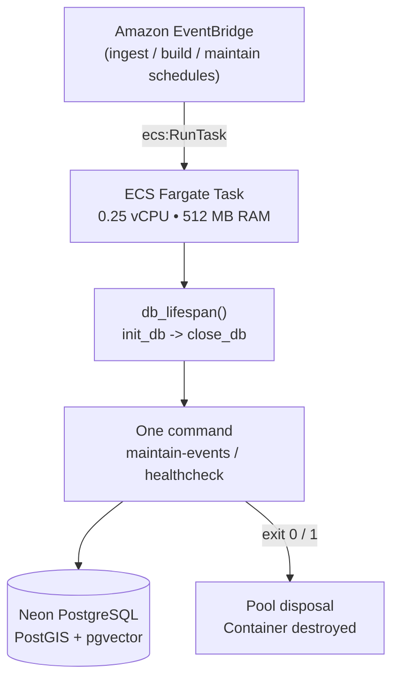
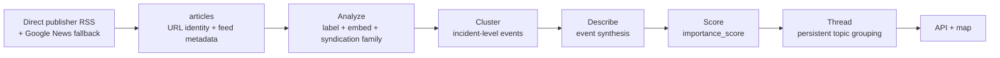
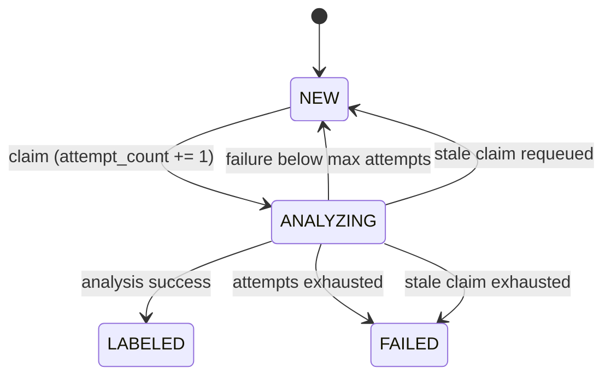

# Hermes Worker — Architecture & Design Rationale

This document describes the worker's execution model, the target news ingestion architecture, and the Phase 1 job foundation. The target stages are implemented incrementally; each section marks what exists today.

---

## 1. Cloud Infrastructure & Ephemeral Execution Model

### Architecture Topology



### Lifecycle of an Ephemeral Execution

1. EventBridge invokes `ecs:RunTask` with one worker command.
2. The container starts, loads typed settings through `pydantic-settings`, and calls `init_db(settings.db_url)` inside `db_lifespan()`.
3. The command opens a `JobContext`, runs its ordered stages, and commits per stage.
4. The context flushes LLM telemetry, disposes the engine pool, and the process exits with `0` on success or `1` on failure.

### Architectural Rationale: Why Ephemeral Compute?

- **Zero idle cost**: No always-on worker fleet or queue daemon. Compute exists only for the scheduled run.
- **Memory reclamation**: A one-shot process returns all memory to the OS; there is no long-lived Python heap to leak.
- **Simple failure model**: A non-zero exit code is the operational signal. Logs carry the stage, counters, and bounded error string.
- **No shadow scheduler**: Cadence belongs to EventBridge (or local cron), not to an internal loop.

---

## 2. Target Ingestion Architecture

> **Status:** Phase 1 provides the job runtime, article claim queue, maintenance, and healthcheck. Ingestion and event construction are implemented in later phases.



### 2.1 Command Cadence

| Command | Schedule | Scope | LLM |
| :--- | :--- | :--- | :--- |
| `ingest-articles` | every 15 min | Fetch feeds, write the article ledger, label, embed, assign syndication family | yes |
| `build-events` | hourly | Cluster articles into events, describe, verify, score, update threads | yes |
| `maintain-events` | daily | Requeue stale claims, lifecycle transitions, retention, consistency checks | no |
| `healthcheck` | on demand | Connectivity, schema, queue depth, stale claims | no |

Phase 1 registers `maintain-events` and `healthcheck`. `ingest-articles` and `build-events` are registered when their stages land; there is no feature flag and no parallel legacy path.

### 2.2 Article Ledger and Claim Queue

`articles.ingest_status` is the only work queue:



- Claims use `UPDATE ... WHERE id IN (SELECT ... FOR UPDATE SKIP LOCKED)` and `RETURNING`.
- `attempt_count` is bounded by `ARTICLE_MAX_ATTEMPTS`.
- `maintain-events` requeues `ANALYZING` rows older than `ARTICLE_CLAIM_STALE_MINUTES`.
- A stage commits its own work; `ArticleQueue` never commits. A crash before commit leaves work claimable by the next run.

### 2.3 Bounded Work and Memory

- Process feeds and articles in bounded batches; never accumulate the full feed set in memory.
- The Fargate task has 512 MB RAM. Feed parsing, embedding requests, and LLM prompts must all have explicit batch limits.
- Network calls are rate-limited (Nominatim 1 req/s; LLM and embedding token buckets).

### 2.4 Grounded Geocoding Shield

LLMs never generate coordinates. They return normalized location names, which `GeocodingService` resolves through OpenStreetMap Nominatim. Results are cached in `geocode_cache`; unresolvable names are stored as negative entries to prevent repeated outbound calls. The service is injected into the job context and shared across stages in one run.

---

## 3. Event, Thread, and Timeline Model

| Entity | Meaning |
| :--- | :--- |
| **Event** | One real-world incident at a place and time. This is the map pin. |
| **Thread** | A persistent topic grouping. Five related events remain five pins, all carrying the thread. |
| **Timeline** | The existing per-event Wikipedia/LLM causality cache. Threads do not generate timelines. |

Threads persist across news cycles:

- `ACTIVE -> DORMANT` after 7 days without a new event.
- `DORMANT -> ENDED` after 30 days.
- A new event on the same topic reactivates a `DORMANT` thread.

Events and threads are not collapsed. Merging is limited to duplicate incidents and is recorded explicitly; there is no automatic splitting in v1.

---

## 4. Verification and Ranking

### 4.1 Syndication Families

Articles are grouped into families by shared syndication origin. Verification is derived from the number and quality of independent families:

| Status | Rule |
| :--- | :--- |
| `SINGLE_SOURCE` | One family only. Visible but capped and badged. |
| `CORROBORATED` | At least two independent families agree. |
| `CONFIRMED` | Corroborated and includes a tier-1 family. |
| `CONFLICTING` | Families disagree on a material fact. |

### 4.2 One Authoritative Score

`importance_score` is the only ranking value. It is recomputed from current evidence, never incremented in place:

```
strength = min(1, sum(max credibility per family) / 9)     # tier1=3, tier2=2, tier3/4=1
impact   = {CRITICAL:1.0, MAJOR:0.8, MODERATE:0.55, MINOR:0.3}
verify   = {CONFIRMED:1.0, CORROBORATED:0.85, SINGLE_SOURCE:0.4, CONFLICTING:0.25}
quality  = clamp(1 - 0.15*(5-specificity) - 0.10*(5-consequence), 0.5, 1.0)

base      = 100 * (0.40*strength + 0.30*impact + 0.15*verify + 0.15*quality)
score     = base * exp(-age_hours / half_life)
half_life = 18h CRITICAL, 36h MAJOR, 72h otherwise
if SINGLE_SOURCE: score = min(score, 45)
```

`score_breakdown` stores the raw value, weight, contribution, freshness multiplier, and cap for each component. Tiers are `PRIMARY >= 55`, `FILLER 30–55`, `DROP < 30`, with ±5 hysteresis. Single-source events remain visible; they never outrank corroborated events unless a short breaking-news override applies.

---

## 5. Phase 1 Job Foundation

### 5.1 Modules

```
jobs/
  context.py   JobContext, LlmBudget, Stage, StageStats, WorkerIdentity
  runner.py    ordered stage execution and optional advisory lock
  locks.py     per-command Postgres advisory locks
  queue.py     ArticleQueue claim/mark/fail/requeue
  commands.py  maintain-events and healthcheck command wiring
  stages/
    maintenance.py  requeue stale claims + event lifecycle
    healthcheck.py  connectivity, schema, queue depth
```

### 5.2 Command Surface

| Command | Stages registered in Phase 1 | Purpose |
| :--- | :--- | :--- |
| `maintain-events` | `REQUEUE_CLAIMS`, `EVENT_LIFECYCLE` | Recover abandoned claims and apply event decay/transitions |
| `healthcheck` | `HEALTHCHECK` | Read-only readiness probe |

`healthcheck` does not take a lock: read-only probes must remain available while maintenance is running. `maintain-events` takes its own advisory lock; a second concurrent invocation records `SKIPPED` in logs and exits cleanly.

### 5.3 Execution Record

There is no run-telemetry table. The durable record is:

- Structured logs with stage name, outcome, counters, and a bounded error string.
- Article claim fields (`claimed_at`, `claimed_by`, `attempt_count`, `last_error`).
- The process exit code.

A run-telemetry table is intentionally not part of the design; it duplicated logs without serving a query that domain rows cannot answer. Add one only when a concrete operational query requires it.

### 5.4 Structured LLM Completion

`LlmService.complete_json(...)` adds a schema-repair retry for structured stages while `call_llm(...)` keeps its single-shot behavior for the legacy extractor. Usage accounting (`LlmUsage`) records calls, input/output tokens, and repairs per process.

The worker builds generic `label`, `adjudicate`, and `describe` routes that default to `LLM_MODEL` / `LLM_API` and accept per-task overrides. Every stage reserves calls through `JobContext.budget` before invoking `complete_json`; exceeding `MAX_LLM_CALLS_PER_RUN` fails the stage instead of allowing unbounded spend.

### 5.5 Schema Guard

`healthcheck` verifies:

- `articles.claimed_at`, `claimed_by`, `attempt_count`, `last_error`
- The expanded `ingeststatus` check constraint (`ANALYZING`, `FAILED`)
- The partial index `idx_articles_analyzing_claimed_at`

A missing migration raises `SchemaCheckError` naming the exact missing object, rather than failing later on an opaque SQL error.

---

## 6. Observability & Langfuse Tracing

- **Opt-in**: Tracing activates only when both Langfuse keys are configured.
- **Structured calls**: `complete_json` runs are traced through the shared `LlmService`; inputs and outputs are not captured for article content.
- **Process tags**: Traces carry `["hermes-worker", ENV]` to separate local runs from production.
- **Flush on exit**: `JobContext.aclose()` calls `LlmService.aclose()`, which flushes the Langfuse client before the container exits.

---

## 7. Failure and Recovery Model

| Failure | Behavior |
| :--- | :--- |
| Stage raises | Runner logs the bounded error and re-raises; process exits `1`. Stage transaction rolls back. |
| Process killed mid-stage | `ANALYZING` claim remains. Next `maintain-events` requeues or fails it based on attempts. |
| Advisory lock held | Second invocation logs `SKIPPED` and exits `0` without mutating state. |
| Schema mismatch | `healthcheck` raises `SchemaCheckError` with the missing object list. |
| LLM budget exhausted | `BudgetExhaustedError` fails the stage; no further calls are made. |
| LLM schema mismatch | One repair retry through `complete_json`; a second failure raises `SchemaValidationError`. |
| Telemetry flush failure | Logged as a warning; it does not mask the stage result. |
