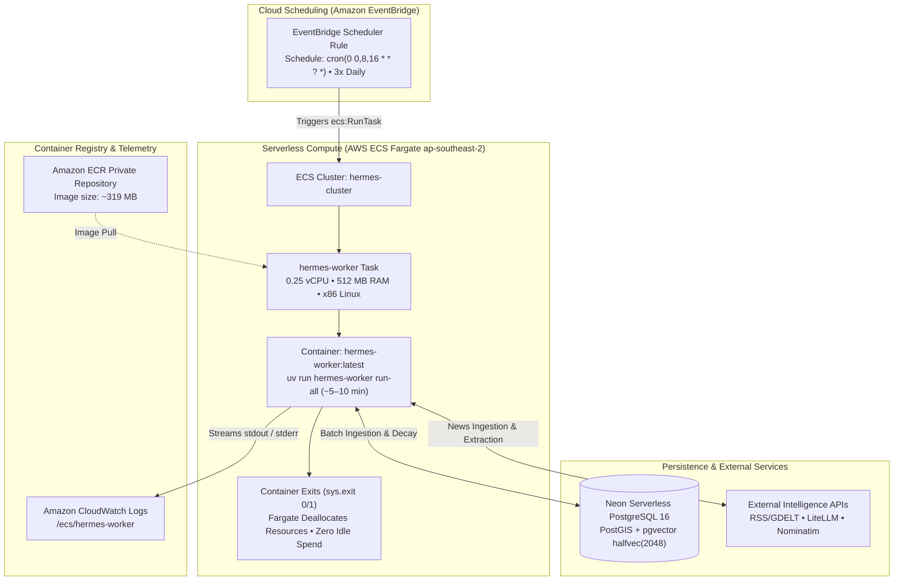
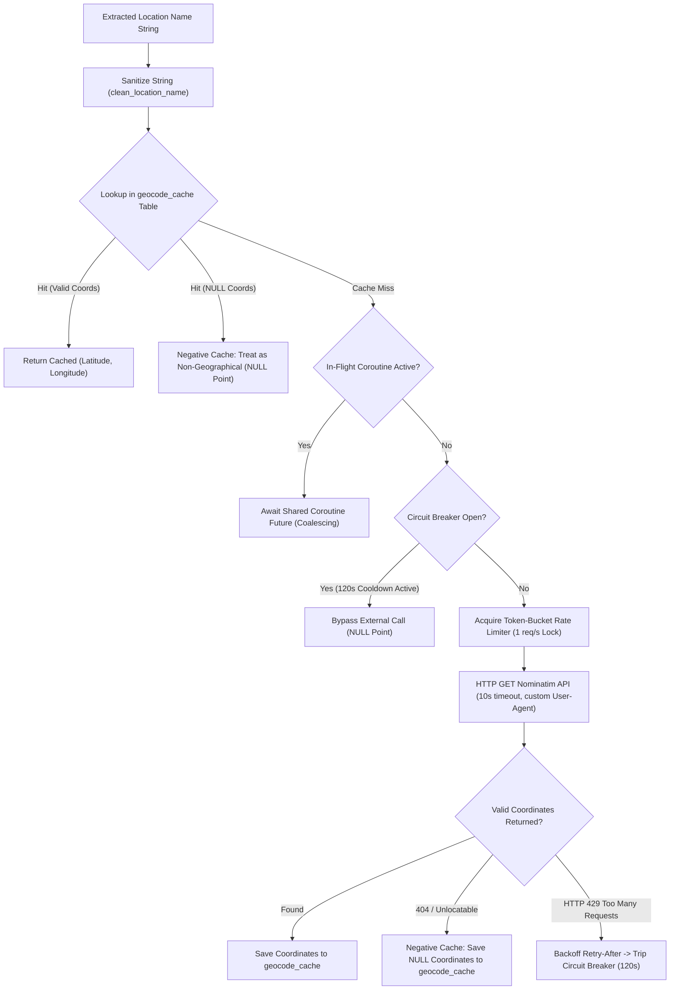

# Hermes Worker — Architecture & Design Rationale

This document details the architectural decisions, cloud infrastructure topology, batch ingestion pipelines, and resiliency mechanisms of `apps/hermes-worker`.

---

## 1. Cloud Infrastructure & Ephemeral Execution Model

`hermes-worker` runs as an autonomous, run-and-die batch CLI in AWS. Rather than maintaining a long-running daemon with in-process schedulers (e.g. Celery Beat or APScheduler), execution is orchestrated entirely through external cloud scheduling.

### Architecture Topology

### Lifecycle of an Ephemeral Execution

1. **EventBridge Scheduler Fires**: At the scheduled cadence (00:00, 08:00, 16:00 UTC daily), EventBridge issues an `ecs:RunTask` API call to the ECS cluster `hermes-cluster`.
2. **Dynamic Resource Allocation**: AWS Fargate dynamically provisions 0.25 vCPU and 512 MB of RAM from the shared compute pool. No virtual machine or container remains pre-running or idle between intervals.
3. **Container Image Pull**: Fargate pulls the production container image (`hermes-worker:latest`) from Amazon ECR.
4. **Execution in Isolated Lifespan**: The container initializes, wraps execution in [`db_lifespan()`](file:///home/pavan/proj/hermes/apps/hermes-worker/src/hermes_worker/core/lifespan.py), and runs `hermes-worker run-all`:
   - Lifecycle maintenance: applies score decay and updates status transitions (`ACTIVE` $\rightarrow$ `STALE` $\rightarrow$ `ARCHIVED`).
   - Source synchronization: fetches due feeds, generates embeddings, deduplicates via vector similarity, extracts metadata via LiteLLM, geocodes coordinates, and commits transactions.
5. **Clean Termination & Teardown**: Upon completing all due sources, the process calls `close_db()` and terminates cleanly (`sys.exit(0)`). ECS marks the task as `STOPPED` and Fargate deallocates compute resources immediately. Billing stops at container termination.
6. **Telemetry Streaming**: Real-time stdout and stderr output streams to Amazon CloudWatch Logs under `/ecs/hermes-worker`.

### Architectural Rationale: Why Ephemeral Compute?

- **Memory Leak Protection**: Parsing thousands of arbitrary, third-party RSS XML feeds with native C-extensions (`feedparser`, `libxml`) in Python frequently leads to memory fragmentation and slow leaks across long-lived processes. Terminating the process on completion guarantees complete memory reclamation by the operating system.
- **Connection Hygiene**: Encapsulating command runs within `db_lifespan()` guarantees that the SQLAlchemy `AsyncEngine` pool initializes on process boot and explicitly calls `engine.dispose()` on process teardown, eliminating dangling socket connections against Neon's PgBouncer pool.
- **Externalized Reliability**: Cloud schedulers natively manage timeouts, execution intervals, retries, and dead-letter alarms, eliminating in-process threading deadlocks across worker restarts.
- **Extreme Cost Efficiency**:
  Running a continuous $24/7$ worker VM or resident container costs $15.00–$45.00/month in idle compute. In contrast, `hermes-worker` runs for ~5–10 minutes per invocation (3 times daily):
  $$\text{Monthly Runtime} = 3 \text{ runs/day} \times 10 \text{ min} \times 30 \text{ days} = 900 \text{ minutes} = 15 \text{ hours/month}$$
  At AWS Fargate Linux rates ($0.04048/vCPU-hour, $0.004445/GB-hour):
  $$\text{vCPU Cost} = 15 \text{ hrs} \times 0.25 \text{ vCPU} \times \$0.04048 = \$0.15$$
  $$\text{Memory Cost} = 15 \text{ hrs} \times 0.5 \text{ GB} \times \$0.004445 = \$0.03$$
  $$\text{Total Compute Cost} \approx \mathbf{\$0.18 / \text{month}}$$

---

## 2. Ingestion Pipeline & Token Optimization

The ingestion stages in [`SyncService`](file:///home/pavan/proj/hermes/apps/hermes-worker/src/hermes_worker/services/sync.py) are structured to minimize token consumption and inference latency:

```mermaid
sequenceDiagram
    autonumber
    participant W as SyncService (apps/hermes-worker)
    participant DB as Neon PostgreSQL (PostGIS / pgvector)
    participant AI as LiteLLM (hermes-ai)
    participant Nom as GeocodingService (Nominatim)

    Note over W: Load due sources (last_fetched_at + interval <= now)
    
    loop Bounded Concurrency (asyncio.Semaphore = 5)
        W->>W: Fetch articles (RSS / GDELT / Sitemaps)
        W->>DB: Filter existing URLs (article_url_exists)
        
        loop Bounded Batches (ARTICLE_BATCH_SIZE = 10)
            W->>AI: gen_embeddings(batch_texts) [nemotron-3-embed-1b]
            AI-->>W: List of 2048-dim vectors
            
            W->>DB: get_active_events_by_embeddings(embeddings)
            Note over DB: HNSW cosine distance scan: Event.embedding <=> vector < 0.25
            DB-->>W: Candidate active events per article
            
            W->>AI: extract_events(articles, candidate_events)
            Note over AI: LiteLLM evaluates whether to corroborate candidate or create new
            AI-->>W: List of ExtractedEvent models
            
            loop For Each Valid Extraction
                alt Has Location Name
                    W->>Nom: geocode(location_name)
                    Note over Nom: Check geocode_cache -> Rate-limited Nominatim (1 req/s)
                    Nom-->>W: Grounded POINT(lng, lat)
                end
                
                alt Article matches candidate event
                    W->>DB: add_article_to_event(event_id, article, credibility)
                    Note over DB: Updates score (Shannon diversity, velocity, syndication)
                else Novel event
                    W->>DB: create_event_with_article(extraction, geocoding, embedding)
                end
            end
        end
        W->>DB: update_last_fetched(source_id)
    end
```

### Architectural Decisions ("The Why")

#### A. Embed Before Extract (Vector Pre-Filtering)
- **The Problem**: Passing batches of full articles to an LLM and asking it to perform cross-comparisons against all active events requires $O(N \times M)$ comparisons. For hundreds of articles against dozens of active events, this burns millions of tokens and exceeds context windows.
- **The Solution**: Articles are embedded *first* into 2048-dimensional dense vectors using `nvidia_nim/nvidia/nemotron-3-embed-1b`. PostGIS evaluates approximate nearest neighbors using an HNSW index with `halfvec_cosine_ops` (`cosine_distance < 0.25`). Only the top candidate events within the threshold are injected into the LLM prompt. The LLM simply confirms whether an article belongs to an existing event or represents a novel incident.

#### B. Bounded Batch Sizing & Memory Limits
- **The Problem**: With only 512 MB of RAM allocated to the Fargate container, collecting large collections of parsed feeds and DOM bodies causes Out-Of-Memory (OOM) task kills.
- **The Solution**: Processing is strictly bounded:
  - Source fetching concurrency is governed by an `asyncio.Semaphore(5)`.
  - Articles are sliced into chunks of `ARTICLE_BATCH_SIZE = 10` before embedding and LLM inference.
  - Article bodies are truncated to 500 words to conserve token context while preserving crucial lead paragraphs.

---

## 3. The Grounded Geocoding Shield

To achieve high spatial accuracy while strictly obeying external rate limits and eliminating LLM coordinate hallucination, `hermes-worker` routes all spatial queries through [`GeocodingService`](file:///home/pavan/proj/hermes/libs/shared/hermes-ai/src/hermes_ai/services/geocoding.py):

### Defense Mechanisms

1. **1.0-Second Token Bucket Lock**: OpenStreetMap's Acceptable Use Policy strictly forbids requests exceeding 1 req/sec. [`NominatimResilienceManager`](file:///home/pavan/proj/hermes/libs/shared/hermes-ai/src/hermes_ai/services/geocoding.py) enforces this through an async token-bucket rate limiter.
2. **Negative Caching**: Non-geographic terms extracted by models (e.g. `"Global Markets"`, `"Cyberspace"`) cannot be geocoded. The worker caches these as `NULL` coordinates in the `geocode_cache` table, permanently preventing redundant external HTTP requests on subsequent runs.
3. **In-Flight Request Coalescing**: If multiple concurrent articles in a batch reference the same location (e.g. three separate reports referencing `"Rafah"`), an in-flight future table ensures only a single HTTP request is dispatched; other coroutines await the identical future.
4. **Circuit Breaker**: If Nominatim returns HTTP 429 across retries, the circuit breaker trips for 120 seconds, preventing IP bans.

---

## 4. Multi-Factor Scoring & Consensus Formulation

When an article corroborates an existing incident, its trending score compounds using:

$$\Delta S = W_{\text{cred}}(a) \times F_{\text{synd}}(a) \times M_{\text{impact}}(E) \times D_{\text{shannon}}(E) \times V_{\text{mult}}(E)$$

- **Credibility Weights ($W_{\text{cred}}$)**: Tier 1 wire services (Reuters, AP) contribute $3.0$; Tier 2 outlets (BBC, NYT) contribute $2.0$; Tier 3 regional outlets contribute $1.0$; Tier 4 aggregators contribute $0.5$.
- **Syndication Dampening ($F_{\text{synd}} = 1 / \sqrt{N_{\text{source}}}$)**: Decreases the marginal value of repetitive reports from the same publisher.
- **Geopolitical Shannon Diversity ($D_{\text{shannon}}$)**: Sources are categorized across 6 geopolitical blocs (`GLOBAL_WIRE`, `NORTH_AMERICA`, `EUROPE`, `ASIA_PACIFIC`, `MIDDLE_EAST_AFRICA`, `LATIN_AMERICA`). Events corroborated across disparate blocs earn a multiplier scaling with Shannon entropy $H$:
  $$D_{\text{shannon}} = 1.0 + 0.5 \times \min(H, 1.0)$$
- **Velocity Multiplier ($V_{\text{mult}}$)**: Rewards events accumulating reports rapidly:
  $$\text{velocity} = \frac{N_{\text{articles}}}{\max(\Delta t, 1.0)}, \quad V_{\text{mult}} = 1.0 + \min((\text{velocity} - 1.0) \times 0.2, 1.0)$$

---

## 5. Lifecycle Decay & Status Transitions

- **Exponential Score Decay**: Event trending scores diminish over time based on an 18-hour half-life:
  $$\text{decay\_factor} = 2^{-\frac{1}{18}} \approx 0.9622 \text{ per hour}$$
- **State Progression**:
  - `ACTIVE` $\rightarrow$ `STALE`: Occurs when an event has received no new corroborating articles for $> 24$ hours (`EVENT_STALE_HOURS`).
  - `STALE` $\rightarrow$ `ARCHIVED`: Occurs when an event has remained stale for $> 48$ hours (`EVENT_ARCHIVE_HOURS`).
  - **Reactivation**: Any new incoming article corroborating a `STALE` event immediately reactivates it to `ACTIVE`.
- **Resource Teardown**: The worker disposes of all database connections on exit, returning a non-zero exit code (`sys.exit(1)`) if an unhandled error occurs during lifecycle or sync tasks.
