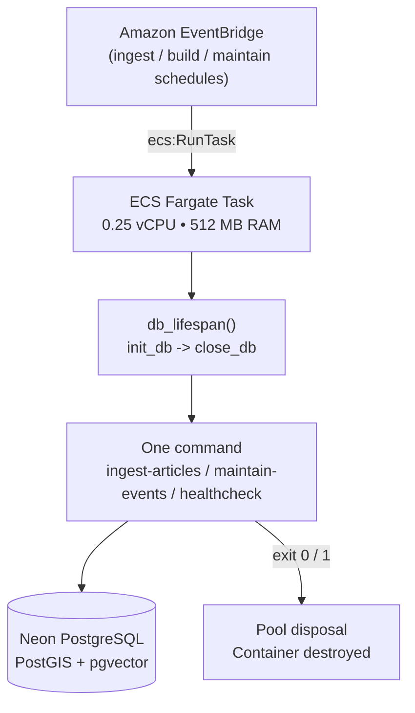
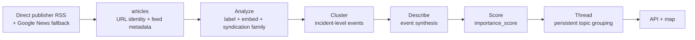
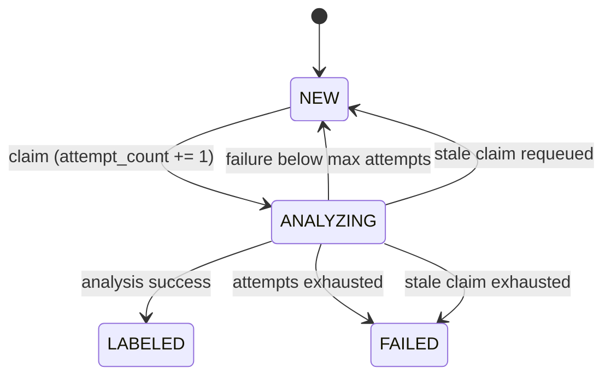

# Hermes Worker — Architecture & Design Rationale

This document describes the worker's execution model, the target news ingestion architecture, and the phases implemented so far. The target stages are implemented incrementally; each section marks what exists today.

---

## 1. Cloud Infrastructure & Ephemeral Execution Model

### Architecture Topology



### Lifecycle of an Ephemeral Execution

1. EventBridge invokes `ecs:RunTask` with one worker command.
2. The container starts, loads typed settings through `pydantic-settings`, and calls `init_db(settings.db_url)` inside `db_lifespan()`.
3. The command opens a `JobContext`, runs its ordered stages, and commits per stage.
4. The context flushes LLM telemetry, disposes the engine pool, and the process exits with `0` on success or `1` on failure.

### Architectural Rationale: Why Ephemeral Compute?

- **Zero idle cost**: No always-on worker fleet or queue daemon. Compute exists only for the scheduled run.
- **Memory reclamation**: A one-shot process returns all memory to the OS; there is no long-lived Python heap to leak.
- **Simple failure model**: A non-zero exit code is the operational signal. Logs carry the stage, counters, and bounded error string.
- **No shadow scheduler**: Cadence belongs to EventBridge (or local cron), not to an internal loop.

---

## 2. Target Ingestion Architecture

> **Status:** Phase 1 provides the job runtime, article claim queue, maintenance, and healthcheck. Phase 2 adds `ingest-articles` and the deduplicated article ledger. Phase 3 adds transient body fetch, article labels, embeddings, and syndication families. Event construction is implemented in later phases.



### 2.1 Command Cadence

| Command | Schedule | Scope | LLM |
| :--- | :--- | :--- | :--- |
| `ingest-articles` | every 15 min | Fetch feeds, write the article ledger, label, embed, and assign syndication families | yes |
| `build-events` | hourly | Cluster articles into events, describe, verify, score, update threads | yes |
| `maintain-events` | daily | Requeue stale claims, lifecycle transitions, retention, consistency checks | no |
| `healthcheck` | on demand | Connectivity, schema, queue depth, stale claims | no |

Phase 1 registers `maintain-events` and `healthcheck`; Phase 2 registers `ingest-articles`. `build-events` is registered when its stages land. There is no feature flag and no parallel legacy path.

### 2.2 Article Ledger and Claim Queue

`articles.ingest_status` is the only work queue:



- Claims use `UPDATE ... WHERE id IN (SELECT ... FOR UPDATE SKIP LOCKED)` and `RETURNING`.
- `attempt_count` is bounded by `ARTICLE_MAX_ATTEMPTS`.
- `maintain-events` requeues `ANALYZING` rows older than `ARTICLE_CLAIM_STALE_MINUTES`.
- A stage commits its own work; `ArticleQueue` never commits. A crash before commit leaves work claimable by the next run.

### 2.2.1 Phase 2 Ingestion Ledger

`ingest-articles` runs a single `INGEST` stage:

1. Sync the `sources` table from `sources.json` in one transaction.
2. Select due active sources, respecting `fetch_interval_minutes` and failure backoff.
3. Fetch feeds with `SOURCE_FETCH_CONCURRENCY` (default `5`).
4. Drop entries older than `ARTICLE_MAX_AGE_HOURS` (default `72`) and clamp future timestamps beyond `ARTICLE_FUTURE_SKEW_HOURS` (default `2`).
5. Canonicalize URLs (`jobs/urls.py`) and insert ledger rows with `ON CONFLICT DO NOTHING`.
6. Record source success/failure health.

The ledger stores `title`, original `url`, `canonical_url`, `canonical_url_hash`, `source_id`, `published_at`, `feed_summary`, and `language`. It does not store article bodies; `feed_content` remains unread and is removed at cleanup.

`canonical_url_hash` has a partial unique index where `duplicate_of_id IS NULL`. Re-running the same feed inserts zero rows. `duplicate_of_id` is reserved for the migration backfill and explicit reconciliation; ingest never sets it.

Source feed metadata is config-owned:

- `feed_provider` is `PUBLISHER`, `GOOGLE_NEWS`, or `GDELT`.
- `fallback_feed_url` is tried only when the primary returns no entries or errors.
- `paywall` and `fetch_policy` drive Phase 3 body fetching; `SUMMARY_ONLY` sources label from `feed_summary`.

### 2.2.2 Phase 3 Analysis

After the ledger insert commits, the same `ingest-articles` run executes the `ANALYZE` stage:

1. Claim up to `ARTICLE_ANALYZE_BATCH_SIZE` `NEW` articles, capped by the remaining LLM budget and `ARTICLE_LABEL_BATCH_SIZE`.
2. Fetch article bodies transiently with `BodyFetcher` when the source policy allows it.
3. Select the labeler text: full body for `FULL_TEXT` sources, otherwise `feed_summary`.
4. Label the batch through the `label` model route, reusing a persisted label when the input hash is unchanged.
5. Apply the deterministic reject gate and persist every label, including rejected ones.
6. Embed accepted labels through the `embed` route.
7. Assign a syndication family by title SimHash, body SimHash, or embedding similarity, then finalize the article as `LABELED`, `REJECTED`, `NEW` (retry), or `FAILED`.

**Transient fetch policy**

- `BodyFetcher` validates every URL and redirect hop, rejecting non-HTTP schemes, credentials, unusual ports, loopback, private, link-local, and reserved addresses before the request.
- It obeys `robots.txt` per host, caps the response at `ARTICLE_FETCH_MAX_BYTES`, limits redirects, and applies per-host concurrency.
- Paywall markers, short bodies, non-HTML content, and HTTP errors fall back to `feed_summary`. A fetched body is never written to the database; only labels, facts, fingerprints, and a bounded `evidence_quote` persist.
- `SUMMARY_ONLY` and paywalled sources never trigger a body request.

**Label contract and reject gate**

The labeler returns one structured object per article: `is_event`, `article_type`, `event_form`, `category`, `specificity`, `consequence`, `certainty`, `fact`, `event_time`, up to three locations, named entities, scale facts, severity, scope, confidence, and `evidence_quote`. Evidence quotes are validated against the supplied text; fabricated spans are dropped. Locations are names only; coordinates are resolved later by the geocoding pipeline.

Reject reasons are recorded on `articles.reject_stage` and `articles.reject_reason`:

- non-event (`is_event = false`) rejects at `LABEL`;
- missing fact, `ANALYSIS` / `FEATURE` / `LISTICLE` / `OPINION`, specificity below 3, or `POLICY_ACTION` specificity below 4 rejects at `GATE`.

**Families**

`article_families` groups near-identical copies so later verification counts independent origins, not repeated syndication. Matching requires the same event window (36 hours) and one of: title SimHash distance ≤ 3, body SimHash distance ≤ 6, or embedding cosine ≥ 0.97. Candidates come from families updated in the last `ARTICLE_FAMILY_WINDOW_DAYS` days, capped at `ARTICLE_FAMILY_MAX_CANDIDATES`.

The embedding vector lives on `articles.embedding` as a deferred column alongside `embedding_model` and `embedding_input_hash`; there is no separate embeddings table. Family matching reads the representative article's vector directly.

### 2.3 Bounded Work and Memory

- Process feeds and articles in bounded batches; never accumulate the full feed set in memory.
- The Fargate task has 512 MB RAM. Feed parsing, embedding requests, and LLM prompts must all have explicit batch limits.
- Network calls are rate-limited (Nominatim 1 req/s; LLM and embedding token buckets).

### 2.4 Grounded Geocoding Shield

LLMs never generate coordinates. They return normalized location names, which `GeocodingService` resolves through OpenStreetMap Nominatim. Results are cached in `geocode_cache`; unresolvable names are stored as negative entries to prevent repeated outbound calls. The service is injected into the job context and shared across stages in one run.

---

## 3. Event, Thread, and Timeline Model

| Entity | Meaning |
| :--- | :--- |
| **Event** | One real-world incident at a place and time. This is the map pin. |
| **Thread** | A persistent topic grouping. Five related events remain five pins, all carrying the thread. |
| **Timeline** | The existing per-event Wikipedia/LLM causality cache. Threads do not generate timelines. |

Threads persist across news cycles:

- `ACTIVE -> DORMANT` after 7 days without a new event.
- `DORMANT -> ENDED` after 30 days.
- A new event on the same topic reactivates a `DORMANT` thread.

Events and threads are not collapsed. Merging is limited to duplicate incidents and is recorded explicitly; there is no automatic splitting in v1.

---

## 4. Verification and Ranking

### 4.1 Syndication Families

Articles are grouped into families by shared syndication origin. Verification is derived from the number and quality of independent families:

| Status | Rule |
| :--- | :--- |
| `SINGLE_SOURCE` | One family only. Visible but capped and badged. |
| `CORROBORATED` | At least two independent families agree. |
| `CONFIRMED` | Corroborated and includes a tier-1 family. |
| `CONFLICTING` | Families disagree on a material fact. |

### 4.2 One Authoritative Score

`importance_score` is the only ranking value. It is recomputed from current evidence, never incremented in place:

```
strength = min(1, sum(max credibility per family) / 9)     # tier1=3, tier2=2, tier3/4=1
impact   = {CRITICAL:1.0, MAJOR:0.8, MODERATE:0.55, MINOR:0.3}
verify   = {CONFIRMED:1.0, CORROBORATED:0.85, SINGLE_SOURCE:0.4, CONFLICTING:0.25}
quality  = clamp(1 - 0.15*(5-specificity) - 0.10*(5-consequence), 0.5, 1.0)

base      = 100 * (0.40*strength + 0.30*impact + 0.15*verify + 0.15*quality)
score     = base * exp(-age_hours / half_life)
half_life = 18h CRITICAL, 36h MAJOR, 72h otherwise
if SINGLE_SOURCE: score = min(score, 45)
```

`score_breakdown` stores the raw value, weight, contribution, freshness multiplier, and cap for each component. Tiers are `PRIMARY >= 55`, `FILLER 30–55`, `DROP < 30`, with ±5 hysteresis. Single-source events remain visible; they never outrank corroborated events unless a short breaking-news override applies.

---

## 5. Job Kernel and Implemented Commands

### 5.1 Modules

```
jobs/
  context.py   JobContext, LlmBudget, Stage, StageStats, WorkerIdentity
  runner.py    ordered stage execution and optional advisory lock
  locks.py     per-command Postgres advisory locks
  queue.py     ArticleQueue claim/mark/fail/requeue
  urls.py      URL canonicalization and ledger hash
  fingerprints.py  token normalization, SimHash, cosine similarity
  fetch.py         SSRF-safe, robots-aware transient body fetcher
  robots.py        per-run robots.txt cache
  labels.py        label payload, gate policy, text selection, hashes
  families.py      syndication-family matching
  commands.py      ingest-articles, maintain-events, healthcheck
  stages/
    ingest.py       source sync, feed fetch, ledger insert, source health
    analyze.py      transient fetch, labels, embeddings, family assignment
    maintenance.py  requeue stale claims + event lifecycle
    healthcheck.py  connectivity, schema, queue depth
```

### 5.2 Command Surface

| Command | Stages registered | Purpose |
| :--- | :--- | :--- |
| `ingest-articles` | `INGEST`, `ANALYZE` | Sync sources, fetch due feeds, write the ledger, then label, embed, and assign families |
| `maintain-events` | `REQUEUE_CLAIMS`, `EVENT_LIFECYCLE` | Recover abandoned claims and apply event decay/transitions |
| `healthcheck` | `HEALTHCHECK` | Read-only readiness probe |

`audit-sources` is a standalone network probe with no database session and no stage. It reports feed status, entry counts, sample URLs, body accessibility, and paywall markers so `sources.json` can be updated from evidence.

`healthcheck` does not take a lock: read-only probes must remain available while maintenance is running. `ingest-articles` and `maintain-events` take their own advisory locks; a second concurrent invocation records `SKIPPED` in logs and exits cleanly.

### 5.3 Execution Record

There is no run-telemetry table. The durable record is:

- Structured logs with stage name, outcome, counters, and a bounded error string.
- Article claim fields (`claimed_at`, `claimed_by`, `attempt_count`, `last_error`).
- The process exit code.

A run-telemetry table is intentionally not part of the design; it duplicated logs without serving a query that domain rows cannot answer. Add one only when a concrete operational query requires it.

### 5.4 Structured LLM Completion

`LlmService.complete_json(...)` adds a schema-repair retry for structured stages while `call_llm(...)` keeps its single-shot behavior for the legacy extractor. Usage accounting (`LlmUsage`) records calls, input/output tokens, and repairs per process.

The worker builds generic `label`, `adjudicate`, and `describe` routes that default to `LLM_MODEL` / `LLM_API` and accept per-task overrides. Every stage reserves calls through `JobContext.budget` before invoking `complete_json`; exceeding `MAX_LLM_CALLS_PER_RUN` fails the stage instead of allowing unbounded spend.

### 5.5 Schema Guard

`healthcheck` verifies:

- `articles.claimed_at`, `claimed_by`, `attempt_count`, `last_error`
- `articles.canonical_url_hash`, `articles.duplicate_of_id`
- Phase 3 article fields: `family_id`, `body_simhash`, `body_source`, `word_count`, `input_quality`, `fetch_http_status`, `reject_stage`, `reject_reason`, `rejected_at`
- Phase 3 label fields: `category`, `event_form`, `specificity`, `consequence`, `certainty`, `reject_reason`, `input_hash`, `evidence_quote`
- `articles.embedding`, `articles.embedding_model`, `articles.embedding_input_hash`
- The `article_families` table
- `sources.fallback_feed_url`, `feed_provider`, `canonical_domain`, `paywall`, `fetch_policy`
- The expanded `ingeststatus` check constraint (`ANALYZING`, `FAILED`)
- The partial indexes `idx_articles_analyzing_claimed_at` and `uq_articles_canonical_url_hash`

A missing migration raises `SchemaCheckError` naming the exact missing object, rather than failing later on an opaque SQL error.

---

## 6. Observability & Langfuse Tracing

- **Opt-in**: Tracing activates only when both Langfuse keys are configured.
- **Structured calls**: `complete_json` runs are traced through the shared `LlmService`; inputs and outputs are not captured for article content.
- **Process tags**: Traces carry `["hermes-worker", ENV]` to separate local runs from production.
- **Flush on exit**: `JobContext.aclose()` calls `LlmService.aclose()`, which flushes the Langfuse client before the container exits.

---

## 7. Failure and Recovery Model

| Failure | Behavior |
| :--- | :--- |
| Stage raises | Runner logs the bounded error and re-raises; process exits `1`. Stage transaction rolls back. |
| Process killed mid-stage | `ANALYZING` claim remains. Next `maintain-events` requeues or fails it based on attempts. |
| Advisory lock held | Second invocation logs `SKIPPED` and exits `0` without mutating state. |
| Schema mismatch | `healthcheck` raises `SchemaCheckError` with the missing object list. |
| LLM budget exhausted | `ANALYZE` stops before the next group, releases the in-flight claims, and exits successfully with `budget_exhausted`; other LLM stages fail the stage. |
| LLM schema mismatch | One repair retry through `complete_json`; a second failure raises `SchemaValidationError`. |
| Telemetry flush failure | Logged as a warning; it does not mask the stage result. |
