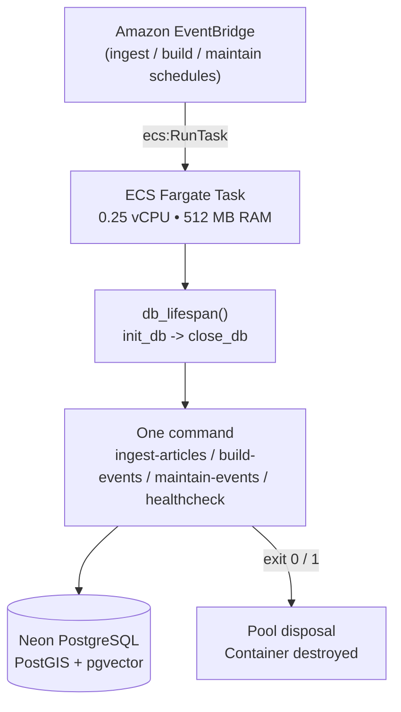
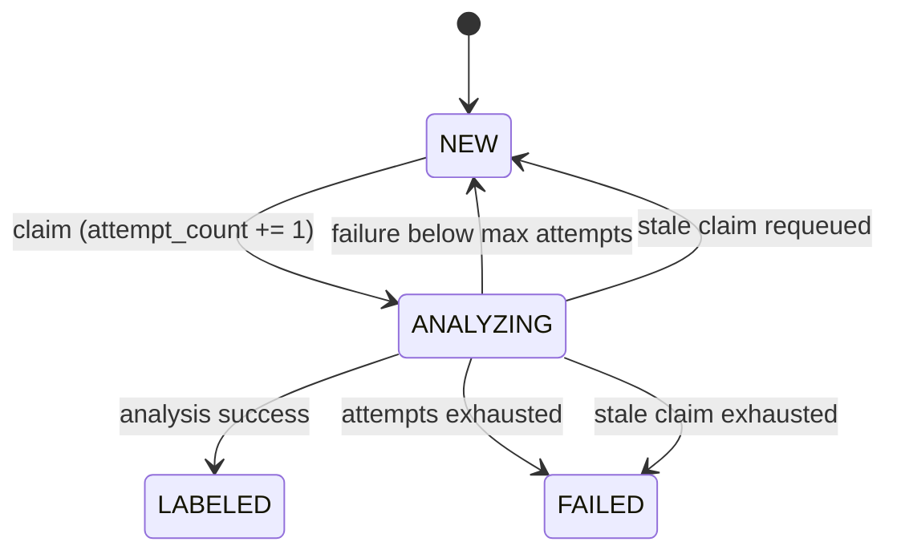

# Hermes Worker — Architecture & Design Rationale

This document describes the worker's execution model, the complete staged ingestion and event construction pipeline, and operational runbooks. All pipeline commands and stages (Phases 1–9 plus pairwise cross-event relationships and actor extraction) are implemented.

---

## 1. Cloud Infrastructure & Ephemeral Execution Model

### Architecture Topology



### Lifecycle of an Ephemeral Execution

1. EventBridge invokes `ecs:RunTask` with one worker command.
2. The container starts, loads typed settings through `pydantic-settings`, and calls `init_db(settings.db_url)` inside `db_lifespan()`.
3. The command opens a `JobContext`, runs its ordered stages, and commits per stage.
4. The context flushes LLM telemetry, disposes the engine pool, and the process exits with `0` on success or `1` on failure.

### Architectural Rationale: Why Ephemeral Compute?

- **Zero idle cost**: No always-on worker fleet or queue daemon. Compute exists only for the scheduled run.
- **Memory reclamation**: A one-shot process returns all memory to the OS; there is no long-lived Python heap to leak.
- **Simple failure model**: A non-zero exit code is the operational signal. Logs carry the stage, counters, and bounded error string.
- **No shadow scheduler**: Cadence belongs to EventBridge (or local cron), not to an internal loop.

---

## 2. Target Ingestion Architecture

```mermaid
flowchart LR
    Feeds["Direct publisher RSS\n+ Google News fallback"] --> Ledger["articles\nURL identity + feed metadata"]
    Ledger --> Analyze["Analyze\nlabel + embed + syndication family"]
    Analyze --> Cluster["Cluster\nincident-level events"]
    Cluster --> Describe["Describe\nevent synthesis"]
    Describe --> Score["Score\nimportance_score"]
    Score --> Reconcile["Reconcile\nduplicate-event merge"]
    Reconcile --> Relationship["Relationship\ntyped cross-event links"]
    Relationship --> Thread["Thread\npersistent topic grouping"]
    Thread --> Serve["API + map"]
```



### 2.1 Command Cadence

| Command | Schedule | Scope | LLM |
| :--- | :--- | :--- | :--- |
| `ingest-articles` | every 15 min | Fetch feeds, write the article ledger, label, embed, and assign syndication families | yes |
| `build-events` | hourly | Cluster articles into events, describe, verify, score, merge duplicates, discover pairwise relationships, update threads | yes |
| `maintain-events` | daily | Requeue stale claims, lifecycle transitions, retention, consistency checks | no |
| `healthcheck` | on demand | Connectivity, schema, queue depth, stale claims | no |

All four scheduled commands (`ingest-articles`, `build-events`, `maintain-events`, `healthcheck`) plus standalone utilities (`audit-sources`, `reset-db`) are implemented. There is no feature flag and no parallel legacy path.

### 2.2 Article Ledger and Claim Queue

`articles.ingest_status` is the only work queue:



- Claims use `UPDATE ... WHERE id IN (SELECT ... FOR UPDATE SKIP LOCKED)` and `RETURNING`.
- `attempt_count` is bounded by `ARTICLE_MAX_ATTEMPTS`.
- `maintain-events` requeues `ANALYZING` rows older than `ARTICLE_CLAIM_STALE_MINUTES`.
- A stage commits its own work; `ArticleQueue` never commits. A crash before commit leaves work claimable by the next run.

### 2.2.1 Phase 2 Ingestion Ledger

`ingest-articles` runs a single `INGEST` stage:

1. Sync the `sources` table from `sources.json` in one transaction.
2. Select due active sources, respecting `fetch_interval_minutes` and failure backoff.
3. Fetch feeds with `SOURCE_FETCH_CONCURRENCY` (default `5`).
4. Drop entries older than `ARTICLE_MAX_AGE_HOURS` (default `72`) and clamp future timestamps beyond `ARTICLE_FUTURE_SKEW_HOURS` (default `2`).
5. Canonicalize URLs (`jobs/urls.py`) and insert ledger rows with `ON CONFLICT DO NOTHING`.
6. Record source success/failure health.

The ledger stores `title`, original `url`, `canonical_url`, `canonical_url_hash`, `source_id`, `published_at`, `feed_summary`, and `language`. Raw article bodies are processed transiently in memory and never persisted to disk.

`canonical_url_hash` has a partial unique index where `duplicate_of_id IS NULL`. Re-running the same feed inserts zero rows. `duplicate_of_id` is reserved for the migration backfill and explicit reconciliation; ingest never sets it.

Source feed metadata is config-owned:

- `feed_provider` is `PUBLISHER`, `GOOGLE_NEWS`, or `GDELT`.
- `fallback_feed_url` is tried only when the primary returns no entries or errors.
- `paywall` and `fetch_policy` drive Phase 3 body fetching; `SUMMARY_ONLY` sources label from `feed_summary`.

### 2.2.2 Phase 3 Analysis

After the ledger insert commits, the same `ingest-articles` run executes the `ANALYZE` stage:

1. Claim up to `ARTICLE_ANALYZE_BATCH_SIZE` `NEW` articles, capped by the remaining LLM budget and `ARTICLE_LABEL_BATCH_SIZE`.
2. Fetch article bodies transiently with `BodyFetcher` when the source policy allows it.
3. Select the labeler text: full body for `FULL_TEXT` sources, otherwise `feed_summary`.
4. Label the batch through the `label` model route, reusing a persisted label when the input hash is unchanged.
5. Apply the deterministic reject gate and persist every label, including rejected ones.
6. Embed accepted labels through the `embed` route.
7. Assign a syndication family by title SimHash, body SimHash, or embedding similarity, then finalize the article as `LABELED`, `REJECTED`, `NEW` (retry), or `FAILED`.

**Transient fetch policy**

- `BodyFetcher` validates every URL and redirect hop, rejecting non-HTTP schemes, credentials, unusual ports, loopback, private, link-local, and reserved addresses before the request.
- It obeys `robots.txt` per host, caps the response at `ARTICLE_FETCH_MAX_BYTES`, limits redirects, and applies per-host concurrency.
- Paywall markers, short bodies, non-HTML content, and HTTP errors fall back to `feed_summary`. A fetched body is never written to the database; only labels, facts, fingerprints, and a bounded `evidence_quote` persist.
- `SUMMARY_ONLY` and paywalled sources never trigger a body request.

**Label contract and reject gate**

The labeler returns one structured object per article: `is_event`, `article_type`, `event_form`, `category`, `specificity`, `consequence`, `certainty`, `fact`, `event_time`, up to three locations, named entities, scale facts, severity, scope, confidence, and `evidence_quote`. Evidence quotes are validated against the supplied text; fabricated spans are dropped. Locations are names only; coordinates are resolved later by the geocoding pipeline.

Reject reasons are recorded on `articles.reject_stage` and `articles.reject_reason`:

- non-event (`is_event = false`) rejects at `LABEL`;
- missing fact, `ANALYSIS` / `FEATURE` / `LISTICLE` / `OPINION`, specificity below 3, or `POLICY_ACTION` specificity below 4 rejects at `GATE`.

**Families**

`article_families` groups near-identical copies so later verification counts independent origins, not repeated syndication. Matching requires the same event window (36 hours) and one of: title SimHash distance ≤ 3, body SimHash distance ≤ 6, or embedding cosine ≥ 0.97. Candidates come from families updated in the last `ARTICLE_FAMILY_WINDOW_DAYS` days, capped at `ARTICLE_FAMILY_MAX_CANDIDATES`.

The embedding vector lives on `articles.embedding` as a deferred column alongside `embedding_model` and `embedding_input_hash`; there is no separate embeddings table. Family matching reads the representative article's vector directly.

### 2.3 Bounded Work and Memory

- Process feeds and articles in bounded batches; never accumulate the full feed set in memory.
- The Fargate task has 512 MB RAM. Feed parsing, embedding requests, and LLM prompts must all have explicit batch limits.
- Network calls are rate-limited (Nominatim 1 req/s; LLM and embedding token buckets).

### 2.4 Grounded Geocoding Shield

LLMs never generate coordinates. They return normalized location names, which `GeocodingService` resolves through OpenStreetMap Nominatim. Results are cached in `geocode_cache`; unresolvable names are stored as negative entries to prevent repeated outbound calls. The service is injected into the job context and shared across stages in one run.

---

## 3. Event, Thread, and Timeline Model

| Entity | Meaning |
| :--- | :--- |
| **Event** | One real-world incident at a place and time. This is the map pin. |
| **Thread** | A persistent topic grouping. Five related events remain five pins, all carrying the thread. |
| **Timeline** | The existing per-event Wikipedia/LLM causality cache. Threads do not generate timelines. |

Threads persist across news cycles:

- `ACTIVE -> DORMANT` after 7 days without a new event.
- `DORMANT -> ENDED` after 30 days.
- A new event on the same topic reactivates a `DORMANT` thread.

Events and threads are not collapsed. Merging is limited to duplicate incidents and is recorded explicitly; there is no automatic splitting in v1.

---

## 4. Verification and Ranking

### 4.1 Syndication Families

Articles are grouped into families by shared syndication origin. Verification is derived from the number and quality of independent families:

| Status | Rule |
| :--- | :--- |
| `SINGLE_SOURCE` | One independent origin group or family only. Visible but capped (`65.0`) unless breaking-news override applies. |
| `CORROBORATED` | At least two independent origin groups agree (without `CONFIRMED` certainty). |
| `CONFIRMED` | At least two independent origin groups agree AND at least one member carries `certainty == CONFIRMED`. |
| `CONFLICTING` | Any member article reports `certainty == DISPUTED`. |

### 4.2 One Authoritative Score

`importance_score` is the only ranking value. It is recomputed from current evidence, never incremented in place:

```
strength = min(1, sum(max credibility per family) / 9)     # tier1=3, tier2=2, tier3/4=1
impact   = {CRITICAL:1.0, MAJOR:0.8, MODERATE:0.55, MINOR:0.3}
verify   = {CONFIRMED:1.0, CORROBORATED:0.85, SINGLE_SOURCE:0.75, CONFLICTING:0.5}
quality  = clamp(1 - 0.15*(5-specificity) - 0.10*(5-consequence), 0.5, 1.0)

base      = 100 * (0.40*strength + 0.30*impact + 0.15*verify + 0.15*quality)
score     = base * exp(-age_hours / half_life)
half_life = 18h CRITICAL, 36h MAJOR, 96h otherwise
if SINGLE_SOURCE: score = min(score, 65)
```

`score_breakdown` stores the raw value, weight, contribution, freshness multiplier, and cap for each component. Tiers are `PRIMARY >= 50`, `FILLER 22–50`, `DROP < 22`, with ±5 hysteresis. Single-source events remain visible; they never outrank corroborated events unless a short breaking-news override applies.

---

## 5. Job Kernel and Commands

### 5.1 Modules

```
jobs/
  actors.py         normalized actor labels and coordinates
  context.py        JobContext, LlmBudget, Stage, StageStats, WorkerIdentity
  runner.py         ordered stage execution and optional advisory lock
  errors.py         error formatting helpers
  locks.py          per-command Postgres advisory locks
  queue.py          ArticleQueue claim/mark/fail/requeue
  urls.py           URL canonicalization and ledger hash
  fingerprints.py   token normalization, SimHash, cosine similarity
  fetch.py          SSRF-safe, robots-aware transient body fetcher
  robots.py         per-run robots.txt cache
  labels.py         label payload, gate policy, text selection, hashes
  families.py       syndication-family matching
  pair_score.py     article-pair and event-pair scoring, vetoes, bands
  commands.py       ingest-articles, build-events, maintain-events, healthcheck
  stages/
    ingest.py       source sync, feed fetch, ledger insert, source health
    analyze.py      transient fetch, labels, embeddings, family assignment
    cluster.py      incident clustering, adjudication, verification
    describe.py     event synthesis, actor extraction, geocoding
    score.py        importance score recompute for all active events
    reconcile.py    event merge deduplication, gray adjudication
    relationship.py pairwise cross-event relationship classification and upsert
    thread.py       thread assignment, candidate scoring, creation
    maintenance.py  stale claims, event lifecycle, thread lifecycle,
                    count reconciliation, retention, consistency report
    healthcheck.py  connectivity, schema, queue depth, stale claims
```

### 5.2 Command Surface

| Command | Stages | Purpose | LLM | Lock |
| :--- | :--- | :--- | :--- | :--- |
| `ingest-articles` | `INGEST`, `ANALYZE` | Sync sources, write ledger, label, embed, assign families | yes | yes |
| `build-events` | `CLUSTER`, `DESCRIBE`, `SCORE`, `RECONCILE`, `RELATIONSHIP`, `THREAD` | Cluster → synthesize → score → merge duplicate events → discover pairwise relationships → thread | yes | yes |
| `maintain-events` | `REQUEUE_CLAIMS`, `EVENT_LIFECYCLE`, `THREAD_LIFECYCLE`, `MAINTENANCE` | Recover claims, lifecycle transitions, retention, consistency report | no | yes |
| `healthcheck` | `HEALTHCHECK` | Read-only readiness probe | no | no |

`audit-sources` is a standalone network probe with no database session and no stage. It reports feed status, entry counts, sample URLs, body accessibility, and paywall markers so `sources.json` can be updated from evidence.

`healthcheck` does not take a lock — read-only probes must remain available while maintenance is running. `ingest-articles`, `build-events`, and `maintain-events` take per-command advisory locks; a concurrent second invocation logs `SKIPPED` and exits `0`.

### 5.3 Execution Record

There is no run-telemetry table. The durable record is:

- Structured logs with stage name, outcome, counters, and a bounded error string.
- Article claim fields (`claimed_at`, `claimed_by`, `attempt_count`, `last_error`).
- The process exit code.

A run-telemetry table is intentionally not part of the design; it duplicated logs without serving a query that domain rows cannot answer. Add one only when a concrete operational query requires it.

### 5.4 Structured LLM Completion

`LlmService.complete_json(...)` adds a schema-repair retry for structured stages. Usage accounting (`LlmUsage`) records calls, input/output tokens, and repairs per process.

The worker builds generic `extractor`, `label`, `adjudicate`, `describe`, `relationship`, and `thread` routes that default to `LLM_MODEL` / `LLM_API` (and `LLM_MODEL_KWARGS`, with `LLM_REQUEST_TIMEOUT_SECONDS = 120.0`) and accept per-task overrides (`LABEL_MODEL/API/KWARGS`, `ADJUDICATE_MODEL/API/KWARGS`, `DESCRIBE_MODEL/API/KWARGS`, `RELATIONSHIP_MODEL/API/KWARGS`, `THREAD_MODEL/API/KWARGS`). Every stage reserves calls through `JobContext.budget` before invoking `complete_json`; exceeding `MAX_LLM_CALLS_PER_RUN` stops the stage cleanly and leaves remaining work queued.

### 5.5 Schema Guard

`healthcheck` verifies:

- `articles.claimed_at`, `claimed_by`, `attempt_count`, `last_error`
- `articles.canonical_url_hash`, `articles.duplicate_of_id`
- Phase 3 article fields: `family_id`, `body_simhash`, `body_source`, `word_count`, `input_quality`, `fetch_http_status`, `reject_stage`, `reject_reason`, `rejected_at`
- Phase 3 label fields: `category`, `event_form`, `specificity`, `consequence`, `certainty`, `reject_reason`, `input_hash`, `evidence_quote`
- `articles.embedding`, `articles.embedding_model`, `articles.embedding_input_hash`
- The `article_families` table
- `sources.fallback_feed_url`, `feed_provider`, `canonical_domain`, `paywall`, `fetch_policy`
- The expanded `ingeststatus` check constraint (`ANALYZING`, `FAILED`)
- The partial indexes `idx_articles_analyzing_claimed_at` and `uq_articles_canonical_url_hash`

A missing migration raises `SchemaCheckError` naming the exact missing object, rather than failing later on an opaque SQL error.

---

## 6. Clustering, Scoring, and Merge Pipeline (Phases 4–7)

### 6.1 Article-to-Event Clustering (Phase 4)

The `CLUSTER` stage groups `LABELED` articles into incident-level events using a pair-score with hard vetoes.

**Pair score** (article → event, `score_pair` in `pair_score.py`):

```
score = 0.40 * embedding_cosine
      + 0.20 * entity_jaccard
      + 0.15 * location_compatibility
      + 0.15 * time_proximity          # 48h half-life
      + 0.10 * action_token_overlap
```

**Hard vetoes** (immediately score 0):

- Incompatible `event_form` values (e.g. `INCIDENT` vs. `PLANNED_EVENT`).
- Conflicting specific locations > 100 km apart with different admin regions.
- Time delta > 7 days.
- Non-empty, disjoint top entity sets.

**Bands**:

| Score | Action |
| :--- | :--- |
| ≥ 0.80 | Auto-attach to event |
| 0.60–0.80 | Batched LLM adjudication (10 pairs/call, cached by `pair_hash`, max `EVENT_CLUSTER_LLM_PAIRS_PER_RUN`) |
| < 0.60 or `UNSURE` | Separate event |

Candidate events come from: ANN top-20 by embedding + same-country block; total candidate cap `EVENT_CLUSTER_CANDIDATE_CAP` (default 40). Each article is processed in `event_time` order within the wave; provisional new events are kept in memory so the next article in the wave can land in the same cluster before commit.

**On attach**: `event_members` row inserted, `articles.event_id` updated, event centroid recomputed (weighted mean), counts incremented, `member_hash` cleared (triggering describe), `latest_published_at` updated. Verification is recomputed from family membership.

### 6.2 Event Synthesis (Phase 5 + Actors)

The `DESCRIBE` stage synthesizes a unified description and structured actor list for every event whose `member_hash` is unset (i.e., membership changed since last describe).

- Input: up to `EVENT_DESCRIBE_MAX_FAMILIES` (default 8) independent family facts, source, published time, entities, locations, scale facts.
- Output: headline ≤ 120 chars, summary ≤ 900 chars, up to `MAX_LOCATIONS = 3` locations, impact, scope, and up to `MAX_ACTORS = 6` key actors (`name`, `kind`: `STATE`/`ORGANIZATION`/`PERSON`/`GROUP`, `role`: `ACTOR`/`TARGET`/`PARTICIPANT`, plus optional home location).
- Numeric fidelity: every number in the output must appear in the input; one retry; fallback to template headline on second failure.
- Grounded Geocoding: primary event location and up to `MAX_ACTOR_GEOCODES = 3` cross-border actor home locations are resolved through the shared `GeocodingService` instance (never LLM coordinates). Only a changed location triggers a geocoder call.
- `member_hash` is set after success; `event.version` bumps only on a material field change.

### 6.3 Importance Scoring (Phase 5)

The `SCORE` stage recomputes `importance_score` for all active events in pages of `EVENT_SCORE_PAGE_SIZE` (default 500). Score is never incremented — always a full recomputation.

Formula (from `event_scoring.py`):

```
strength = min(1, Σ(max credibility per family) / 9)
           # TIER_1=3.0, TIER_2=2.0, TIER_3/4=1.0

impact   = {CRITICAL:1.0, MAJOR:0.8, MODERATE:0.55, MINOR:0.3}
verify   = {CONFIRMED:1.0, CORROBORATED:0.85, SINGLE_SOURCE:0.75,
            CONFLICTING:0.5, UNVERIFIED:0.0}
quality  = clamp(1 - 0.15*(5-specificity) - 0.10*(5-consequence), 0.5, 1.0)

base     = 100 * (0.40*strength + 0.30*impact + 0.15*verify + 0.15*quality)
score    = base * exp(-age_hours / half_life)
half_life = 18h (CRITICAL), 36h (MAJOR), 96h (otherwise)

if SINGLE_SOURCE: score = min(score, 65)      # single-source cap

breaking override: age ≤ 2h AND article_type=BREAKING AND impact ≥ MAJOR
                   AND score ≥ 35 → bypass DROP/FILLER tiers to PRIMARY
```

`score_breakdown` JSONB stores value, weight, contribution, freshness multiplier, and cap flag per component.

**Selection tiers** (with ±5 hysteresis):

| Tier | Score |
| :--- | :--- |
| `PRIMARY` | ≥ 50 |
| `FILLER` | 22–50 |
| `DROP` | < 22 |

`DROP` events are excluded from API results. Single-source events are always visible; they never outrank corroborated events unless the breaking override applies.

**Event lifecycle**:

- `ACTIVE → STALE` after 96h since `latest_published_at`.
- `STALE → ARCHIVED` after 240h (10 days).
- A new member on a `STALE` event reactivates it to `ACTIVE`.
- `ARCHIVED` events are not clustering candidates.

Timeline cache: `event_timelines.event_version` is compared to `events.version` before returning; a mismatch triggers regeneration.

### 6.4 Story Threads (Phase 6)

The `THREAD` stage assigns events to persistent topic groups.

**Candidate ranking** (`ThreadService.ranked_candidates`):

```
score = 0.70 * embedding_cosine + 0.30 * entity_jaccard
```

`ThreadService.candidates` loads up to `THREAD_CANDIDATE_LIMIT` (default `100`) `ACTIVE` and `DORMANT` threads ordered by `last_event_at DESC`, and `ranked_candidates` scores and sorts them in Python so entity blocking does not require a dedicated JSONB index.

**Assignment bands**:

| Score | Action |
| :--- | :--- |
| ≥ 0.85 | Auto-assign to thread |
| 0.70–0.85 | Batched LLM adjudication (cached by `pair_hash`, max `THREAD_LLM_PAIRS_PER_RUN`) |
| < 0.70 | No assignment |

Thread creation: when ≥ `THREAD_MIN_GROUP` (default 2) unthreaded events share the same entity pair, a new thread is created with `kind=DEVELOPING` or `kind=TOPIC`.

**Thread lifecycle** (`run_lifecycle` in `ThreadService`):

- `ACTIVE → DORMANT` after `THREAD_DORMANT_DAYS` (7) days without a new event.
- `DORMANT → ENDED` after `THREAD_ENDED_DAYS` (30) days.
- A new event reactivates a `DORMANT` thread.

Thread importance: max member `importance_score` decayed by `THREAD_IMPORTANCE_HALF_LIFE_HOURS` (168h, ~7 days) since `last_event_at`.

### 6.5 Event Merge / Reconciliation (Phase 7)

The `RECONCILE` stage detects and merges duplicate events that survived clustering as separate pins.

**Merge pair score** (`score_event_pair` in `pair_score.py`):

```
base = 0.58 * embedding_cosine
     + 0.18 * entity_jaccard
     + 0.11 * location_compatibility
     + 0.08 * time_proximity
     + 0.05 * category_match
score = min(1.0, base + 0.04 * family_overlap)
```

Hard vetoes: > 7 days, > 100 km + different country (bypassed to compatible for same-country `COUNTRY`/`GLOBAL` vs `CITY` scopes when distance exceeds 100 km), and disjoint top entities (soft multi-token matching via `_entities_compatible`, bypassed when `embedding_cosine >= 0.86`).

**Merge bands**:

| Score | Action |
| :--- | :--- |
| ≥ 0.90 | Auto-merge |
| 0.74–0.90 | Batched LLM adjudication (max `EVENT_MERGE_LLM_PAIRS_PER_RUN`) |
| < 0.74 | No merge |

Decisions are cached in `cluster_decisions` keyed by sorted event IDs + both `member_hash` values + prompt version.

**Survivor selection**: more members wins; on a tie, the older event wins. Loser members are reassigned to survivor; loser is marked `MERGED` with a redirect (`merged_into_id`), and `EventMergeService` deletes direct survivor↔loser edges and repoints third-party `event_relationships` rows to the survivor. The API resolves redirect chains; events are never deleted. Merge clears survivor `member_hash` (triggering a re-describe) and bumps `version` on both.

#### Pairwise Event Relationships (`RELATIONSHIP` stage)

After duplicate merges settle in `RECONCILE`, `RelationshipStage` recalls distinct active/stale non-dropped event pairs within `RELATIONSHIP_WINDOW_DAYS` (default `10`) using:
1. pgvector ANN similarity (`>= RELATIONSHIP_MIN_EMBEDDING_SIM`, default `0.62`, up to `RELATIONSHIP_NEIGHBORS_PER_EVENT = 8` per anchor),
2. Shared extracted actors (`MAX_ACTOR_NEIGHBORS_PER_EVENT = 6` per anchor), and
3. Soft shared-entity fallback without country restrictions (pairs sharing only 1 entity require embedding cosine `>= 0.50` when both vectors share a model).

Pairs not already upserted or cached in `cluster_decisions` (keyed by `"rel|<id1>|<id2>|<hash1>|<hash2>|<prompt_version>"`, capped at `RELATIONSHIP_LLM_PAIRS_PER_RUN = 30`) are classified via `HermesAi.relationships` into `CAUSED`, `FOLLOW_UP`, `REACTION`, `RELATED`, `SAME_INCIDENT`, or `NONE`. Confidence-gated relationships (`>= RELATIONSHIP_MIN_CONFIDENCE = 0.70`) persist to `event_relationships`, while high-confidence `SAME_INCIDENT` classifications trigger guarded `_try_auto_merge_same_incident` merges followed by survivor rescoring and thread recomputation.

### 6.6 Maintenance (Phase 7)

`maintain-events` runs four stages daily:

1. **`REQUEUE_CLAIMS`**: Returns `ANALYZING` articles older than `ARTICLE_CLAIM_STALE_MINUTES` to `NEW` (up to `ARTICLE_MAX_ATTEMPTS`; then `FAILED`).
2. **`EVENT_LIFECYCLE`**: Applies `ACTIVE → STALE → ARCHIVED` transitions, purges `events.embedding` (`EventLifecycleService.purge_archived_embeddings`) for events archived > 30 days.
3. **`THREAD_LIFECYCLE`**: Applies `ACTIVE → DORMANT → ENDED` transitions for story threads.
4. **`MAINTENANCE`**: Reconciles `article_count`, `source_count`, `family_count`, `independent_origin_count` from `event_members`; applies retention; produces consistency report.

**Retention schedule**:

| Data | Retention |
| :--- | :--- |
| `cluster_decisions` | 90 days |
| Removed `event_members` (`is_current=false`) | 180 days |
| `events.embedding` (`embedding_model`) for archived events | 30 days after archive |
| Article metadata and labels | Forever (audit evidence) |

**Reprocessing**: `maintain-events --requeue --since <YYYY-MM-DD>` resets `FAILED`/`REJECTED` articles published on or after that date back to `NEW`.

---

## 7. Observability & Langfuse Tracing

- **Opt-in**: Tracing activates only when both Langfuse keys are configured.
- **Structured calls**: `complete_json` runs are traced through the shared `LlmService`; inputs and outputs are not captured for article content.
- **Process tags**: Traces carry `["hermes-worker", ENV]` to separate local runs from production.
- **Flush on exit**: `JobContext.aclose()` calls `LlmService.aclose()`, which flushes the Langfuse client before the container exits.

---

## 8. Failure and Recovery Model

| Failure | Behavior |
| :--- | :--- |
| Stage raises | Runner logs the bounded error and re-raises; process exits `1`. Stage transaction rolls back. |
| Process killed mid-stage | `ANALYZING` claim remains. Next `maintain-events` requeues or fails it based on attempts. |
| Advisory lock held | Second invocation logs `SKIPPED` and exits `0` without mutating state. |
| Schema mismatch | `healthcheck` raises `SchemaCheckError` with the missing object list. |
| LLM budget exhausted | `ANALYZE` stops before the next group, releases in-flight claims, exits successfully with `budget_exhausted`; other LLM stages fail the stage. |
| LLM schema mismatch | One repair retry through `complete_json`; a second failure raises `SchemaValidationError`. |
| Telemetry flush failure | Logged as a warning; does not mask the stage result. |
| Feed outage | `fallback_feed_url` is tried when primary returns no entries or errors. Source health is updated; failing sources are deprioritized. |
| Geocoder outage | `GeocodingService` returns cached entries first; network failures produce `None` (no location set). Rate limit: 1 req/s enforced by token bucket in `hermes-ai`. |
| LLM rate limit | `complete_json` respects the RPM/TPM token bucket. Budget exhaustion stops the stage; remaining work queued for the next run. |

---

## 9. Operations Runbook

### 9.1 Stuck Queue

**Symptom**: Articles stuck in `ANALYZING` > 30 minutes; `healthcheck` reports stale claims.

**Resolution**:
1. Run `npx nx run hermes-worker:healthcheck` to confirm the count.
2. Run `npx nx run hermes-worker:maintain-events` — the `REQUEUE_CLAIMS` stage requeues stale claims automatically.
3. If claims keep sticking, check worker logs for `ANALYZE` stage errors; the `last_error` column on affected articles contains the bounded error string.

### 9.2 Feed Outage

**Symptom**: Zero new articles inserted; `ingest-articles` logs show fetch errors.

**Resolution**:
1. Run `npx nx run hermes-worker:audit-sources` to identify which feeds are failing.
2. If the primary feed is unavailable, check whether `fallback_feed_url` is configured in `sources.json`. If not, add one and re-seed via `SourceService.seed_sources`.
3. Paywalled sources that block body fetching automatically fall back to `SUMMARY_ONLY`; no intervention needed.

### 9.3 LLM Budget Exhaustion

**Symptom**: `build-events` or `ingest-articles` logs `budget_exhausted`; LLM calls per run hit `MAX_LLM_CALLS_PER_RUN`.

**Resolution**:
1. The stage stops cleanly; remaining articles/events are queued for the next scheduled run. No action required for a single occurrence.
2. If systematic, raise `MAX_LLM_CALLS_PER_RUN` in settings (requires approval) or reduce batch sizes (`ARTICLE_LABEL_BATCH_SIZE`, `EVENT_CLUSTER_ADJUDICATION_BATCH_SIZE`).
3. Check Langfuse for token counts; if the model is producing verbose outputs, tighten the system prompt.

### 9.4 Geocoder Outage

**Symptom**: Events missing `location`; `describe.py` logs geocoding failures.

**Resolution**:
1. The describe stage skips geocoding for `None` results and leaves the location unchanged. The event is still published with its previous location.
2. When Nominatim recovers, the next `build-events` run will geocode events whose `member_hash` has changed (triggering a re-describe).
3. Never call Nominatim directly; always go through `GeocodingService` to enforce the 1 req/s token bucket and cache.

### 9.5 Rollback Procedure

**Scenario**: A bad deployment causes stage errors or data corruption.

1. Revert to the previous Docker image tag in ECS.
2. Because all migrations through Phase 7 are additive (backward-compatible), no migration rollback is needed unless the Phase 9 cleanup migration has run.
3. If Phase 9 cleanup has run (`trending_score` etc. columns dropped), restore the pre-cutover RDS snapshot; there is no non-destructive rollback path.
4. Run `healthcheck` after revert to confirm schema compatibility.

---

## 10. Historical Cutover Reference Checklist

> **Policy**: Operational cutover runbook reference (historical production cutover steps; Alembic head has since advanced to `219faff153a6`). No schema steps run against production without explicit approval.

### Pre-Cutover

- [ ] Restore a recent production dump locally; run `alembic upgrade head` through Phase 7 (`e7f8a9b0c1d2`); skip Phase 9 (`f8a9b0c1d2e3`) until after soak.
- [ ] Run the full pipeline locally against the restored dump: `ingest-articles` then `build-events`; verify events, scores, verification, threads.
- [ ] Confirm source audit report; update `sources.json` from evidence if needed.
- [ ] Confirm acceptance metrics on the eval corpus (pairwise cluster precision ≥ 0.90, recall ≥ 0.80, duplicate rate ≤ 5%).
- [ ] Schedule a low-traffic window (weekend late night).

### Cutover Steps

1. Freeze the old scheduler (stop EventBridge rules).
2. Take a database snapshot.
3. Deploy new worker/API/UI image.
4. Run `alembic upgrade e7f8a9b0c1d2` (Phases 1–7 only; defer Phase 9).
5. Truncate derived tables: `article_labels`, `article_families`, `events`, `threads`, `event_members`, `event_timelines`, `cluster_decisions`. Keep `sources`, `geocode_cache`, and `articles` metadata.
6. Reset source health: `UPDATE sources SET last_fetched_at = NULL, consecutive_failures = 0, last_error = NULL`.
7. Run one `ingest-articles` manually; verify article ledger.
8. Run one `build-events` manually; verify events, scores, threads, verification badges.
9. Enable schedules: `ingest-articles` every 15 min, `build-events` hourly, `maintain-events` daily.
10. Monitor for 24 hours (see below).

### Monitoring Checklist (First 24h)

- Queue depth and stuck `ANALYZING` articles.
- Ingest/insert/duplicate/reject rates per `ingest-articles` run.
- Events/hour, clusters/hour, merges from `build-events`.
- LLM calls/tokens vs. `MAX_LLM_CALLS_PER_RUN`.
- Geocoder 1 req/s — no Nominatim rate-limit warnings.
- Top-10 events: no stale single-source events older than 2h.
- API latency and map render time.
- `maintain-events` consistency report: zero count drift expected after first run.
