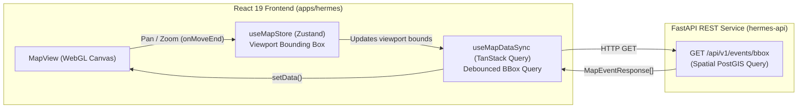

# Hermes Web Client (`@hermes/hermes`)

[](https://react.dev)
[](https://reactrouter.com)
[](https://tailwindcss.com)
[](https://docs.mapbox.com/mapbox-gl-js/)
[](https://clerk.com)
[](https://vitejs.dev)

The `@hermes/hermes` application is the React 19 frontend shell for the Hermes geospatial intelligence platform, deployed in production on Vercel at [hermes-eight-inky.vercel.app](https://hermes-eight-inky.vercel.app). It provides the user interface for monitoring global events through an interactive WebGL map, managing user authentication, and exploring historical event lineages.

---

## Architecture & Responsibilities

In accordance with workspace architectural invariants, `apps/hermes` operates as an **ultra-thin routing and provider composition shell**:

- **Shell Scope (<20%)**: Manages top-level routes ([`app/routes.tsx`](file:///home/pavan/proj/hermes/apps/hermes/app/routes.tsx)), root document layout and middleware ([`app/root.tsx`](file:///home/pavan/proj/hermes/apps/hermes/app/root.tsx)), server-side route loaders, environment variable injection, and toolchain configurations.
- **Library Scope (>80%)**: All heavy domain logic, WebGL canvas lifecycle management, Mapbox layer rendering, Zustand telemetry stores, and tactical UI primitives are isolated within workspace libraries ([`libs/map`](file:///home/pavan/proj/hermes/libs/map), [`libs/shared/ui-components`](file:///home/pavan/proj/hermes/libs/shared/ui-components), and [`libs/shared/util-types`](file:///home/pavan/proj/hermes/libs/shared/util-types)).

> [!NOTE]
> For a deep dive into the server rendering mechanics, dynamic WebGL isolation, and design decisions, see [apps/hermes/docs/architecture.md](docs/architecture.md).

---

## Route Structure

Routes are declared in [`app/routes.tsx`](file:///home/pavan/proj/hermes/apps/hermes/app/routes.tsx) using the React Router 8 file and route configuration:

| Route Path | Module | Access Level | Description |
| :--- | :--- | :--- | :--- |
| `/` | [`app/routes/landing.tsx`](file:///home/pavan/proj/hermes/apps/hermes/app/routes/landing.tsx) | Public | Operational landing page introducing platform capabilities, problem statement, and launch entry points. |
| `/map` | [`app/routes/map.tsx`](file:///home/pavan/proj/hermes/apps/hermes/app/routes/map.tsx) | Protected | The primary tactical map interface. Hosts the WebGL Mapbox canvas, event clusters, detail popups, and the timeline lineage drawer. |
| `/auth/*` | [`app/routes/auth.tsx`](file:///home/pavan/proj/hermes/apps/hermes/app/routes/auth.tsx) | Public / Flow | Multi-step authentication workflow (Email, OTP, Password, Setup, and SSO callbacks) powered by Clerk. |

---

## Server-Side Rendering (SSR) & WebGL Isolation

The application is configured with `ssr: true` in [`react-router.config.ts`](file:///home/pavan/proj/hermes/apps/hermes/react-router.config.ts), executing within a Node.js server environment in production.

### 1. Server-Side Access Control
Authentication is verified server-side inside route loaders using Clerk's `getAuth` before rendering the document shell:
- Requests to `/map` without an active session are redirected server-side to `/auth`, eliminating unauthenticated UI flashes.
- Authenticated requests visiting `/auth` are automatically redirected to `/map`.

### 2. Client-Only WebGL Dynamic Boundary
Mapbox GL JS requires browser globals (`window`, `document`, and WebGL contexts) that do not exist during Node.js server execution. To maintain SSR compatibility without hydration failures:
- [`MapView`](file:///home/pavan/proj/hermes/libs/map/src/lib/ui/map-view.tsx) and its configuration provider are wrapped in a dynamic `React.lazy` container within [`app/routes/map.tsx`](file:///home/pavan/proj/hermes/apps/hermes/app/routes/map.tsx).
- A `<Suspense fallback={<MapLoadingFallback />}>` boundary renders a lightweight animated placeholder while the client hydrates and loads the Mapbox bundle.

---

## Data Synchronization & State Architecture



- **Single Source of Truth**: Viewport coordinates (`north`, `south`, `east`, `west`), event selection (`selectedEventId`), and timeline mode (`isTlMode`) reside in [`useMapStore`](file:///home/pavan/proj/hermes/libs/map/src/lib/store/store.ts).
- **Decoupled Configuration**: Credentials and API base URLs are provided declaratively to domain hooks via [`MapConfigProvider`](file:///home/pavan/proj/hermes/libs/map/src/lib/config-context.tsx), preventing libraries from directly referencing `import.meta.env`.

---

## Tactical Design System

The application enforces a high-density, mission-control visual theme:

- **Zero Border Radius**: Border radius utility tokens are globally reset (`--radius-*: initial;`) in [`styles.css`](file:///home/pavan/proj/hermes/apps/hermes/styles.css). Components strictly avoid `rounded-*` utility classes.
- **Monospace Typography**: All interface text inherits `JetBrains Mono` and `Fira Code`.
- **Tactical Palette**: Built on dark obsidian backdrops (`#050505`) accented with neon cyan (`#00f0ff`), deep tactical borders (`#1e3a8a`), and category-specific status indicators.
- **Shared UI Primitives**: Base UI components (buttons, dialogs, inputs) are maintained in [`libs/shared/ui-components`](file:///home/pavan/proj/hermes/libs/shared/ui-components), never created ad-hoc in `apps/hermes`.

---

## Environment Configuration

The application consumes environment variables configured in the repository root `.env` or set in the deployment dashboard:

| Variable | Required | Description |
| :--- | :--- | :--- |
| `VITE_MAPBOX_TOKEN` | Yes | Mapbox public access token for WebGL tiles and map rendering. |
| `VITE_BASE_URL` | Yes | HTTP base URL of the backend REST service (e.g. `http://localhost:8000`). |
| `VITE_API_VER` | Yes | REST API version prefix (default: `v1`). |
| `VITE_CLERK_PUBLISHABLE_KEY` | Yes | Clerk publishable key used for client authentication workflows. |
| `CLERK_SECRET_KEY` | Yes | Clerk secret key used by server loaders during SSR request evaluation. |

---

## Development Commands

All commands are executed from the monorepo root:

```bash
# Start the local development server (Vite on port 4200)
npx nx dev hermes

# Build the production application bundle
npx nx build @hermes/hermes

# Run unit and component test suites (Vitest)
npx nx test @hermes/hermes

# Run ESLint validation
npx nx lint @hermes/hermes

# Run TypeScript type verification
npx nx typecheck @hermes/hermes
```
