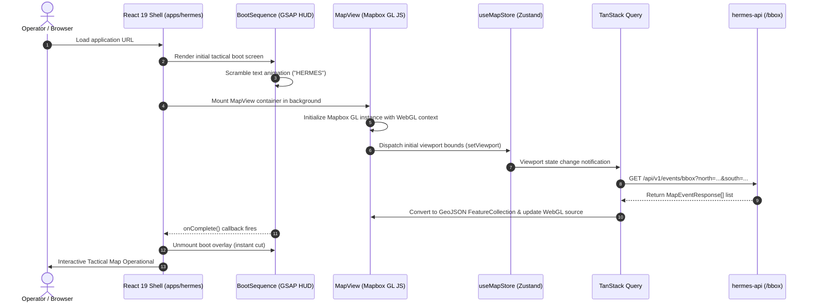
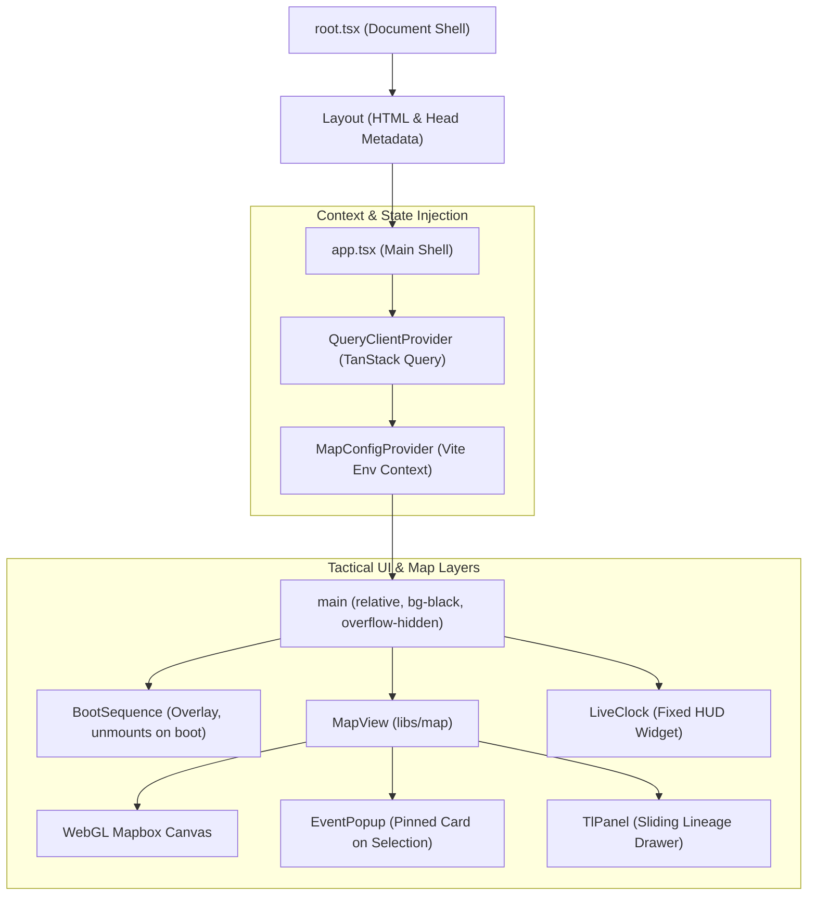

# Hermes React Client (`@hermes/hermes`)

The `@hermes/hermes` application is the React 19 frontend shell for the Hermes geospatial intelligence platform. It provides the tactical Mission Control user interface, orchestrating the hardware-accelerated Mapbox GL JS WebGL canvas, reactive spatial telemetry, and cybernetic HUD overlays into a unified Single Page Application (SPA).

---

## Table of Contents

- [Architectural Philosophy ("The Why")](#architectural-philosophy-the-why)
  - [The 80/20 Monorepo Boundary](#the-8020-monorepo-boundary)
  - [Strict SPA Mode Rationale](#strict-spa-mode-rationale)
  - [Unidirectional Telemetry (Zero Shadow State)](#unidirectional-telemetry-zero-shadow-state)
  - [Pragmatic Accessibility (a11y) Strategy](#pragmatic-accessibility-a11y-strategy)
  - [Tactical Design Constraints](#tactical-design-constraints)
- [System Architecture & Visual Diagrams](#system-architecture--visual-diagrams)
  - [1. Client Boot & Lifecycle Flow](#1-client-boot--lifecycle-flow)
  - [2. Component Rendering & Provider Tree](#2-component-rendering--provider-tree)
  - [3. Unidirectional Data Synchronization Loop](#3-unidirectional-data-synchronization-loop)
- [Directory Structure](#directory-structure)
- [Toolchain & Configuration Deep Dive](#toolchain--configuration-deep-dive)
  - [React Router 8 Setup](#react-router-8-setup)
  - [Vite & Vitest Toolchain](#vite--vitest-toolchain)
  - [Tailwind CSS 4 Engine](#tailwind-css-4-engine)
- [Environment Configuration](#environment-configuration)
- [Cross-Package Integration Contracts](#cross-package-integration-contracts)
- [Development & Verification Runbook](#development--verification-runbook)
  - [Nx Commands](#nx-commands)
  - [Docker Execution](#docker-execution)

---

## Architectural Philosophy ("The Why")

### The 80/20 Monorepo Boundary
In accordance with the workspace's Nx architecture rules, `apps/hermes` functions strictly as an **ultra-thin routing and configuration shell**:
- **App Responsibility (<20%)**: Declares routes, manages document-level HTML tags, binds environment variables via React Context, and mounts top-level layout providers.
- **Library Responsibility (>80%)**: All heavy domain logic, WebGL canvas lifecycle management, Mapbox event handlers, timeline graph drawers, and telemetry stores reside in [`libs/map`](file:///home/pavan/proj/hermes/libs/map) and [`libs/shared/ui-components`](file:///home/pavan/proj/hermes/libs/shared/ui-components).

**The Rationale**: Monolithic frontend apps often tightly couple route definitions with third-party WebGL canvas APIs. By isolating Mapbox and HUD widgets into workspace libraries, components remain testable with isolated Vitest and Playwright harnesses, portable across potential future surfaces (such as secondary dashboards or mobile shells), and protected by strict Nx module boundaries (`type:app`, `scope:frontend`).

---

### Strict SPA Mode Rationale
Hermes is deliberately configured in strict Single Page Application mode via `ssr: false` in [`react-router.config.ts`](file:///home/pavan/proj/hermes/react-router.config.ts).

| Dimension | Server-Side Rendering (SSR) | Client-Side SPA (`ssr: false`) | Hermes Decision |
| :--- | :--- | :--- | :--- |
| **WebGL Context** | Fails; `window`, `document`, and WebGL hardware drivers do not exist in Node/V8 server streams. | Native; Browser directly allocates the `WebGLRenderingContext`. | **SPA**: Mapbox requires direct DOM attachment. |
| **Hydration Complexity** | High risk of hydration mismatches, canvas recreation, or DOM thrashing. | Zero hydration friction; React 19 boots directly into the document root. | **SPA**: Eliminates blank canvas flashes and layout shifts. |
| **Search Engine Indexing** | Renders HTML strings for web crawlers. | Emits lean static HTML shell (`index.html`). | **SPA**: Hermes is an operational real-time geospatial terminal, not an indexable blog. |

---

### Unidirectional Telemetry (Zero Shadow State)
Managing external WebGL instances inside React applications frequently suffers from state de-synchronization when developers store duplicate coordinates in both the Mapbox instance and React state.

Hermes enforces strict **unidirectional state flow**:
1. [`useMapStore`](file:///home/pavan/proj/hermes/libs/map/src/lib/store/store.ts) (Zustand) is the **single source of truth** for coordinates, viewport bounding boxes (`north`, `south`, `east`, `west`), and active selection (`selectedEventId`, `isTlMode`).
2. The Mapbox GL JS map instance is treated purely as a **rendering projection sink**. It never maintains independent or divergent state.
3. User interactions with the WebGL canvas (pan, zoom) dispatch bounding box coordinates directly into Zustand.
4. [`useMapDataSync`](file:///home/pavan/proj/hermes/libs/map/src/lib/hooks/datasync.ts) (TanStack Query v5) observes Zustand's `viewport` and issues spatial bounding-box API requests (`GET /api/v1/events/bbox`) with automatic debouncing.
5. GeoJSON transformations update Mapbox native layer sources without triggering cascading React re-renders.

---

### Pragmatic Accessibility (a11y) Strategy
Hardware-accelerated WebGL renders thousands of event pins directly onto an HTML5 `<canvas>` element:
- **Canvas Boundary**: We explicitly avoid generating thousands of hidden, off-screen DOM anchor tags to represent canvas coordinates. Doing so causes severe memory overhead, destroys 60 FPS canvas performance, and degrades screen reader usability.
- **Overlay Accessibility**: All textual data and interactive controls are surfaced through standard semantic HTML DOM elements:
  - Tactical HUD buttons and the boot console maintain explicit ARIA labels and keyboard triggers.
  - Inspection cards ([`EventPopup`](file:///home/pavan/proj/hermes/libs/map/src/lib/ui/components/EventPopup.tsx)) and the timeline drawer ([`TlPanel`](file:///home/pavan/proj/hermes/libs/map/src/lib/ui/components/TlPanel.tsx)) provide semantic headers, accessible close triggers with keyboard escape handlers, and readable text hierarchies.

---

### Tactical Design Constraints
The frontend shell enforces a distinct Mission Control aesthetic:
- **Zero Border Radius**: Configured globally in [`styles.css`](file:///home/pavan/proj/hermes/apps/hermes/styles.css) via `@theme { --radius-*: initial; }`. No rounded edges exist in the application.
- **Strict Monospace Type**: All interface elements inherit `JetBrains Mono` or `Fira Code`.
- **High-Contrast Dark Theme**: Deep space background (`#050505`, `#0a0f19`) paired with tactical neon accents (`#00f0ff` neon blue, `#1e3a8a` HUD border, `#fbbf24` warning indicator).

---

## System Architecture & Visual Diagrams

### 1. Client Boot & Lifecycle Flow

The application boot sequence orchestrates the tactical scramble text overlay, initializes the WebGL map context, and activates real-time polling:



---

### 2. Component Rendering & Provider Tree

The structural hierarchy forms a clean pyramid of contextual providers and visual overlays:



---

### 3. Unidirectional Data Synchronization Loop

```mermaid
flowchart LR
    subgraph Interaction ["Operator Actions"]
        PanZoom["Camera Pan / Zoom"]
        MarkerClick["Marker Click"]
    end

    subgraph StateSink ["Zustand Store (Single Source of Truth)"]
        VpState["viewport: BoundingBox"]
        SelState["selectedEventId: string"]
    end

    subgraph Synchronization ["TanStack Query Sync"]
        BboxQuery["useMapDataSync()
(Debounced Query Hook)"]
    end

    subgraph Backend ["FastAPI Backend (hermes-api)"]
        PostGIS["PostGIS Spatial Query
ST_Within(geometry, BBOX)"]
    end

    subgraph WebGLSink ["Mapbox GL Engine"]
        GeoJSON["GeoJSON Source
FeatureCollection"]
        RenderLayers["WebGL Circle & Cluster Layers"]
    end

    PanZoom -->|Dispatches bounds| VpState
    MarkerClick -->|Dispatches event ID| SelState
    VpState -->|Triggers query key update| BboxQuery
    BboxQuery -->|HTTP GET /api/v1/events/bbox| PostGIS
    PostGIS -->|JSON Response| BboxQuery
    BboxQuery -->|createGeoJson()| GeoJSON
    GeoJSON -->|setData()| RenderLayers
```

---

## Directory Structure

```text
apps/hermes/
├── app/                              # React Router 8 application root
│   ├── routes/
│   │   └── about.tsx                 # Secondary about route (/about)
│   ├── app.tsx                       # Primary layout & provider assembly
│   ├── entry.client.tsx              # Client hydration / bootstrap entry
│   ├── entry.server.tsx              # Static stream handler (SPA mode fallback)
│   ├── root.tsx                      # Root HTML, fonts, and meta links
│   └── routes.tsx                    # Route configuration definitions
├── public/                           # Static assets served as-is
├── tests/                            # Unit & integration test suites
│   └── routes/
│       └── _index.spec.tsx           # Route stub & component mounting test
├── Dockerfile                        # Multi-stage Docker image (dev & prod)
├── eslint.config.mjs                 # ESLint flat config extending root
├── package.json                      # Project manifest (@hermes/hermes)
├── project.json                      # Nx project configuration & targets
├── react-router.config.ts            # React Router 8 build config (ssr: false)
├── styles.css                        # Tailwind 4 CSS-first theme, source & Mapbox CSS
├── test-env.js                       # Environment testing helper
├── tsconfig.app.json                 # TypeScript app build configuration
├── tsconfig.json                     # TypeScript project configuration
├── tsconfig.spec.json                # TypeScript test configuration
└── vite.config.mts                   # Vite build, server & Vitest configuration
```

---

## Toolchain & Configuration Deep Dive

### React Router 8 Setup
- **Strict SPA Configuration**: [`react-router.config.ts`](file:///home/pavan/proj/hermes/apps/hermes/react-router.config.ts) defines `ssr: false`, instructuring `@react-router/dev` to output a pure static client bundle without runtime server rendering.
- **Route Manifest**: Defined in [`app/routes.tsx`](file:///home/pavan/proj/hermes/apps/hermes/app/routes.tsx), mapping `/` to [`app/app.tsx`](file:///home/pavan/proj/hermes/apps/hermes/app/app.tsx) and `/about` to [`app/routes/about.tsx`](file:///home/pavan/proj/hermes/apps/hermes/app/routes/about.tsx).
- **Document Shell**: [`app/root.tsx`](file:///home/pavan/proj/hermes/apps/hermes/app/root.tsx) injects `JetBrains Mono` from Google Fonts and loads global styling from `styles.css`.

### Vite & Vitest Toolchain
The configuration in [`vite.config.mts`](file:///home/pavan/proj/hermes/apps/hermes/vite.config.mts) coordinates multiple specialized plugins:
- **Tailwind Vite Plugin**: `@tailwindcss/vite` compiles styles seamlessly with instant HMR and internal Lightning CSS processing.
- **Root Environment Loading**: `envDir: '../../'` points Vite to the monorepo root to load `.env`, ensuring consistent variable sharing across apps.
- **Path Resolution**: `resolve: { tsconfigPaths: true }` resolves TypeScript paths without duplicate Vite alias definitions.
- **Conditional Plugins**: `!process.env.VITEST && reactRouter()` ensures test execution remains lightweight by bypassing full router bundling during test passes.
- **Vitest Runner**: Uses the `jsdom` environment with test discovery targeting `tests/**/*.spec.tsx`.

### Tailwind CSS 4 Engine
Tailwind CSS 4 is configured natively in CSS with tactical constraints:
- **Library Scanning**: [`styles.css`](file:///home/pavan/proj/hermes/apps/hermes/styles.css) declares `@source "../../libs";`, ensuring utility classes used in `@hermes/map` and `@hermes/ui-components` are compiled into the client stylesheet.
- **CSS-First Theme & Zero-Border Enforcement**: Defined directly in [`styles.css`](file:///home/pavan/proj/hermes/apps/hermes/styles.css) using native `@theme`:
  ```css
  @theme {
    --font-sans: 'JetBrains Mono', 'Fira Code', monospace;
    --font-mono: 'JetBrains Mono', 'Fira Code', monospace;

    --color-hud-bg: rgba(10, 15, 25, 0.85);
    --color-hud-border: #1e3a8a;
    --color-hud-glow: #3b82f6;
    --color-neon-blue: #00f0ff;
    --color-warning-yellow: #fbbf24;

    --radius-*: initial;
  }
  ```
- **Monospace Font System**: Enforces `JetBrains Mono` and `Fira Code` across both `font-sans` and `font-mono`.
- **Palette Tokens**: Custom HUD theme tokens:
  - `hud-bg`: `rgba(10, 15, 25, 0.85)` (Translucent command panel background)
  - `hud-border`: `#1e3a8a` (Deep military blue border)
  - `hud-glow`: `#3b82f6` (Neon blue accent aura)
  - `neon-blue`: `#00f0ff` (High-visibility tactical blue)
  - `warning-yellow`: `#fbbf24` (Alert highlights)

---

## Environment Configuration

The application requires three build/runtime variables loaded from the repository root `.env` or injected during deployment:

| Variable | Type | Default / Example | Purpose |
| :--- | :--- | :--- | :--- |
| `VITE_MAPBOX_TOKEN` | `string` | `pk.eyJ1...` | Mandatory public API token required to initialize Mapbox GL JS map tiles and WebGL render layers. |
| `VITE_BASE_URL` | `string` | `http://localhost:8000` | HTTP root URL of the backend REST API (`hermes-api`). |
| `VITE_API_VER` | `string` | `v1` | API version prefix used when constructing endpoints (e.g., `/api/v1/events/bbox`). |

Variables are bundled at build time via `import.meta.env` and supplied to map hooks via [`MapConfigProvider`](file:///home/pavan/proj/hermes/libs/map/src/lib/config-context.tsx):

```tsx
const MAP_CONFIG = {
  baseUrl: import.meta.env.VITE_BASE_URL,
  apiVer: import.meta.env.VITE_API_VER,
  mapboxToken: import.meta.env.VITE_MAPBOX_TOKEN,
};
```

---

## Cross-Package Integration Contracts

`apps/hermes` depends directly on three workspace libraries and consumes one backend service:

```
@hermes/hermes (apps/hermes)
  ├── Imports MapView, MapConfigProvider from @hermes/map
  ├── Imports BootSequence, LiveClock from @hermes/ui-components
  ├── Consumes TypeScript models from @hermes/util-types
  └── Queries REST endpoints on hermes-api
```

### 1. `@hermes/map`
- **`MapView`**: Core React component hosting the WebGL canvas, clustering engine, layer setup, and interaction callbacks.
- **`MapConfigProvider`**: Context provider through which the shell injects `baseUrl`, `apiVer`, and `mapboxToken`.
- **`useMapStore`**: Zustand store managing camera telemetry and selection state.

### 2. `@hermes/ui-components`
- **`BootSequence`**: Tactical initialization screen playing a scramble-text decode sequence on initial application load.
- **`LiveClock`**: Floating monospace telemetry widget rendering current UTC system time (`SYS.TIME HH:MM:SS UTC`).

### 3. `@hermes/util-types`
Provides strict types for all network payloads, preventing schema divergence:
- `MapEventResponse`: Lightweight bounding-box payload for map pins.
- `EventDetailResponse`: Full event payload for inspection cards.
- `TlResponse`: Historical timeline lineage graph containing nodes and edges.

### 4. `hermes-api`
Endpoints queried via Axios in `@hermes/map`:
- `GET /api/v1/events/bbox`: Viewport bounding-box spatial query.
- `GET /api/v1/events/{id}`: Event detail modal query.
- `GET /api/v1/events/tl?event_id={id}`: Historical causality lineage query.

---

## Development & Verification Runbook

All commands must be executed from the **workspace root**.

### Nx Commands

#### 1. Start Development Server
Launches the Vite dev server with Hot Module Replacement on port `4200`:
```bash
npx nx dev @hermes/hermes
```

#### 2. Execute Production Build
Generates compiled and minified assets into `apps/hermes/build/client` and `apps/hermes/dist`:
```bash
npx nx build @hermes/hermes
```

#### 3. Run Unit & Integration Tests
Executes the Vitest test runner across all spec files:
```bash
npx nx test @hermes/hermes
```

#### 4. Run Code Linter
Executes ESLint with strict React rules and monorepo boundaries:
```bash
npx nx lint @hermes/hermes
```

#### 5. Run Type Check
Compiles TypeScript declarations and validates type soundness:
```bash
npx nx typecheck @hermes/hermes
```

---

### Docker Execution

The application includes a multi-stage Docker build in [`apps/hermes/Dockerfile`](file:///home/pavan/proj/hermes/apps/hermes/Dockerfile).

#### Development Container
Mounts the source tree and serves via Vite dev server:
```bash
docker build --target development -t hermes-client:dev -f apps/hermes/Dockerfile .
docker run -p 4200:4200 -e VITE_MAPBOX_TOKEN=your_token hermes-client:dev
```

#### Production Container
Builds the static client distribution and serves using `react-router-serve`:
```bash
docker build --target production -t hermes-client:prod -f apps/hermes/Dockerfile .
docker run -p 4200:4200 hermes-client:prod
```
