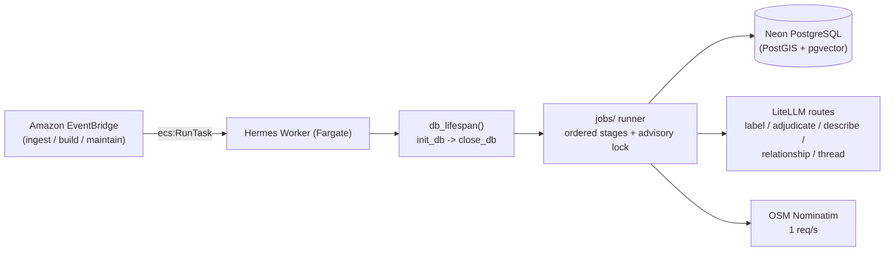
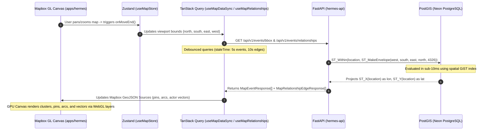
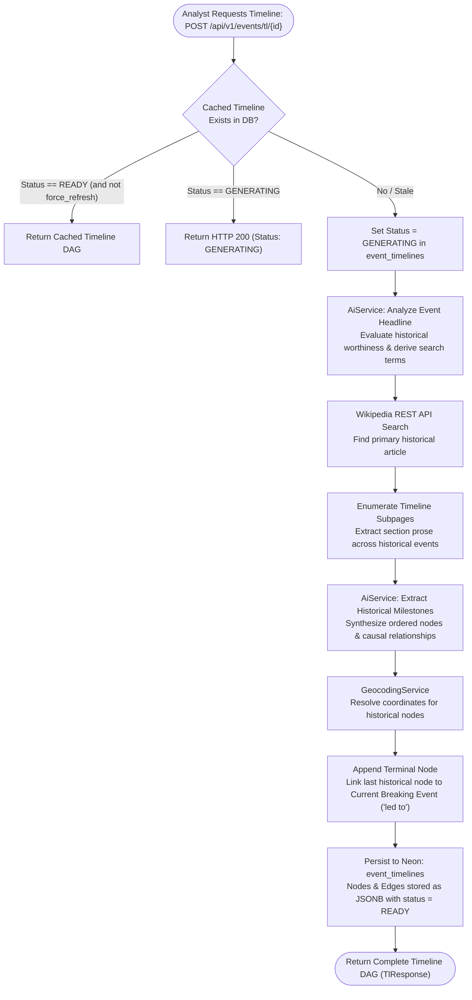
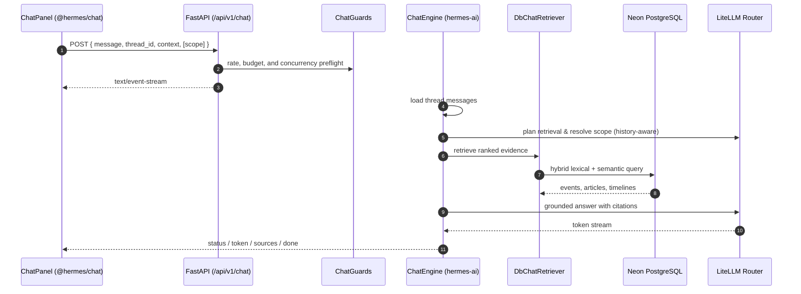

# Hermes — Production Architecture & System Design

This document details the production architecture, cloud infrastructure topology, data pipelines, and design rationale for **Hermes**.

---

## 1. High-Level Production Topology

Hermes is deployed as a resilient, cost-optimized multi-cloud system spanning **Vercel**, **Amazon Lightsail**, **AWS ECS Fargate (ARM64)**, and **Neon Serverless PostgreSQL**.

```mermaid
flowchart TD
    subgraph ClientLayer["Client and Edge Layer (Vercel)"]
        User["End User Browser"]
        VercelEdge["Vercel SSR (Node.js Runtime)\napps/hermes • hermes-eight-inky.vercel.app"]
        ClerkAuth["Clerk Authentication\nSession Management and JWT"]
    end

    subgraph ApiLayer["API Serving Layer (Amazon Lightsail)"]
        LightsailApi["FastAPI REST Service\napps/hermes-api (Nano Container)"]
    end

    subgraph BatchLayer["Autonomous Ingestion Layer (AWS ap-southeast-2)"]
        EventBridge["Amazon EventBridge\n(ingest / build / maintain)"]
        ECR["Amazon ECR\nhermes-worker:latest"]
        Fargate["AWS ECS Fargate Task\n0.25 vCPU • 512 MB RAM • Ephemeral CLI"]
        CloudWatch["Amazon CloudWatch Logs\n/ecs/hermes-worker"]
    end

    subgraph DataLayer["Persistence Layer (Neon Serverless PostgreSQL 16)"]
        PgBouncer["PgBouncer Connection Pooler\nTransaction Pooling (Port 5432/6543)"]
        PostGIS["PostGIS 3.4 Spatial Engine\nGeometry(POINT, 4326) • GiST Index"]
        PgVector["pgvector Extension\nhalfvec(2048) • HNSW Index"]
        Relational["Relational Tables\nevents, articles, article_labels,\narticle_families, event_members,\nevent_relationships, cluster_decisions,\nthreads, event_timelines, sources,\ngeocode_cache, chat checkpoints"]
    end

    subgraph ExternalServices["External Intelligence and Inference APIs"]
        RSSFeeds["Global News Feeds\nRSS / Atom / News Sitemaps"]
        GDELT["GDELT 2.0 Doc API\nGlobal Event Database"]
        Nominatim["OpenStreetMap Nominatim\nToken-Bucket Rate Limited (1 req/s)"]
        Wikipedia["MediaWiki REST API\nHistorical Archive Querying"]
        Tavily["Tavily Search API\nExternal News Fallback (opt-in)"]
        LiteLLM["LiteLLM Inference Router"]
        Mistral["Primary LLM:\nmistral/ministral-8b-latest"]
        NvidiaNim["Fallback LLM:\nnvidia_nim/openai/gpt-oss-20b\nEmbeddings:\nnvidia_nim/nvidia/nemotron-3-embed-1b"]
        Langfuse["Langfuse Observability\nTraces, Spans and Cost Tracking"]
    end

    %% User interactions
    User -->|"HTTPS / WebGL Map Interactions"| VercelEdge
    VercelEdge -->|"Server-Side Auth Validation"| ClerkAuth
    User -->|"Direct REST Queries (/events/*, /threads/*, /events/tl, /chat)"| LightsailApi

    %% API to Database
    LightsailApi -->|"asyncpg / SQLAlchemy 2.0 + psycopg Checkpointer"| PgBouncer

    %% API to AI & Wikipedia
    LightsailApi -->|"Timeline & Chat Inference"| LiteLLM
    LightsailApi -->|"Historical Article Search"| Wikipedia
    LightsailApi -->|"Optional Web Fallback"| Tavily
    LightsailApi -->|"Historical Node Geocoding"| Nominatim

    %% Worker Execution
    EventBridge -->|"RunTask Trigger"| Fargate
    ECR -.->|"Image Pull"| Fargate
    Fargate -->|"Logs & Telemetry"| CloudWatch
    Fargate -->|"Source Polling"| RSSFeeds
    Fargate -->|"Event Discovery"| GDELT
    Fargate -->|"Embeddings & Event Extraction"| LiteLLM
    Fargate -->|"Location Resolution"| Nominatim
    Fargate -->|"Batch Upserts & Lifecycle Decay"| PgBouncer

    %% Database internals
    PgBouncer --> PostGIS
    PgBouncer --> PgVector
    PgBouncer --> Relational

    %% LLM routing & Observability
    LiteLLM --> Mistral
    LiteLLM -.->|"Failover / Embeddings"| NvidiaNim
    LiteLLM -.->|"Traces & Spans (opt-in)"| Langfuse
```

---

## 2. Infrastructure & Hosting Topology

### A. Frontend Application (`apps/hermes`)
- **Hosting Platform**: **Vercel** (`apps/hermes` deployed at [`hermes-eight-inky.vercel.app`](https://hermes-eight-inky.vercel.app)).
- **Runtime**: Server-Side Rendering (SSR) running on the Vercel Node.js runtime via `@react-router/node`.
- **Authentication**: **Clerk** integration via `@clerk/react-router`. Authentication is evaluated server-side in route loaders (`getAuth`) before rendering the document shell, preventing unauthenticated page flash.
- **Client Rendering**: Mapbox GL JS WebGL canvas runs strictly in client contexts behind dynamic lazy-load boundaries (`React.lazy` + `Suspense`), shielding browser globals (`window`, WebGL context) from Node.js SSR evaluation.
- **Client Data Synchronization**: Communicates directly with `hermes-api` using `@tanstack/react-query` and `axios` to synchronize viewport bounding boxes (`/api/v1/events/bbox`).

### B. REST API Service (`apps/hermes-api`)
- **Hosting Platform**: **Amazon Lightsail Container Services** (`hermes-api`, Nano tier).
- **Runtime**: Python 3.14 + Uvicorn running FastAPI with a single worker.
- **Read & Synthesis Contract**: The API service executes zero background jobs, schedulers, or ingestion loops. It serves read-optimized spatial/relationship queries and on-demand AI workloads:
  1. High-frequency spatial bounding-box and relationship queries (`GET /api/v1/events/bbox`, `GET /api/v1/events/relationships`), merge-aware event details (`GET /api/v1/events/{id}`), and narrative story threads (`GET /api/v1/threads/*`).
  2. On-demand causal timeline synthesis (`POST /api/v1/events/tl/{id}`) that discovers historical antecedents and generates causal DAGs.
  3. Conversational RAG (`POST /api/v1/chat`) streamed over Server-Sent Events, resolved to an event, viewport, or global scope.
- **Checkpoint Memory & Guards**: Conversation memory is keyed per `thread_id` via LangGraph, preferring `AsyncPostgresSaver` at startup (`CHECKPOINT_DB_URL` or `DB_*`) and falling back to process-local `InMemorySaver` on failure. `ChatGuards` (rate limit, token budget, concurrency semaphore) are process-local.
- **CORS Handling**: Handlers in [`core/errors.py`](../apps/hermes-api/src/hermes_api/core/errors.py) explicitly inject access headers (`_cors_headers(request)`) to prevent Starlette `ExceptionMiddleware` from masking application exceptions behind browser CORS errors.
- **Graceful Degradation**: If external LLM API credentials are not provisioned, spatial and event retrieval endpoints remain operational, while timeline synthesis and chat return explicit `503` responses.

### C. Ingestion & Lifecycle Worker (`apps/hermes-worker`)
- **Hosting Platform**: **AWS ECS Fargate** (Sydney region: `ap-southeast-2`).
- **Compute Sizing**: `0.25 vCPU` and `512 MB RAM` running an ARM64 (AWS Graviton) Linux container image hosted in a private **Amazon ECR** repository.
- **Scheduling**: **Amazon EventBridge** triggers one-shot executions via ECS `RunTask` across separate scheduled worker commands: `ingest-articles`, `build-events`, and `maintain-events`.
- **Ephemeral Run-and-Die Execution Model**:
  - The worker process spins up on demand, wraps database connections within [`db_lifespan()`](../apps/hermes-worker/src/hermes_worker/core/lifespan.py), and executes one command (`ingest-articles`, `build-events`, `maintain-events`, or `healthcheck`).
  - Upon task completion, the container terminates cleanly (`sys.exit(0)` on success or `sys.exit(1)` on error). Fargate deallocates compute resources immediately, terminating billing charges.
  - Telemetry and stdout/stderr logs stream to **Amazon CloudWatch Logs** under `/ecs/hermes-worker`.

### D. Persistence Layer (`libs/shared/hermes-db`)
- **Hosting Platform**: **Neon Serverless PostgreSQL 16**.
- **Extensions**:
  - `postgis`: Enables geospatial operations (`Geometry(POINT, 4326)`), R-tree GiST indexing, and native SQL spatial filtering (`ST_Within`, `ST_MakeEnvelope`).
  - `pgvector`: Enables dense vector storage using 16-bit half-precision floats (`halfvec(2048)`) and HNSW index traversal for sub-15ms approximate nearest-neighbor search.
- **Connection Management**:
  - Async driver: `asyncpg` via SQLAlchemy 2.0 AsyncEngine.
  - Pooled through Neon's built-in **PgBouncer** proxy (transaction pooling).
  - To prevent transaction-pooling errors with prepared statements, engines are instantiated with `connect_args={"statement_cache_size": 0}`.
  - Schema alterations are managed strictly through **Alembic** migrations.

---

## 3. Ingestion Worker & Staged Pipeline

The worker executes a staged pipeline across separately scheduled commands with PostgreSQL advisory locking per mutating command ([`apps/hermes-worker/docs/architecture.md`](../apps/hermes-worker/docs/architecture.md)):

### 3.1 Command Surface

| Command | Schedule | Stages & Purpose |
| :--- | :--- | :--- |
| `ingest-articles` | every 15 min | `INGEST -> ANALYZE`: Sync `sources.json`, fetch due RSS/Google News/GDELT feeds, write the canonical ledger, transiently fetch `FULL_TEXT` bodies, label, embed (`halfvec(2048)`), and assign syndication families. |
| `build-events` | hourly | `CLUSTER -> DESCRIBE -> SCORE -> RECONCILE -> RELATIONSHIP -> THREAD`: Cluster labeled articles into incident events, synthesize headlines/actors, compute `importance_score`, merge duplicate events, classify cross-event relationships, and group story threads. |
| `maintain-events` | daily | `REQUEUE_CLAIMS -> EVENT_LIFECYCLE -> THREAD_LIFECYCLE -> MAINTENANCE`: Requeue stale claims, transition event/thread lifecycles, reconcile aggregate counters, prune retention windows, and check consistency. |
| `healthcheck` | on demand | `HEALTHCHECK`: Read-only connectivity, schema, queue depth, and stale-claim probe. |

All four scheduled commands plus standalone utilities (`audit-sources`, `reset-db`) are implemented. `audit-sources` is a read-only feed probe without database access. There is no feature flag and no parallel legacy path.

### 3.2 Work Queue and Execution Record

- `articles.ingest_status` tracks the work queue: `NEW → ANALYZING → LABELED → CLUSTERED`, with `REJECTED` (gated out at `LABEL` or `GATE`) and `FAILED` as terminal states.
- Claims use `UPDATE … WHERE id IN (SELECT … FOR UPDATE SKIP LOCKED) … RETURNING`, bounded by `ARTICLE_CLAIM_BATCH_SIZE` (`50`).
- An abandoned `ANALYZING` claim older than `ARTICLE_CLAIM_STALE_MINUTES` (`30`) is requeued by `maintain-events`; exhausted attempts (`ARTICLE_MAX_ATTEMPTS = 3`) become `FAILED`.
- There is no run-telemetry table. The execution record is the exit code, structured stage logs, and article claim fields (`claimed_at`, `claimed_by`, `attempt_count`, `last_error`).
- Stages own their transaction boundaries. Domain services never commit; a crash before commit leaves the claim recoverable.

### 3.3 Bounded Work and Memory

- The Fargate task has 0.25 vCPU and 512 MB RAM. Feeds, articles, transient bodies, and LLM prompts are processed in bounded batches.
- Network calls are rate-limited: Nominatim at 1 req/s, plus per-route LLM/embedding token buckets (`RPM_LIMIT`, `EMBED_RPM_LIMIT`).
- LLM stages reserve calls against `MAX_LLM_CALLS_PER_RUN` (`120`). `ANALYZE` stops cleanly on exhaustion and releases remaining claims for the next run.

### 3.4 Grounded Geocoding Shield

LLMs never generate coordinates. They return normalized location names, which [`GeocodingService`](../libs/shared/hermes-ai/src/hermes_ai/services/geocoding.py) resolves through OpenStreetMap Nominatim. The service enforces a 1 req/s token bucket, caches results in `geocode_cache`, deduplicates in-flight requests, and stores unresolvable names as negative cache entries (`latitude=NULL`, `longitude=NULL`) to prevent repeated outbound calls.

---

## 4. Verification, Unified Importance Scoring & Relationships

Hermes computes one authoritative, deterministic `importance_score` (0–100, `SCORE_VERSION = "score-v2"`) in [`EventScoringService`](../libs/shared/hermes-db/src/hermes_db/services/event_scoring.py) from each event's active syndication-deduplicated members, impact, verification, and age.

### 4.1 Verification & Syndication Independence

[`compute_verification`](../libs/shared/hermes-db/src/hermes_db/services/verification.py) groups articles by `ArticleFamily` (title/body SimHash or cosine `>= 0.97` within 36 hours) and publisher `origin_group` so wire reprints count as a single independent origin:
- `CONFIRMED` (`1.00`): `>= 2` independent origins AND `>= 1` member has `certainty == CONFIRMED`.
- `CORROBORATED` (`0.85`): `>= 2` independent origins without `CONFIRMED` certainty.
- `SINGLE_SOURCE` (`0.75`): `1` independent origin.
- `CONFLICTING` (`0.50`): any member reports `certainty == DISPUTED`.

### 4.2 The Scoring Formula & Selection Tiers

$$\text{base} = 100 \times \left( 0.40 \times \text{strength} + 0.30 \times \text{impact} + 0.15 \times \text{verify} + 0.15 \times \text{quality} \right)$$

$$\text{freshness} = e^{-\frac{\text{age\_hours}}{\text{half\_life}}}, \quad \text{score} = \text{base} \times \text{freshness}$$

- **Source Strength ($\text{strength}$)**: $\min(1.0, \sum(\max \text{credibility per family}) / 9.0)$ with `TIER_1 = 3.0`, `TIER_2 = 2.0`, `TIER_3/4 = 1.0`.
- **Impact Level ($\text{impact}$)**: `CRITICAL = 1.0`, `MAJOR = 0.8`, `MODERATE = 0.55`, `MINOR = 0.3`.
- **Reporting Quality ($\text{quality}$)**: $\text{clamp}(1.0 - 0.15 \times (5 - \text{specificity}) - 0.10 \times (5 - \text{consequence}), 0.5, 1.0)$.
- **Impact-Calibrated Exponential Decay**: `age_hours` anchors on `latest_published_at or event_time` with half-lives of **18h** (`CRITICAL`), **36h** (`MAJOR`), and **96h** (`MODERATE`/`MINOR`).
- **Cap & Breaking Override**: `SINGLE_SOURCE` scores are capped at **`65.0`**. If `age_hours <= 2.0`, `impact` is `CRITICAL` or `MAJOR`, any member is `BREAKING`, and post-cap `score >= 35.0`, `select_tier()` forces `PRIMARY` visibility.
- **Selection Tiers (`±5.0` Hysteresis)**: Initial cutoffs are `PRIMARY >= 50.0`, `FILLER 22.0–50.0`, `DROP < 22.0` (`DROP` events are hidden from public API queries). Events transition `ACTIVE -> STALE` after **96 hours** without new reporting and `STALE -> ARCHIVED` after **240 hours (10 days)**; new members reactivate `STALE` events to `ACTIVE`.

### 4.3 Cross-Event Relationships & Story Threads

- **Pairwise Relationships**: `RelationshipStage` links active/stale events within `10` days using vector similarity, shared actors, and entity overlap, persisting `CAUSED`, `FOLLOW_UP`, `REACTION`, and `RELATED` edges in `event_relationships` (and triggering guarded `SAME_INCIDENT` auto-merges when warranted).
- **Actors**: `DescribeStage` extracts structured `STATE`/`ORGANIZATION`/`PERSON`/`GROUP` actors (`Event.actors`), geocoding cross-border actor home coordinates via Nominatim.
- **Story Threads**: `ThreadStage` groups developing and topical arcs into `threads` (`ACTIVE -> DORMANT` at 7 days, `-> ENDED` at 30 days).

---

## 5. Spatial Query & WebGL Viewport Synchronization

Serving live event pins, relationship arcs, and story threads across a global map requires tight coordination between Mapbox GL, TanStack Query, and PostGIS:

### Spatial Optimization Decisions

1. **Direct Coordinate Projection**: Rather than serializing and transmitting Well-Known Binary (WKB) geometry objects from PostgreSQL and parsing them on the client, the query executes `ST_X(Event.location)` and `ST_Y(Event.location)` directly in the SQL select projection.
2. **GPU Canvas Layers**: Event pins, clusters (`hermes-clusters`, `hermes-cluster-count`), relationship great-circle arcs (`hermes-relationship-arcs`, `hermes-relationship-arcs-glow`), partner rings, actor vectors/anchors, and citation rings render as Mapbox GL WebGL layers rather than DOM markers (`new mapboxgl.Marker()`). Floating overlays (`EventPopup`, `ClusterList`, `StoryPanel`) handle accessible drill-down.
3. **Decoupled Viewport State**: Viewport coordinates, selected events, cited rings, and the relationship toggle (`showRelationships`) live in [`useMapStore`](../libs/map/src/lib/store/store.ts), while active thread IDs synchronize cleanly via URL `?thread=<id>`.

---

## 6. Causality Timeline Synthesis Engine

When an analyst clicks an active event on the map and requests historical lineage, [`apps/hermes-api`](../apps/hermes-api) initiates an on-demand historical timeline synthesis (`POST /api/v1/events/tl/{id}`):

### State Machine & Idempotency
- Status transitions (`GENERATING` $\rightarrow$ `READY` / `NO_CONTENT` / `FAILED`) are tracked in the `event_timelines` table.
- Concurrent requests received while an AI generation is active receive an immediate `GENERATING` status response, preventing redundant external API calls and token waste.
- Analysts can bypass cached graphs using `?force_refresh=true`.

---

## 7. Conversational RAG & Checkpoint Memory

`POST /api/v1/chat` answers questions about the map or global developments and streams the response over Server-Sent Events. Each request carries the new message, a `thread_id`, and an optional explicit `scope` (`event`, `viewport`, or `global`) plus live map `context` (`ChatMapContext`: `event_id`, `bbox`) for automatic planner scope inference.

- **Memory**: `ChatEngine` compiles a LangGraph `StateGraph` and checkpoints the `messages` channel per `thread_id`. At startup `hermes-api` connects `AsyncPostgresSaver` (`CHECKPOINT_DB_URL` or `DB_*`) and runs `setup()`, falling back cleanly to process-local `InMemorySaver` if PostgreSQL checkpoint setup fails.
- **Retrieval**: `DbChatRetriever` opens a short-lived session, runs hybrid full-text + pgvector retrieval, and closes the session before generation. Tavily is consulted when local coverage is thin or stale; failures degrade to local-only answers.
- **Guards**: Per-client rate limiting, a daily token budget, and a concurrency semaphore live in `ChatGuards`. They are process-local and reset on restart, matching the single-worker deployment.
- **Citations**: The `sources` SSE event feeds `@hermes/chat` citation rendering and `useMapStore.citedEvents`. Closing the panel aborts an active stream, marks it `cancelled`, and keeps the client transcript; clearing the conversation generates a new `thread_id`.

---

## 8. Model Routing, Failover & Geocoding Resiliency

The intelligence layer ([`hermes-ai`](../libs/shared/hermes-ai)) provides unified model orchestration and defense mechanisms:

| Capability | Primary Engine | Fallback Engine | Rationale |
| :--- | :--- | :--- | :--- |
| **Worker Pipeline & Timelines** | `LLM_MODEL` (`mistral/ministral-8b-latest`) + optional worker overrides (`LABEL_*`, `ADJUDICATE_*`, `DESCRIBE_*`, `RELATIONSHIP_*`, `THREAD_*`) | Optional `LLM_MODEL_1` (`nvidia_nim/openai/gpt-oss-20b`) | High-throughput structured JSON extraction with automatic failover on network timeouts or Pydantic `ValidationError`. |
| **Chat Answer & Planning** | `CHAT_MODEL` / `PLAN_MODEL` (defaults to `LLM_MODEL`, typically Mistral) | Optional `CHAT_MODEL_1` / `PLAN_MODEL_1` | History-aware retrieval planning, dynamic scope inference, and grounded streaming answer generation. |
| **Vector Embeddings** | `EMBED_MODEL` (`nvidia_nim/nvidia/nemotron-3-embed-1b`) | Optional `EMBED_MODEL_1` | Produces 2048-dimensional dense semantic vectors optimized for retrieval and deduplication. |
| **Geocoding** | OpenStreetMap Nominatim | Local Negative Cache | Token-bucket rate-limited (1 req/s) with a 120-second circuit breaker cooldown on persistent HTTP 429s. |

### Schema-Level Validation Failover
When an LLM returns HTTP 200 with syntactically valid JSON that fails Pydantic schema validation (e.g. missing required enum fields or misformatted relations), [`LlmService`](../libs/shared/hermes-ai/src/hermes_ai/services/llm.py) catches the `ValidationError` and automatically retries the prompt against the secondary fallback model.

### LLM Observability & Tracing (Langfuse)
Hermes instruments LLM operations using the **Langfuse Python SDK v3** (`langfuse>=3.0.0`) within `libs/shared/hermes-ai`. Observability is strictly **opt-in** and activates automatically when both `LANGFUSE_PUBLIC_KEY` and `LANGFUSE_SECRET_KEY` are provisioned in the application environment.

| Span Identifier | Component | Purpose |
| :--- | :--- | :--- |
| `article-label` | `LabelExtractor.label_batch` | Captures batch article classification, claims, entities, and locations. |
| `event-adjudicate` | `PairAdjudicator.adjudicate_articles` | Records gray-band article-to-event clustering adjudication. |
| `event-merge-adjudicate` | `PairAdjudicator.adjudicate_events` | Records gray-band duplicate-event merge decisions. |
| `event-describe` | `DescribeExtractor.describe` | Measures event headline, summary, and actor extraction. |
| `event-relationship` | `RelationshipExtractor.classify` | Traces cross-event relationship classification and `SAME_INCIDENT` checks. |
| `thread-assign` | `ThreadAssigner.assign` | Traces story thread matching and creation naming. |
| `tl-analyze` | `TlExtractor.analyze` | Records headline triage evaluation and Wikipedia query generation. |
| `tl-extract` | `TlExtractor.extract` | Measures Wikipedia prose extraction, milestone node structuring, and causal edge linking. |

- **Telemetry Architecture**: `LlmService` registers the Langfuse SDK client singleton on startup. Extractor methods use the `@observe(as_type="span", ...)` decorator to create spans without manual context propagation; chat calls reuse the same `LlmService` client.
- **Privacy Controls**: All `@observe` spans configure `capture_input=False` and `capture_output=False`, and `LANGFUSE_MASK_CONTENT=true` scrubs sensitive text attributes before export.
- **Teardown Flush Guarantee**: On process or task shutdown, `LlmService.aclose()` invokes `get_client().flush()`. This synchronous drain ensures zero trace loss in ephemeral compute contexts like AWS Fargate.
- **Context Filtering**: Traces include service-level metadata tags (`["hermes-api", ENV]` or `["hermes-worker", ENV]`), allowing engineers to filter and analyze production vs. local executions within the Langfuse console.

---

## 9. Failure Modes, Tradeoffs & Operational Boundaries

| Scenario | Impact | Mitigation Strategy |
| :--- | :--- | :--- |
| **API Restart or Redeploy** | Process-local `ChatGuards` (rate/budget counters) reset; when PostgreSQL checkpointing falls back to `InMemorySaver`, server chat memory resets too. | `AsyncPostgresSaver` persists `thread_id` checkpoints when reachable; `@hermes/chat` keeps its transcript in `localStorage` and starts fresh threads cleanly. |
| **Nominatim 429 Rate Limiting** | OpenStreetMap blocks excessive request volumes. | `NominatimResilienceManager` enforces a 1 req/s token bucket, in-flight request deduplication, exponential backoff with `Retry-After` parsing, and a 120-second circuit breaker. |
| **LLM Provider Outage** | External inference API becomes unavailable or credentials expire. | `hermes-api` catches client initialization errors and returns `HTTP 503` for timeline synthesis while keeping spatial map queries fully operational. |
| **PgBouncer Transaction Pooling** | Prepared statement conflicts across pooled connections. | SQLAlchemy async engines instantiate with `connect_args={"statement_cache_size": 0}` across both API and Worker processes. |
| **SSR WebGL Hydration Mismatch** | Mapbox GL attempts to access `window` or WebGL context on the Node.js server. | Map container is isolated behind `React.lazy` and dynamic imports inside `apps/hermes/app/routes/map.tsx`. |
| **Langfuse Misconfiguration / Outage** | Telemetry endpoint unavailable or API keys omitted. | Tracing is opt-in and fully non-blocking. If credentials are missing or Langfuse is unreachable, LLM extraction and timeline synthesis continue with zero interruption. |

---

## 10. CI/CD & Deployment Workflows

Continuous Integration and Continuous Deployment are automated via GitHub Actions:

- [`.github/workflows/ci-cd.yml`](../.github/workflows/ci-cd.yml):
  - **Triggers**: Pushes and pull requests to `master` and `dev`.
  - **Validate Job**: Sets up Node.js 22 and Python 3.14 via `uv`, installs dependencies with `npm ci` and `uv sync --frozen`, then runs `npm run lint` (ESLint + Ruff) and `npm test` (Vitest + Pytest).
  - **Deploy Fan-Out**: On a push to `master` only, the `deploy-worker`, `deploy-frontend`, and `deploy-api` jobs run in parallel after validation and call the reusable workflows below.
- [`.github/workflows/cd-worker.yml`](../.github/workflows/cd-worker.yml):
  - **Triggers**: `workflow_call` from `ci-cd.yml` or manual dispatch.
  - **Path Filters**: Runs only when changes touch `apps/hermes-worker/**`, `libs/shared/hermes-db/**`, `libs/shared/hermes-ai/**`, `pyproject.toml`, `uv.lock`, or the workflow itself.
  - **Tasks**: Authenticates to AWS, logs into Amazon ECR, builds the production target of `apps/hermes-worker/Dockerfile` for `linux/arm64` via QEMU/Buildx, and pushes `:latest` plus `:<git-sha>` tags.
- [`.github/workflows/cd-api.yml`](../.github/workflows/cd-api.yml):
  - **Path Filters**: `apps/hermes-api/**`, `libs/shared/hermes-db/**`, `libs/shared/hermes-ai/**`, `libs/shared/utils/py/**`, `pyproject.toml`, `uv.lock`, or the workflow itself.
  - **Tasks**: Builds the production Docker target, streams the image to the Lightsail container service with `lightsailctl`, and deploys a new revision. Environment values come from the `HERMES_API_PROD_ENV` secret when present; otherwise the workflow carries forward the active Lightsail container environment.
- [`.github/workflows/cd-frontend.yml`](../.github/workflows/cd-frontend.yml):
  - **Path Filters**: `apps/hermes/**`, `libs/shared/ui-components/**`, `libs/shared/util-types/**`, `libs/map/**`, `package.json`, `package-lock.json`, or the workflow itself.
  - **Tasks**: Injects the `HERMES_PROD_ENV` secret into `apps/hermes/.env.production`, runs `vercel build --prod`, and deploys the prebuilt artifact to Vercel.
