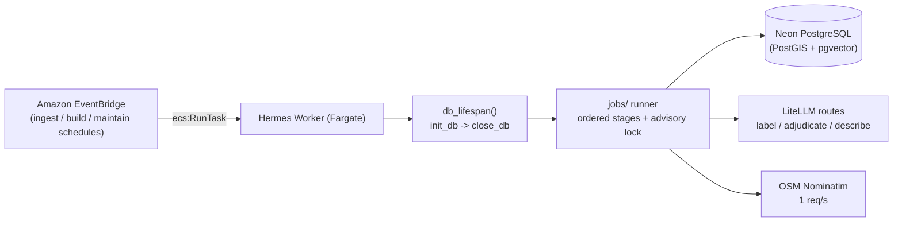
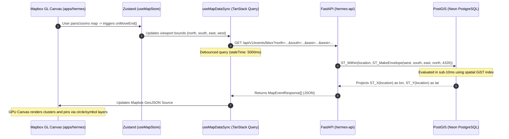
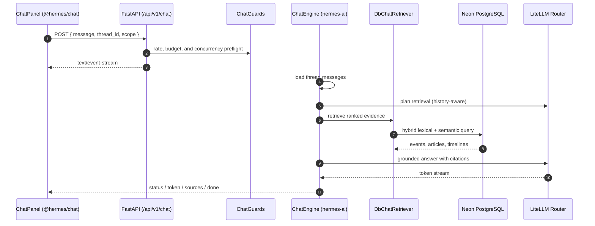

# Hermes — Production Architecture & System Design

This document details the production architecture, cloud infrastructure topology, data pipelines, and design rationale for **Hermes**.

---

## 1. High-Level Production Topology

Hermes is deployed as a resilient, cost-optimized multi-cloud system spanning **Vercel**, **Amazon Lightsail**, **AWS ECS Fargate (ARM64)**, and **Neon Serverless PostgreSQL**.

```mermaid
flowchart TD
    subgraph ClientLayer["Client and Edge Layer (Vercel)"]
        User["End User Browser"]
        VercelEdge["Vercel SSR (Node.js Runtime)\napps/hermes • hermes-eight-inky.vercel.app"]
        ClerkAuth["Clerk Authentication\nSession Management and JWT"]
    end

    subgraph ApiLayer["API Serving Layer (Amazon Lightsail)"]
        LightsailApi["FastAPI REST Service\napps/hermes-api (Nano Container)"]
    end

    subgraph BatchLayer["Autonomous Ingestion Layer (AWS ap-southeast-2)"]
        EventBridge["Amazon EventBridge\nSchedule: 3x daily"]
        ECR["Amazon ECR\nhermes-worker:latest (~319 MB)"]
        Fargate["AWS ECS Fargate Task\n0.25 vCPU • 512 MB RAM • Ephemeral CLI"]
        CloudWatch["Amazon CloudWatch Logs\n/ecs/hermes-worker"]
    end

    subgraph DataLayer["Persistence Layer (Neon Serverless PostgreSQL 16)"]
        PgBouncer["PgBouncer Connection Pooler\nTransaction Pooling (Port 5432/6543)"]
        PostGIS["PostGIS 3.4 Spatial Engine\nGeometry(POINT, 4326) • GiST Index"]
        PgVector["pgvector Extension\nhalfvec(2048) • HNSW Index"]
        Relational["Relational Tables\nevents, articles, sources, event_timelines, geocode_cache"]
    end

    subgraph ExternalServices["External Intelligence and Inference APIs"]
        RSSFeeds["Global News Feeds\nRSS / Atom / News Sitemaps"]
        GDELT["GDELT 2.0 Doc API\nGlobal Event Database"]
        Nominatim["OpenStreetMap Nominatim\nToken-Bucket Rate Limited (1 req/s)"]
        Wikipedia["MediaWiki REST API\nHistorical Archive Querying"]
        LiteLLM["LiteLLM Inference Router"]
        Mistral["Primary LLM:\nmistral/ministral-8b-latest"]
        NvidiaNim["Fallback LLM:\nnvidia_nim/openai/gpt-oss-20b\nEmbeddings:\nnvidia_nim/nvidia/nemotron-3-embed-1b"]
        Langfuse["Langfuse Observability\nTraces, Spans and Cost Tracking"]
    end

    %% User interactions
    User -->|"HTTPS / WebGL Map Interactions"| VercelEdge
    VercelEdge -->|"Server-Side Auth Validation"| ClerkAuth
    User -->|"Direct REST Queries (/events/bbox, /events/tl, /chat)"| LightsailApi

    %% API to Database
    LightsailApi -->|"asyncpg / SQLAlchemy 2.0 (SSL)"| PgBouncer

    %% API to AI & Wikipedia
    LightsailApi -->|"Timeline & Chat Inference"| LiteLLM
    LightsailApi -->|"Historical Article Search"| Wikipedia
    LightsailApi -->|"Historical Node Geocoding"| Nominatim

    %% Worker Execution
    EventBridge -->|"RunTask Trigger"| Fargate
    ECR -.->|"Image Pull"| Fargate
    Fargate -->|"Logs & Telemetry"| CloudWatch
    Fargate -->|"Source Polling"| RSSFeeds
    Fargate -->|"Event Discovery"| GDELT
    Fargate -->|"Embeddings & Event Extraction"| LiteLLM
    Fargate -->|"Location Resolution"| Nominatim
    Fargate -->|"Batch Upserts & Lifecycle Decay"| PgBouncer

    %% Database internals
    PgBouncer --> PostGIS
    PgBouncer --> PgVector
    PgBouncer --> Relational

    %% LLM routing & Observability
    LiteLLM --> Mistral
    LiteLLM -.->|"Failover / Embeddings"| NvidiaNim
    LiteLLM -.->|"Traces & Spans (opt-in)"| Langfuse
```

---

## 2. Infrastructure & Hosting Topology

### A. Frontend Application (`apps/hermes`)
- **Hosting Platform**: **Vercel** (`apps/hermes` deployed at [`hermes-eight-inky.vercel.app`](https://hermes-eight-inky.vercel.app)).
- **Runtime**: Server-Side Rendering (SSR) running on the Vercel Node.js runtime via `@react-router/node`.
- **Authentication**: **Clerk** integration via `@clerk/react-router`. Authentication is evaluated server-side in route loaders (`getAuth`) before rendering the document shell, preventing unauthenticated page flash.
- **Client Rendering**: Mapbox GL JS WebGL canvas runs strictly in client contexts behind dynamic lazy-load boundaries (`React.lazy` + `Suspense`), shielding browser globals (`window`, WebGL context) from Node.js SSR evaluation.
- **Client Data Synchronization**: Communicates directly with `hermes-api` using `@tanstack/react-query` and `axios` to synchronize viewport bounding boxes (`/api/v1/events/bbox`).

### B. REST API Service (`apps/hermes-api`)
- **Hosting Platform**: **Amazon Lightsail Container Services** (`hermes-api`, Nano tier).
- **Runtime**: Python 3.14 + Uvicorn running FastAPI with a single worker.
- **Read & Synthesis Contract**: The API service executes zero background jobs, schedulers, or ingestion loops. It serves three read-optimized workloads:
  1. High-frequency spatial bounding box queries (`GET /api/v1/events/bbox`) parameterized by viewport bounds (`north`, `south`, `east`, `west`).
  2. On-demand causal timeline synthesis (`POST /api/v1/events/tl/{id}`) that discovers historical antecedents and generates causal DAGs.
  3. Conversational RAG (`POST /api/v1/chat`) streamed over Server-Sent Events, scoped to an event, viewport, or the globe.
- **Process-Local State**: Chat conversation memory and chat guardrails are held in process memory. A restart clears both; the client keeps its transcript in `localStorage` and can start a new server thread. The `ChatRuntime` accepts any LangGraph `BaseCheckpointSaver`, so a persistent saver can be introduced without changing the API contract.
- **CORS Handling**: Handlers in [`core/errors.py`](../apps/hermes-api/src/hermes_api/core/errors.py) explicitly inject access headers (`_cors_headers(request)`) to prevent Starlette `ExceptionMiddleware` from masking application exceptions behind browser CORS errors.
- **Graceful Degradation**: If external LLM API credentials are not provisioned, spatial and event retrieval endpoints remain operational, while timeline synthesis and chat return explicit `503` responses.

### C. Ingestion & Lifecycle Worker (`apps/hermes-worker`)
- **Hosting Platform**: **AWS ECS Fargate** (Sydney region: `ap-southeast-2`).
- **Compute Sizing**: `0.25 vCPU` and `512 MB RAM` running an ARM64 (AWS Graviton) Linux container image (~319 MB) hosted in a private **Amazon ECR** repository.
- **Scheduling**: **Amazon EventBridge** triggers one-shot executions via ECS `RunTask`. Production currently runs the legacy schedule three times daily (`cron(0 0,8,16 * * ? *)`); cutover splits it into ingest, build, and maintenance schedules.
- **Ephemeral Run-and-Die Execution Model**:
  - The worker process spins up on demand, wraps database connections within [`db_lifespan()`](../apps/hermes-worker/src/hermes_worker/core/lifespan.py), and executes one command such as `hermes-worker maintain-events`.
  - Typical runtime is **5 to 10 minutes**. At cutover, EventBridge schedules are split across `ingest-articles`, `build-events`, and `maintain-events`.
  - Upon task completion, the container terminates cleanly (`sys.exit(0)` on success or `sys.exit(1)` on error). Fargate deallocates compute resources immediately, terminating billing charges.
  - Telemetry and stdout/stderr logs stream to **Amazon CloudWatch Logs** under `/ecs/hermes-worker`.

### D. Persistence Layer (`libs/shared/hermes-db`)
- **Hosting Platform**: **Neon Serverless PostgreSQL 16**.
- **Extensions**:
  - `postgis`: Enables geospatial operations (`Geometry(POINT, 4326)`), R-tree GiST indexing, and native SQL spatial filtering (`ST_Within`, `ST_MakeEnvelope`).
  - `pgvector`: Enables dense vector storage using 16-bit half-precision floats (`halfvec(2048)`) and HNSW index traversal for sub-15ms approximate nearest-neighbor search.
- **Connection Management**:
  - Async driver: `asyncpg` via SQLAlchemy 2.0 AsyncEngine.
  - Pooled through Neon's built-in **PgBouncer** proxy (transaction pooling).
  - To prevent transaction-pooling errors with prepared statements, engines are instantiated with `connect_args={"statement_cache_size": 0}`.
  - Schema alterations are managed strictly through **Alembic** migrations.

---

## 3. Ingestion Worker & Job Foundation

The worker no longer runs a monolithic ingestion service. Ingestion and event construction are being rebuilt as one staged pipeline with explicit, separately scheduled commands. Phase 1 ships the runtime and maintenance surface; `ingest-articles` and `build-events` are added with their stages in later phases.

### 3.1 Command Surface

| Command | Schedule | Purpose |
| :--- | :--- | :--- |
| `ingest-articles` | every 15 min | Fetch feeds, write the article ledger, label, embed, assign syndication family. Added in Phase 2/3. |
| `build-events` | hourly | Cluster articles into events, describe, verify, score, update threads. Added in Phase 4/5. |
| `maintain-events` | daily | Requeue abandoned article claims and apply event lifecycle transitions. |
| `healthcheck` | on demand | Read-only connectivity, schema, queue depth, and stale-claim probe. |

`maintain-events` and `healthcheck` exist today. There is no feature flag and no parallel legacy path.

### 3.2 Work Queue and Execution Record

- `articles.ingest_status` is the only work queue: `NEW → ANALYZING → LABELED → CLUSTERED`, with `REJECTED` and `FAILED` as terminal states.
- Claims use `UPDATE … WHERE id IN (SELECT … FOR UPDATE SKIP LOCKED) … RETURNING`, bounded by `ARTICLE_CLAIM_BATCH_SIZE`.
- An abandoned `ANALYZING` claim older than `ARTICLE_CLAIM_STALE_MINUTES` is requeued by `maintain-events`; exhausted attempts become `FAILED`.
- There is no run-telemetry table. The execution record is the exit code, structured stage logs, and the article claim fields (`claimed_at`, `claimed_by`, `attempt_count`, `last_error`).
- Stages own their transaction boundaries. Domain services never commit; a crash before commit leaves the claim recoverable.

### 3.3 Bounded Work and Memory

- The Fargate task has 0.25 vCPU and 512 MB RAM. Feeds, articles, bodies, and LLM calls are processed in bounded batches.
- Network calls are rate-limited: Nominatim at 1 req/s, plus per-route LLM/embedding token buckets.
- Every stage reserves LLM calls through a per-run budget; exhaustion fails the stage and leaves remaining work queued.

### 3.4 Grounded Geocoding Shield

LLMs never generate coordinates. They return normalized location names, which [`GeocodingService`](../libs/shared/hermes-ai/src/hermes_ai/services/geocoding.py) resolves through OpenStreetMap Nominatim. The service enforces a 1 req/s token bucket, caches results in `geocode_cache`, deduplicates in-flight requests, and stores unresolvable names as negative cache entries (`latitude=NULL`, `longitude=NULL`) to prevent repeated outbound calls.

---

## 4. Multi-Factor Trending & Ranking Algorithm

Event prominence is calculated using an objective mathematical model incorporating editorial credibility, geopolitical diversity, reporting velocity, and continuous exponential time decay.

### The Scoring Formulation

When an incoming article $a$ is attached to an event $E$, the event's score updates according to:

$$\Delta S = W_{\text{cred}}(a) \times F_{\text{synd}}(a) \times M_{\text{impact}}(E) \times D_{\text{shannon}}(E) \times V_{\text{mult}}(E)$$

Where:

- **Credibility Weight ($W_{\text{cred}}$)**: Calibrated by source tier:
  - Tier 1 (Wire Services: Reuters, AP, AFP): **3.0**
  - Tier 2 (Major Global Outlets: BBC, NYT, DW, France24): **2.0**
  - Tier 3 (Regional / Secondary Outlets): **1.0**
  - Tier 4 (Aggregators / Unverified Outlets): **0.5**

- **Syndication Dampening ($F_{\text{synd}}$)**: Dampens repetitive reporting from the same publisher:
  $$F_{\text{synd}} = \frac{1}{\sqrt{N_{\text{source}}}}$$
  *(where $N_{\text{source}}$ is the count of articles contributed by that specific source).*

- **Geopolitical Shannon Diversity ($D_{\text{shannon}}$)**: Rewards cross-bloc corroboration. Sources are mapped into 6 geopolitical blocs: `GLOBAL_WIRE`, `NORTH_AMERICA`, `EUROPE`, `ASIA_PACIFIC`, `MIDDLE_EAST_AFRICA`, `LATIN_AMERICA`. The Shannon entropy $H$ of the bloc distribution scales the score:
  $$H = -\sum_{b} p_b \ln(p_b), \quad D_{\text{shannon}} = 1.0 + 0.5 \times \min(H, 1.0)$$

- **Velocity Multiplier ($V_{\text{mult}}$)**: Measures publishing frequency over elapsed hours $\Delta t$:
  $$\text{velocity} = \frac{N_{\text{articles}}}{\max(\Delta t, 1.0)}, \quad V_{\text{mult}} = 1.0 + \min((\text{velocity} - 1.0) \times 0.2, 1.0)$$

- **Organic Half-Life Time Decay**:
  Trending scores diminish organically over time via an 18-hour half-life model:
  $$\lambda = 2^{-\frac{1}{18}} \approx 0.9622 \text{ per hour}$$
  During every worker lifecycle pass, scores decay according to elapsed time. Events transition from `ACTIVE` $\rightarrow$ `STALE` after 24 hours without new reporting, and `STALE` $\rightarrow$ `ARCHIVED` after 48 hours. Any new corroborated article immediately reactivates a `STALE` event to `ACTIVE`.

---

## 5. Spatial Query & WebGL Viewport Synchronization

Serving live event pins across a global map without lag requires tight coordination between Mapbox GL, TanStack Query, and PostGIS:

### Spatial Optimization Decisions

1. **Direct Coordinate Projection**: Rather than serializing and transmitting Well-Known Binary (WKB) geometry objects from PostgreSQL and parsing them on the client, the query executes `ST_X(Event.location)` and `ST_Y(Event.location)` directly in the SQL select projection.
2. **GPU Canvas Layers**: Map markers are rendered as Mapbox GL WebGL `circle` and `symbol` layers rather than DOM elements (`new mapboxgl.Marker()`). This enables thousands of concurrent data points to be rendered and clustered at 60 FPS without DOM thrashing.
3. **Decoupled Viewport State**: Viewport coordinates are tracked in a global Zustand store ([`useMapStore`](../libs/map/src/lib/store/store.ts)). React components subscribe to fine-grained state slices, preventing cascading re-renders across the Mapbox container when popups or drawers toggle.

---

## 6. Causality Timeline Synthesis Engine

When an analyst clicks an active event on the map and requests historical lineage, [`apps/hermes-api`](../apps/hermes-api) initiates an on-demand historical timeline synthesis (`POST /api/v1/events/tl/{id}`):

### State Machine & Idempotency
- Status transitions (`GENERATING` $\rightarrow$ `READY` / `NO_CONTENT` / `FAILED`) are tracked in the `event_timelines` table.
- Concurrent requests received while an AI generation is active receive an immediate `GENERATING` status response, preventing redundant external API calls and token waste.
- Analysts can bypass cached graphs using `?force_refresh=true`.

---

## 7. Conversational RAG & Process-Local Memory

`POST /api/v1/chat` answers questions about the current map scope and streams the response over Server-Sent Events. The request carries only the new message, a `thread_id`, and a discriminated `scope` (`event`, `viewport`, or `global`).

- **Memory**: `ChatEngine` compiles a LangGraph `StateGraph` and checkpoints the `messages` channel per `thread_id`. The API currently prefers `AsyncPostgresSaver` when a checkpoint connection is available and falls back to `InMemorySaver`; the in-memory saver is the baseline deployment mode. Because a process restart or scale-out loses in-memory threads, `ChatRuntime` accepts any `BaseCheckpointSaver` so persistence can be enabled at the composition root without changing the client contract.
- **Retrieval**: `DbChatRetriever` opens a short-lived session, runs hybrid full-text + pgvector retrieval, and closes the session before generation. Tavily is consulted when local coverage is thin or stale; failures degrade to local-only answers.
- **Guards**: Per-client rate limiting, a daily token budget, and a concurrency semaphore live in `ChatGuards`. They are process-local and reset on restart, matching the single-worker deployment.
- **Citations**: The `sources` SSE event feeds `@hermes/chat` citation rendering and `useMapStore.citedEvents`. Closing the panel aborts an active stream, marks it `cancelled`, and keeps the client transcript; clearing the conversation generates a new `thread_id`.

---

## 8. Model Routing, Failover & Geocoding Resiliency

The intelligence layer ([`hermes-ai`](../libs/shared/hermes-ai)) provides unified model orchestration and defense mechanisms:

| Capability | Primary Engine | Fallback Engine | Rationale |
| :--- | :--- | :--- | :--- |
| **Event & Timeline Extraction** | `mistral/ministral-8b-latest` | `nvidia_nim/openai/gpt-oss-20b` | High-throughput structured JSON extraction with automatic failover on network timeouts or Pydantic `ValidationError`. |
| **Chat Answer & Planning** | `CHAT_MODEL` / `PLAN_MODEL` (defaults to `LLM_MODEL`, typically Mistral) | Optional `CHAT_MODEL_1` / `PLAN_MODEL_1` | History-aware retrieval planning and grounded answer generation; both groups inherit the same LiteLLM router and failover rules. |
| **Vector Embeddings** | `nvidia_nim/nvidia/nemotron-3-embed-1b` | None | Produces 2048-dimensional dense semantic vectors optimized for retrieval and deduplication. |
| **Geocoding** | OpenStreetMap Nominatim | Local Negative Cache | Token-bucket rate-limited (1 req/s) with a 120-second circuit breaker cooldown on persistent HTTP 429s. |

### Schema-Level Validation Failover
When an LLM returns HTTP 200 with syntactically valid JSON that fails Pydantic schema validation (e.g. missing required enum fields or misformatted relations), [`LlmService`](../libs/shared/hermes-ai/src/hermes_ai/services/llm.py) catches the `ValidationError` and automatically retries the prompt against the secondary fallback model.

### LLM Observability & Tracing (Langfuse)
Hermes instruments LLM operations using the **Langfuse Python SDK v3** (`langfuse>=3.0.0`) within `libs/shared/hermes-ai`. Observability is strictly **opt-in** and activates automatically when both `LANGFUSE_PUBLIC_KEY` and `LANGFUSE_SECRET_KEY` are provisioned in the application environment.

| Span Identifier | Component | Purpose |
| :--- | :--- | :--- |
| `tl-analyze` | `TlExtractor.analyze` | Records headline triage evaluation and Wikipedia query generation. |
| `tl-extract` | `TlExtractor.extract` | Measures Wikipedia prose extraction, milestone node structuring, and causal edge linking. |

- **Telemetry Architecture**: `LlmService` registers the Langfuse SDK client singleton on startup. Extractor methods use the `@observe(as_type="span", ...)` decorator to create spans without manual context propagation.
- **Privacy Controls**: All `@observe` spans configure `capture_input=False` and `capture_output=False` to prevent raw news article text and generated summaries from persisting to telemetry stores.
- **Teardown Flush Guarantee**: On process or task shutdown, `LlmService.aclose()` invokes `get_client().flush()`. This synchronous drain ensures zero trace loss in ephemeral compute contexts like AWS Fargate.
- **Context Filtering**: Traces include service-level metadata tags (`["hermes-api", ENV]` or `["hermes-worker", ENV]`), allowing engineers to filter and analyze production vs. local executions within the Langfuse console.

---

## 9. Failure Modes, Tradeoffs & Operational Boundaries

| Scenario | Impact | Mitigation Strategy |
| :--- | :--- | :--- |
| **API Restart or Redeploy** | In-memory chat threads and process-local rate/budget guards are lost. Clients retain their transcript but the server starts a fresh memory thread. | `@hermes/chat` persists `threadId` and messages in `localStorage` and can clear/restart a thread. A persistent LangGraph checkpointer can be injected through `ChatRuntime` when cross-restart memory is required. |
| **Nominatim 429 Rate Limiting** | OpenStreetMap blocks excessive request volumes. | `NominatimResilienceManager` enforces a 1 req/s token bucket, in-flight request deduplication, exponential backoff with `Retry-After` parsing, and a 120-second circuit breaker. |
| **LLM Provider Outage** | External inference API becomes unavailable or credentials expire. | `hermes-api` catches client initialization errors and returns `HTTP 503` for timeline synthesis while keeping spatial map queries fully operational. |
| **PgBouncer Transaction Pooling** | Prepared statement conflicts across pooled connections. | SQLAlchemy async engines instantiate with `connect_args={"statement_cache_size": 0}` across both API and Worker processes. |
| **SSR WebGL Hydration Mismatch** | Mapbox GL attempts to access `window` or WebGL context on the Node.js server. | Map container is isolated behind `React.lazy` and dynamic imports inside `apps/hermes/app/routes/map.tsx`. |
| **Langfuse Misconfiguration / Outage** | Telemetry endpoint unavailable or API keys omitted. | Tracing is opt-in and fully non-blocking. If credentials are missing or Langfuse is unreachable, LLM extraction and timeline synthesis continue with zero interruption. |

---

## 10. CI/CD & Deployment Workflows

Continuous Integration and Continuous Deployment are automated via GitHub Actions:

- [`.github/workflows/ci-cd.yml`](../.github/workflows/ci-cd.yml):
  - **Triggers**: Pushes and pull requests to `master` and `dev`.
  - **Validate Job**: Sets up Node.js 22 and Python 3.14 via `uv`, installs dependencies with `npm ci` and `uv sync --frozen`, then runs `npm run lint` (ESLint + Ruff) and `npm test` (Vitest + Pytest).
  - **Deploy Fan-Out**: On a push to `master` only, the `deploy-worker`, `deploy-frontend`, and `deploy-api` jobs run in parallel after validation and call the reusable workflows below.
- [`.github/workflows/cd-worker.yml`](../.github/workflows/cd-worker.yml):
  - **Triggers**: `workflow_call` from `ci-cd.yml` or manual dispatch.
  - **Path Filters**: Runs only when changes touch `apps/hermes-worker/**`, `libs/shared/hermes-db/**`, `libs/shared/hermes-ai/**`, `pyproject.toml`, `uv.lock`, or the workflow itself.
  - **Tasks**: Authenticates to AWS, logs into Amazon ECR, builds the production target of `apps/hermes-worker/Dockerfile` for `linux/arm64` via QEMU/Buildx, and pushes `:latest` plus `:<git-sha>` tags.
- [`.github/workflows/cd-api.yml`](../.github/workflows/cd-api.yml):
  - **Path Filters**: `apps/hermes-api/**`, `libs/shared/hermes-db/**`, `libs/shared/hermes-ai/**`, `libs/shared/utils/py/**`, `pyproject.toml`, `uv.lock`, or the workflow itself.
  - **Tasks**: Builds the production Docker target, streams the image to the Lightsail container service with `lightsailctl`, and deploys a new revision. Environment values come from the `HERMES_API_PROD_ENV` secret when present; otherwise the workflow carries forward the active Lightsail container environment.
- [`.github/workflows/cd-frontend.yml`](../.github/workflows/cd-frontend.yml):
  - **Path Filters**: `apps/hermes/**`, `libs/shared/ui-components/**`, `libs/shared/util-types/**`, `libs/map/**`, `package.json`, `package-lock.json`, or the workflow itself.
  - **Tasks**: Injects the `HERMES_PROD_ENV` secret into `apps/hermes/.env.production`, runs `vercel build --prod`, and deploys the prebuilt artifact to Vercel.
