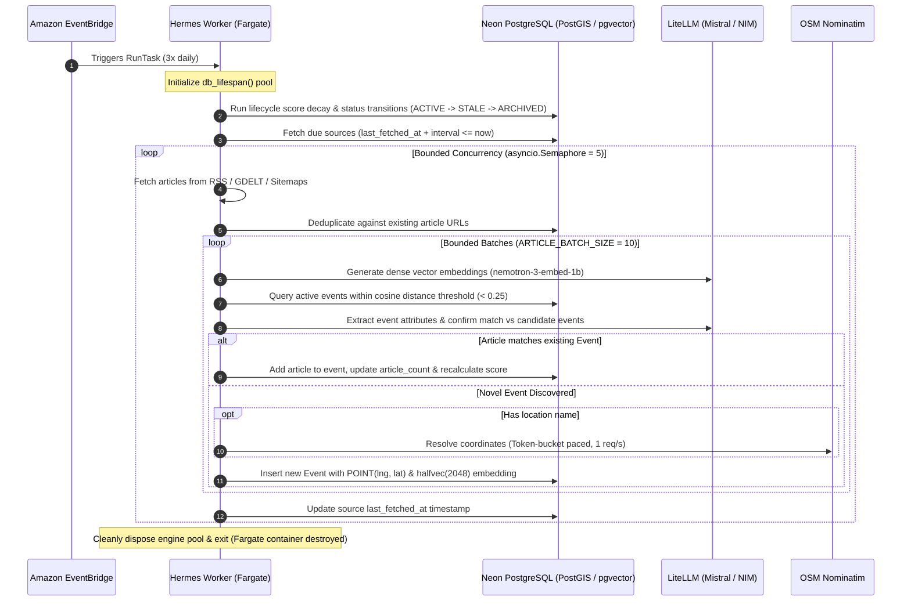
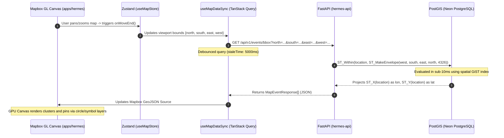
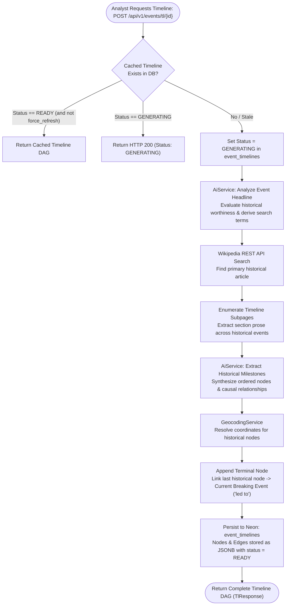

# Hermes — Production Architecture & System Design

This document details the production architecture, cloud infrastructure topology, data pipelines, and design rationale for **Hermes**.

---

## 1. High-Level Production Topology

Hermes is deployed as a resilient, cost-optimized multi-cloud system spanning **Vercel**, **Render**, **AWS ECS Fargate**, and **Neon Serverless PostgreSQL**.

```mermaid
flowchart TD
    subgraph ClientLayer["Client & Edge Layer (Vercel)"]
        User["End User Browser"]
        VercelEdge["Vercel SSR (Node.js Runtime)\napps/hermes • hermes-eight-inky.vercel.app"]
        ClerkAuth["Clerk Authentication\nSession Management & JWT"]
    end

    subgraph ApiLayer["API Serving Layer (Render)"]
        RenderApi["FastAPI REST Service\napps/hermes-api (Free Tier Container)"]
    end

    subgraph BatchLayer["Autonomous Ingestion Layer (AWS ap-southeast-2)"]
        EventBridge["Amazon EventBridge\nSchedule: 3x daily"]
        ECR["Amazon ECR\nhermes-worker:latest (~319 MB)"]
        Fargate["AWS ECS Fargate Task\n0.25 vCPU • 512 MB RAM • Ephemeral CLI"]
        CloudWatch["Amazon CloudWatch Logs\n/ecs/hermes-worker"]
    end

    subgraph DataLayer["Persistence Layer (Neon Serverless PostgreSQL 16)"]
        PgBouncer["PgBouncer Connection Pooler\nTransaction Pooling (Port 5432/6543)"]
        PostGIS["PostGIS 3.4 Spatial Engine\nGeometry(POINT, 4326) • GiST Index"]
        PgVector["pgvector Extension\nhalfvec(2048) • HNSW Index"]
        Relational["Relational Tables\nevents, articles, sources, event_timelines, geocode_cache"]
    end

    subgraph ExternalServices["External Intelligence & Inference APIs"]
        RSSFeeds["Global News Feeds\nRSS / Atom / News Sitemaps"]
        GDELT["GDELT 2.0 Doc API\nGlobal Event Database"]
        Nominatim["OpenStreetMap Nominatim\nToken-Bucket Rate Limited (1 req/s)"]
        Wikipedia["MediaWiki REST API\nHistorical Archive Querying"]
        LiteLLM["LiteLLM Inference Router"]
        Mistral["Primary LLM:\nmistral/ministral-8b-latest"]
        NvidiaNim["Fallback LLM:\nnvidia_nim/openai/gpt-oss-20b\nEmbeddings:\nnvidia_nim/nvidia/nemotron-3-embed-1b"]
    end

    %% User interactions
    User <-->|"HTTPS / WebGL Map Interactions"| VercelEdge
    VercelEdge <-->|"Server-Side Auth Validation"| ClerkAuth
    User <-->|"Direct REST Queries (/events/bbox, /events/tl)"| RenderApi

    %% API to Database
    RenderApi <-->|"asyncpg / SQLAlchemy 2.0 (SSL)"| PgBouncer

    %% API to AI & Wikipedia
    RenderApi <-->|"Timeline Extraction"| LiteLLM
    RenderApi <-->|"Historical Article Search"| Wikipedia
    RenderApi <-->|"Historical Node Geocoding"| Nominatim

    %% Worker Execution
    EventBridge -->|"RunTask Trigger"| Fargate
    ECR -.->|"Image Pull"| Fargate
    Fargate -->|"Logs & Telemetry"| CloudWatch
    Fargate <-->|"Source Polling"| RSSFeeds
    Fargate <-->|"Event Discovery"| GDELT
    Fargate <-->|"Embeddings & Event Extraction"| LiteLLM
    Fargate <-->|"Location Resolution"| Nominatim
    Fargate <-->|"Batch Upserts & Lifecycle Decay"| PgBouncer

    %% Database internals
    PgBouncer --> PostGIS
    PgBouncer --> PgVector
    PgBouncer --> Relational

    %% LLM routing
    LiteLLM --> Mistral
    LiteLLM -.->|"Failover / Embeddings"| NvidiaNim
```

---

## 2. Infrastructure & Hosting Topology

### A. Frontend Application (`apps/hermes`)
- **Hosting Platform**: **Vercel** (`apps/hermes` deployed at [`hermes-eight-inky.vercel.app`](https://hermes-eight-inky.vercel.app)).
- **Runtime**: Server-Side Rendering (SSR) running on the Vercel Node.js runtime via `@react-router/node`.
- **Authentication**: **Clerk** integration via `@clerk/react-router`. Authentication is evaluated server-side in route loaders (`getAuth`) before rendering the document shell, preventing unauthenticated page flash.
- **Client Rendering**: Mapbox GL JS WebGL canvas runs strictly in client contexts behind dynamic lazy-load boundaries (`React.lazy` + `Suspense`), shielding browser globals (`window`, WebGL context) from Node.js SSR evaluation.
- **Client Data Synchronization**: Communicates directly with `hermes-api` using `@tanstack/react-query` and `axios` to synchronize viewport bounding boxes (`/api/v1/events/bbox`).

### B. REST API Service (`apps/hermes-api`)
- **Hosting Platform**: **Render** (Free Tier Web Service container).
- **Runtime**: Python 3.14 + Uvicorn running FastAPI.
- **Stateless 12-Factor Contract**: The API service executes zero background jobs, schedulers, or ingestion loops. It serves two distinct read-optimized workloads:
  1. High-frequency spatial bounding box queries (`GET /api/v1/events/bbox`) parameterized by viewport bounds (`north`, `south`, `east`, `west`).
  2. On-demand causal timeline synthesis (`POST /api/v1/events/tl/{id}`) that discovers historical antecedents and generates causal DAGs.
- **CORS Handling**: Handlers in [`core/errors.py`](file:///home/pavan/proj/hermes/apps/hermes-api/src/hermes_api/core/errors.py) explicitly inject access headers (`_cors_headers(request)`) to prevent Starlette `ExceptionMiddleware` from masking application exceptions behind browser CORS errors.
- **Graceful Degradation**: If external LLM API credentials are not provisioned, spatial and event retrieval endpoints remain operational, while timeline synthesis returns an explicit `HTTP 503 Service Unavailable`.

### C. Ingestion & Lifecycle Worker (`apps/hermes-worker`)
- **Hosting Platform**: **AWS ECS Fargate** (Sydney region: `ap-southeast-2`).
- **Compute Sizing**: `0.25 vCPU` and `512 MB RAM` running an x86-64 Linux container image (~319 MB) hosted in a private **Amazon ECR** repository.
- **Scheduling**: **Amazon EventBridge** triggers execution three times daily (`cron(0 0,8,16 * * ? *)`) via ECS `RunTask`.
- **Ephemeral Run-and-Die Execution Model**:
  - The worker process spins up on demand, wraps database connections within [`db_lifespan()`](file:///home/pavan/proj/hermes/apps/hermes-worker/src/hermes_worker/core/lifespan.py), and executes `hermes-worker run-all` (lifecycle transitions and due source synchronization).
  - Typical runtime is **5 to 10 minutes**.
  - Upon task completion, the container terminates cleanly (`sys.exit(0)` on success or `sys.exit(1)` on error). Fargate deallocates compute resources immediately, terminating billing charges.
  - Telemetry and stdout/stderr logs stream to **Amazon CloudWatch Logs** under `/ecs/hermes-worker`.

### D. Persistence Layer (`libs/shared/hermes-db`)
- **Hosting Platform**: **Neon Serverless PostgreSQL 16**.
- **Extensions**:
  - `postgis`: Enables geospatial operations (`Geometry(POINT, 4326)`), R-tree GiST indexing, and native SQL spatial filtering (`ST_Within`, `ST_MakeEnvelope`).
  - `pgvector`: Enables dense vector storage using 16-bit half-precision floats (`halfvec(2048)`) and HNSW index traversal for sub-15ms approximate nearest-neighbor search.
- **Connection Management**:
  - Async driver: `asyncpg` via SQLAlchemy 2.0 AsyncEngine.
  - Pooled through Neon's built-in **PgBouncer** proxy (transaction pooling).
  - To prevent transaction-pooling errors with prepared statements, engines are instantiated with `connect_args={"statement_cache_size": 0}`.
  - Schema alterations are managed strictly through **Alembic** migrations.

---

## 3. Data Ingestion & Consensus Pipeline

The batch synchronization pipeline in [`SyncService`](file:///home/pavan/proj/hermes/apps/hermes-worker/src/hermes_worker/services/sync.py) processes incoming articles through a strict sequence optimized for token efficiency and memory constraints:

### Architectural Optimizations ("The Why")

1. **Embed Before Extract (Vector Pre-Filtering)**:
   - Articles are embedded using `nvidia_nim/nvidia/nemotron-3-embed-1b` (2048-dimensional vectors) before prompting an LLM.
   - Postgres evaluates approximate nearest neighbors using an HNSW index with `halfvec_cosine_ops`.
   - Instead of performing $O(N^2)$ pairwise LLM text comparisons, candidate events within cosine distance $< 0.25$ are passed directly into the LLM extraction prompt for confirmation or new event creation.

2. **Memory Bounds on Fargate (512 MB RAM)**:
   - Untrusted XML parsing and web scraping can cause memory bloat in Python.
   - Processing feeds in chunks of `ARTICLE_BATCH_SIZE = 10` constrained by an `asyncio.Semaphore(5)` ensures memory footprint remains well beneath the 512 MB container threshold.

3. **Grounded Geocoding Shield**:
   - LLMs are never permitted to guess or generate latitude/longitude coordinates directly.
   - The LLM extracts only normalized location names (e.g. `"Rafah, Gaza Strip"`), which are resolved by [`GeocodingService`](file:///home/pavan/proj/hermes/libs/shared/hermes-ai/src/hermes_ai/services/geocoding.py) against OpenStreetMap Nominatim.
   - Paced by a token-bucket rate limiter enforcing the Nominatim 1 request/second usage policy.
   - Unresolvable locations are stored as negative cache entries (`latitude=NULL`, `longitude=NULL`), preventing repeated outbound calls.

---

## 4. Multi-Factor Trending & Ranking Algorithm

Event prominence is calculated using an objective mathematical model incorporating editorial credibility, geopolitical diversity, reporting velocity, and continuous exponential time decay.

### The Scoring Formulation

When an incoming article $a$ is attached to an event $E$, the event's score updates according to:

$$\Delta S = W_{\text{cred}}(a) \times F_{\text{synd}}(a) \times M_{\text{impact}}(E) \times D_{\text{shannon}}(E) \times V_{\text{mult}}(E)$$

Where:

- **Credibility Weight ($W_{\text{cred}}$)**: Calibrated by source tier:
  - Tier 1 (Wire Services: Reuters, AP, AFP): **3.0**
  - Tier 2 (Major Global Outlets: BBC, NYT, DW, France24): **2.0**
  - Tier 3 (Regional / Secondary Outlets): **1.0**
  - Tier 4 (Aggregators / Unverified Outlets): **0.5**

- **Syndication Dampening ($F_{\text{synd}}$)**: Dampens repetitive reporting from the same publisher:
  $$F_{\text{synd}} = \frac{1}{\sqrt{N_{\text{source}}}}$$
  *(where $N_{\text{source}}$ is the count of articles contributed by that specific source).*

- **Geopolitical Shannon Diversity ($D_{\text{shannon}}$)**: Rewards cross-bloc corroboration. Sources are mapped into 6 geopolitical blocs: `GLOBAL_WIRE`, `NORTH_AMERICA`, `EUROPE`, `ASIA_PACIFIC`, `MIDDLE_EAST_AFRICA`, `LATIN_AMERICA`. The Shannon entropy $H$ of the bloc distribution scales the score:
  $$H = -\sum_{b} p_b \ln(p_b), \quad D_{\text{shannon}} = 1.0 + 0.5 \times \min(H, 1.0)$$

- **Velocity Multiplier ($V_{\text{mult}}$)**: Measures publishing frequency over elapsed hours $\Delta t$:
  $$\text{velocity} = \frac{N_{\text{articles}}}{\max(\Delta t, 1.0)}, \quad V_{\text{mult}} = 1.0 + \min((\text{velocity} - 1.0) \times 0.2, 1.0)$$

- **Organic Half-Life Time Decay**:
  Trending scores diminish organically over time via an 18-hour half-life model:
  $$\lambda = 2^{-\frac{1}{18}} \approx 0.9622 \text{ per hour}$$
  During every worker lifecycle pass, scores decay according to elapsed time. Events transition from `ACTIVE` $\rightarrow$ `STALE` after 24 hours without new reporting, and `STALE` $\rightarrow$ `ARCHIVED` after 48 hours. Any new corroborated article immediately reactivates a `STALE` event to `ACTIVE`.

---

## 5. Spatial Query & WebGL Viewport Synchronization

Serving live event pins across a global map without lag requires tight coordination between Mapbox GL, TanStack Query, and PostGIS:

### Spatial Optimization Decisions

1. **Direct Coordinate Projection**: Rather than serializing and transmitting Well-Known Binary (WKB) geometry objects from PostgreSQL and parsing them on the client, the query executes `ST_X(Event.location)` and `ST_Y(Event.location)` directly in the SQL select projection.
2. **GPU Canvas Layers**: Map markers are rendered as Mapbox GL WebGL `circle` and `symbol` layers rather than DOM elements (`new mapboxgl.Marker()`). This enables thousands of concurrent data points to be rendered and clustered at 60 FPS without DOM thrashing.
3. **Decoupled Viewport State**: Viewport coordinates are tracked in a global Zustand store ([`useMapStore`](file:///home/pavan/proj/hermes/libs/map/src/lib/store/store.ts)). React components subscribe to fine-grained state slices, preventing cascading re-renders across the Mapbox container when popups or drawers toggle.

---

## 6. Causality Timeline Synthesis Engine

When an analyst clicks an active event on the map and requests historical lineage, [`apps/hermes-api`](file:///home/pavan/proj/hermes/apps/hermes-api) initiates an on-demand historical timeline synthesis (`POST /api/v1/events/tl/{id}`):

### State Machine & Idempotency
- Status transitions (`GENERATING` $\rightarrow$ `READY` / `NO_CONTENT` / `FAILED`) are tracked in the `event_timelines` table.
- Concurrent requests received while an AI generation is active receive an immediate `GENERATING` status response, preventing redundant external API calls and token waste.
- Analysts can bypass cached graphs using `?force_refresh=true`.

---

## 7. Model Routing, Failover & Geocoding Resiliency

The intelligence layer ([`hermes-ai`](file:///home/pavan/proj/hermes/libs/shared/hermes-ai)) provides unified model orchestration and defense mechanisms:

| Capability | Primary Engine | Fallback Engine | Rationale |
| :--- | :--- | :--- | :--- |
| **Event & Timeline Extraction** | `mistral/ministral-8b-latest` | `nvidia_nim/openai/gpt-oss-20b` | High-throughput structured JSON extraction with automatic failover on network timeouts or Pydantic `ValidationError`. |
| **Vector Embeddings** | `nvidia_nim/nvidia/nemotron-3-embed-1b` | None | Produces 2048-dimensional dense semantic vectors optimized for retrieval and deduplication. |
| **Geocoding** | OpenStreetMap Nominatim | Local Negative Cache | Token-bucket rate-limited (1 req/s) with a 120-second circuit breaker cooldown on persistent HTTP 429s. |

### Schema-Level Validation Failover
When an LLM returns HTTP 200 with syntactically valid JSON that fails Pydantic schema validation (e.g. missing required enum fields or misformatted relations), [`LlmService`](file:///home/pavan/proj/hermes/libs/shared/hermes-ai/src/hermes_ai/services/llm.py) catches the `ValidationError` and automatically retries the prompt against the secondary fallback model.

---

## 8. Failure Modes, Tradeoffs & Operational Boundaries

| Scenario | Impact | Mitigation Strategy |
| :--- | :--- | :--- |
| **Render Free-Tier Spin-Down** | Inactivity causes the container to spin down, resulting in a 30–50s cold start on initial HTTP requests. | Frontend client handles loading states gracefully with animated HUD placeholders (`BootSequence`, `MapLoadingFallback`). |
| **Nominatim 429 Rate Limiting** | OpenStreetMap blocks excessive request volumes. | `NominatimResilienceManager` enforces a 1 req/s token bucket, in-flight request deduplication, exponential backoff with `Retry-After` parsing, and a 120-second circuit breaker. |
| **LLM Provider Outage** | External inference API becomes unavailable or credentials expire. | `hermes-api` catches client initialization errors and returns `HTTP 503` for timeline synthesis while keeping spatial map queries fully operational. |
| **PgBouncer Transaction Pooling** | Prepared statement conflicts across pooled connections. | SQLAlchemy async engines instantiate with `connect_args={"statement_cache_size": 0}` across both API and Worker processes. |
| **SSR WebGL Hydration Mismatch** | Mapbox GL attempts to access `window` or WebGL context on the Node.js server. | Map container is isolated behind `React.lazy` and dynamic imports inside `apps/hermes/app/routes/map.tsx`. |

---

## 9. CI/CD & Deployment Workflows

Continuous Integration and Continuous Deployment are automated via GitHub Actions:

- [`.github/workflows/ci.yml`](file:///home/pavan/proj/hermes/.github/workflows/ci.yml):
  - **Triggers**: Pushes and pull requests to `master` and `dev`.
  - **Tasks**: Sets up Node.js 22 and Python 3.14 via `uv`, runs `npm run lint` (ESLint + Ruff), runs `npm test` (Vitest + Pytest), and verifies type checks.
- [`.github/workflows/cd-worker.yml`](file:///home/pavan/proj/hermes/.github/workflows/cd-worker.yml):
  - **Triggers**: Successful completion of the CI workflow on `master` or `dev`.
  - **Path Filters**: Runs only when changes touch `apps/hermes-worker/**`, `libs/shared/hermes-db/**`, `libs/shared/hermes-ai/**`, `pyproject.toml`, or `uv.lock`.
  - **Tasks**: Authenticates to AWS, logs into Amazon ECR, builds the production target of `apps/hermes-worker/Dockerfile` via Docker Buildx, and pushes image tags (`:latest` and `:<git-sha>`).
