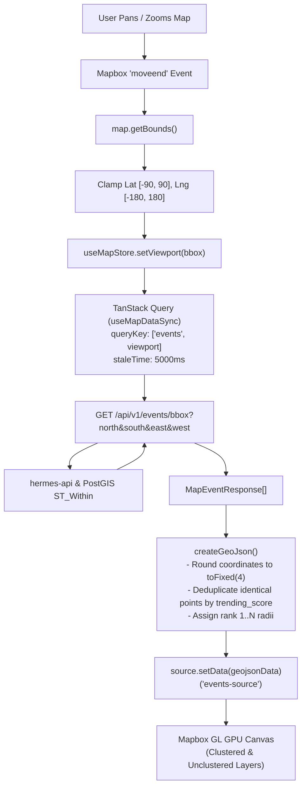
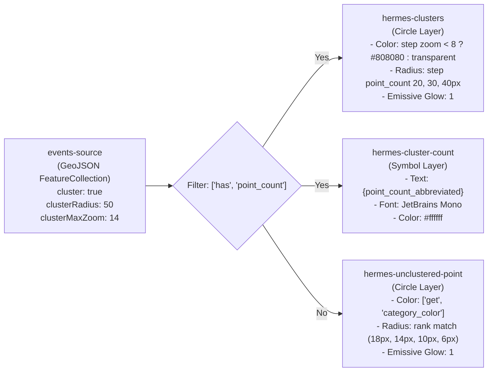
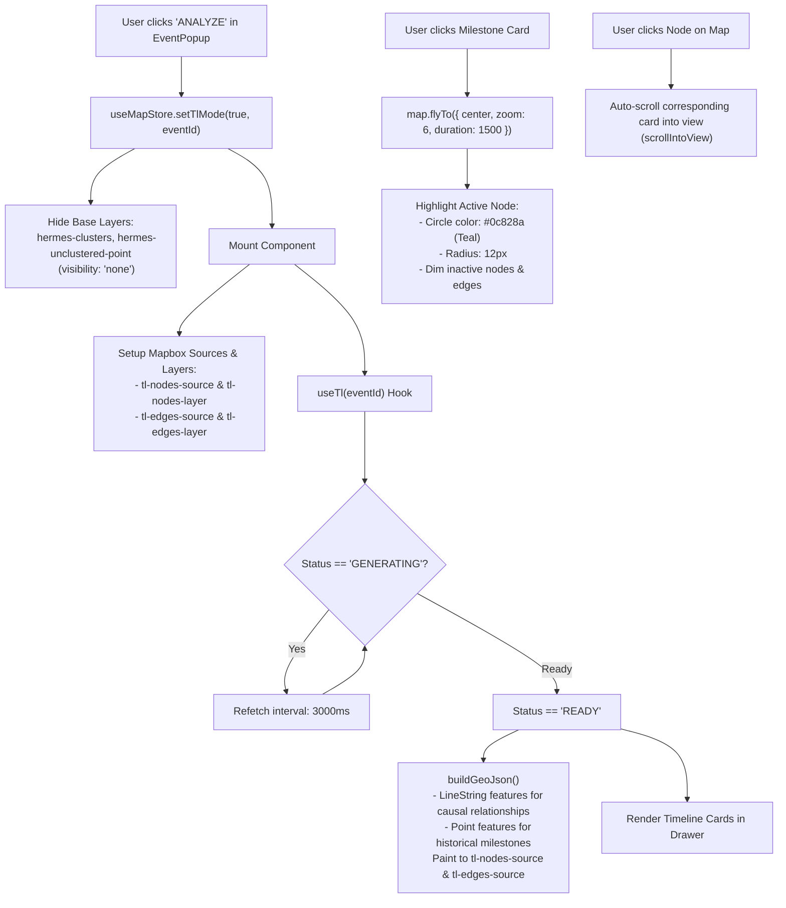

# @hermes/map

The `@hermes/map` library is the core geospatial intelligence and temporal visualization engine of Project Hermes. It encapsulates all Mapbox GL JS WebGL context management, spatial clustering, data-driven styling, coordinate screen projection, and interactive historical timeline graph rendering.

---

## 1. Architectural Decisions & Engineering Rationale ("The Why")

### WebGL GPU Native Layers vs. DOM Markers
- **Decision**: All clusters, cluster count badges, and individual event markers are rendered as native Mapbox WebGL layers (`circle` and `symbol` types) within the GPU canvas, avoiding HTML DOM markers (`new mapboxgl.Marker()`).
- **Rationale**: Rendering thousands of DOM markers incurs massive CPU layout calculation and DOM reflow penalties on every frame of panning and zooming. Past 200–300 DOM markers, user interaction drops below 15 FPS. WebGL instanced rendering renders 10,000+ points on the GPU in a single draw call at a rock-solid 60 FPS.

### Strict `useRef` for Map Instance Lifecycle
- **Decision**: The `mapboxgl.Map` instance is stored strictly in a React `useRef` (`const map = useRef<mapboxgl.Map | null>(null)`).
- **Rationale**: A Mapbox GL instance contains heavy internal state: WebGL contexts, animation frame handles, tile caches, and event dispatchers. Putting this instance in React `useState` triggers recursive reconciliation and infinite re-render cascades as React attempts to compare or mutate internal references.

### Zustand (`useMapStore`) as Single Source of Truth
- **Decision**: Viewport telemetry (`BoundingBox`), selected event state, and timeline modal flags are stored in a centralized Zustand store (`useMapStore`).
- **Rationale**: Mapbox event listeners fire from WebGL event dispatchers outside the React synthetic event system. Storing telemetry in Zustand eliminates complex callback drilling and prevents split-brain state desynchronization between the WebGL canvas, HUD overlays (`EventPopup`, `TlPanel`), TanStack Query hooks, and top-level telemetry widgets (`LiveClock`).

### Viewport Telemetry Debouncing & PostGIS Coordinate Clamping
- **Decision**: Viewport bounds are updated on Mapbox's `moveend` event, clamped to `[-90, 90]` latitude and `[-180, 180]` longitude, and synchronized via TanStack Query with `staleTime: 5000`.
- **Rationale**: Querying the spatial database during active dragging (`move` or `render`) would flood `hermes-api` and the PostGIS backend with hundreds of redundant spatial queries. Synchronizing on `moveend` naturally debounces user interactions. Clamping coordinates prevents PostGIS `ST_MakeEnvelope` from crashing when high-latitude Mercator projections produce latitudes exceeding ±85° or longitudes wrapping around the world.

### Floating HUD Screen Projection Pattern
- **Decision**: Floating overlays (`EventPopup`) do not attach to Mapbox DOM markers. Instead, they calculate screen coordinates via `requestAnimationFrame` + `map.project(lngLat)`.
- **Rationale**: Completely decouples the React component tree from Mapbox DOM lifecycle. It allows pure CSS hardware-accelerated transforms (`translate3d`), enables viewport boundary clamping (`Math.max` / `Math.min`) to prevent modals from clipping outside the screen edges, and guarantees smooth 60 FPS tracking during camera easing.

### Multi-Speed Camera Motion Physics
- **Decision**: Camera movements utilize distinct easing curves tailored to context:
  - **Pin Selection**: `map.easeTo({ center, duration: 800, easing: (t) => t * (2 - t) })` (Smooth quadratic ease-out).
  - **Cluster Expansion**: `map.easeTo({ center, zoom, duration: 400, easing: (t) => t })` (Snappy linear easing for tactical drill-down).
  - **Timeline Milestone Hops**: `map.flyTo({ center, zoom: 6, duration: 1500 })` (Parabolic curve preserving spatial orientation across long distances).
- **Rationale**: Linear easing gives clusters an immediate, tactical response, while quadratic ease-out centers event cards without causing motion sickness. Parabolic fly-to curves help users understand regional spatial transitions between historical milestones.

### Dynamic Timeline Layer Re-Injection (`TlPanel`)
- **Decision**: Historical causality graphs are rendered dynamically on the map using dedicated sources (`tl-nodes-source`, `tl-edges-source`) and layers (`tl-nodes-layer`, `tl-edges-layer`).
- **Rationale**: When opening the timeline drawer, `TlPanel` mounts and tears down these layers cleanly. A `mountId = useRef({})` dependency ensures re-initialization even if the `map` reference remains stable. Base event layers are toggled using `map.getLayer()` rather than `map.isStyleLoaded()`, preventing race conditions when map tiles are in-flight.

### Client-Side Spatial Deduplication & Priority Scaling
- **Decision**: In `createGeoJson`, events are bucketed by coordinates rounded to 4 decimal places (`toFixed(4)` ≈ 11m).
- **Rationale**: Multiple RSS feeds frequently report news at identical city-center coordinates. Deduplicating by selecting the event with the highest `trending_score` eliminates z-fighting and overlapping circles, mapping top events to larger visual radii (rank 1: 18px, rank 2: 14px, rank 3: 10px, fallback: 6px).

---

## 2. System Architecture Diagrams

### A. Map Telemetry & Query Synchronization Loop



### B. WebGL Layer Rendering Pipeline



### C. Interactive Timeline & Lineage Rendering Flow



---

## 3. Component Architecture

### `<MapConfigProvider />` & `useMapConfig()`
A React context provider that exposes backend connection parameters to the map library. This decouples the map engine from specific bundler environment configurations (`import.meta.env` or `process.env`).

```tsx
export interface MapConfig {
  baseUrl: string;
  apiVer: string;
  mapboxToken: string;
}
```

- **Location**: `libs/map/src/lib/config-context.tsx`
- **Usage**:
  ```tsx
  <MapConfigProvider config={{ baseUrl, apiVer, mapboxToken }}>
    <MapView />
  </MapConfigProvider>
  ```

### `<MapView />`
The primary map engine component. Mounts the Mapbox GL WebGL canvas, configures data sources, instantiates clustered and unclustered layers, binds event listeners, and controls mode toggling.

- **Props**: None (configuration injected via `MapConfigProvider`, state via `useMapStore`).
- **Features**:
  - Locked 2D projection (`mercator`, `pitch: 0`, `dragRotate: false`, `renderWorldCopies: false`).
  - Native cluster expansion on click with linear easing.
  - Smooth camera panning to clicked unclustered events (`easeTo` with quadratic ease-out).
  - Mode-based layer switching between standard event view and timeline mode.
  - "SCANNING..." tactical HUD loader indicator during active TanStack query fetching.

### `<EventPopup />`
A floating tactical HUD modal positioned directly over the selected event pin.

- **Props**: `{ map: mapboxgl.Map | null }`.
- **Features**:
  - Synchronized via `requestAnimationFrame` + `map.project()`.
  - Screen boundary edge-clamping to prevent modal clipping.
  - Terminal scramble-text animation effect for AI summaries (vanilla JS 50-frame reveal).
  - Category badge colored dynamically via `category_color`.
  - Normalized source links showing domain name and slugified article titles.
  - "ANALYZE" button triggering timeline lineage mode.

### `<TlPanel />`
An interactive historical causality drawer that displays causal nodes, Wikipedia historical antecedents, and connecting edges.

- **Props**: `{ map: mapboxgl.Map | null }`.
- **Features**:
  - Injects dynamic Mapbox LineString (`tl-edges-layer`) and Point (`tl-nodes-layer`) layers.
  - Automatically polls status every 3 seconds while generation is in progress.
  - Interactive camera hops (`map.flyTo()`) when selecting historical milestones.
  - Bidirectional selection: clicking a map node auto-scrolls the corresponding card into view; clicking a card highlights the map node and hops camera.
  - Status management: handles `GENERATING`, `READY`, `NO_CONTENT`, and `FAILED` gracefully with retry mechanisms.

### Data-Driven Categorization & Visual Filtering
Visual categorization is implemented natively on the GPU using Mapbox Data-Driven Styling expressions:
- **Pin Color**: `['get', 'category_color']` evaluates each event's category hex color dynamically.
- **Pin Size**: `['match', ['get', 'rank'], 1, 18, 2, 14, 3, 10, 6]` renders prominent events with larger radii.
- **Cluster Badge Styling**: `['step', ['get', 'point_count'], 20, 10, 30, 50, 40]` scales cluster boundaries based on event density.

---

## 4. State Management (`useMapStore`)

The Zustand store (`libs/map/src/lib/store/store.ts`) acts as the single source of truth for all spatial telemetry and selection state.

### State Schema

| Property | Type | Description |
| :--- | :--- | :--- |
| `selectedEventId` | `string \| null` | UUID of the currently selected event pin, or `null`. |
| `selectedEventLngLat` | `[number, number] \| null` | Longitude and latitude of selected pin for popup projection. |
| `viewport` | `BoundingBox \| null` | Current geographic bounding box (`north`, `south`, `east`, `west`). |
| `isTlMode` | `boolean` | Flag indicating whether historical timeline mode is active. |
| `tlTargetId` | `string \| null` | Event ID being analyzed in timeline mode. |

### Actions

| Action | Signature | Description |
| :--- | :--- | :--- |
| `setSelectedEventId` | `(id: string \| null, lngLat?: [number, number] \| null) => void` | Sets the selected event and coordinates. |
| `setViewport` | `(viewport: BoundingBox) => void` | Updates current bounding box coordinates. |
| `setTlMode` | `(active: boolean, targetId?: string \| null) => void` | Toggles timeline drawer and target event ID. |

---

## 5. Data Synchronization Hooks

### `useMapDataSync()`
- **File**: `libs/map/src/lib/hooks/datasync.ts`
- **Purpose**: Synchronizes the viewport bounding box with the backend spatial query endpoint (`/api/v1/events/bbox`).
- **Features**:
  - Clamps coordinates to valid geographic ranges (`[-90, 90]` lat, `[-180, 180]` lng).
  - Caches results with `staleTime: 5000` to prevent redundant network requests.
  - Automatically disables when `viewport` is `null`.

### `useEventDetails(eventId: string | null)`
- **File**: `libs/map/src/lib/hooks/eventDetails.ts`
- **Purpose**: Fetches comprehensive event metadata, AI summary, and verified article sources (`/api/v1/events/:id`).
- **Caching**: `staleTime: 60000` (1 minute).

### `useTl(eventId: string | null)`
- **File**: `libs/map/src/lib/hooks/useTl.ts`
- **Purpose**: Manages historical timeline generation, polling, and cache invalidation (`/api/v1/events/tl/:id`).
- **Features**:
  - Dynamic polling (`refetchInterval: 3000`) while status is `'GENERATING'`.
  - Mutation `regenerate()` sends `?force_refresh=true` to recalculate causal lineages.

---

## 6. WebGL Layer Specifications

| Layer ID | Type | Source | Filter Expression | Key Paint/Layout Properties |
| :--- | :--- | :--- | :--- | :--- |
| `hermes-clusters` | `circle` | `events-source` | `['has', 'point_count']` | `circle-color`: zoom-stepped (`#808080` < zoom 8, hollow outline >= 8)<br>`circle-radius`: stepped by `point_count` (20px, 30px, 40px)<br>`circle-stroke-width`: 2px |
| `hermes-cluster-count` | `symbol` | `events-source` | `['has', 'point_count']` | `text-field`: `{point_count_abbreviated}`<br>`text-font`: `['JetBrains Mono Regular', 'Arial Unicode MS Bold']`<br>`text-size`: 12 |
| `hermes-unclustered-point` | `circle` | `events-source` | `['!', ['has', 'point_count']]` | `circle-color`: `['get', 'category_color']`<br>`circle-radius`: rank match (18px, 14px, 10px, 6px)<br>`circle-stroke-color`: `#000000` |
| `tl-edges-layer` | `line` | `tl-edges-source` | None | `line-color`: `#00f0ff`<br>`line-width`: 2px<br>`line-dasharray`: `[2, 2]` |
| `tl-nodes-layer` | `circle` | `tl-nodes-source` | None | `circle-color`: active node `#0c828a`, current event category color, historical `#00f0ff`<br>`circle-radius`: active 12px, current 10px, historical 6px |

---

## 7. Directory Structure

```text
libs/map/
├── .agents/
│   └── rules/
│       └── mapbox-gis.md          # Strict Mapbox & GIS guidelines (useRef, data-driven styling)
├── src/
│   ├── index.ts                   # Barrel export (MapView, useMapStore, MapConfigProvider)
│   └── lib/
│       ├── config-context.tsx     # MapConfigProvider & useMapConfig React context
│       ├── hooks/
│       │   ├── datasync.ts        # useMapDataSync (Bounding box query hook)
│       │   ├── eventDetails.ts    # useEventDetails (Full event payload hook)
│       │   └── useTl.ts           # useTl (Timeline generation & polling hook)
│       ├── store/
│       │   ├── store.ts           # Zustand global map telemetry store
│       │   └── store.spec.ts      # Unit tests for store state transitions
│       └── ui/
│           ├── map-view.tsx       # MapView component & WebGL layer manager
│           └── components/
│               ├── EventPopup.tsx # Floating projected event HUD modal
│               └── TlPanel.tsx    # Historical timeline drawer & layer injector
├── package.json                   # Library package manifest (@hermes/map)
├── vite.config.mts                # Vitest & Vite configuration
├── tsconfig.json                  # TypeScript configuration
├── AGENTS.md                      # AI agent architectural context & decision log
└── README.md                      # Comprehensive developer reference manual
```

---

## 8. Testing & Quality Verification

All commands must be executed from the workspace root:

```bash
# Run unit test suite (Vitest)
npx nx test @hermes/map

# Run linter checks (ESLint)
npx nx lint @hermes/map

# Type check and build library
npx nx build @hermes/map
```
