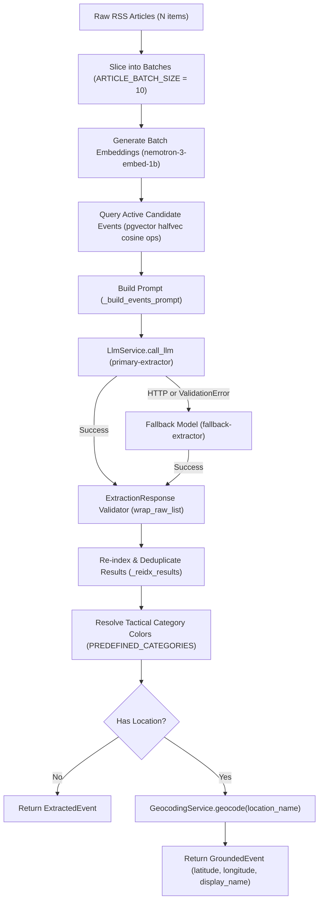
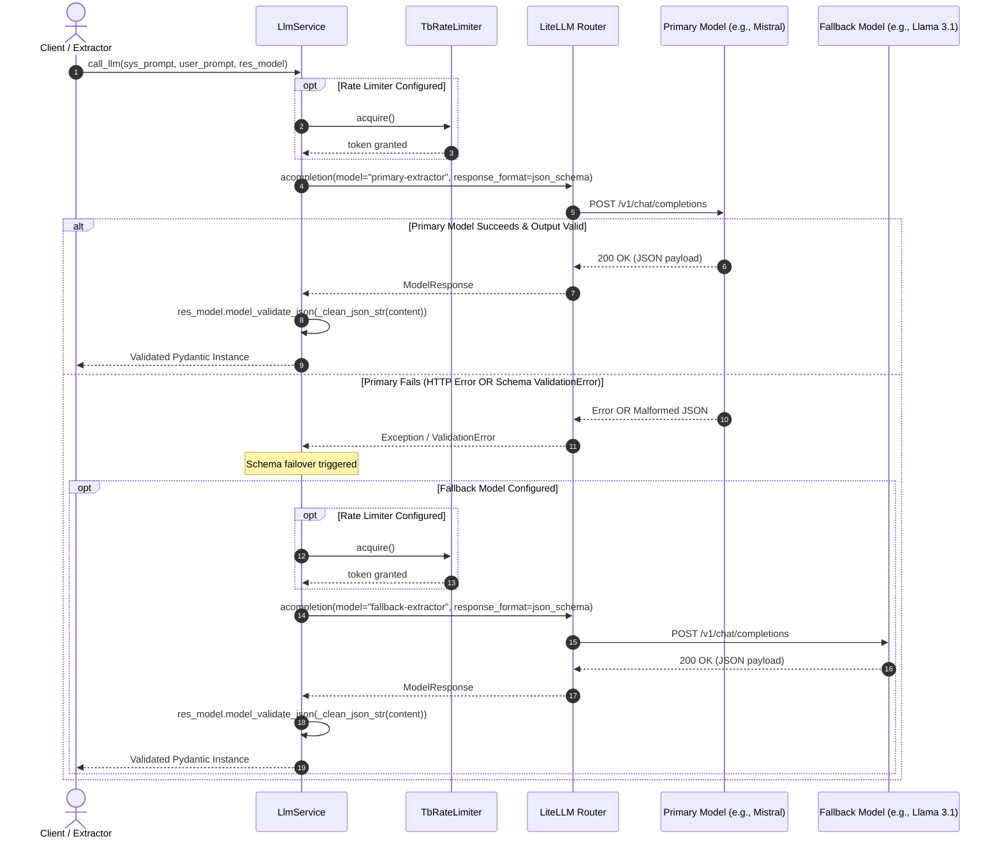

# Hermes AI — Shared Intelligence & Geocoding Shield Library

`hermes-ai` is the foundational artificial intelligence, structured extraction, embedding generation, and geospatial grounding library for Project Hermes. It serves as the shared intelligence engine for both the ingestion worker (`apps/hermes-worker`) and the REST API (`apps/hermes-api`).

---

## 1. Overview & Capabilities

Modern news extraction pipelines face significant reliability hurdles: LLM vendor API fragmentation, hallucinated geospatial coordinates, rate-limiting constraints from community services like OpenStreetMap Nominatim, and inconsistent JSON outputs from small language models.

`hermes-ai` solves these challenges through a unified, database-agnostic architecture:

- **Decoupled LLM Orchestration**: Universal provider abstraction through [LiteLLM](https://docs.litellm.ai/), enabling seamless routing, retries, and fallbacks across NVIDIA NIM, Mistral AI, OpenAI, and Anthropic.
- **Dual-Tier Schema Failover**: Catches both HTTP transport errors and semantic Pydantic `ValidationError` deserialization failures, automatically falling back to secondary models.
- **Zero-Hallucination Geocoding Shield**: Grounded geospatial resolution via OpenStreetMap Nominatim, protected by an asynchronous token-bucket rate limiter (1.0s minimum interval), in-flight request deduplication, negative result caching, and an automated circuit breaker.
- **High-Precision Vector Embeddings**: Generates 2048-dimensional dense embeddings using `nemotron-3-embed-1b`, optimized for vector similarity search via `pgvector` half-precision (`halfvec(2048)`) indexing.
- **Polymorphic Extraction Normalization**: Defensive data parsing that tolerates raw JSON lists, markdown backticks, and localized dictionary wrappers without pipeline crashes.
- **Protocol-Driven Inversion of Control**: Clean decoupling from database models through `GeocodeCacheProtocol`, allowing consumers to inject PostgreSQL caches without ORM coupling.

---

## 2. Architecture & Design Principles ("The Why")

### Why LiteLLM Abstraction?
Direct integration with proprietary SDKs binds an application to vendor-specific request parameters and error models. `hermes-ai` utilizes LiteLLM's `Router` to decouple the high-level extraction logic from the underlying model provider. This enables:
- Seamless runtime switching between models (e.g., Mistral Large to LLaMA 3.1 70B).
- Unified JSON schema enforcement (`response_format={"type": "json_schema"}`).
- Centralized cooldown periods, retries, and exponential backoff.

### Why 2048-Dimensional `nemotron-3-embed-1b` Embeddings?
Geopolitical event aggregation requires cross-source consensus detection across diverse news feeds reporting in multiple languages and editorial styles. `nvidia/nemotron-3-embed-1b` produces 2048-dimensional embeddings that demonstrate superior retrieval accuracy and semantic clustering for news text. In conjunction with `hermes-db`, these vectors are stored in PostgreSQL using `halfvec(2048)` with HNSW indexes (`halfvec_cosine_ops`), reducing memory and disk footprint by 50% while preserving cosine similarity precision.

### Why a Dedicated Geocoding Shield for OSM Nominatim?
Large language models notoriously hallucinate geographic coordinates. To ensure absolute map precision, Hermes uses a hybrid pipeline: LLMs extract clean textual location names (e.g., `"Geneva, Switzerland"`), which are then resolved via OpenStreetMap Nominatim.
However, Nominatim is a non-profit community utility with a strict [Usage Policy](https://operations.osmfoundation.org/policies/nominatim/):
1. **1.0s Concurrency Pacing**: Max 1 request per second. Violations lead to immediate IP blacklisting. `NominatimResilienceManager` gates every external call behind an `asyncio.Lock()` and guarantees a minimum 1.0s elapsed interval.
2. **Negative Caching (`_NOT_FOUND`)**: Unresolvable location names (e.g., fictional places, metaphorical entities) would otherwise be repeatedly queried on every RSS ingestion cycle. `GeocodingService` saves negative cache entries (`latitude=None, longitude=None`), short-circuiting future requests.
3. **In-Flight Deduplication**: Multiple simultaneous articles mentioning the same city (e.g., `"Paris, France"`) share a single pending `asyncio.Future`, preventing redundant external requests.
4. **Circuit Breaker on 429/403**: If Nominatim responds with HTTP 429 Too Many Requests, exponential backoff respects the `Retry-After` header. If rate limits persist after 3 retries, the circuit breaker trips for a 120-second cooldown period, preventing permanent service bans.

### Why Polymorphic List Ingestion and Defensive Coercion?
While frontier models adhere strictly to JSON schemas, smaller or quantized open-source models (such as 7B or 8B parameter variants) often return:
- Raw JSON arrays (`[...]`) instead of object envelopes (`{"events": [...]}`).
- Markdown code blocks (` ```json ... ``` `).
- Localized dictionaries (`{"en": "Paris, France"}`) instead of scalar strings.

`ExtractionResponse.wrap_raw_list` and `coerce_to_str` defensively normalize these patterns before validation, drastically reducing extraction failure rates.

---

## 3. System Workflows & Data Flow

### Batch Event Extraction Workflow

The ingestion pipeline processes articles in batches of 10 (`ARTICLE_BATCH_SIZE = 10`), balancing token context limits against API call overhead.



### Geocoding Shield Decision Engine

```mermaid
flowchart TD
    Start["Location Name Input"] --> Clean["Sanitize & Normalize (clean_location_name)"]
    Clean --> Valid{"Valid Location Name?"}
    Valid -->|Filtered / Abstract Token| Reject["Return None (Skip Geocoding)"]
    Valid -->|Valid Place Name| CacheCheck{"Cache Check (GeocodeCacheProtocol)"}
    
    CacheCheck -->|Positive Hit (lat/lon present)| CacheHit["Return GeocodingResult"]
    CacheCheck -->|Negative Hit (lat/lon is None)| NegHit["Return None (Negative Cache Hit)"]
    CacheCheck -->|Cache Miss| InFlight{"In-Flight Future Active?"}
    
    InFlight -->|Yes| AwaitFlight["Await Shared asyncio.Future"]
    InFlight -->|No| CreateFlight["Create New asyncio.Future"]
    
    CreateFlight --> CBCheck{"Circuit Breaker Open?"}
    CBCheck -->|Yes (Cooldown Active)| CBBlock["Log Warning & Return None"]
    CBCheck -->|No| Pacing["Enforce Rate Pacing (asyncio.Lock, min 1.0s)"]
    
    Pacing --> Query["Dispatch HTTP GET to Nominatim"]
    Query --> StatusCheck{"HTTP Status"}
    
    StatusCheck -->|200 OK & Found| SavePos["Save to Cache (lat, lon, display_name)"]
    StatusCheck -->|200 OK & Empty| SaveNeg["Save Negative Cache (lat=None, lon=None)"]
    StatusCheck -->|429 Rate Limited| Backoff["Exponential Backoff with Retry-After"]
    StatusCheck -->|5xx / HTTP Error| NetRetry["Linear Retry Delay"]
    
    Backoff --> RetryCheck{"Retries Exhausted (3 attempts)?"}
    RetryCheck -->|No| Pacing
    RetryCheck -->|Yes| TripCB["Trip Circuit Breaker (120s cooldown)"]
    
    SavePos --> ResolveFuture["Resolve Future -> Return GeocodingResult"]
    SaveNeg --> ResolveFutureNone["Resolve Future -> Return None"]
    AwaitFlight --> EndResult["Return Future Result"]
    CBBlock --> ResolveFutureNone
    TripCB --> ResolveFutureNone
```

### Dual-Tier LLM Fallback Sequence



---

## 4. Domain Models & Schemas

### News Event Extraction Models (`hermes_ai.models.events`)

| Model | Purpose | Key Attributes |
| :--- | :--- | :--- |
| `ArticleInput` | Transport payload for unparsed news articles | `title: str`, `content: str` |
| `ExtractedEvent` | Raw structured event metadata produced by the LLM | `article_index: int`, `has_location: bool`, `location_name: str \| None`, `country_code: str \| None`, `headline: str`, `summary: str`, `category: str`, `category_color: str \| None`, `matched_event_id: str \| None` |
| `ExtractionResponse` | Batch envelope container with polymorphic array parsing | `events: list[ExtractedEvent]` |
| `GroundedEvent` | Subclass of `ExtractedEvent` enriched with verified coordinates | Inherits `ExtractedEvent` + `latitude: float \| None`, `longitude: float \| None`, `display_name: str \| None` |

### Historical Timeline Models (`hermes_ai.models.tl`)

| Model | Purpose | Key Attributes |
| :--- | :--- | :--- |
| `TlSearchQuery` | Triage decision for Wikipedia historical viability | `is_tl_worthy: bool`, `wiki_search_query: str \| None` |
| `TlNodeExtraction` | Milestone event node extracted from Wikipedia text | `date: str`, `headline: str`, `location_name: str \| None`, `summary: str` |
| `TlEdgeExtraction` | Causal dependency between timeline nodes | `source_index: int`, `target_index: int`, `relationship: str` |
| `TlExtractionResponse`| Full causal graph response | `tl_summary: str`, `nodes: list[TlNodeExtraction]`, `edges: list[TlEdgeExtraction]` |
| `GroundedTlNode` | Timeline node enriched with verified coordinates | Inherits `TlNodeExtraction` + `latitude: float \| None`, `longitude: float \| None` |

### Predefined Tactical Categories (`PREDEFINED_CATEGORIES`)

Events are automatically categorized into a standardized tactical taxonomy with designated hex colors:

| Category | Display Name | Tactical Hex Color |
| :--- | :--- | :--- |
| `CONFLICT` | Conflict & Crisis | `#EF4444` (Red) |
| `DISASTER` | Disaster | `#DC2626` (Dark Red) |
| `ECONOMY` | Economy & Trade | `#22C55E` (Green) |
| `POLITICS` | Politics & Governance | `#3B82F6` (Blue) |
| `TECHNOLOGY` | Technology | `#06B6D4` (Cyan) |
| `SCIENCE` | Science & Research | `#8B5CF6` (Purple) |
| `HEALTH` | Health & Medicine | `#EC4899` (Pink) |
| `ENVIRONMENT` | Environment & Climate | `#14B8A6` (Teal) |
| `SPORTS` | Sports | `#F97316` (Orange) |
| `ENTERTAINMENT`| Entertainment & Culture | `#EAB308` (Yellow) |
| *Default / Unmatched* | Custom Category | `#6B7280` (Gray) |

---

## 5. Core Subsystems Deep Dive

### 1. `LlmService` (`hermes_ai.services.llm`)
Low-level engine responsible for managing the LiteLLM `Router`, executing chat completions with strict JSON schemas, and generating vector embeddings.
- Configures primary and fallback deployments.
- Implements two-tier failover: catches both transport exceptions and `pydantic.ValidationError` when models return valid JSON that does not match the target schema.
- Cleans markdown fences (```` ```json ````) before deserialization via `_clean_json_str`.
- Invokes `litellm.aembedding` with `encoding_format="float"` for NVIDIA NIM endpoints.

### 2. `GeocodingService` & `NominatimResilienceManager` (`hermes_ai.services.geocoding`)
A complete defensive shield around OpenStreetMap Nominatim.
- **Sanitization**: `clean_location_name` extracts parenthetical targets (`"Cities (e.g. Cairo)" -> "Cairo"`), removes trailing ISO-2 codes (`", US"`), and filters unlocatable tokens (`"worldwide"`, `"global"`, `"multiple"`).
- **Concurrency Pacing**: `NominatimResilienceManager` locks execution via `asyncio.Lock()`, measuring elapsed monotonic time to enforce `min_request_interval = 1.0s`.
- **In-Flight Deduplication**: Tracks ongoing queries in `_in_flight: dict[str, asyncio.Future]` to prevent duplicate network calls.
- **Negative Caching**: Saves `latitude=None, longitude=None` when Nominatim returns 0 results (`_NOT_FOUND`).
- **Circuit Breaker**: Tracks `circuit_open_until`. If 429 errors persist across 3 retries, trips the breaker for 120 seconds.

### 3. `TbRateLimiter` (`hermes_ai.utils.rate_limiter`)
Asynchronous token-bucket rate limiter.
- Initializes with `req_per_min` (RPM) tokens.
- Refills tokens continuously based on elapsed monotonic time: `tokens += elapsed * (rpm / 60.0)`.
- Thread-safe and coroutine-safe via `asyncio.Lock()`.
- Calculates exact fractional sleep time if tokens are depleted before granting access.

### 4. `EventExtractor` & `TlExtractor` (`hermes_ai.extractors.*`)
Domain-specific prompt engineering and extraction coordinators:
- **`EventExtractor`**: Slices article lists into `ARTICLE_BATCH_SIZE = 10` chunks, formats active candidate events for source consensus matching, calls LLM, re-indexes results, maps tactical colors, and coordinates geospatial grounding.
- **`TlExtractor`**: Evaluates whether breaking headlines qualify for historical analysis (`analyze_tl_context`), extracts chronological milestone graphs from Wikipedia prose (`extract_tl`), and geocodes milestone locations.

---

## 6. Configuration Reference

All settings are encapsulated within the immutable `AiConfig` dataclass:

| Parameter | Type | Default | Description |
| :--- | :--- | :--- | :--- |
| `primary_model` | `str` | *Required* | LiteLLM model identifier for primary extraction (e.g., `mistral/ministral-8b-latest`). |
| `primary_api_key` | `str` | *Required* | API key for the primary model provider. |
| `fallback_model` | `str \| None` | `None` | Secondary model identifier used if primary fails (e.g., `nvidia_nim/meta/llama-3.1-70b-instruct`). |
| `fallback_api_key` | `str \| None` | `None` | API key for the fallback model provider. |
| `embed_model` | `str \| None` | `None` | LiteLLM embedding model identifier (e.g., `nvidia/nemotron-3-embed-1b`). |
| `embed_api_key` | `str \| None` | `None` | API key for the embedding provider. |
| `num_retries` | `int` | `2` | Number of retries on network/HTTP failures. |
| `cooldown_time` | `int` | `180` | Cooldown period in seconds for temporary deployment suspensions. |
| `retry_after` | `bool` | `True` | Whether to honor `Retry-After` headers returned by providers. |
| `rpm_limit` | `int \| None` | `None` | Maximum requests per minute for extraction completions. |
| `embed_rpm_limit` | `int \| None` | `None` | Maximum requests per minute for embedding generation. |

### Environment Variable Mapping in Consumer Apps

`apps/hermes-api` and `apps/hermes-worker` map environment variables to `AiConfig` as follows:

| Environment Variable | Target `AiConfig` Field | Description |
| :--- | :--- | :--- |
| `LLM_MODEL` | `primary_model` | Primary chat completion model |
| `LLM_API` | `primary_api_key` | Primary provider API key |
| `LLM_MODEL_1` | `fallback_model` | Fallback chat completion model |
| `LLM_API_1` | `fallback_api_key` | Fallback provider API key |
| `EMBED_MODEL` | `embed_model` | Embedding model identifier |
| `EMBED_API` | `embed_api_key` | Embedding provider API key |
| `RPM_LIMIT` | `rpm_limit` | Chat completion rate limit |
| `EMBED_RPM_LIMIT` | `embed_rpm_limit` | Vector embedding rate limit |

---

## 7. Public API & Usage Examples

### 1. Batch News Article Extraction & Grounding

```python
import asyncio
from hermes_ai import (
    AiConfig,
    ArticleInput,
    GeocodingService,
    HermesAiClient,
)


async def main() -> None:
    # 1. Configure the client
    config = AiConfig(
        primary_model="mistral/ministral-8b-latest",
        primary_api_key="your-mistral-key",
        fallback_model="nvidia_nim/meta/llama-3.1-70b-instruct",
        fallback_api_key="your-nim-key",
        rpm_limit=60,
    )
    client = HermesAiClient(config)
    geocoder = GeocodingService(user_agent="hermes-app/1.0")

    # 2. Prepare articles
    articles = [
        ArticleInput(
            title="Diplomatic Accord Reached in Geneva",
            content="Delegates from 12 nations concluded a maritime security treaty in Geneva today.",
        )
    ]

    # 3. Extract and ground events
    results = await client.extract_events(articles, geocoding_svc=geocoder)
    for event in results:
        if event:
            print(f"Headline: {event.headline}")
            print(f"Category: {event.category} ({event.category_color})")
            if hasattr(event, "latitude"):
                print(f"Coordinates: ({event.latitude}, {event.longitude})")


if __name__ == "__main__":
    asyncio.run(main())
```

### 2. Historical Timeline Extraction from Wikipedia Prose

```python
async def extract_timeline_example(
    client: HermesAiClient, geocoder: GeocodingService
) -> None:
    headline = "Armistice Signed in Geneva Ending Border Dispute"

    # 1. Triage whether the headline warrants a historical timeline
    triage = await client.analyze_tl_context(headline)
    if not triage or not triage.is_tl_worthy:
        print("Event does not warrant historical timeline synthesis.")
        return

    print(f"Target Wikipedia Search Query: {triage.wiki_search_query}")

    # 2. Extract timeline nodes and causal relationships from fetched prose
    wiki_prose = """
    In 1994, initial border clashes ignited between the nations.
    By 2002, the Treaty of Bern established a temporary demilitarized zone.
    In 2024, direct diplomatic talks culminated in the comprehensive Geneva Accord.
    """

    timeline = await client.extract_tl(
        pg_title="Border Conflict History",
        prose=wiki_prose,
        geocoding_svc=geocoder,
    )

    if timeline:
        print(f"Summary: {timeline.tl_summary}")
        for node in timeline.nodes:
            print(
                f"- [{node.date}] {node.headline} ({node.latitude}, {node.longitude})"
            )
        for edge in timeline.edges:
            print(
                f"  Edge: Event {edge.source_index} -> Event {edge.target_index} ({edge.relationship})"
            )
```

### 3. Generating Vector Embeddings

```python
async def embedding_example(client: HermesAiClient) -> None:
    texts = [
        "Major earthquake hits northern Japan",
        "Central bank announces interest rate cuts",
    ]
    embeddings = await client.gen_embeddings(texts)
    for idx, vec in enumerate(embeddings):
        if vec:
            print(f"Text {idx}: 2048-dim vector generated (dim={len(vec)})")
```

### 4. Custom Cache Adapter via `GeocodeCacheProtocol`

`hermes-ai` never directly couples to SQLAlchemy or database schemas. Any cache implementation satisfying `GeocodeCacheProtocol` can be passed to `GeocodingService`:

```python
from hermes_ai import GeocodeCacheEntry, GeocodeCacheProtocol


class InMemoryGeocodeCache(GeocodeCacheProtocol):
    def __init__(self) -> None:
        self._store: dict[str, tuple[float | None, float | None, str | None]] = {}

    async def get_by_location_name(
        self, location_name: str
    ) -> GeocodeCacheEntry | None:
        if location_name in self._store:
            lat, lon, name = self._store[location_name]

            # Duck-typed GeocodeCacheEntry
            class Entry:
                latitude = lat
                longitude = lon
                display_name = name

            return Entry()
        return None

    async def save_geocode_result(
        self,
        location_name: str,
        latitude: float | None,
        longitude: float | None,
        display_name: str | None,
    ) -> object:
        self._store[location_name] = (latitude, longitude, display_name)
        return True
```

---

## 8. Testing & Quality Verification

All tests and lint checks are executed from the workspace root using the Nx CLI:

```bash
# Run complete test suite (pytest with coverage reporting)
npx nx test hermes-ai

# Run Ruff linter
npx nx lint hermes-ai

# Format code with Ruff
npx nx format hermes-ai
```

### Test Suite Organization

| Test File | Focus Area |
| :--- | :--- |
| `tests/test_client.py` | Facade delegation, extractor orchestration, embedding generation. |
| `tests/test_foundation.py` | Pydantic schema validation, polymorphic raw list wrapping, string coercion, constants. |
| `tests/test_geocoding.py` | Location name cleaning, cache hits/misses, negative caching, in-flight dedup, Nominatim 429 backoff, circuit breaker. |
| `tests/test_llm_service.py` | Router initialization, schema validation failover, embedding generation with NIM format. |
| `tests/test_rate_limiter.py` | Token-bucket bursts, refill mechanics, concurrency throttling, and client integration wiring. |
