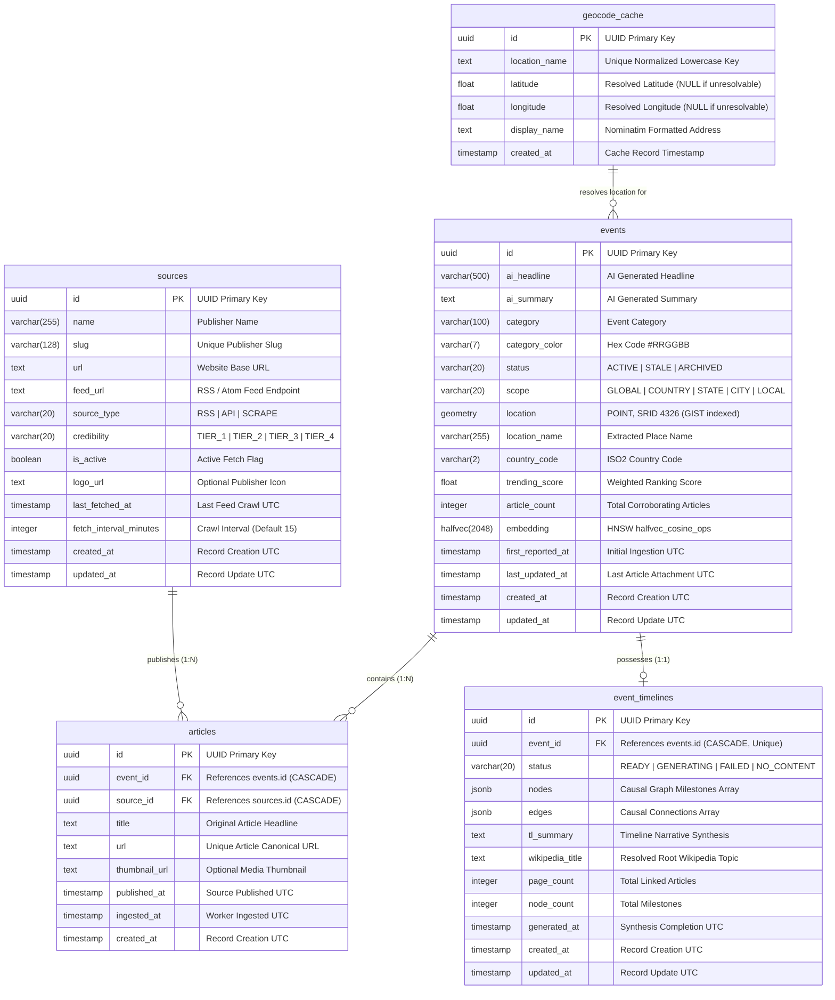
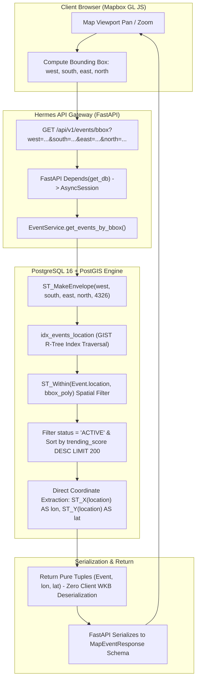
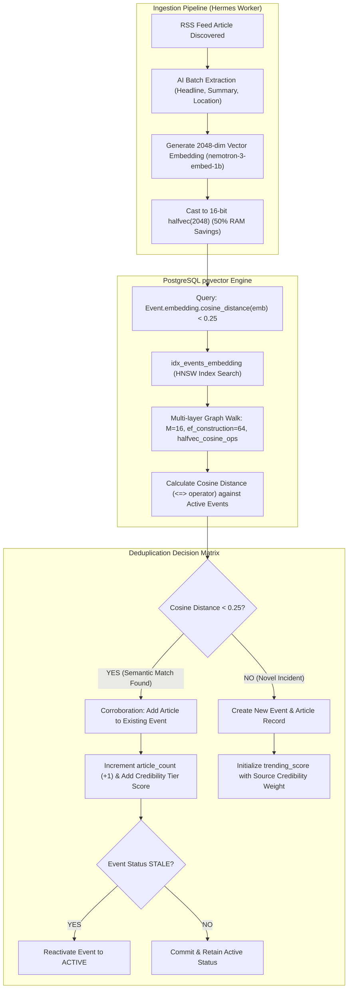

# Hermes Shared Database Library (`hermes-db`)

The [`libs/shared/hermes-db`](file:///home/pavan/proj/hermes/libs/shared/hermes-db) library is the central source of truth for the entire platform's persistence and data access layer. It houses the SQLAlchemy 2.0 ORM models, PostGIS geospatial configurations, `pgvector` half-precision index definitions, Alembic schema migrations, and asynchronous database services.

By centralizing all database models and services in this shared library, both [`apps/hermes-api`](file:///home/pavan/proj/hermes/apps/hermes-api) (serving read/query endpoints and historical timeline synthesis) and [`apps/hermes-worker`](file:///home/pavan/proj/hermes/apps/hermes-worker) (handling RSS ingestion, AI batch extraction, geocoding, and lifecycle decay) maintain guaranteed schema synchronization, strict compile-time typing, and uniform connection pool management.

---

## Table of Contents

1. [Architectural Posture & "The Why"](#1-architectural-posture--the-why)
2. [Mermaid System Diagrams](#2-mermaid-system-diagrams)
   - [Entity-Relationship (ER) Schema](#entity-relationship-er-schema)
   - [Spatial Bounding Box Query Execution Flow](#spatial-bounding-box-query-execution-flow)
   - [Vector Similarity & Deduplication Traversal](#vector-similarity--deduplication-traversal)
3. [Complete Database Schema Reference](#3-complete-database-schema-reference)
4. [Index Architecture & Optimization](#4-index-architecture--optimization)
5. [Database Service Layer API](#5-database-service-layer-api)
6. [Connection Pooling & Session Lifecycle](#6-connection-pooling--session-lifecycle)
7. [Alembic Migrations Workflow](#7-alembic-migrations-workflow)
8. [Testing & Quality Verification](#8-testing--quality-verification)

---

## 1. Architectural Posture & "The Why"

The design of `hermes-db` is shaped by rigorous performance benchmarks, strict cloud resource constraints, and geospatial query optimization.

### Asynchronous SQLAlchemy 2.0 with `asyncpg`
- **Why Async?**: Hermes handles high-frequency spatial bounding box queries concurrently with background RSS ingestion. Synchronous blocking drivers (e.g., `psycopg2`) tie up worker threads during network I/O, rapidly causing thread starvation.
- **`asyncpg` Wire Protocol**: The `asyncpg` driver interacts directly with PostgreSQL's binary protocol over asynchronous sockets, avoiding Python Global Interpreter Lock (GIL) contention and delivering maximum throughput.

### PostGIS SRID 4326 with GIST Spatial Indexing
- **Standard Spatial Reference (WGS 84)**: The `location` column on [`Event`](file:///home/pavan/proj/hermes/libs/shared/hermes-db/src/hermes_db/models/event.py#L17-L76) uses PostGIS `Geometry(POINT, 4326)`. Coordinates are stored as `(longitude, latitude)` in the WGS 84 ellipsoidal system (EPSG:4326), aligning with Mapbox GL JS without client-side or server-side coordinate reprojection.
- **R-Tree GIST Search Tree**: The `idx_events_location` index leverages a Generalized Search Tree (GIST). When a user pans or zooms, Mapbox transmits the bounding box (`west`, `south`, `east`, `north`). PostGIS prunes non-overlapping bounding boxes in $O(\log N)$ time using `ST_MakeEnvelope` and `ST_Within`.
- **Zero Client-Side WKB Deserialization**: Client-side geometry parsing is CPU-intensive. In [`EventService.get_events_by_bbox()`](file:///home/pavan/proj/hermes/libs/shared/hermes-db/src/hermes_db/services/event.py#L175-L193), coordinate floats are extracted in SQL using `ST_X(Event.location)` and `ST_Y(Event.location)`, bypassing Well-Known Binary (WKB) decoding on the API application server.

### pgvector `halfvec(2048)` with HNSW `halfvec_cosine_ops`
- **50% RAM Footprint Reduction**: Full 32-bit floats (`vector(2048)`) require 8,192 bytes per row for vector embeddings generated by Nemotron-3 (`nemotron-3-embed-1b`). 16-bit half-precision floats (`halfvec(2048)`) halve memory consumption to 4,096 bytes per vector with zero degradation in cosine similarity accuracy.
- **Sub-15ms Nearest Neighbor Traversal**: Hierarchical Navigable Small World (HNSW) graphs (`M=16, ef_construction=64`) allow logarithmic-time approximate nearest-neighbor (ANN) lookups, completely eliminating $O(N)$ sequential scans.
- **Tuned Semantic Threshold (< 0.25)**: Duplicate detection checks whether `Event.embedding.cosine_distance(emb) < 0.25`. Embeddings within distance $< 0.25$ correspond to identical real-world occurrences and are clustered together; distances $\ge 0.25$ represent distinct stories.

### Neon Serverless PostgreSQL & Transaction Pooling Compatibility
- **Serverless Scaling**: Production runs on **Neon Serverless PostgreSQL** with `postgis` and `pgvector` extensions enabled.
- **`statement_cache_size: 0`**: Neon uses connection poolers (PgBouncer) in transaction pooling mode. Transaction pooling reassigns database connections per transaction, causing client-side prepared statement caches to fail (`prepared statement already exists`). Setting `connect_args={"statement_cache_size": 0}` in [`session.py`](file:///home/pavan/proj/hermes/libs/shared/hermes-db/src/hermes_db/session.py#L25) disables prepared statement caching, guaranteeing flawless execution through PgBouncer.
- **Enforced SSL**: [`Settings.db_url`](file:///home/pavan/proj/hermes/libs/shared/hermes-db/src/hermes_db/core/config.py#L26-L39) automatically injects `ssl=require` for all remote hosts.

### Grounded Geocoding Shield (`geocode_cache`)
- **Strict Nominatim Rate Limit (1 req/sec)**: OpenStreetMap Nominatim enforces a strict 1 request/second usage limit.
- **Permanent Negative Resolution Caching**: When Nominatim returns `_NOT_FOUND` (unknown or invalid location), [`GeocodeCacheService.save_geocode_result()`](file:///home/pavan/proj/hermes/libs/shared/hermes-db/src/hermes_db/services/geocode.py#L42-L70) stores `latitude=NULL, longitude=NULL` under the normalized lowercase string. This permanently prevents repeated API calls for unresolvable location names, shielding the system against 429 rate limit floods.

### Source Consensus & Dynamic Lifecycle Decay
- **Credibility Scoring Weights**: Corroborating articles boost `trending_score`:
  - `TIER_1` = `+3.0` (Global Tier-1 wire services: Reuters, AP)
  - `TIER_2` = `+2.0` (Major national publications: BBC, NYT)
  - `TIER_3` = `+1.0` (Regional or standard news sources)
  - `TIER_4` = `+0.5` (Specialized blogs and secondary aggregators)
- **Automatic Reactivation**: If an article arrives for an [`EventStatus.STALE`](file:///home/pavan/proj/hermes/libs/shared/hermes-db/src/hermes_db/enums.py#L6) event, [`EventService.add_article_to_event()`](file:///home/pavan/proj/hermes/libs/shared/hermes-db/src/hermes_db/services/event.py#L115-L158) reactivates it to [`EventStatus.ACTIVE`](file:///home/pavan/proj/hermes/libs/shared/hermes-db/src/hermes_db/enums.py#L5).
- **Lifecycle Decay**: Every hour, [`EventService.run_lifecycle_transitions()`](file:///home/pavan/proj/hermes/libs/shared/hermes-db/src/hermes_db/services/event.py#L278-L305) decays active scores by 10% (`trending_score * 0.9`), transitions events older than 24 hours to `STALE`, and archives events older than 48 hours to `ARCHIVED`.

---

## 2. Mermaid System Diagrams

### Entity-Relationship (ER) Schema

The database consists of 5 core models defined in [`src/hermes_db/models/`](file:///home/pavan/proj/hermes/libs/shared/hermes-db/src/hermes_db/models):



---

### Spatial Bounding Box Query Execution Flow



---

### Vector Similarity & Deduplication Traversal



---

## 3. Complete Database Schema Reference

### Table: `events`
Defined in [`src/hermes_db/models/event.py`](file:///home/pavan/proj/hermes/libs/shared/hermes-db/src/hermes_db/models/event.py).

| Column Name | Type | Modifiers / Constraints | Description |
| :--- | :--- | :--- | :--- |
| `id` | `UUID` | `PRIMARY KEY`, default `uuid.uuid4` | Unique event identifier. |
| `ai_headline` | `VARCHAR(500)` | `NOT NULL` | Synthesized AI headline. |
| `ai_summary` | `TEXT` | `NULLABLE` | Concise AI summary narrative. |
| `category` | `VARCHAR(100)` | `NOT NULL` | Domain category (e.g., Conflict, Economy, Tech). |
| `category_color` | `VARCHAR(7)` | `NOT NULL` | Hex color string (`#RRGGBB`) for map pins. |
| `status` | `VARCHAR(20)` | `NOT NULL`, default `ACTIVE` | Lifecycle state: `ACTIVE`, `STALE`, `ARCHIVED`. |
| `scope` | `VARCHAR(20)` | `NOT NULL`, default `COUNTRY` | Spatial impact: `GLOBAL`, `COUNTRY`, `STATE`, `CITY`, `LOCAL`. |
| `location` | `GEOMETRY(POINT, 4326)` | `NULLABLE` | PostGIS spatial point (Longitude, Latitude). |
| `location_name` | `VARCHAR(255)` | `NULLABLE` | Resolved location string (e.g., "Kyiv, Ukraine"). |
| `country_code` | `VARCHAR(2)` | `NULLABLE` | ISO 3166-1 alpha-2 country code. |
| `trending_score` | `FLOAT` | `NOT NULL`, default `0.0` | Consensus-weighted score decayed over time. |
| `article_count` | `INTEGER` | `NOT NULL`, default `0` | Number of corroborating articles attached. |
| `embedding` | `HALFVEC(2048)` | `NULLABLE` | 16-bit half-precision 2048-dim embedding. |
| `first_reported_at` | `TIMESTAMP` | `NOT NULL`, default `now()` | Earliest article ingestion timestamp. |
| `last_updated_at` | `TIMESTAMP` | `NOT NULL`, default `now()` | Most recent article attachment timestamp. |
| `created_at` | `TIMESTAMP` | `NOT NULL`, default `now()` | Database insertion timestamp. |
| `updated_at` | `TIMESTAMP` | `NOT NULL`, default `now()` | Last modification timestamp. |

---

### Table: `articles`
Defined in [`src/hermes_db/models/article.py`](file:///home/pavan/proj/hermes/libs/shared/hermes-db/src/hermes_db/models/article.py).

| Column Name | Type | Modifiers / Constraints | Description |
| :--- | :--- | :--- | :--- |
| `id` | `UUID` | `PRIMARY KEY`, default `uuid.uuid4` | Unique article identifier. |
| `event_id` | `UUID` | `NOT NULL`, `FOREIGN KEY (events.id) ON DELETE CASCADE` | Associated event entity. |
| `source_id` | `UUID` | `NOT NULL`, `FOREIGN KEY (sources.id) ON DELETE CASCADE` | Publishing news source. |
| `title` | `TEXT` | `NOT NULL` | Raw article headline from RSS feed. |
| `url` | `TEXT` | `NOT NULL`, `UNIQUE` | Canonical URL (used for deduplication). |
| `thumbnail_url` | `TEXT` | `NULLABLE` | Article lead image URL if available. |
| `published_at` | `TIMESTAMP` | `NULLABLE` | Original publication timestamp from feed. |
| `ingested_at` | `TIMESTAMP` | `NOT NULL`, default `now()` | Ingestion timestamp by worker. |
| `created_at` | `TIMESTAMP` | `NOT NULL`, default `now()` | Row creation timestamp. |

---

### Table: `sources`
Defined in [`src/hermes_db/models/source.py`](file:///home/pavan/proj/hermes/libs/shared/hermes-db/src/hermes_db/models/source.py).

| Column Name | Type | Modifiers / Constraints | Description |
| :--- | :--- | :--- | :--- |
| `id` | `UUID` | `PRIMARY KEY`, default `uuid.uuid4` | Unique source identifier. |
| `name` | `VARCHAR(255)` | `NOT NULL` | Display name of publication (e.g. "BBC World"). |
| `slug` | `VARCHAR(128)` | `NOT NULL`, `UNIQUE` | URL-safe publication identifier (e.g. "bbc-world"). |
| `url` | `TEXT` | `NOT NULL` | Publication root website URL. |
| `feed_url` | `TEXT` | `NULLABLE` | Direct RSS/Atom XML feed link. |
| `source_type` | `VARCHAR(20)` | `NOT NULL`, default `RSS` | Ingestion protocol: `RSS`, `API`, `SCRAPE`. |
| `credibility` | `VARCHAR(20)` | `NOT NULL`, default `TIER_3` | Credibility tier: `TIER_1`, `TIER_2`, `TIER_3`, `TIER_4`. |
| `is_active` | `BOOLEAN` | `NOT NULL`, default `TRUE` | Whether the worker currently polls this source. |
| `logo_url` | `TEXT` | `NULLABLE` | Publisher brand icon URL. |
| `last_fetched_at` | `TIMESTAMP` | `NULLABLE` | UTC timestamp of last completed feed scrape. |
| `fetch_interval_minutes` | `INTEGER` | `NOT NULL`, default `15` | Minimum cooldown between crawls. |
| `created_at` | `TIMESTAMP` | `NOT NULL`, default `now()` | Record creation timestamp. |
| `updated_at` | `TIMESTAMP` | `NOT NULL`, default `now()` | Record update timestamp. |

---

### Table: `geocode_cache`
Defined in [`src/hermes_db/models/geocode_cache.py`](file:///home/pavan/proj/hermes/libs/shared/hermes-db/src/hermes_db/models/geocode_cache.py).

| Column Name | Type | Modifiers / Constraints | Description |
| :--- | :--- | :--- | :--- |
| `id` | `UUID` | `PRIMARY KEY`, default `uuid.uuid4` | Cache entry UUID. |
| `location_name` | `TEXT` | `NOT NULL`, `UNIQUE`, `INDEXED` | Normalized lowercase location query string. |
| `latitude` | `FLOAT` | `NULLABLE` | WGS 84 Latitude (`NULL` = negative resolution cache). |
| `longitude` | `FLOAT` | `NULLABLE` | WGS 84 Longitude (`NULL` = negative resolution cache). |
| `display_name` | `TEXT` | `NULLABLE` | Canonical Nominatim formatted string. |
| `created_at` | `TIMESTAMP WITH TIME ZONE` | `NOT NULL`, default `now()` | Cache entry timestamp. |

---

### Table: `event_timelines`
Defined in [`src/hermes_db/models/event_tl.py`](file:///home/pavan/proj/hermes/libs/shared/hermes-db/src/hermes_db/models/event_tl.py).

| Column Name | Type | Modifiers / Constraints | Description |
| :--- | :--- | :--- | :--- |
| `id` | `UUID` | `PRIMARY KEY`, default `uuid.uuid4` | Timeline record identifier. |
| `event_id` | `UUID` | `NOT NULL`, `UNIQUE`, `FOREIGN KEY (events.id) ON DELETE CASCADE` | 1:1 link to parent event. |
| `status` | `VARCHAR(20)` | `NOT NULL`, default `GENERATING` | `READY`, `GENERATING`, `FAILED`, `NO_CONTENT`. |
| `nodes` | `JSONB` | `NOT NULL`, default `'[]'` | Milestones array with titles, dates, descriptions. |
| `edges` | `JSONB` | `NOT NULL`, default `'[]'` | Causal connections array with relationship verbs. |
| `tl_summary` | `TEXT` | `NOT NULL`, default `''` | Synthesized causal timeline summary text. |
| `wikipedia_title` | `TEXT` | `NULLABLE` | Root Wikipedia article title used for lineage. |
| `page_count` | `INTEGER` | `NOT NULL`, default `0` | Total Wikipedia pages parsed. |
| `node_count` | `INTEGER` | `NOT NULL`, default `0` | Total historical graph milestones extracted. |
| `generated_at` | `TIMESTAMP WITH TIME ZONE` | `NULLABLE` | Completion timestamp. |
| `created_at` | `TIMESTAMP` | `NOT NULL`, default `now()` | Record creation timestamp. |
| `updated_at` | `TIMESTAMP` | `NOT NULL`, default `now()` | Record update timestamp. |

---

## 4. Index Architecture & Optimization

| Index Name | Table | Type | Columns / Expression | Specific Purpose |
| :--- | :--- | :--- | :--- | :--- |
| `idx_events_location` | `events` | **GIST** | `location` | Accelerates 2D spatial `ST_Within` bounding box queries for viewport map rendering. |
| `idx_events_embedding` | `events` | **HNSW** | `embedding` (`halfvec_cosine_ops`, `m=16`, `ef_construction=64`) | Accelerates sub-15ms approximate nearest-neighbor vector deduplication using cosine distance (`<=>`). |
| `idx_events_active_score` | `events` | **B-tree (Partial)** | `status, trending_score` `WHERE (status = 'ACTIVE')` | Enables instant sorting of top-trending active events while ignoring dormant/archived records. |
| `idx_events_scope` | `events` | **B-tree** | `scope, status` | Optimizes global vs national viewport category queries. |
| `idx_events_country` | `events` | **B-tree (Partial)** | `country_code` `WHERE (country_code IS NOT NULL)` | Speeds up country-level event filtering and geopolitical rollups. |
| `articles_url_key` | `articles` | **B-tree (Unique)** | `url` | Guarantees article idempotency; supports `ON CONFLICT (url) DO NOTHING`. |
| `sources_slug_key` | `sources` | **B-tree (Unique)** | `slug` | Enables safe source upserts during `sources.json` synchronizations. |
| `geocode_cache_location_name_key` | `geocode_cache` | **B-tree (Unique)** | `location_name` | Fast $O(1)$ cache hits for geocoding queries; supports idempotent cache upserting. |
| `event_timelines_event_id_key` | `event_timelines` | **B-tree (Unique)** | `event_id` | Enforces strict 1:1 relationship between events and their historical timelines. |

---

## 5. Database Service Layer API

All business logic querying or modifying tables is encapsulated in strongly-typed service classes in [`src/hermes_db/services/`](file:///home/pavan/proj/hermes/libs/shared/hermes-db/src/hermes_db/services):

### [`EventService`](file:///home/pavan/proj/hermes/libs/shared/hermes-db/src/hermes_db/services/event.py#L54-L305)
Manages event creation, article attachment, spatial queries, and score lifecycles:
- `create_event_with_article(...)`: Atomically creates an [`Event`](file:///home/pavan/proj/hermes/libs/shared/hermes-db/src/hermes_db/models/event.py#L17-L76) and its initial [`Article`](file:///home/pavan/proj/hermes/libs/shared/hermes-db/src/hermes_db/models/article.py#L18-L38). Rolls back if the article URL is already present. Computes initial `trending_score` from the source credibility tier.
- `add_article_to_event(...)`: Idempotently attaches an article to an existing event. Increments `article_count`, adds credibility score, updates `last_updated_at`, and reactivates `STALE` events to `ACTIVE`.
- `get_events(status, scope, limit)`: Queries events ordered by `trending_score DESC`.
- `get_events_by_bbox(north, south, east, west)`: Executes `ST_Within(Event.location, ST_MakeEnvelope(...))` with direct `ST_X` and `ST_Y` coordinate projections.
- `get_event_by_id(event_id)`: Fetches an event with eager loaded articles via `selectinload(Event.articles)`.
- `get_active_events_by_embeddings(embeddings)`: Searches for existing events within `cosine_distance < 0.25` using the HNSW index for deduplication.
- `run_lifecycle_transitions()`: Applies -10% score decay to active events and transitions `ACTIVE -> STALE` (24h) and `STALE -> ARCHIVED` (48h).

### [`ArticleService`](file:///home/pavan/proj/hermes/libs/shared/hermes-db/src/hermes_db/services/article.py#L15-L46)
Handles article persistence with database-level conflict avoidance:
- `create_article(...)`: Executes native PostgreSQL `pg_insert(Article).on_conflict_do_nothing(index_elements=["url"]).returning(Article)`.
- `article_url_exists(url)`: Fast existence check for candidate URLs.

### [`SourceService`](file:///home/pavan/proj/hermes/libs/shared/hermes-db/src/hermes_db/services/source.py#L30-L88)
Manages feed crawl scheduling and configuration sync:
- `get_due_sources(force=False)`: Computes which active sources have exceeded their `fetch_interval_minutes`. Returns immutable [`DueSource`](file:///home/pavan/proj/hermes/libs/shared/hermes-db/src/hermes_db/services/source.py#L20-L28) data records.
- `update_last_fetched(source_id, fetched_at)`: Updates the last fetch timestamp after crawl completion.
- [`sync_sources_from_config(session, config_path)`](file:///home/pavan/proj/hermes/libs/shared/hermes-db/src/hermes_db/services/source.py#L101-L172): Reads seed configuration from [`sources.json`](file:///home/pavan/proj/hermes/libs/shared/hermes-db/src/hermes_db/data/sources.json), updates modified fields, seeds new sources, and deactivates removed sources.

### [`GeocodeCacheService`](file:///home/pavan/proj/hermes/libs/shared/hermes-db/src/hermes_db/services/geocode.py#L22-L70)
Provides the caching shield for Nominatim geocoding:
- `get_by_location_name(location_name)`: Looks up normalized string in cache.
- `save_geocode_result(location_name, latitude, longitude, display_name)`: Idempotently upserts coordinates (`on_conflict_do_nothing`), supporting positive and negative (`latitude=None`) caching.

### [`EventTlService`](file:///home/pavan/proj/hermes/libs/shared/hermes-db/src/hermes_db/services/tl.py#L12-L71)
Handles persistence and status transitions for historical causal graphs:
- `get_tl(event_id)`: Fetches timeline record for an event.
- `create_tl(event_id, status)`: Creates a new timeline in `GENERATING` state.
- `update_tl_status(tl, status)`: Transitions status (`READY`, `FAILED`, `NO_CONTENT`).
- `save_generated_tl(...)`: Persists synthesized JSONB `nodes`, `edges`, `tl_summary`, and Wikipedia metadata.
- `get_event_coordinates(event_id)`: Extracts `(latitude, longitude)` directly using `ST_Y` and `ST_X`.

---

## 6. Connection Pooling & Session Lifecycle

Connection pooling is configured in [`src/hermes_db/session.py`](file:///home/pavan/proj/hermes/libs/shared/hermes-db/src/hermes_db/session.py):

```python
engine: AsyncEngine = create_async_engine(
    settings.db_url,
    echo=False,
    pool_size=5,
    pool_pre_ping=True,
    max_overflow=10,
    connect_args={"statement_cache_size": 0},
)

AsyncSessionLocal = async_sessionmaker(
    bind=engine,
    expire_on_commit=False,
)
```

### Settings Breakdown
- `pool_size=5`: Keeps 5 persistent database connections per application worker process.
- `max_overflow=10`: Allows bursting up to 15 simultaneous connections during traffic spikes.
- `pool_pre_ping=True`: Tests connections with a ping (`SELECT 1`) prior to checkout, preventing stale connection errors when Neon serverless proxies suspend inactive compute endpoints.
- `connect_args={"statement_cache_size": 0}`: Disables prepared statement caching in `asyncpg` to guarantee compatibility with Neon PgBouncer transaction pooling.
- `expire_on_commit=False`: Prevents attributes from expiring after commit, allowing async callers to access model properties without redundant SQL queries outside the session context.

### Lifespan Usage

In host applications ([`hermes-api`](file:///home/pavan/proj/hermes/apps/hermes-api/src/hermes_api/main.py#L6) and [`hermes-worker`](file:///home/pavan/proj/hermes/apps/hermes-worker/src/hermes_worker/core/lifespan.py#L4)):

```python
# Startup
await init_db(app_settings.db_url)

# Shutdown
await close_db()
```

### FastAPI Dependency Injection

Endpoints inject database sessions via [`get_db()`](file:///home/pavan/proj/hermes/libs/shared/hermes-db/src/hermes_db/session.py#L34-L41):

```python
@router.get("/events")
async def list_events(session: AsyncSession = Depends(get_db)):
    service = EventService(session)
    return await service.get_events()
```

If an unhandled exception occurs inside the route handler, `get_db()` automatically rolls back the transaction before releasing the connection back to the pool.

---

## 7. Alembic Migrations Workflow

Migrations are managed with Alembic and configured in [`alembic.ini`](file:///home/pavan/proj/hermes/libs/shared/hermes-db/alembic.ini) and [`migrations/env.py`](file:///home/pavan/proj/hermes/libs/shared/hermes-db/migrations/env.py).

### GeoAlchemy2 Integration
PostGIS introduces internal geometry extension tables (e.g. `spatial_ref_sys`, `tiger_geocoder`). In [`migrations/env.py`](file:///home/pavan/proj/hermes/libs/shared/hermes-db/migrations/env.py#L25-L35), `custom_include_object()` filters out PostGIS internal tables so Alembic autogenerate never attempts to drop or alter database extension schemas.

Furthermore, migrations execute with `NullPool` (no pooled connections) and an explicit `lock_timeout="30000"` (30 seconds) to prevent hanging DDL locks in production.

### Migration History Chain

```text
2ec3541646e8  (Initial schema: events, articles, sources)
    │
b8446b410d52  (Made event location nullable)
    │
a1b2c3d4e5f6  (Add unique constraint on article url)
    │
c1d2e3f4a5b6  (Create geocode_cache table)
    │
d2e3f4a5b6c7  (Add vector embedding to events)
    │
e3f4a5b6c7d8  (Create event_timelines table)
    │
d159bcfd1e94  (Add lineage_target_id to events)
    │
ce3d9051b570  (Create event_edges table)
    │
db402a499ebd  (Create story_allowlist table)
    │
64fc96ec0afd  (Teardown old lineage architecture)
    │
67c2d30edccd  (Create updated event_timeline schema)
    │
e4f5a6b7c8d9  (Update embedding to halfvec 2048 with HNSW halfvec_cosine_ops)
    │
f5a6b7c8d9e0  [HEAD] (Purge null geocode cache from legacy rate limit floods)
```

### Migration Execution Commands

All commands should be executed from the workspace root:

```bash
# Apply pending migrations to the database
npx nx run hermes-db:migrate

# Alternatively apply via hermes-api target
npx nx run hermes-api:migrate

# Check current revision status
uv run --project libs/shared/hermes-db alembic current

# View full migration revision history
uv run --project libs/shared/hermes-db alembic history

# Auto-generate a new migration script based on model changes
npx nx run hermes-db:makemigrations -- -m "describe_change"
# Or directly with uv:
# uv run --project libs/shared/hermes-db alembic revision --autogenerate -m "describe_change"

# Downgrade one revision
uv run --project libs/shared/hermes-db alembic downgrade -1
```

---

## 8. Testing & Quality Verification

All unit tests in [`tests/`](file:///home/pavan/proj/hermes/libs/shared/hermes-db/tests) are **pure unit tests** designed to run without a live PostgreSQL database.

### Test Isolation Architecture
- [`conftest.py`](file:///home/pavan/proj/hermes/libs/shared/hermes-db/tests/conftest.py): Replaces `AsyncSession` with an `AsyncMock` factory (`make_async_session`).
- Model factories (`make_event`, `make_source`, `make_article`) construct mock ORM objects with sensible defaults.
- Database services are verified in complete isolation with zero network I/O.

### Running Verification Tasks

From the workspace root:

```bash
# Run the complete test suite with coverage
npx nx test hermes-db

# Run ruff lint check
npx nx lint hermes-db

# Run ruff code formatting
npx nx format hermes-db
```
