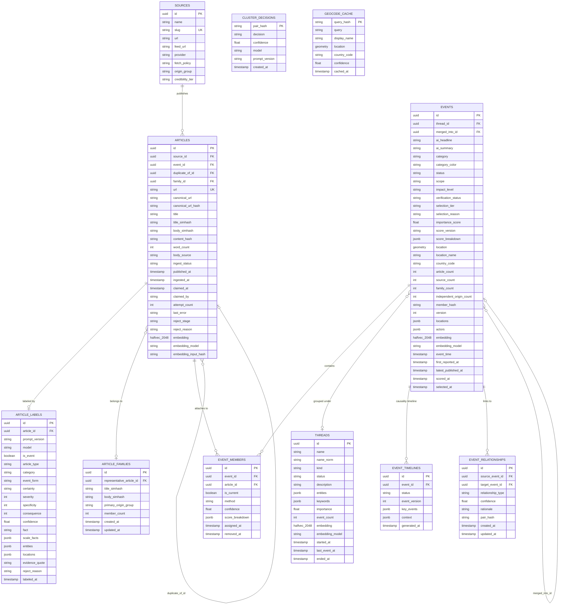
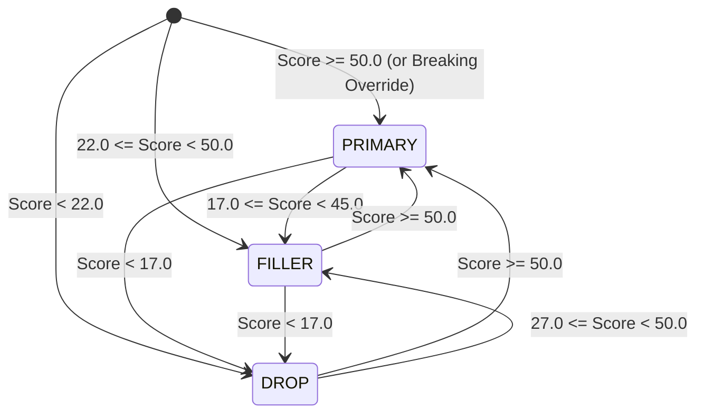
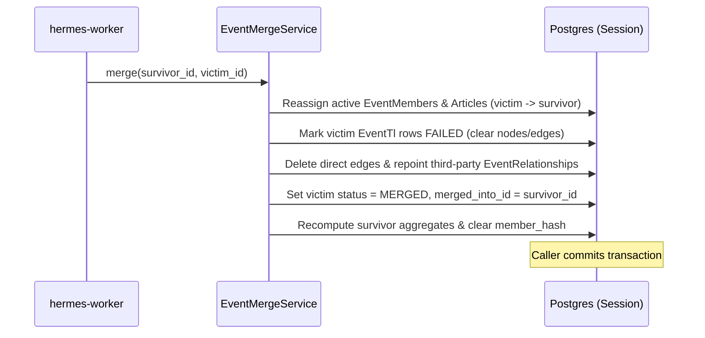

# Hermes DB — Architecture & Design Rationale

`libs/shared/hermes-db` is the asynchronous persistence foundation of Hermes. It is an internal **library**, not a service: consumer applications (`apps/hermes-api`, `apps/hermes-worker`, `apps/hermes`) own their process lifecycle and inject database connection parameters, while this package owns the schema, SQLAlchemy 2.0 ORM models, Alembic migrations, PostGIS spatial queries, pgvector embeddings, and persistence-facing domain services.

The design goal is strict encapsulation of all database concerns: consumer applications orchestrate pipelines and serve API requests without embedding SQL strings, PostGIS expressions, vector distance math, or schema knowledge.

> **Companion reading:**
> - [Workspace Instructions](file:///home/pavan/proj/hermes/hermes/AGENTS.md)
> - [Worker Architecture](file:///home/pavan/proj/hermes/hermes/apps/hermes-worker/docs/architecture.md)
> - [API Architecture](file:///home/pavan/proj/hermes/hermes/apps/hermes-api/docs/architecture.md)
> - [Database Guidelines](file:///home/pavan/proj/hermes/hermes/libs/shared/hermes-db/AGENTS.md)

---

## 1. Mission, Scope, and Architectural Boundaries

### 1.1 Core Responsibilities

- **Canonical Data Models**: Declare SQLAlchemy 2.0 models for sources, article ingestion ledgers, article labels, syndication families, events (including extracted actors), event membership history, pairwise cross-event relationships, pairwise cluster decisions, persistent story threads, causality timelines, and geocoding cache.
- **Alembic Schema Authority**: Own every database migration revision and execution environment.
- **Asynchronous Persistence Services**: Provide domain services for article claiming and lifecycle queues, syndication family grouping, event creation, membership aggregation, verification, deterministic scoring, thread clustering, non-destructive event merging, relationship discovery/querying, and scheduled retention sweeps.
- **Spatial & Vector Primitives**: Manage PostGIS geometry points (SRID 4326 WGS 84), spatial bounding-box filters, coordinate projection via SQL `ST_X` / `ST_Y`, and pgvector `HALFVEC(2048)` HNSW indexing with cosine distance.
- **Lexical & Semantic Search**: Provide full-text search indexes (`tsvector`), weighted document rankers, and hybrid vector retrieval.

### 1.2 Explicit Non-Responsibilities

- **No Network I/O or Feeds**: Never perform HTTP calls, RSS parsing, GDELT fetching, or HTML scraping.
- **No LLM Prompts or Inference**: Never construct prompts or call AI providers. LLM generation and embedding synthesis are orchestrated by `hermes-worker` via `libs/shared/hermes-ai`.
- **No Direct Geocoding Calls**: The library stores and queries `geocode_cache`; the rate-limited Nominatim geocoder lives in `libs/shared/hermes-ai`.
- **No Application Lifecycles**: Never create standalone daemons, FastAPI routers, or CLI schedulers.
- **No Outward Dependencies**: Dependency flow is strictly unidirectional. `hermes-db` never imports from `apps/*` or `libs/shared/hermes-ai`.

### 1.3 Consumers & Usage Patterns

| Consumer | Invocation Mechanism | Primary Services & Models |
| :--- | :--- | :--- |
| `apps/hermes-api` | FastAPI lifespan `init_db` / `close_db`, `Depends(get_db)` | `EventService` (map bbox, FTS, detail), `SearchService`, `EventRelationshipService`, `EventTlService`, `ThreadService`, `GeocodeCacheService` |
| `apps/hermes-worker` | CLI batch jobs via `db_lifespan()` | `ArticleService`, `ArticleAnalysisService`, `ArticleFamilyService`, `EventAssignmentService`, `EventScoringService`, `EventMembershipService`, `EventMergeService`, `EventRelationshipService`, `EventLifecycleService`, `ThreadService`, `MaintenanceService` |
| Alembic CLI | `npx nx run hermes-db:migrate` / `makemigrations` | `migrations/env.py`, `Base.metadata` |
| Unit Tests | Pure in-memory SQLite / mock session tests | Models, Enums, Math formulas, SQL expression compilation |

### 1.4 Architectural Invariants

1. **Unidirectional Dependency**: `hermes-db` never imports application code.
2. **Inversion of Control (IoC) for Configuration**: Domain code never inspects `os.environ` or `.env` files. Consumers load environment variables and pass validated connection strings to `init_db(db_url)`. Standalone Alembic CLI is the sole exception (`migrations/env.py`).
3. **Transaction Boundaries Belong to Callers**: Domain services (`EventScoringService`, `EventMergeService`, etc.) **never commit** transactions (`await session.commit()`). They flush state (`await session.flush()`) when generated IDs are required, leaving commit and rollback semantics to the orchestrating worker stage or API route.
4. **Statement Caching Disabled**: Every engine instance configures `connect_args={"statement_cache_size": 0}` to support transaction-mode connection poolers (e.g. PgBouncer on Neon Serverless).
5. **Direct SQL Coordinate Projection**: Longitude and latitude are projected via `ST_X` and `ST_Y` in SQL expressions rather than serializing/deserializing WKB geometry objects on the client.
6. **Alembic-Only Schema Evolution**: Schema mutations are executed strictly via Alembic revisions. Raw SQL DDL and `Base.metadata.create_all()` are strictly prohibited.
7. **Spatial Coordinate Standard**: All stored locations are `POINT` geometries in SRID 4326, ordered `(longitude, latitude)`.
8. **No Redundant Tables or Columns**: Defer to minimum justified schema. Embeddings live directly on `articles.embedding` and `events.embedding` as deferred `HALFVEC(2048)`.

---

## 2. Entity-Relationship Data Model

The following diagram illustrates the core entity relationships across ingestion, clustering, scoring, story threading, and causality:



---

## 3. Article Ingestion Ledger & Queue

The `articles` table serves as an immutable ingestion ledger, deduplication gate, and asynchronous work queue.

### 3.1 Ledger Identity & Deduplication

1. **URL Normalization & Hash**: Incoming links are normalized and fingerprinted via `canonical_url_hash = sha256(canonical_url)`. A partial unique index prevents redundant ledger rows:
   ```sql
   CREATE UNIQUE INDEX uq_articles_canonical_url_hash
   ON articles (canonical_url_hash)
   WHERE duplicate_of_id IS NULL;
   ```
2. **Idempotent Ingestion**: Raw articles are inserted using `ON CONFLICT (url) DO NOTHING`. Ingest never updates existing articles in place or revives superseded records.
3. **SimHash & Content Hashes**: Articles carry 64-bit SimHash hex digests for title (`title_simhash`) and transient body text (`body_simhash`), enabling fast Bitwise Hamming distance filtering during syndication grouping.
4. **Transient Bodies**: Fetched article bodies are never persisted. Only the extracted labels, entities, fingerprints, and a bounded `evidence_quote` (≤400 characters) are written to disk.

### 3.2 Claim Queue State Machine

The queue status is governed by `Article.ingest_status`:

```
NEW ──► ANALYZING ──► LABELED ──► CLUSTERED
            │              │
            ▼              ▼
          FAILED        REJECTED (with reject_stage and reject_reason)
```

- **Concurrency Control**: Stages claim batches via `ArticleQueue` using atomic PostgreSQL row locks:
  ```sql
  UPDATE articles
  SET ingest_status = 'ANALYZING',
      claimed_at = NOW(),
      claimed_by = :worker_id,
      attempt_count = attempt_count + 1
  WHERE id IN (
      SELECT id FROM articles
      WHERE ingest_status = 'NEW'
      ORDER BY published_at ASC NULLS LAST
      FOR UPDATE SKIP LOCKED
      LIMIT :batch_size
  )
  RETURNING *;
  ```
- **Abandonment & Requeuing**: `attempt_count` tracks retries. If an ephemeral worker dies, claims older than `ARTICLE_CLAIM_STALE_MINUTES` are cleared by `MaintenanceService.requeue_stale_claims()` or transitioned to `FAILED` once `attempt_count >= ARTICLE_MAX_ATTEMPTS (3)`.
- **Rejection Tracking**: Articles failing event criteria or factual quality checks are marked `REJECTED` with `reject_stage` (`LABEL` or `GATE`), `reject_reason`, and `rejected_at`.

### 3.3 Article Embeddings

Dense semantic vectors are stored directly in `articles.embedding` as a deferred `HALFVEC(2048)` column:
- **Index**: HNSW index using cosine distance:
  ```sql
  CREATE INDEX idx_articles_embedding_hnsw
  ON articles USING hnsw (embedding halfvec_cosine_ops)
  WITH (m = 16, ef_construction = 64);
  ```
- **Integrity**: `ck_articles_embedding_metadata` ensures `embedding`, `embedding_model`, and `embedding_input_hash` are either all populated or all null simultaneously.

---

## 4. Article Analysis & Syndication Families

### 4.1 Article Labels (`article_labels`)

`ArticleLabel` contains structured factual metadata extracted by the LLM in `hermes-worker`. Each article has at most one valid label per prompt version:
- **Core Verification Attributes**: `is_event` (boolean), `article_type` (`BREAKING`, `DEVELOPMENT`, `ANALYSIS`, `FEATURE`, `OPINION`, `LISTICLE`, `OTHER`), `event_form` (`INCIDENT`, `PLANNED_EVENT`, `POLICY_ACTION`, `STATEMENT`, `REPORT`, `MARKET_MOVE`, `OTHER`), `certainty` (`CONFIRMED`, `REPORTED`, `ALLEGED`, `DISPUTED`).
- **Impact & Quality Scales**: `severity` (1–5), `specificity` (1–5), `consequence` (1–5), `confidence` (0.0–1.0).
- **Extracted Facts & Quotes**: `fact` (one-sentence factual claim), `scale_facts` (JSONB metric key-values), `evidence_quote` (≤400 character excerpt verified against article text).
- **Structured Entities & Locations**: JSONB arrays indexed by PostgreSQL GIN (`idx_article_labels_entities_gin`, `idx_article_labels_locations_gin`) enabling rapid entity blocking.

### 4.2 Syndication Families (`article_families`)

Wire services (Reuters, AP, AFP) are syndicated across hundreds of regional publishers. Treating each syndicated reprint as independent evidence produces artificial corroboration.

`ArticleFamily` groups identical or minimally edited syndicate copies:
- **Grouping Unit**: Syndication families represent *wire distribution*, not topic grouping.
- **Representative Article**: The earliest published article in the cluster becomes `representative_article_id`.
- **Match Criteria**: An article attaches to an existing family if:
  1. Published within a 36-hour window (`MAX_DAY_DELTA = timedelta(hours=36)`); AND
  2. Any one of the following holds:
     - Title SimHash Hamming distance $\le 3$; OR
     - Body SimHash Hamming distance $\le 6$; OR
     - Text embedding cosine similarity $\ge 0.97$.
- **Verification Impact**: When corroborating an event, multiple articles belonging to the same `family_id` count as a single piece of origin evidence.

---

## 5. Event Model & Membership Semantics

### 5.1 The Event as a Physical Pin

An `Event` represents **one physical real-world incident at a specific place and time**.
- Events are never merged across distinct incidents (e.g. two separate drone strikes in different cities remain distinct pins).
- Broad historical movements or military campaigns are represented as `Thread` records, linking individual event pins together.

### 5.2 Membership History (`event_members`)

Articles attach to events through the `event_members` join table:
- **Active Membership**: Indicated by `is_current = True`. A unique partial index enforces that an article belongs to at most one event at any time:
  ```sql
  CREATE UNIQUE INDEX uq_event_members_current_article
  ON event_members (article_id)
  WHERE is_current;
  ```
- **Historical Audit Trail**: When an article is detached, reassigned, or merged, `is_current` is set to `False` and `removed_at` is stamped.
- **Attachment Method & Provenance**: `method` records how the article was attached (`AUTO`, `LLM`, `MANUAL`), accompanied by `confidence` and `score_breakdown` (JSONB).

### 5.3 Member Hash & Description Synthesis Caching

The `Event.member_hash` column holds a SHA-256 fingerprint of the event's current active member article IDs and their facts.
- **Cluster Stage**: Attaches new member rows and leaves `member_hash` untouched (or stale).
- **Describe Stage**: Computes the SHA-256 hash of current members. If `event.member_hash == computed_hash`, the description LLM call is bypassed.
- **Synthesis Invalidation**: Whenever new articles attach or old ones detach, the hash changes, prompting `hermes-worker` to regenerate headline, summary, and locations.

### 5.4 Event Versioning & Timeline Invalidation

Each event maintains an integer `version` counter:
- **Controlled Invalidation**: `version` is incremented only when material user-facing attributes change (`ai_headline`, `ai_summary`, `location`, `category`). Minor score adjustments or non-material member joins do not bump `version`.
- **Causality Cache Alignment**: `event_timelines.event_version` stores the event version for which the Wikipedia/LLM causality timeline was synthesized. When `events.version > event_timelines.event_version`, the API or worker detects that the timeline is stale.

### 5.5 Non-Destructive Event Merging (`merged_into_id`)

When two existing events are determined to represent the same incident:
- Merged events are **never deleted**.
- The victim event has its status updated to `EventStatus.MERGED`, and its `merged_into_id` is set to the survivor's ID.
- Active members are transferred to the survivor event.
- `EventMergeService.resolve_event_id()` recursively follows redirect chains to guarantee that bookmarks, API clients, and timeline queries always resolve to the canonical active survivor.

---

## 6. Verification Engine

The verification engine (`libs/shared/hermes-db/src/hermes_db/services/verification.py`) computes an event's corroboration status purely from its current member articles and their source syndication families.

### 6.1 Status Taxonomy

| Status | Verification Rule | Weight in Scoring |
| :--- | :--- | :--- |
| `CONFIRMED` | $\ge 2$ independent origin groups AND $\ge 1$ member reports `certainty == CONFIRMED` | 1.00 |
| `CORROBORATED` | $\ge 2$ independent origin groups agree (without `CONFIRMED` certainty) | 0.85 |
| `SINGLE_SOURCE` | Exactly 1 independent origin group or family | 0.75 |
| `CONFLICTING` | Any member article reports `certainty == DISPUTED` | 0.50 |
| `UNVERIFIED` | Internal state: zero members | 0.00 |

### 6.2 Origin Group Resolution

To determine true independence, `_origin_key()` resolves each member article into an origin identifier:
1. If the article belongs to an `ArticleFamily`, use `family:{family_origin_group or source_origin_group or family_id}`.
2. Otherwise, if the source has a configured `source_origin_group` (e.g. News Corp, Hearst), use `origin:{source_origin_group}`; otherwise `origin:{source_slug}`.
3. Fallback (no family/source): `article:{article_id}`.

Ten regional newspapers publishing the exact same AP wire story share one family origin key, correctly evaluating to `SINGLE_SOURCE`.

---

## 7. Unified Importance Scoring & Selection Tiers

Hermes uses a single, authoritative, explainable `importance_score` (0–100) computed by `EventScoringService` (`SCORE_VERSION = "score-v2"`). Legacy metrics (`trending_score`, `popularity_score`, `velocity`, `confidence`) have been removed.

### 7.1 The Scoring Formula

$$\text{importance\_score} = \text{round}(\text{score}, 2), \quad \text{score} = \min(\text{SINGLE\_SOURCE\_CAP}, \text{base} \times \text{freshness}) \text{ when SINGLE\_SOURCE}$$

#### 1. Base Score (0–100)
$$\text{base} = 100 \times \left( 0.40 \times \text{strength} + 0.30 \times \text{impact} + 0.15 \times \text{verify} + 0.15 \times \text{quality} \right)$$

- **Source Strength** ($\text{strength} \in [0.0, 1.0]$):
  $$\text{strength} = \min\left(1.0, \frac{\sum \text{family\_credibility}}{9.0}\right)$$
  Where the maximum credibility tier per unique `ArticleFamily` (or individual `Article` when ungrouped) contributes:
  - `TIER_1` = 3.0 (e.g. Reuters, BBC, AP)
  - `TIER_2` = 2.0 (e.g. Major national dailies)
  - `TIER_3` / `TIER_4` = 1.0 (Regional / niche outlets)
- **Impact Level** ($\text{impact} \in [0.0, 1.0]$):
  - `CRITICAL` = 1.00
  - `MAJOR` = 0.80
  - `MODERATE` = 0.55
  - `MINOR` = 0.30
- **Verification Multiplier** ($\text{verify} \in [0.0, 1.0]$):
  - `CONFIRMED` = 1.00
  - `CORROBORATED` = 0.85
  - `SINGLE_SOURCE` = 0.75
  - `CONFLICTING` = 0.50
  - `UNVERIFIED` = 0.00
- **Reporting Quality** ($\text{quality} \in [0.5, 1.0]$):
  $$\text{quality} = \min\left(1.0, \max\left(0.5, 1.0 - 0.15 \times (5 - \text{specificity}) - 0.10 \times (5 - \text{consequence})\right)\right)$$
  *(Using the maximum `specificity` and `consequence` across active members, defaulting unset values to `3`.)*

#### 2. Freshness Decay
$$\text{freshness} = e^{-\frac{\text{age\_hours}}{\text{half\_life}}}$$

Age is anchored on `latest_published_at or event_time` (falling back to `0.0` if neither is set). Decay time constants (`half_life`) are calibrated by impact:
- `CRITICAL`: 18.0 hours
- `MAJOR`: 36.0 hours
- `MODERATE` / `MINOR`: 96.0 hours

#### 3. Single-Source Cap & Breaking Override
- **Cap**: Single-source events are capped at $\text{SINGLE\_SOURCE\_CAP} = 65.0$ (`score = min(score, 65.0)`).
- **Breaking News Override**: Evaluated after capping: if $\text{age\_hours} \le 2.0$, `impact in {CRITICAL, MAJOR}`, any member has `article_type == BREAKING`, and $\text{score} \ge 35.0$ (`BREAKING_MIN_SCORE`), `select_tier()` forces `SelectionTier.PRIMARY` (`breaking_override`).

### 7.2 Selection Tiers & Hysteresis

Events are classified into map visibility tiers using `PRIMARY_THRESHOLD = 50.0`, `FILLER_THRESHOLD = 22.0`, and a `HYSTERESIS = 5.0` band to prevent UI thrashing during score decay:



- **PRIMARY** (initial $\ge 50.0$, holds down to $\ge 45.0$, or breaking override): Prominent pins rendered with highest priority.
- **FILLER** (initial $22.0 - 50.0$, holds down to $\ge 17.0$, `DROP` promotes at $\ge 27.0$): Standard map pins rendered across viewports.
- **DROP** (initial $< 22.0$, demotes below $17.0$): Excluded from public map and search API responses.

---

## 8. Story Threads

`Thread` represents an ongoing narrative or topic aggregating multiple individual incident pins across time and geography (e.g. "Sudan Humanitarian Crisis", "2026 Global AI Summit").

### 8.1 Model Attributes & Representations

- **Identifiers**: `name` (display title) and `name_norm` (casefolded and whitespace-normalized for deterministic blocking).
- **Taxonomy**: `kind` (`DEVELOPING`, `TOPIC`).
- **Semantic Representation**: Deferred `HALFVEC(2048)` embedding (centroid of active/stale non-merged member events) and `embedding_model`.
- **Extracted Aggregates**: `entities` (JSONB top 12 entity name/kind pairs) and `keywords` (JSONB top 10 terms) derived from member facts.
- **Aggregate Metrics**: `event_count` and `importance`, where $\text{importance} = \max(\text{member.importance\_score}) \times e^{-\text{age\_hours} / 168.0}$ anchored on `last_event_at` (`THREAD_IMPORTANCE_HALF_LIFE_HOURS = 168.0`).

### 8.2 Thread Lifecycle

Managed by `ThreadService.run_lifecycle()`:
- `ACTIVE` $\rightarrow$ `DORMANT`: No new events assigned for 7 days (`THREAD_DORMANT_DAYS = 7`).
- `DORMANT` $\rightarrow$ `ENDED`: No new events assigned for 30 days (`THREAD_ENDED_DAYS = 30`).
- **Reactivation**: Assigning a new incident to a `DORMANT` or `ENDED` thread immediately flips its status back to `ACTIVE`.

---

## 9. Non-Destructive Event Merge & Reconciliation

During hourly build cycles, `hermes-worker` searches for duplicate events created in separate batches. `EventMergeService` handles reconciliation without data loss.

### 9.1 Merge Execution Flow



1. **Resolution**: `resolve_event_id()` traces existing redirect chains to ensure neither target is already merged into another entity.
2. **Member & Article Reassignment**: Current `event_members` and `articles` belonging to the victim are updated with `event_id = survivor.id`.
3. **Timeline Invalidation & Relationship Repointing**: Existing `EventTl` rows on the victim are marked `EventTlStatus.FAILED` with cleared graphs (`event_version=None`). Direct survivor↔victim `EventRelationship` rows are deleted, and third-party `event_relationships` referencing the victim are repointed to the survivor (deduplicating pair collisions via `_repoint_relationships`).
4. **Status Update & Inheritance**: The victim is marked `EventStatus.MERGED` with `merged_into_id = survivor.id` (preserving coordinates/summary for auditability). If the survivor lacks a `thread_id`, it inherits the victim's `thread_id`.
5. **Re-aggregation**: `EventMembershipService.recompute(survivor.id)` refreshes source counts, independent origin counts, verification status, centroid location, and clears `member_hash` for re-synthesis.

---

## 10. Lifecycle, Maintenance, and Retention

The `MaintenanceService` runs during daily maintenance sweeps or health checks to enforce database hygiene.

### 10.1 Daily Maintenance Stages

1. **Count Reconciliation** (`reconcile_counts`):
   Iterates through active, non-merged events and recalculates `article_count`, `source_count`, `family_count`, `independent_origin_count`, `verification_status`, and publication timestamps directly from active `event_members`.
2. **Consistency Reporting** (`consistency_report`):
   Executes high-speed subqueries checking for:
   - `count_drift`: Events whose cached counts deviate from current members.
   - `events_without_members`: Active or stale events with zero active members.
   - `missing_embeddings`: Articles marked `LABELED` missing vector embeddings.
   - `failed_claims`: Articles marked `FAILED` in the ingest queue.
   - `orphan_labels`: Labels pointing to non-existent articles.
3. **Data Retention Sweeps** (`apply_retention`):
   - **Cluster Decisions**: Purges cached pairwise LLM adjudications (`cluster_decisions`) older than 90 days.
   - **Inactive Memberships**: Purges historical `event_members` records where `is_current = False` and `removed_at < NOW() - 180 days`.
   - **Archived Embeddings**: Nulls out dense vectors on `Event.embedding` for events archived for more than 30 days, freeing storage while preserving textual and historical metadata.
4. **Article Requeueing** (`requeue_articles`):
   Allows operational resets by requeuing `FAILED` or `REJECTED` articles published after a specified timestamp back to `NEW`.

---

## 11. Schema DDL & Type Strategies

PostgreSQL enums require careful handling to avoid table locks or migration failures. Hermes employs a hybrid strategy:

### 11.1 Native PostgreSQL Enums (`native_enum=True`)

Used for fixed, low-cardinality architectural states:
- `eventstatus`: `ACTIVE`, `STALE`, `ARCHIVED`, `MERGED`
- `eventscope`: `GLOBAL`, `COUNTRY`, `STATE`, `CITY`, `LOCAL`
- `sourcetype`: `RSS`, `API`, `SCRAPE`, `GDELT`
- `sourcefeedprovider`: `PUBLISHER`, `GOOGLE_NEWS`, `GDELT`
- `sourcefetchpolicy`: `FULL_TEXT`, `SUMMARY_ONLY`

> [!NOTE]
> Modifying native PostgreSQL enums requires `ALTER TYPE ... ADD VALUE`, which cannot execute inside a transactional Alembic migration block. Such migrations use autocommit blocks (`with op.get_context().autocommit_block():`).

### 11.2 Check-Constrained Varchar Enums (`native_enum=False`)

Used for evolving taxonomies and domain classifications:
- `selection_tier`: `PRIMARY`, `FILLER`, `DROP`
- `verification_status`: `CONFIRMED`, `CORROBORATED`, `SINGLE_SOURCE`, `CONFLICTING`, `UNVERIFIED`
- `assignmentmethod`: `AUTO`, `LLM`, `MANUAL`
- `clusterdecisionkind`: `SAME`, `DIFFERENT`, `UNSURE`
- `threadkind`: `DEVELOPING`, `TOPIC`
- `threadstatus`: `ACTIVE`, `DORMANT`, `ENDED`
- `ingeststatus`: `NEW`, `NORMALIZED`, `ANALYZING`, `LABELED`, `CLUSTERED`, `REJECTED`, `FAILED`
- `articletype`: `BREAKING`, `DEVELOPMENT`, `ANALYSIS`, `FEATURE`, `OPINION`, `LISTICLE`, `OTHER`
- `eventform`: `INCIDENT`, `PLANNED_EVENT`, `POLICY_ACTION`, `STATEMENT`, `REPORT`, `MARKET_MOVE`, `OTHER`
- `articlecertainty`: `CONFIRMED`, `REPORTED`, `ALLEGED`, `DISPUTED`
- `articlecategory`: `CONFLICT`, `DISASTER`, `ECONOMY`, `POLITICS`, `TECHNOLOGY`, `SCIENCE`, `HEALTH`, `ENVIRONMENT`, `SPORTS`, `ENTERTAINMENT`, `OTHER`
- `articlebodysource`: `FULL_TEXT`, `FEED_SUMMARY`
- `rejectstage`: `LABEL`, `GATE`
- `eventtlstatus`: `READY`, `GENERATING`, `FAILED`, `NO_CONTENT`
- `impactlevel`: `CRITICAL`, `MAJOR`, `MODERATE`, `MINOR`
- `credibilitytier`: `TIER_1`, `TIER_2`, `TIER_3`, `TIER_4`
- `eventrelationshiptype`: `CAUSED`, `FOLLOW_UP`, `REACTION`, `RELATED`

**Rationale**: Non-native enums are stored as standard `VARCHAR` columns with named `CHECK` constraints. Modifying values requires a standard `DROP CONSTRAINT` and `ADD CONSTRAINT` migration, which is fully transactional and requires zero table rewriting.

---

## 12. Complete Migration History

All 28 migrations are maintained linearly in `libs/shared/hermes-db/migrations/versions/`:

| Revision | Down Revision | Description & Key Schema Alterations |
| :--- | :--- | :--- |
| `2ec3541646e8` | *base* | Initial schema: baseline `sources`, `articles`, `events`, PostGIS setup |
| `b8446b410d52` | `2ec3541646e8` | Make `events.location` geometry nullable |
| `a1b2c3d4e5f6` | `b8446b410d52` | Add unique constraint on `articles.url` |
| `c1d2e3f4a5b6` | `a1b2c3d4e5f6` | Create `geocode_cache` table for cached Nominatim lookups |
| `d2e3f4a5b6c7` | `c1d2e3f4a5b6` | Add pgvector extension and `events.embedding` |
| `e3f4a5b6c7d8` | `d2e3f4a5b6c7` | Create `event_timelines` table |
| `d159bcfd1e94` | `e3f4a5b6c7d8` | Add `lineage_target_id` to `events` |
| `ce3d9051b570` | `d159bcfd1e94` | Create `event_edges` table |
| `db402a499ebd` | `ce3d9051b570` | Create `story_allowlist` table |
| `64fc96ec0afd` | `db402a499ebd` | Teardown old event lineage fields and constraints |
| `67c2d30edccd` | `64fc96ec0afd` | Recreate canonical `event_timelines` table |
| `e4f5a6b7c8d9` | `67c2d30edccd` | Upgrade vector columns from `vector` to `HALFVEC(2048)` |
| `f5a6b7c8d9e0` | `e4f5a6b7c8d9` | Purge null coordinate entries from `geocode_cache` |
| `b1c2d3e4f5a6` | `f5a6b7c8d9e0` | Add `impact_level` and `velocity` to `events` |
| `c2d3e4f5a6b7` | `b1c2d3e4f5a6` | Add `events` PostgreSQL full-text search GIN index (`event_fts_expression`) |
| `9e1bb45d1cba` | `c2d3e4f5a6b7` | Harden event schema indexes and convert timestamps to `TIMESTAMPTZ` |
| `c4d5e6f7a8b9` | `9e1bb45d1cba` | Add article ledger columns, `article_labels`, and article embeddings |
| `d5e6f7a8b9c0` | `c4d5e6f7a8b9` | Add event graph columns, `threads`, and source health fields |
| `e5f6a7b8c9d0` | `d5e6f7a8b9c0` | Add article claim queue fields (`ingest_status`, `claimed_at`, `attempt_count`) |
| `f6a7b8c9d0e1` | `e5f6a7b8c9d0` | Add source feed metadata, provider enums, and `canonical_url_hash` |
| `a3b4c5d6e7f8` | `f6a7b8c9d0e1` | Add `article_families` table, deferred `articles.embedding`, SimHash indexes |
| `b4c5d6e7f8a9` | `a3b4c5d6e7f8` | Add `event_members`, `cluster_decisions`, `verification_status`, and `member_hash` |
| `c5d6e7f8a9b0` | `b4c5d6e7f8a9` | Add unified `importance_score`, `selection_tier`, score breakdowns, timeline provenance |
| `d6e7f8a9b0c1` | `c5d6e7f8a9b0` | Add thread `HALFVEC(2048)` embeddings, `name_norm`, and event counters |
| `e7f8a9b0c1d2` | `d6e7f8a9b0c1` | Add `events.merged_into_id`, `EventStatus.MERGED` enum value, and redirect indexes |
| `f8a9b0c1d2e3` | `e7f8a9b0c1d2` | Drop legacy ranking columns (`trending_score`, `popularity_score`, `velocity`, `confidence`, `threads.confidence`, `articles.feed_content`) |
| `33ae8a869e4e` | `f8a9b0c1d2e3` | Create `event_relationships` table, constraints, and unordered-pair index |
| `219faff153a6` | `33ae8a869e4e` | Add `events.actors` JSONB column |

---

## 13. Service Layer Architecture & Boundaries

The service layer is structured to enforce single-responsibility boundaries and prevent transaction entanglement:

```
src/hermes_db/services/
├── article.py             # Article CRUD, ledger queries, claim queue acquisition
├── article_analysis.py    # Article analysis persistence and status updates
├── article_family.py      # Syndication family creation, attachment, and lookup
├── article_label.py       # Article label persistence
├── cluster_decision.py    # Pairwise cluster decision caching (pair_hash)
├── event.py               # Read-side event queries (bounding box, FTS, detail)
├── event_assignment.py    # Event candidate loading for article assignment
├── event_lifecycle.py     # Deterministic ACTIVE -> STALE -> ARCHIVED state machine
├── event_membership.py    # Member attachment, detachment, aggregate recalculation
├── event_merge.py         # Non-destructive event merge and redirect resolution
├── event_relationship.py  # Relationship candidate recall, upsert, bbox & detail queries
├── event_scoring.py       # Deterministic importance score formula and tier assignment
├── geocode.py             # Read/write access to geocode_cache
├── maintenance.py         # Count reconciliation, consistency reporting, retention sweeps
├── search.py              # Hybrid reciprocal-rank fusion and text search
├── source.py              # Source feed synchronization and status tracking
├── thread.py              # Thread CRUD, candidate ranking, and lifecycle sweeps
├── tl.py                  # Event causality timeline persistence
└── verification.py        # Independent origin derivation and status calculation
```

### 13.1 Service Guidelines

1. **Pure Async Operations**: All database operations use `AsyncSession` methods (`execute`, `scalars`, `get`).
2. **Explicit Dependency Injection**: Services accept `AsyncSession` in their constructor:
   ```python
   service = EventScoringService(session)
   await service.rescore(event_id, now=datetime.now(UTC))
   ```
3. **No Hidden Commits**: Services never invoke `session.commit()`. If an operation requires a database-generated ID (such as creating an `ArticleFamily` or `Event`), the service calls `await session.flush()`.
4. **Read vs. Write Separation**: `EventService` in `event.py` is reserved exclusively for read-side queries, spatial projections, and API responses. Event mutations belong exclusively to `EventMembershipService`, `EventScoringService`, `EventMergeService`, `EventRelationshipService`, or `EventLifecycleService`.
