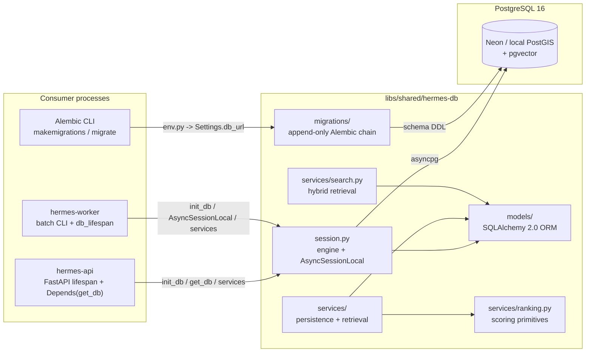
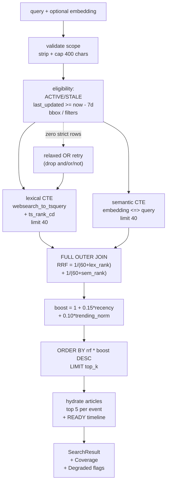
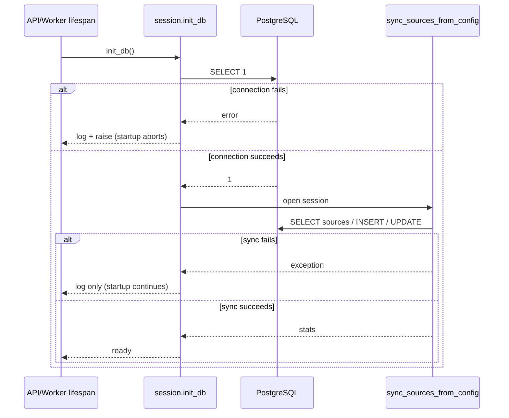

# Hermes DB — Architecture & Design Rationale

`libs/shared/hermes-db` is the persistence foundation of Hermes. It is a **library**, not a service: consumer applications own their process lifecycle and inject a database URL, while this package owns the schema, SQLAlchemy models, migrations, spatial/vector queries, ranking primitives, and persistence-facing service methods.

The design goal is to keep every database concern in one place so `hermes-api` and `hermes-worker` remain thin shells that orchestrate use cases without embedding SQL, PostGIS expressions, vector math, or schema knowledge.

> **Companion reading:** the workspace-level [`docs/architecture.md`](../../../../docs/architecture.md), [`apps/hermes-api/docs/architecture.md`](../../../../apps/hermes-api/docs/architecture.md), and [`apps/hermes-worker/docs/architecture.md`](../../../../apps/hermes-worker/docs/architecture.md) describe how this library is embedded in the broader system.

---

## 1. Mission, Scope, and Boundaries

### 1.1 Responsibilities

- Declare the canonical SQLAlchemy 2.0 ORM models for sources, articles, events, timelines, and the geocoding cache.
- Own every Alembic migration and the migration execution environment.
- Provide async persistence services for article ingestion, event creation/corroboration, source scheduling, geocoding cache access, timeline persistence, and lifecycle maintenance.
- Provide PostGIS spatial queries (bounding boxes, coordinate projection) and pgvector approximate-nearest-neighbor queries.
- Provide full-text search and hybrid lexical + semantic retrieval with reciprocal-rank fusion and coverage classification.
- Provide deterministic ranking primitives (credibility, impact, syndication dampening, geopolitical diversity, velocity, exponential decay).

### 1.2 Explicit non-responsibilities

- No RSS/GDELT fetching, HTML scraping, or ingestion loops.
- No LLM prompts, event extraction, embedding generation, or timeline synthesis.
- No geocoding HTTP calls. The library only stores and retrieves the geocoding cache; the Nominatim client lives in `libs/shared/hermes-ai`.
- No FastAPI routes, CLI commands, schedulers, or background jobs.
- No imports from `apps/hermes-api`, `apps/hermes-worker`, or `apps/hermes`. Dependency flow is strictly one-way.

### 1.3 Consumers

| Consumer | What it uses | Why |
| :--- | :--- | :--- |
| `apps/hermes-api` | `init_db` / `close_db` in lifespan, `get_db` in FastAPI dependencies, `EventService`, `EventTlService`, `GeocodeCacheService`, `SearchService` via the chat retriever | Read APIs, map queries, timeline persistence, conversational retrieval |
| `apps/hermes-worker` | `db_lifespan`, `AsyncSessionLocal`, `SourceService`, `EventService`, `GeocodeCacheService` | Ingestion, vector deduplication, event corroboration, lifecycle decay |
| Alembic CLI | `migrations/env.py`, `Settings`, `Base.metadata`, all models | Schema migration generation and execution |
| Tests | Models, enums, services, ranking, SQL compilation | Pure unit verification without a live database |

### 1.4 Architectural invariants

1. **Unidirectional dependency**: `hermes-db` never imports application code.
2. **Engine lifecycle inversion of control**: consumers validate their environment and call `init_db(db_url)`; standalone Alembic resolves configuration directly in `migrations/env.py`.
3. **Domain logic boundary**: no business workflows, ingestion pipelines, or LLM prompting. Persistence-adjacent scoring and retrieval logic is allowed because it is expressed as SQL/ORM operations and deterministic math.
4. **Statement caching disabled**: every engine passes `connect_args={"statement_cache_size": 0}` for PgBouncer transaction pooling compatibility.
5. **Direct coordinate projection**: longitude/latitude are projected with `ST_X` / `ST_Y` in SQL rather than decoding WKB geometry on the client.
6. **Migrations only**: all schema changes go through Alembic. Raw DDL and `Base.metadata.create_all()` are prohibited.
7. **WGS 84**: all stored coordinates are `POINT` geometries in SRID 4326, ordered `(longitude, latitude)`.

---

## 2. Position in the System



### 2.1 Why a shared library instead of per-app models

The alternative — separate ORM models in the API and worker — creates schema drift, duplicated enum definitions, and incompatible query behavior. A single library guarantees that both processes agree on column names, enum values, nullability, indexes, and ranking semantics. The TypeScript API response types are mirrored separately in `libs/shared/util-types`, but the Python contract has exactly one source of truth here.

### 2.2 Structural typing at the AI boundary

`protocols.py` defines two `typing.Protocol` interfaces:

- `EventExtractionData`: `headline`, `summary`, `category`, `category_color`, `location_name`, `impact_level`.
- `GeocodingData`: `latitude`, `longitude`.

These let `hermes-ai` Pydantic models satisfy `EventService` parameters without `hermes-db` importing `hermes-ai`. The dependency arrow stays `hermes-ai -> hermes-db` (or neither), never the reverse.

One contract nuance: `EventExtractionData.category_color` is typed `str | None`, while `events.category_color` is non-nullable `String(7)`. Upstream extraction must supply a color; otherwise the insert fails at the database boundary.

---

## 3. Package Layout and Public Surface

```text
libs/shared/hermes-db/
├── alembic.ini                  # Alembic config; script_location + prepend_sys_path
├── pyproject.toml               # deps, Ruff, pytest/coverage config
├── project.json                 # Nx targets: migrate, makemigrations, test, lint, build
├── migrations/
│   ├── env.py                   # async Alembic environment, GeoAlchemy2 integration
│   ├── script.py.mako
│   └── versions/                # 15 append-only revisions, head c2d3e4f5a6b7
├── src/hermes_db/
│   ├── __init__.py              # public session API: init_db, get_db, close_db
│   ├── base.py                  # Base, UUIDPrimaryKeyMixin, TimestampMixin
│   ├── enums.py                 # EventStatus, EventScope, EventTlStatus, ...
│   ├── protocols.py             # structural ports for AI/geocoding payloads
│   ├── session.py               # engine, session factory, lifespan helpers
│   ├── data/sources.json        # seeded source catalog (20 RSS feeds)
│   ├── models/
│   │   ├── __init__.py          # imports every model so metadata is complete
│   │   ├── source.py
│   │   ├── article.py
│   │   ├── event.py             # includes FTS expression + all event indexes
│   │   ├── event_tl.py
│   │   └── geocode_cache.py
│   └── services/
│       ├── __init__.py          # public service/result exports
│       ├── article.py           # ArticleService
│       ├── event.py             # EventService (write path, reads, lifecycle)
│       ├── ranking.py           # pure scoring functions and constants
│       ├── search.py            # SearchService + Pydantic result models
│       ├── source.py            # SourceService + sources.json sync
│       ├── geocode.py           # GeocodeCacheService
│       └── tl.py                # EventTlService
└── tests/                       # pure unit tests, fully mocked sessions
```

### 3.1 Public exports

`hermes_db/__init__.py` exposes only the session lifecycle:

```python
from hermes_db import close_db, get_db, init_db
```

Everything else is imported from its module (`hermes_db.services`, `hermes_db.models`, `hermes_db.enums`). `services/__init__.py` re-exports the common service classes and the search result models so consumers can use a single import for common cases. One exception: `EventTlService` is **not** re-exported; consumers import it from `hermes_db.services.tl` (as `hermes-api` does).

### 3.2 Import direction

```text
apps/hermes-api ─┐
apps/hermes-worker ─┼──> hermes_db.models / services / session
apps/hermes (TS) ──┘          │
                              ├──> geoalchemy2, pgvector, sqlalchemy, asyncpg
                              └──> standard library

hermes_db  ──X──> apps/*      (prohibited)
```

Application processes pass their own validated URL to `init_db` so database configuration is not duplicated. Standalone migration runs resolve credentials inside `migrations/env.py`.

---

## 4. Configuration and Engine Lifecycle

### 4.1 Pure Library Separation

`hermes-db` is a pure persistence library with zero environment inspection in `src/hermes_db`. It does not read `.env` files or invoke `os.getenv`. Standalone migration runs (`npx nx run hermes-db:migrate`) resolve database connection URLs directly in [`migrations/env.py`](file:///home/pavan/proj/hermes/hermes/libs/shared/hermes-db/migrations/env.py) by loading root `.env` files relative to the project root.

### 4.2 Engine and session factory

`session.py` follows strict Inversion of Control (IoC). No engine is instantiated at module import time:

```python
engine: AsyncEngine | None = None

AsyncSessionLocal: async_sessionmaker[AsyncSession] = async_sessionmaker(
    expire_on_commit=False,
)
```

Consumers call `init_db(db_url)` during application startup (e.g. FastAPI / CLI lifespan), creating the configured `AsyncEngine` and binding `AsyncSessionLocal` via `AsyncSessionLocal.configure(bind=engine)`:

```python
engine = create_async_engine(
    db_url,
    echo=False,
    pool_size=5,
    pool_pre_ping=True,
    max_overflow=10,
    connect_args={"statement_cache_size": 0},
)
AsyncSessionLocal.configure(bind=engine)
```

| Parameter | Value | Rationale |
| :--- | :--- | :--- |
| `echo` | `False` | SQL logging is controlled by application logging, not the engine |
| `pool_size` | `5` | Small per-process pool; matches API/worker concurrency envelopes |
| `max_overflow` | `10` | Allows bursts up to 15 connections per process |
| `pool_pre_ping` | `True` | Discards dead connections after network/idle failures (important for Neon) |
| `connect_args.statement_cache_size` | `0` | Required for PgBouncer transaction pooling: asyncpg must not rely on server-side prepared statements |
| `expire_on_commit` | `False` | ORM objects stay usable after a service commits |

No engine or TCP connection exists until `init_db` is explicitly awaited. Importing `hermes_db` carries zero environment dependencies.

### 4.3 Startup, request, and shutdown flow

```mermaid
sequenceDiagram
    autonumber
    participant C as Consumer lifespan
    participant S as session.py
    participant E as AsyncEngine
    participant DB as PostgreSQL
    participant SS as sync_sources_from_config

    C->>S: init_db(db_url)
    alt db_url provided
        S->>E: dispose() old engine
        S->>E: create_async_engine(db_url, pool=5, overflow=10, cache=0)
        S->>S: AsyncSessionLocal.configure(bind=new_engine)
    end
    S->>DB: SELECT 1 (connectivity probe)
    alt probe fails
        S-->>C: re-raise exception
    else probe succeeds
        S->>SS: sync_sources_from_config(session)
        SS->>DB: upsert / reactivate / soft-disable sources
        SS->>DB: COMMIT
        Note over S,SS: sync failure is logged, not fatal
    end
    C-->>C: application serves requests
    loop per request / per unit of work
        C->>S: get_db()
        S-->>C: AsyncSession
        Note over C: caller queries; get_db rolls back on any BaseException
    end
    C->>S: close_db()
    S->>E: dispose()
```

`init_db` is the explicit IoC seam:

- If `db_url` is provided, the old engine is disposed, a new engine is created with the same pool/statement-cache policy, and the existing `async_sessionmaker` is reconfigured in place. References to `AsyncSessionLocal` remain valid because `configure()` mutates the factory.
- If `db_url` is omitted, the module-level engine from `Settings` is reused. This supports standalone tooling and simple scripts.
- Connectivity is verified with `SELECT 1` inside `engine.begin()`.
- The source catalog sync runs once at startup. Its failure is intentionally swallowed with `logger.exception`, leaving the process alive because a stale source catalog should not prevent the API from serving reads or the worker from processing already-known sources.

`get_db` is a FastAPI-compatible async generator:

```python
async def get_db() -> AsyncGenerator[AsyncSession]:
    async with AsyncSessionLocal() as session:
        try:
            yield session
        except BaseException:
            await session.rollback()
            raise
```

It **never commits**. Read-only routes do not need a commit; any future mutation route must commit explicitly or call a service that owns its commit boundary. Catching `BaseException` (rather than `Exception`) ensures rollback also happens for cancellation and other async control-flow exceptions.

`close_db()` disposes the engine and logs closure. It does not set the module global to `None`; calling `init_db` again will dispose it a second time, which is safe.

### 4.4 PgBouncer and prepared statements

Neon’s pooled endpoint uses PgBouncer in transaction mode. In that mode, a server-side prepared statement can be created on one pooled connection and later referenced on another, producing `prepared statement ... does not exist` errors. Setting `statement_cache_size=0` on asyncpg disables the client-side statement cache and forces unnamed statements, trading a small parse overhead for correctness. The same setting is applied in three places:

1. The application engine in `session.py`.
2. Any replacement engine created by `init_db`.
3. The Alembic migration engine in `migrations/env.py`.

---

## 5. Domain Model and Schema

### 5.1 Entity-relationship overview

```mermaid
erDiagram
    SOURCES ||--o{ ARTICLES : "publishes"
    EVENTS ||--o{ ARTICLES : "is corroborated by"
    EVENTS ||--o| EVENT_TIMELINES : "has zero or one"
    SOURCES {
        uuid id PK
        text slug UK
        text name
        text url
        text feed_url
        enum source_type
        enum credibility
        bool is_active
        datetime last_fetched_at
        int fetch_interval_minutes
    }
    ARTICLES {
        uuid id PK
        uuid event_id FK
        uuid source_id FK
        text title
        text url UK
        datetime published_at
        datetime ingested_at
    }
    EVENTS {
        uuid id PK
        text ai_headline
        text ai_summary
        text category
        text category_color
        enum status
        enum scope
        enum impact_level
        geometry location
        text location_name
        text country_code
        float trending_score
        float velocity
        int article_count
        datetime first_reported_at
        datetime last_updated_at
        halfvec embedding
    }
    EVENT_TIMELINES {
        uuid id PK
        uuid event_id FK_UK
        enum status
        jsonb nodes
        jsonb edges
        text tl_summary
        text wikipedia_title
        int page_count
        int node_count
        timestamptz generated_at
    }
    GEOCODE_CACHE {
        uuid id PK
        text location_name UK
        float latitude
        float longitude
        text display_name
        timestamptz created_at
    }
```

`geocode_cache` is intentionally standalone: it is a generic cache, not owned by a source or an event.

### 5.2 Base classes and mixins

`base.py` defines:

```python
class Base(DeclarativeBase):
    pass


class TimestampMixin:
    created_at: Mapped[datetime] = mapped_column(server_default=func.now())
    updated_at: Mapped[datetime] = mapped_column(
        server_default=func.now(),
        onupdate=func.now(),
    )


class UUIDPrimaryKeyMixin:
    id: Mapped[uuid.UUID] = mapped_column(
        primary_key=True,
        default=uuid.uuid4,
    )
```

Design consequences:

- `id` is generated in Python by `uuid.uuid4`, while the initial migration also gives several tables a `gen_random_uuid()` server default. ORM inserts use the Python value; raw SQL inserts get a database value.
- `created_at` and `updated_at` are **timezone-naive** `DateTime` columns (SQLAlchemy infers `TIMESTAMP WITHOUT TIME ZONE`). The entire application convention is “naive UTC”. `onupdate` fires on ORM-originated updates, but it is metadata, not a lifecycle clock.
- `EventTl.generated_at` is the one model column explicitly declared `DateTime(timezone=True)` (`TIMESTAMPTZ`). `GeocodeCache` is inconsistent: its migration created `created_at` as `TIMESTAMPTZ` and **omitted `updated_at` entirely**, while the model inherits both from `TimestampMixin` (§12.4).
- `UUIDPrimaryKeyMixin` is listed before `TimestampMixin` in model bases for consistency. SQLAlchemy’s declarative mixin ordering does not affect column order in practice, but the convention is stable.

### 5.3 Enumerations

`enums.py` uses `enum.StrEnum`, so members compare equal to their string values and serialize cleanly through Pydantic and JSON.

| Enum | Members | Stored in DB? | Notes |
| :--- | :--- | :--- | :--- |
| `EventStatus` | `ACTIVE`, `STALE`, `ARCHIVED` | Yes, native `eventstatus` | Lifecycle state |
| `EventScope` | `GLOBAL`, `COUNTRY`, `STATE`, `CITY`, `LOCAL` | Yes, native `eventscope` | Default `COUNTRY`; no automatic derivation in this library |
| `EventTlStatus` | `READY`, `GENERATING`, `FAILED`, `NO_CONTENT` | Yes, non-native enum → `VARCHAR` | Timeline generation state machine |
| `SourceType` | `RSS`, `API`, `SCRAPE`, `GDELT` | Yes, native `sourcetype` | `GDELT` added in a later migration |
| `ImpactLevel` | `CRITICAL`, `MAJOR`, `MODERATE`, `MINOR` | Yes, native `impactlevel` | Default `MODERATE` |
| `CredibilityTier` | `TIER_1` … `TIER_4` | Yes, native `credibilitytier` | Default `TIER_3` |
| `GeopoliticalBloc` | `NORTH_AMERICA`, `EUROPE`, `ASIA_PACIFIC`, `MIDDLE_EAST_AFRICA`, `LATIN_AMERICA`, `GLOBAL_WIRE` | **No** | Used only by ranking/diversity math |

Native PostgreSQL enums are convenient but append-only: adding a value requires `ALTER TYPE ... ADD VALUE`, which is why the `GDELT` migration uses `IF NOT EXISTS`. Removing or reordering enum values is not supported without a type replacement.

### 5.4 `sources`

One row per publisher or feed. Sources are soft-disabled, never deleted, so historical articles keep a valid foreign key.

| Column | Type | Null | Default (ORM unless noted) | Notes |
| :--- | :--- | :--- | :--- | :--- |
| `id` | UUID | no | `uuid4` (Python), `gen_random_uuid()` (DB) | Primary key |
| `name` | varchar(255) | no | — | Display name |
| `slug` | varchar(128) | no | — | Unique, stable key used by config sync and bloc mapping |
| `url` | text | no | — | Publisher home page |
| `feed_url` | text | yes | — | RSS/Atom URL; required for RSS sources to be due |
| `source_type` | `sourcetype` | no | `RSS` | Chooses the worker fetcher |
| `credibility` | `credibilitytier` | no | `TIER_3` | Feeds ranking weights |
| `is_active` | boolean | no | `true` | Soft-disable flag |
| `logo_url` | text | yes | — | UI asset |
| `last_fetched_at` | timestamp | yes | — | Naive UTC; scheduling cursor |
| `fetch_interval_minutes` | integer | no | `15` | Per-source cadence |
| `created_at`, `updated_at` | timestamp | no | `now()` | Mixin columns |

Relationship: `Source.articles -> list[Article]`, back-populated by `Article.source`.

### 5.5 `articles`

An article is one fetched item, always attached to exactly one event and one source. The URL is globally unique; this is the idempotency key for ingestion.

| Column | Type | Null | Default | Notes |
| :--- | :--- | :--- | :--- | :--- |
| `id` | UUID | no | `uuid4` / `gen_random_uuid()` | Primary key |
| `event_id` | UUID | no | — | FK `events.id`, `ON DELETE CASCADE` |
| `source_id` | UUID | no | — | FK `sources.id`, `ON DELETE CASCADE` |
| `title` | text | no | — | Article headline |
| `url` | text | no | — | **Unique** (`uq_articles_url`); ingestion dedupe key |
| `thumbnail_url` | text | yes | — | Column exists but `create_article` does not populate it yet |
| `published_at` | timestamp | yes | — | Publisher timestamp, may be missing |
| `ingested_at` | timestamp | no | `now()` | Server-side ingestion time |
| `created_at`, `updated_at` | timestamp | no | `now()` | Mixin columns |

Relationships:

- `Article.event -> Event`, back-populated by `Event.articles`.
- `Article.source -> Source`, **lazy `selectin`** so `article.source_name` is available without a second explicit loader in async code.
- `Article.source_name` is a Python property returning `self.source.name`, or `None` if the relation is unset.

The unique URL constraint is enforced by a named constraint (`uq_articles_url`) rather than an inline `UNIQUE` column, because the migration adds it after deduplicating existing rows. `ArticleService.create_article` targets this constraint with `ON CONFLICT DO NOTHING`.

### 5.6 `events`

The central aggregate. An event is an AI-synthesized incident that one or more articles corroborate. It is deliberately denormalized for map/feed reads: headline, category, score, velocity, article count, and coordinates live on the row so the hottest queries avoid joins.

| Column | Type | Null | Default | Notes |
| :--- | :--- | :--- | :--- | :--- |
| `id` | UUID | no | `uuid4` / `gen_random_uuid()` | Primary key |
| `ai_headline` | varchar(500) | no | — | FTS weight A |
| `ai_summary` | text | yes | — | FTS weight B |
| `category` | varchar(100) | no | — | FTS weight C; case-insensitive search filter |
| `category_color` | varchar(7) | no | — | Hex color for the UI |
| `status` | `eventstatus` | no | `ACTIVE` | Lifecycle state |
| `scope` | `eventscope` | no | `COUNTRY` | Geographic scope |
| `impact_level` | `impactlevel` | no | `MODERATE` | Ranking multiplier; DB server default added later |
| `location` | `geometry(POINT, 4326)` | yes | — | Null when geocoding fails or is not applicable |
| `location_name` | varchar(255) | yes | — | Human-readable place |
| `country_code` | varchar(2) | yes | — | ISO-3166-1 alpha-2; indexed only when present |
| `trending_score` | float | no | `0.0` | Denormalized score; decayed by lifecycle |
| `velocity` | float | no | `1.0` | Articles per hour at last corroboration |
| `article_count` | integer | no | `0` | Denormalized count; incremented by service |
| `first_reported_at` | timestamp | no | `now()` | Set once at creation; velocity denominator |
| `last_updated_at` | timestamp | no | `now()` | Set on creation and each corroboration; lifecycle cutoff |
| `embedding` | `halfvec(2048)` | yes | — | Semantic dedupe / ANN search |
| `created_at`, `updated_at` | timestamp | no | `now()` | Mixin columns |

Relationships:

- `Event.articles -> list[Article]`, `cascade="all, delete-orphan"`. The database FK also has `ON DELETE CASCADE`, so both ORM and SQL deletion paths clean up children.
- Deleting an event cascades articles and its timeline. Deleting an article directly does **not** decrement `article_count`; the counter is service-maintained metadata.

Indexes declared in `Event.__table_args__`:

| Index | Method | Columns / expression | Purpose |
| :--- | :--- | :--- | :--- |
| `idx_events_location` | GiST | `location` | Bounding-box (`ST_Within`) map queries |
| `idx_events_embedding` | HNSW | `embedding halfvec_cosine_ops` | Approximate cosine nearest neighbors |
| `idx_events_active_score` | btree, partial | `(status, trending_score)` where `status = 'ACTIVE'` | Active feed ordered by score |
| `idx_events_scope` | btree | `(scope, status)` | Scope-filtered feeds |
| `idx_events_country` | btree, partial | `country_code` where `country_code IS NOT NULL` | Country filters |
| `idx_events_fts` | GIN | weighted `to_tsvector` expression | Full-text lexical search |

The FTS index is declared as a SQLAlchemy expression index and is also created by a dedicated migration using `CREATE INDEX CONCURRENTLY`.

### 5.7 `event_timelines`

A timeline is an optional, one-to-one enrichment of an event. The table replaced an earlier normalized lineage/edge/allowlist design; the current model stores the generated graph as two JSONB arrays plus summary metadata. This keeps timeline synthesis writes atomic (one row) and lets the API evolve node/edge shapes without a migration for every field.

| Column | Type | Null | Default | Notes |
| :--- | :--- | :--- | :--- | :--- |
| `id` | UUID | no | `uuid4` | Primary key |
| `event_id` | UUID | no | — | FK `events.id`, `ON DELETE CASCADE`, **unique** |
| `status` | varchar(20) / non-native enum | no | `GENERATING` | `READY`, `GENERATING`, `FAILED`, `NO_CONTENT` |
| `nodes` | JSONB | no | `[]` | List of timeline node objects |
| `edges` | JSONB | no | `[]` | List of timeline edge objects |
| `tl_summary` | text | no | `""` | Concatenated per-page summaries |
| `wikipedia_title` | text | yes | — | Root Wikipedia article used |
| `page_count` | integer | no | `0` | Number of Wikipedia pages processed |
| `node_count` | integer | no | `0` | Number of stored nodes |
| `generated_at` | timestamptz | yes | — | Set when generation reaches a terminal state |
| `created_at`, `updated_at` | timestamp | no | `now()` | Mixin columns |

Expected JSONB shapes (validated in `SearchService` when read):

```json
// node
{
  "id": "uuid-string",
  "date": "YYYY-MM-DD",
  "headline": "string",
  "summary": "string",
  "location_name": "string|null",
  "latitude": 0.0,
  "longitude": 0.0,
  "category_color": "#RRGGBB|null"
}

// edge
{
  "source_node_id": "uuid-string",
  "target_node_id": "uuid-string",
  "relationship": "led to"
}
```

The current event is appended by the API as a terminal node with id `"current-event"`; the last historical node is linked to it with `"led to"`. The library only stores and validates this data; it does not synthesize timelines.

### 5.8 `geocode_cache`

A normalized-key cache in front of the Nominatim client. It is deliberately provider-agnostic and contains no business logic.

| Column | Type | Null | Default | Notes |
| :--- | :--- | :--- | :--- | :--- |
| `id` | UUID | no | `uuid4` | Primary key (no DB server default) |
| `location_name` | text | no | — | **Unique index** `ix_geocode_cache_location_name`; stored `strip().lower()` |
| `latitude` | float | yes | — | `NULL` means “known un-geocodable” (negative cache) |
| `longitude` | float | yes | — | Same |
| `display_name` | text | yes | — | Provider display name |
| `created_at` | timestamptz (DB) / naive `DateTime` (model) | no | `now()` | **Drift:** the migration uses `TIMESTAMPTZ`; the model declares a naive type |
| `updated_at` | **missing in DB** | — | — | Mapped by `TimestampMixin` but never created by migration `c1d2e3f4a5b6`; ORM selects reference it (§12.4, §17.30) |

The cache is first-write-wins. `save_geocode_result` uses `ON CONFLICT (location_name) DO NOTHING`, then re-fetches. A cached `NULL` coordinate result therefore remains a negative cache until explicitly purged; migration `f5a6b7c8d9e0` performed a one-time purge of null-coordinate rows created during a rate-limit flood.

### 5.9 Relationship loading and async safety

| Relationship | Strategy | Where it is safe |
| :--- | :--- | :--- |
| `Article.source` | `lazy="selectin"` | Any article load; `source_name` is immediately usable |
| `Event.articles` | default `lazy="select"` | Safe only after `selectinload(Event.articles)`; `get_event_by_id` does this |
| `Article.event` | default `lazy="select"` | Safe only when explicitly eager-loaded |
| `Source.articles` | default `lazy="select"` | Same |

In async SQLAlchemy, touching an unloaded lazy relationship raises `MissingGreenlet`. The library solves this at the service boundary rather than globally: `EventService.get_event_by_id` uses `selectinload(Event.articles).joinedload(Article.source)`, and `Article.source` is selectin by default. Any new consumer that walks `event.articles` from a plain `select(Event)` must add its own eager-loading option.

### 5.10 Time semantics

- All “business” timestamps (`created_at`, `updated_at`, `first_reported_at`, `last_updated_at`, `published_at`, `ingested_at`, `last_fetched_at`) are **naive UTC**.
- Services normalize with `datetime.now(UTC).replace(tzinfo=None)` before writing or comparing. This matches `TIMESTAMP WITHOUT TIME ZONE` and avoids asyncpg timezone surprises.
- `calculate_velocity` defensively strips `tzinfo` from both inputs rather than converting between zones.
- `EventTl.generated_at` is the one explicitly aware model timestamp. `GeocodeCache.created_at` is aware in the database (`TIMESTAMPTZ`) but declared naive in the model, and its `updated_at` does not exist in the migrated table at all (§12.4). Consumers should not assume every datetime in the package is naive *or* that every mapped column exists in the database.
- `updated_at` is maintained by SQLAlchemy’s `onupdate`, but lifecycle decisions use `last_updated_at`, which is only advanced when a corroborating article is added.

---

## 6. Spatial Architecture (PostGIS)

### 6.1 Storage model

`Event.location` is a `geoalchemy2.Geometry(POINT, srid=4326, spatial_index=False)`. The spatial index is declared explicitly in `Event.__table_args__` rather than auto-created by GeoAlchemy2, so Alembic can render it deterministically with `postgresql_using="gist"`.

Coordinates are stored in **longitude, latitude** order, per the WGS 84 / PostGIS convention. Application payloads (`GeocodingData`) expose `latitude` and `longitude` separately; the service composes WKT:

```python
location_wkt = f"SRID=4326;POINT({geocoding.longitude} {geocoding.latitude})"
```

This is safe because both values are floats from the geocoding pipeline. No string interpolation of user text occurs.

### 6.2 Direct projection

Map and API responses need `latitude` and `longitude`, not WKB. The library always projects them in SQL:

```python
select(
    Event,
    ST_Y(Event.location).label("latitude"),
    ST_X(Event.location).label("longitude"),
)
```

This avoids shipping and deserializing WKB in Python, keeps the conversion in PostGIS, and lets the same query drive Pydantic/response construction. `EventTlService.get_event_coordinates` uses the same pattern for timeline terminal nodes.

### 6.3 Bounding-box queries

`EventService.get_events_by_bbox` builds a polygon with `ST_MakeEnvelope(west, south, east, north, 4326)`, filters `ST_Within(Event.location, polygon)`, excludes events without a location, restricts to `ACTIVE`, orders by `trending_score` descending, and caps at 200 rows.

`SearchService` adds two refinements:

1. **Antimeridian handling**: when `west > east`, the viewport is split into two envelopes (`west..180` and `-180..east`) combined with `OR`.
2. **Scope validation**: `VIEWPORT` scope requires a `BoundingBox`; `GLOBAL` ignores bbox; `EVENT` bypasses spatial filtering entirely.

`BoundingBox` validates `north >= south`, latitude in `[-90, 90]`, and longitude in `[-180, 180]`. It intentionally does **not** require `west <= east`, because crossing the antimeridian is valid.

### 6.4 Index behavior

The GiST index supports `ST_Within`/`ST_MakeEnvelope` lookups. The partial `idx_events_active_score` index helps the `ACTIVE` filter and trending order, but the planner may still choose a sequential scan for very broad viewports. The API caps bbox results at 200 rows; there is no pagination.

### 6.5 Why PostGIS rather than application-side geometry

- Spatial predicates (`ST_Within`, `ST_MakeEnvelope`) execute next to the data and use the GiST index.
- Coordinates never become LLM-generated values: they arrive through the geocoding pipeline and are stored as geometry, not free-form JSON.
- SRID 4326 is explicit in the schema and in every `ST_MakeEnvelope` call, preventing mixed-coordinate bugs.

---

## 7. Vector Architecture (pgvector)

### 7.1 Storage model

`Event.embedding` is `pgvector.sqlalchemy.HALFVEC(2048)`. The half-precision type halves storage and memory bandwidth versus `vector(2048)` while retaining enough precision for cosine similarity. The dimension matches the embedding model used by the worker (`nvidia_nim/nvidia/nemotron-3-embed-1b` in the current pipeline).

The HNSW index is:

```python
Index(
    "idx_events_embedding",
    "embedding",
    postgresql_using="hnsw",
    postgresql_with={"M": "16", "ef_construction": "64"},
    postgresql_ops={"embedding": "halfvec_cosine_ops"},
)
```

| Parameter | Value | Effect |
| :--- | :--- | :--- |
| `M` | 16 | Maximum bidirectional links per node; higher = better recall, more memory |
| `ef_construction` | 64 | Candidate list during build; higher = better graph quality, slower build |
| operator class | `halfvec_cosine_ops` | Enables `<=>` cosine distance on halfvec |

The index is approximate. `pgvector` uses `hnsw.ef_search` at query time (default 40); the library does not override it.

### 7.2 Query patterns

**Candidate retrieval for ingest deduplication** (`EventService.get_active_events_by_embeddings`):

```python
Event.embedding.cosine_distance(embedding) < 0.25
ORDER BY Event.embedding.cosine_distance(embedding)
LIMIT 5
```

- Only `ACTIVE` events are considered.
- The threshold is a cosine **distance** (0 = identical, 2 = opposite), so `< 0.25` is a fairly strict “same story” neighborhood.
- One query runs per non-empty embedding. The worker batches 10 articles, so at most 10 queries per batch; results are deduplicated by event id across embeddings.
- No lookback window is applied; an old active event can still match.

**Hybrid search semantic leg** (`SearchService._build_statement`):

```python
distance = Event.embedding.cosine_distance(list(embedding))
semantic = (
    select(Event.id, row_number().over(order_by=distance).label("rank"), distance)
    .where(*eligibility_conditions)
    .where(Event.embedding.is_not(None))
    .order_by(distance)
    .limit(semantic_limit)
    .cte("semantic")
)
```

The semantic CTE returns at most `semantic_limit` (default 40) candidates. `semantic_similarity` in the result is `1 - distance`, not a probability. There is no semantic threshold in search; thresholding happens only through ranking and coverage classification.

### 7.3 Embedding lifecycle

1. The worker generates embeddings for article text before extraction.
2. A new event stores the article embedding on `Event.embedding`.
3. Existing events are matched by cosine distance through the HNSW index.
4. If an event is corroborated, **its embedding is not updated**. The first article’s vector remains the event’s semantic anchor. This is a deliberate simplification; re-centering would require averaging or re-embedding and is not implemented.
5. Changing the embedding model or dimension is a destructive migration: `e4f5a6b7c8d9` dropped the old HNSW index, set every existing embedding to `NULL`, altered the column to `halfvec(2048)`, and rebuilt the index. A future dimension change must follow the same pattern and trigger re-embedding of active events.

### 7.4 Why HNSW + halfvec

- HNSW gives sub-linear approximate nearest-neighbor search with good recall at moderate memory cost.
- `halfvec` halves index size and I/O, which matters on a serverless PostgreSQL plan.
- Cosine distance is appropriate for normalized text embeddings and is invariant to vector magnitude.
- The same operator class must be used at index creation and query time; using `vector_cosine_ops` against a `halfvec` column fails.

---

## 8. Full-Text Search Architecture

### 8.1 Weighted tsvector expression

`models/event.py` defines a reusable expression function:

```python
def event_fts_expression(headline, summary, location_name, category):
    regconfig = literal_column("'english'::regconfig")
    return (
        setweight(to_tsvector(regconfig, coalesce(headline, '')), 'A')
        || setweight(to_tsvector(regconfig, coalesce(summary, '')), 'B')
        || setweight(to_tsvector(regconfig, coalesce(location_name, '')), 'B')
        || setweight(to_tsvector(regconfig, coalesce(category, '')), 'C')
    )
```

Weight semantics:

| Weight | Field | Intent |
| :--- | :--- | :--- |
| A | `ai_headline` | Strongest signal |
| B | `ai_summary`, `location_name` | Supporting context and place-name matching |
| C | `category` | Weak topical hint |

`coalesce(..., '')` ensures NULL summaries/locations produce a valid tsvector instead of NULL. The `'english'::regconfig` literal makes the expression immutable enough for an expression index (the configuration is a constant, not a column).

### 8.2 GIN index and concurrent creation

`idx_events_fts` is a GIN index over the full expression. Migration `c2d3e4f5a6b7` creates it with:

```sql
CREATE INDEX CONCURRENTLY IF NOT EXISTS idx_events_fts
ON events USING gin (( ...weighted expression... ));
```

`CREATE INDEX CONCURRENTLY` cannot run inside a transaction, so the migration wraps it in `op.get_context().autocommit_block()`. The matching test (`test_event_fts.py`) compiles the SQLAlchemy index against the PostgreSQL dialect and compares the normalized expression with the migration text, guarding against drift between metadata and DDL.

### 8.3 Query path

`SearchService` builds:

```python
fts = event_fts_expression(...)
ts_query = func.websearch_to_tsquery(REG_CONFIG, query)
```

`websearch_to_tsquery` accepts web-style syntax (`"quoted phrase"`, `or`, `-term`) and is safer than raw `to_tsquery` because it does not raise on malformed input. Lexical candidates are ranked by `ts_rank_cd(fts, ts_query)`, assigned `row_number()`, and capped at `lexical_limit` (default 40).

If the strict query returns zero rows, `_relaxed_query` joins the terms with `" or "` (dropping `and`/`or`/`not` and quote characters) and retries once. This recovers from verbose planner rewrites without weakening the first pass. The relaxed query is also capped at 400 characters.

### 8.4 Language coupling

The FTS configuration is hard-coded to `english`. Supporting additional languages would require either per-row `regconfig` columns (which complicates the expression index) or separate indexes. This is a known limitation, not an accident.

---

## 9. Service Layer

The service layer is a set of small, session-scoped classes. None of them own a connection; each receives an `AsyncSession` in its constructor. This makes them composable inside a request or unit of work, and easy to test with a mocked session.

| Service | Responsibility | Commit behavior |
| :--- | :--- | :--- |
| `ArticleService` | URL existence check, idempotent article insert | No commit (caller/service owner commits) |
| `EventService` | Event creation, corroboration/scoring, reads, lifecycle | Commits on successful writes; rolls back on duplicate new event |
| `SourceService` | Due-source selection, `last_fetched_at` update | No commit; caller commits |
| `sync_sources_from_config` | Seed/update/disable sources from JSON | Commits |
| `GeocodeCacheService` | Normalized cache reads/writes | Commits on save |
| `EventTlService` | Timeline row lifecycle and coordinate projection | Commits on every mutation |
| `SearchService` | Hybrid retrieval, coverage, context hydration | Read-only |

### 9.1 `ArticleService`

```python
class ArticleService:
    async def article_url_exists(self, url: str) -> bool
    async def create_article(event_id, source_id, title, url,
                             published_at=None) -> Article | None
```

- `article_url_exists` issues `SELECT id FROM articles WHERE url = :url LIMIT 1` and returns a boolean. The worker calls it to skip already-ingested URLs before spending embedding/LLM tokens.
- `create_article` uses PostgreSQL-specific `INSERT ... ON CONFLICT DO NOTHING RETURNING *` via `pg_insert`. It returns the inserted `Article` or `None` when the URL already exists.
- Using the database unique constraint as the arbiter makes ingestion safe under concurrent workers: two processes racing on the same URL cannot both insert.
- The method never calls `session.add()`; the Core insert bypasses ORM unit-of-work state.
- `thumbnail_url` is not part of the insert; if the worker later needs it, the method signature and migration already have a column for it.

### 9.2 `EventService` — creation path

`create_event_with_article` is the “new event” branch of the ingestion pipeline.

```mermaid
sequenceDiagram
    autonumber
    participant W as Worker
    participant ES as EventService
    participant AS as ArticleService
    participant DB as PostgreSQL

    W->>ES: create_event_with_article(extraction, geocoding, article, source, embedding)
    ES->>ES: build WKT from geocoding (or None)
    ES->>ES: parse impact level; compute initial score
    ES->>DB: session.add(event); flush()
    DB-->>ES: event.id assigned
    ES->>AS: create_article(event.id, source.id, title, url)
    AS->>DB: INSERT ... ON CONFLICT (url) DO NOTHING RETURNING *
    alt URL already exists
        AS-->>ES: None
        ES->>DB: ROLLBACK
        ES-->>W: None
    else new article
        ES->>DB: COMMIT
        ES-->>W: Event
    end
```

Initial state:

```text
trending_score = CREDIBILITY_WEIGHTS[source_credibility] * IMPACT_MULTIPLIERS[impact]
velocity       = 1.0
article_count  = 1
status         = ACTIVE
scope          = COUNTRY (ORM default)
first_reported_at = last_updated_at = now (naive UTC)
embedding      = article embedding or NULL
location       = WKT POINT or NULL
```

Important transaction semantics:

- `session.flush()` is required before `create_article` so the event UUID exists for the article foreign key.
- If the article URL is a duplicate, the method rolls back the **entire transaction**, including the new event. This prevents orphan events.
- Because the rollback is unconditional, calling this method inside a larger caller-owned transaction will also roll back prior work. The service is designed to own its transaction boundary.
- `impact_level` is parsed from a string, an `ImpactLevel`, or `None` (defaults to `MODERATE`). An invalid string raises `ValueError`; upstream extraction should validate against the enum.
- `category_color` is passed through; the database requires a non-null 7-character value.

### 9.3 `EventService` — corroboration and scoring

`add_article_to_event` is the “existing event” branch.

1. Load the event with `session.get(Event, event_id)`. If missing, log and return `None` without committing.
2. Insert the article through `ArticleService`. If the URL is a duplicate, log and return `None` **without** rolling back or committing (the caller may fall back to creating a new event).
3. Increment `event.article_count`, set `event.last_updated_at = now`.
4. Query the event’s articles joined to sources to obtain each article’s `source_id` and source `slug`.
5. Compute the scoring factors below.
6. Add the increment to `event.trending_score`.
7. Reactivate `STALE -> ACTIVE` if needed.
8. Commit and return the event.

The increment is:

```text
ΔS = W_cred(new source)
   × (1 / sqrt(N_same_source))
   × M_impact(event)
   × D_shannon(event blocs)
   × V_mult(event velocity)
```

| Factor | Definition | Range / values |
| :--- | :--- | :--- |
| `W_cred` | `CREDIBILITY_WEIGHTS[source_credibility]` | `TIER_1=3.0`, `TIER_2=2.0`, `TIER_3=1.0`, `TIER_4=0.5` |
| `N_same_source` | Number of articles on this event from the same source, including the one just inserted; minimum 1 | `1, 2, 3, ...` |
| `M_impact` | `IMPACT_MULTIPLIERS[event.impact_level]` | `CRITICAL=2.0`, `MAJOR=1.5`, `MODERATE=1.0`, `MINOR=0.8` |
| `D_shannon` | `1 + 0.5 × min(H, 1.0)` where `H = -Σ p_i ln p_i` over geopolitical blocs | `1.0` (one bloc) to `1.5` (H ≥ 1) |
| `V_mult` | `1 + min((velocity - 1) × 0.2, 1.0)` for velocity > 1 | `1.0` to `2.0` |
| `velocity` | `article_count / max(hours_since_first_reported, 1.0)` | articles/hour |

The `1 / sqrt(N_same_source)` factor is the syndication dampener: ten copies of the same wire story from one publisher should not outweigh independent corroboration from ten different publishers. The Shannon term rewards cross-bloc consensus. The velocity term rewards fast-moving stories, capped so it cannot dominate relevance.

Unknown source slugs map to `GeopoliticalBloc.GLOBAL_WIRE` in `EventService`. Because all unknowns land in the same bucket, a set of unrecognized sources contributes zero diversity rather than spurious diversity.

> **Concurrency caveat:** this is a read-modify-write on `article_count` and `trending_score` in Python. Two transactions that corroborate the same event concurrently can lose an increment. The worker’s `asyncio.Semaphore(5)` limits concurrency per process, but not across processes or API instances. An atomic `UPDATE events SET article_count = article_count + 1, trending_score = trending_score + :delta` would be the robust alternative if cross-process contention becomes real.

### 9.4 Ranking primitives (`services/ranking.py`)

`ranking.py` is pure Python with no database dependency, which makes it cheap to test and reuse.

| Constant | Value | Meaning |
| :--- | :--- | :--- |
| `CREDIBILITY_WEIGHTS` | 3.0 / 2.0 / 1.0 / 0.5 | Source tier contribution |
| `IMPACT_MULTIPLIERS` | 2.0 / 1.5 / 1.0 / 0.8 | Event impact contribution |
| `HALF_LIFE_HOURS` | 18.0 | Named half-life for decay |
| `HOURLY_DECAY_FACTOR` | `2 ** (-1/18) ≈ 0.962216` | Multiply score once per lifecycle run |
| `SOURCE_BLOC_MAP` | slug → bloc | Curated mapping for known outlets |

`SOURCE_BLOC_MAP` covers Reuters/AP/AFP (global wire), BBC/Guardian/DW/France24/Euronews/Politico Europe (Europe), PBS/NYT/NPR/CBC/WSJ/WaPo/CNN/ABC (North America), NHK (Asia-Pacific), and Al Jazeera (Middle East/Africa). It is intentionally a static map: bloc assignment is editorial policy, not something to infer at runtime.

### 9.5 `EventService` — read operations

| Method | Query shape | Returns | Notes |
| :--- | :--- | :--- | :--- |
| `get_events(status=ACTIVE, scope=None, limit=50)` | `SELECT * FROM events` filtered by status/scope, ordered by `trending_score DESC`, limit | `list[Event]` | `status=None` disables the status filter; API validates limit 1–200 |
| `get_events_by_bbox(north, south, east, west)` | `Event` + `ST_X`/`ST_Y`, `ST_Within` an envelope, `ACTIVE`, order by score, limit 200 | SQLAlchemy `Row` tuples `(Event, longitude, latitude)` | API maps these rows explicitly |
| `get_event_by_id(event_id)` | `selectinload(Event.articles).joinedload(Article.source)` | `Event | None` | The only method that fully hydrates articles + sources |
| `get_active_events()` | `id, ai_headline, location_name, category` for `ACTIVE`, order by score, limit 100 | `list[dict[str, str]]` | Used by the worker as LLM candidate context; `location_name` is `"N/A"` when null |
| `get_active_events_by_embeddings(embeddings)` | One HNSW query per embedding, `cosine_distance < 0.25`, `ACTIVE`, limit 5; dedupe by id | `list[dict[str, str]]` | Returns the same compact shape as `get_active_events` |
| `article_url_exists(url)` | Delegates to `ArticleService` | `bool` | Convenience for callers that only hold `EventService` |

`get_active_events` and `get_active_events_by_embeddings` deliberately return compact dictionaries rather than ORM objects. These dictionaries are passed into the LLM extraction prompt; they should contain only stable, minimal context (id, headline, place, category) and no internal scoring or embedding data.

### 9.6 Lifecycle maintenance

`run_lifecycle_transitions` is the worker’s periodic maintenance entry point:

```text
1. UPDATE events SET trending_score = trending_score * HOURLY_DECAY_FACTOR
   WHERE status = 'ACTIVE';

2. UPDATE events SET status = 'STALE'
   WHERE status = 'ACTIVE' AND last_updated_at < now() - EVENT_STALE_HRS;

3. UPDATE events SET status = 'ARCHIVED'
   WHERE status = 'STALE' AND last_updated_at < now() - EVENT_ARCHIVE_HRS;

4. COMMIT once.
```

- The decay step applies to **every** active event, regardless of age. There is no per-event time delta in the SQL.
- The status transitions use `last_updated_at`, not `updated_at` or `created_at`.
- Because step 2 runs before step 3, an event whose `last_updated_at` is older than both cutoffs can move `ACTIVE -> STALE -> ARCHIVED` in the same invocation.
- `_transition_event_status` returns the driver `rowcount` when the result is a `CursorResult`; otherwise it safely returns 0.
- The method commits once at the end. If any statement fails, the whole lifecycle batch rolls back.

> **Effective decay cadence:** `HOURLY_DECAY_FACTOR` is one hour of exponential decay, but the method applies exactly one step per invocation. At the documented worker cadence of three runs per day (every 8 hours), a score takes 18 invocations — about six days — to halve, not 18 hours. The constant name and comment describe hourly decay; the scheduler determines the real half-life. If true 18-hour wall-clock decay is required, the update should compute `POWER(0.5, EXTRACT(EPOCH FROM (now() - last_updated_at)) / 3600 / 18)` or the worker must run hourly.

Status progression:

```text
ACTIVE ──(no corroboration for > 24h)──> STALE ──(no corroboration for > 48h)──> ARCHIVED
   ^                                        │
   └──────────── new article ───────────────┘
```

`ARCHIVED` is not resurrected by `add_article_to_event` in the current implementation: only `STALE` is flipped back to `ACTIVE`. If a caller explicitly adds an article to an archived event, the article is attached but the status remains `ARCHIVED`. Normal ingest matching never selects archived events, so this only happens through a direct call. This is a deliberate lifecycle choice (archive is terminal for the current model), but consumers should be aware of it.

### 9.7 Source scheduling and catalog sync

`SourceService`:

- `get_due_sources(force=False)` selects all active sources, then filters in Python:
  - RSS sources without `feed_url` are skipped.
  - `last_fetched_at is None` means due.
  - A naive `last_fetched_at` is interpreted as UTC.
  - Due when `now >= last_fetched_at + fetch_interval_minutes`, or when `force=True`.
- Returns an immutable `DueSource` dataclass with exactly the fields a fetcher needs: id, name, feed URL, credibility, interval, type, URL, slug, last fetch time. Decoupling the fetcher from the ORM avoids lazy-loading and session leakage into network code.
- `update_last_fetched(source_id, fetched_at=None)` executes a Core `UPDATE` with a naive UTC timestamp. **It does not commit**; the worker commits after calling it.

`sync_sources_from_config(session, config_path=None)`:

1. Load `data/sources.json` (or an explicit path). It must be a JSON array; a non-array raises `ValueError`.
2. For each entry with a `slug`:
   - Look up by slug.
   - If it exists, update only non-`None` fields among `name`, `url`, `feed_url`, `source_type`, `credibility`; reactivate it if inactive.
   - If it does not exist, insert it with fallbacks: `name=slug`, `url=""`, `feed_url=None`, unknown `source_type -> RSS`, unknown `credibility -> TIER_3`.
3. Select all sources and **soft-disable** any active source whose slug is not in the config.
4. Commit once and return `{"inserted": n, "updated": n, "disabled": n}`.

Failure behavior: `FileNotFoundError` and `JSONDecodeError`/`ValueError` are logged and result in zero stats rather than an exception. Other database errors propagate to `init_db`, which logs them but does not abort startup.

The catalog currently contains 20 curated RSS sources: 14 `TIER_1` wire/broadcast outlets and 6 `TIER_2` outlets. Most `feed_url` values are Google News RSS search URLs, which normalize publisher feeds behind a single stable endpoint. There is no runtime admin API for sources; the JSON file is the source of truth.

Config update semantics worth knowing:

- Setting a field to `null` in JSON will **not** clear an existing database value; only non-`None` values are applied.
- A source removed from JSON is disabled, never deleted, preserving article lineage.
- A source re-added later is reactivated by the same slug.

### 9.8 `GeocodeCacheService`

```python
class GeocodeCacheService:
    async def get_by_location_name(location_name) -> GeocodeCacheEntry | None
    async def save_geocode_result(location_name, latitude, longitude,
                                  display_name) -> GeocodeCacheEntry
```

- Both methods normalize with `location_name.strip().lower()`, so `"  London  "` and `"london"` share a cache entry.
- `get_by_location_name` performs an exact equality lookup on the normalized key.
- `save_geocode_result` uses `INSERT ... ON CONFLICT (location_name) DO NOTHING`, commits, then re-fetches. This is first-write-wins: an existing positive or negative entry is never overwritten.
- If the re-fetch unexpectedly returns nothing, it raises `RuntimeError`, treating the cache as inconsistent rather than silently returning a partial result.
- The service never calls Nominatim. It is the persistence adapter used by `hermes-ai`’s `GeocodingService`.

The negative-cache semantics are important: a `NULL` latitude/longitude row means “this location is known not to be geocodable.” It prevents repeated external requests for non-geographic labels such as “Global Markets.” Migration `f5a6b7c8d9e0` purged null rows once after a 429 flood; the service itself does not expire them.

> **Deployment caveat:** the ORM mapping includes `updated_at`, but the migration that created `geocode_cache` did not. Against a database built strictly from migrations, these entity reads fail. Verify the live table shape before relying on this service (§17.30).

### 9.9 `EventTlService`

A thin persistence adapter for timeline synthesis in the API:

| Method | Behavior |
| :--- | :--- |
| `get_event(event_id)` | `session.get(Event, event_id)` |
| `get_tl(event_id)` | Select the single `EventTl` by `event_id` |
| `create_tl(event_id, status)` | Insert a new row (default status passed by caller), commit, return it |
| `update_tl_status(tl, status)` | Mutate status, commit |
| `save_generated_tl(...)` | Assign nodes/edges/summary/title/counts/status, set `generated_at` to aware UTC now, commit |
| `delete_tl(tl)` | Delete row, commit |
| `get_event_coordinates(event_id)` | Project `ST_Y`/`ST_X`; returns `(None, None)` when the event or location is missing |

The unique `event_id` constraint means a second concurrent `create_tl` for the same event fails with an integrity error. The API’s `TlService` reads first and updates an existing row, so this is normally avoided. Each mutation commits independently; timeline generation is therefore not a single atomic unit across status changes. A crash after `GENERATING` is committed leaves a row in that state until a later request updates it.

---

## 10. Hybrid Search and Retrieval (`SearchService`)

`SearchService` is the read path used by conversational chat and any future search UI. It combines PostgreSQL full-text search with pgvector semantic search, fuses the two ranked lists with reciprocal-rank fusion (RRF), applies a bounded recency/trending boost, and returns a typed result with coverage and degradation metadata.

### 10.1 Public result model

```python
class SearchService:
    def __init__(
        self,
        session: AsyncSession,
        *,
        top_k: int = 8,
        lexical_limit: int = 40,
        semantic_limit: int = 40,
        min_local_results: int = 2,
        min_semantic_similarity: float = 0.20,
        freshness_hours: float = 24.0,
        lookback_days: int = 7,
        articles_per_event: int = 5,
        rrf_k: int = 60,
    ) -> None: ...

    async def retrieve(
        self,
        query: str,
        *,
        scope: SearchScope = SearchScope.GLOBAL,
        event_id: uuid.UUID | None = None,
        bbox: BoundingBox | None = None,
        filters: SearchFilters | None = None,
        embedding: Sequence[float] | None = None,
        recency_intent: bool = False,
    ) -> SearchResult: ...
```

`SearchResult` contains:

- `events: list[SearchEvent]` — ranked evidence with optional articles/timeline.
- `coverage: Coverage` — `EMPTY`, `THIN`, or `SUFFICIENT`, plus best signals.
- `degraded: list[SearchDegradedFlag]` — currently only `SEMANTIC_UNAVAILABLE`.

### 10.2 Scopes

| Scope | Required inputs | Behavior |
| :--- | :--- | :--- |
| `GLOBAL` | query, optional filters/embedding | Hybrid search across all eligible events |
| `VIEWPORT` | `bbox` | Hybrid search restricted by `ST_Within` envelope, with antimeridian split |
| `EVENT` | `event_id` | Direct fetch by id; bypasses hybrid ranking and filters |

Validation:

- `EVENT` without `event_id` raises `ValueError("event scope requires event_id.")`.
- `VIEWPORT` without `bbox` raises `ValueError("viewport scope requires bbox.")`.
- Empty/whitespace query raises `ValueError("query must not be empty.")`.
- Query is truncated to `MAX_QUERY_CHARS = 400` **before** binding.

`EVENT` scope is intentionally different: there is no lexical or semantic signal for a single known event, so the result carries no ranks. It still goes through `classify_coverage`, which always classifies a single found event as `THIN` because `count >= min_local_results` can never hold. Callers should treat event scope as “fetch this event and its context,” not as a quality-scored search.

### 10.3 Eligibility conditions

Every non-`EVENT` query starts with:

```python
Event.status.in_([EventStatus.ACTIVE, EventStatus.STALE])
Event.last_updated_at >= now - timedelta(days=lookback_days)  # default 7 days
```

`ARCHIVED` events are never returned by search. Note that search includes `STALE` events, whereas the map and default feed reads include only `ACTIVE`; the same event can therefore appear in chat but not on the map (see §17.9).

Optional filters are applied inside both CTEs, before ranking:

| Filter | Predicate | Semantics |
| :--- | :--- | :--- |
| `category` | `upper(Event.category) = upper(filter)` | Case-insensitive exact category |
| `start` | `Event.last_updated_at >= max(start, cutoff)` | Event must have been updated on/after start |
| `end` | `Event.first_reported_at <= min(end, now)` | Event must have started on/before end |

The two bounds use different timestamps: `start` gates `last_updated_at`, `end` gates `first_reported_at`. This is not a true interval-overlap test; see §17.24 for the consequences and a migration path. Naive datetimes are treated as UTC; aware datetimes are converted to UTC and stripped.

### 10.4 Query pipeline



### 10.5 Lexical CTE

```python
fts = event_fts_expression(
    Event.ai_headline, Event.ai_summary, Event.location_name, Event.category
)
ts_query = func.websearch_to_tsquery(REG_CONFIG, query)

lexical = (
    select(
        Event.id.label("id"),
        func.row_number()
        .over(order_by=func.ts_rank_cd(fts, ts_query).desc())
        .label("rank"),
    )
    .where(*conditions)
    .where(fts.op("@@")(ts_query))
    .order_by(func.ts_rank_cd(fts, ts_query).desc())
    .limit(self._lexical_limit)
    .cte("lexical")
)
```

- `row_number()` assigns a 1-based rank; ties in `ts_rank_cd` are broken arbitrarily by the window ordering (use `dense_rank()` if equal scores must share a rank).
- The rank is computed over the eligible set, then limited.
- The CTE is joined to the semantic CTE by event id.

### 10.6 Semantic CTE

```python
distance = Event.embedding.cosine_distance(list(embedding))
semantic = (
    select(
        Event.id.label("id"),
        func.row_number().over(order_by=distance).label("rank"),
        distance.label("distance"),
    )
    .where(*conditions)
    .where(Event.embedding.is_not(None))
    .order_by(distance)
    .limit(self._semantic_limit)
    .cte("semantic")
)
```

- If `embedding` is falsy (`None` or empty), the semantic CTE is omitted entirely and the fused CTE contains only lexical rows with `semantic_rank = NULL` and `semantic_similarity = NULL`.
- Embedding dimension/type must match the column: 2048 half-floats. A mismatch surfaces as a database error, not a Python validation error.
- `semantic_similarity = 1.0 - distance`; it is reported for coverage and diagnostics, not used as a hard filter.

### 10.7 Reciprocal-rank fusion

With both legs:

```sql
FULL OUTER JOIN semantic ON lexical.id = semantic.id
```

Fusion score:

```text
RRF = COALESCE(1 / (rrf_k + lexical_rank), 0)
    + COALESCE(1 / (rrf_k + semantic_rank), 0)
```

with `rrf_k = 60`. A document that ranks first in both lists gets `1/61 + 1/61 ≈ 0.0328`; a document present in only one list at rank 10 gets `1/70 ≈ 0.0143`. Agreement is rewarded more than a single strong signal.

The full outer join is essential: it preserves lexical-only matches when semantic search misses and semantic-only matches when the query terms do not appear literally.

### 10.8 Recency and trending boost

```text
age_hours      = EXTRACT(EPOCH FROM (now - last_updated_at)) / 3600
trending_norm  = LEAST(1.0, trending_score / GREATEST(max_trending, 1.0))
boost          = 1.0
               + 0.15 * EXP(-age_hours / 168.0)
               + 0.10 * trending_norm
score          = RRF * boost
```

| Constant | Value | Meaning |
| :--- | :--- | :--- |
| `RECENCY_WEIGHT` | 0.15 | Maximum recency contribution |
| `TRENDING_WEIGHT` | 0.10 | Maximum trending contribution |
| `RECENCY_WINDOW_HOURS` | 168 (7 days) | Exponential decay horizon |
| Maximum boost | 1.25 | Relevance always remains the dominant term |

`max_trending` is a window maximum over the fused candidate set, not a global maximum. This normalizes within the result set and prevents an unusually high-scoring outlier elsewhere in the database from flattening all boosts.

The Python helper `boost_multiplier` mirrors the SQL formula and is unit-tested for boundary behavior (`1.25` at zero age and max trending; `1.0` at very old age and zero trending).

### 10.9 Coverage classification

Coverage answers a different question than ranking: “is the local evidence strong enough to answer the user's question?” It is computed after ranking and is independent of `top_k`.

Inputs:

- `result_count = len(events)`
- `best_semantic_similarity = max(event.semantic_similarity)` over events with a semantic rank
- `best_lexical_rank = min(event.lexical_rank)` over events with a lexical rank
- `newest_age_hours = min(event.age_hours)`
- `recency_stale = recency_intent and newest_age > freshness_hours`

Rules:

```text
strong = result_count >= min_local_results
         AND ( best_semantic_similarity >= min_semantic_similarity
               OR best_lexical_rank <= 3 )

EMPTY      if result_count == 0
SUFFICIENT if strong AND NOT recency_stale
THIN       otherwise
```

Defaults: `min_local_results=2`, `min_semantic_similarity=0.20`, `freshness_hours=24`.

Interpretation:

- A single perfect semantic hit is still `THIN` when `min_local_results=2` because corroboration is required.
- A top-3 lexical match can make the result `SUFFICIENT` even without an embedding; this is what keeps search useful when the embedding provider is down.
- `recency_intent` is supplied by the chat planner when the user asks for “latest”/“today” content. If the newest evidence is older than `freshness_hours`, an otherwise strong result is downgraded to `THIN` and `recency_stale=True` is surfaced.

`.coverage` is intended to let the chat layer decide whether to answer from local evidence, ask a clarifying question, or fall back to web search. The database layer classifies; the chat layer decides.

### 10.10 Context hydration

After the event rows are ranked and limited, `_load_context` performs two batched queries:

**Articles** (`_load_articles`):

```sql
SELECT ... FROM (
  SELECT article.*, source.name AS source_name,
         ROW_NUMBER() OVER (
           PARTITION BY event_id
           ORDER BY published_at DESC NULLS LAST,
                    ingested_at DESC,
                    id
         ) AS rank
  FROM articles JOIN sources ON ...
  WHERE event_id IN (...)
) ranked
WHERE rank <= articles_per_event
ORDER BY event_id, rank
```

- At most 5 articles per event by default.
- Newest `published_at` first; missing publication dates fall back to `ingested_at` and then id for deterministic ordering.
- The inner join to `sources` means an article whose source row is missing (which the FK prevents) would be omitted.
- Results are grouped into `dict[event_id, list[SearchArticle]]`.

**Timelines** (`_load_timelines`):

```sql
SELECT event_id, nodes, edges, tl_summary
FROM event_timelines
WHERE event_id IN (...) AND status = 'READY'
```

- Only `READY` timelines are exposed; `GENERATING`, `FAILED`, and `NO_CONTENT` are intentionally invisible to search.
- Nodes/edges are parsed through Pydantic models (`SearchTimelineNode`, `SearchTimelineEdge`). Malformed entries are skipped with a warning rather than failing the whole result.
- If there are no valid nodes, edges, or summary text, the timeline is treated as absent (`None`).

This two-query hydration pattern avoids N+1 queries and keeps the main ranked query free of JSONB payloads.

### 10.11 Relaxed retry and degradation

**Relaxed retry:** if the strict hybrid query returns zero rows, and the query has at least two terms, `_relaxed_query` produces an OR-joined variant:

```text
"recent bomb threats incidents across Europe"
  -> "recent or bomb or threats or incidents or across or Europe"
```

It strips quote characters and drops the stopword-like operators `and`, `or`, `not`. The retry is a single second execution; if it also returns zero rows, the result is empty. This handles the common planner failure mode where a verbose LLM-written query is too restrictive for `websearch_to_tsquery`.

**Degraded flags:** if no embedding was supplied to `retrieve`, the result includes `SearchDegradedFlag.SEMANTIC_UNAVAILABLE`. This is informational: lexical search still ran and may have produced excellent results. The chat layer can use the flag to explain reduced recall or to decide whether to retry embedding generation.

`SearchResult.degraded` is empty when an embedding was passed, even if the semantic leg returned no candidates. The flag describes capability availability, not result quality; coverage describes result quality.

### 10.12 Defensive row mapping

The raw query returns a mix of UUIDs, enums, floats, `Decimal` values (depending on driver/type), and NULLs. `_event_from_row` normalizes them through helpers:

- `_as_float` rejects booleans and accepts `int`, `float`, `Decimal`, and numeric strings.
- `_as_optional_float` preserves `None`.
- `_as_int` accepts `int`, `Decimal`, and numeric strings, rejecting booleans.
- `_as_datetime` requires an actual `datetime`.
- UUIDs are rebuilt with `uuid.UUID(str(value))`.

This is deliberately stricter than `float(value)` everywhere: silently accepting `True` as `1.0` would hide data corruption. The cost is a clear `ValueError` at the boundary when a column type changes unexpectedly.

### 10.13 Search design notes

- **Why RRF instead of score normalization?** Lexical `ts_rank_cd` and cosine similarity are on incomparable scales. RRF uses only ordinal rank, so it is robust to scale drift and requires no calibration.
- **Why a bounded boost?** Relevance should dominate; recency and trending are tie-breakers. A maximum of +25% guarantees that a much better lexical/semantic match cannot be overtaken by a slightly fresher but irrelevant event.
- **Why no semantic threshold in search?** The semantic leg is a candidate generator. A hard threshold would discard useful long-tail matches before RRF has a chance to combine them with lexical evidence. The coverage classifier applies the quality threshold afterward.
- **Why load timelines here?** Chat answers need historical context. Hydrating in the same service keeps the API layer thin and ensures the same READY-only rule everywhere.
- **Why `EVENT` scope bypasses ranking?** A user who selected an event wants that event, not a search result set. Ranking would add noise without changing the answer.

---

## 11. Transactions, Sessions, and Concurrency

### 11.1 Commit matrix

| Operation | Flush | Commit | Rollback | Owner |
| :--- | :--- | :--- | :--- | :--- |
| `ArticleService.create_article` | implicit insert | no | no | Caller / `EventService` |
| `ArticleService.article_url_exists` | — | no | no | Read-only |
| `EventService.create_event_with_article` | yes (before article) | yes, on success | yes, on duplicate URL | Service |
| `EventService.add_article_to_event` | — | yes, on success | no (caller retries create) | Service |
| `EventService.run_lifecycle_transitions` | — | yes, once at end | implicit on error | Service |
| `SourceService.get_due_sources` | — | no | no | Read-only |
| `SourceService.update_last_fetched` | — | no | no | Caller (worker) |
| `sync_sources_from_config` | — | yes | implicit on error | Function |
| `GeocodeCacheService.get_by_location_name` | — | no | no | Read-only |
| `GeocodeCacheService.save_geocode_result` | — | yes | no | Service |
| `EventTlService.create_tl` / `update_tl_status` / `save_generated_tl` / `delete_tl` | — | yes | no | Service |
| `SearchService.retrieve` | — | no | no | Read-only |

The library has **no unit-of-work abstraction**. Each service decides whether it owns a transaction. This keeps call sites simple and matches the two primary execution models:

- **API request**: `get_db` yields a session; read services never commit. A future write route would either call a self-committing service or commit explicitly before the dependency exits.
- **Worker batch**: each article is processed inside its own `AsyncSessionLocal()` block. A failed article rolls back its own session without poisoning the rest of the batch.

### 11.2 Session scopes in practice

```python
# FastAPI dependency
async for session in get_db():
    service = EventService(session)
    ...

# Worker / chat retriever
async with AsyncSessionLocal() as session:
    service = EventService(session)
    ...
```

`AsyncSessionLocal` is the same configured factory everywhere. `init_db` mutates its bind in place, so both patterns pick up a replacement engine without re-importing.

Because `expire_on_commit=False`, returned ORM objects remain usable after a service commits. Consumers do not need to re-query merely to read attributes, but they also must not assume the object reflects later database changes.

### 11.3 Composability limits

- `create_event_with_article` may call `rollback()` on the session. If a caller had pending work in the same session, that work is lost. Do not wrap it in a larger transaction unless you control the rollback semantics.
- `add_article_to_event` commits internally. A caller cannot combine it with other writes atomically through the public API.
- `EventTlService` commits on every method. Timeline generation across `create -> update status -> save` is therefore a sequence of committed steps, not one transaction. This is a deliberate tradeoff: a long-running LLM/Wikipedia workflow should not hold a database transaction open.
- `SearchService` is strictly read-only and never commits.

### 11.4 Concurrency and race conditions

| Scenario | Current behavior | Risk / mitigation |
| :--- | :--- | :--- |
| Two workers insert the same article URL | One insert wins; the other gets `None` from `ON CONFLICT DO NOTHING` | Safe by unique constraint |
| Two workers corroborate the same event | Both read `article_count` and `trending_score`, then write increments | Lost update possible; atomic SQL increments would be needed for strict correctness |
| Two workers create the same event | Both insert; no event-level dedupe key exists | The embedding pre-filter + LLM matching reduces but cannot eliminate duplicates |
| Two API requests create a timeline for the same event | Unique `event_id` constraint rejects the second | API reads first; a retry/conflict handler would be needed for full safety |
| Source sync runs concurrently with a worker fetch | `sync_sources_from_config` may disable/reactivate rows while `get_due_sources` reads them | Startup-only in practice; avoid running sync manually during a batch |
| Connection pool exhaustion | Pool 5 + overflow 10 per process | Bounded concurrency in worker (`Semaphore(5)`); API is read-heavy |
| Cancelled request | `get_db` catches `BaseException` and rolls back | Prevents half-open transactions on client disconnect |

### 11.5 PgBouncer-specific discipline

- Never rely on session-level state (`SET`, temporary tables, advisory locks held across requests). Transaction pooling may route the next statement to a different backend.
- Keep `statement_cache_size=0` in any new engine factory.
- Use short transactions; long LLM/timeline work should happen outside a transaction (as `EventTlService` does).
- Do not use `LISTEN/NOTIFY` through the pooled endpoint.

---

## 12. Migration Architecture (Alembic)

### 12.1 Environment wiring

`migrations/env.py` is a custom async Alembic environment:

1. Imports `hermes_db.models` so every model is registered in `Base.metadata`.
2. Loads `Settings` directly (standalone tooling does not receive a URL from an app).
3. Sets `sqlalchemy.url` from `settings.db_url`, escaping `%` for `configparser`.
4. Configures `target_metadata = Base.metadata`.
5. Installs two GeoAlchemy2 hooks:
   - `include_object` filters PostGIS/Tiger system tables and delegates spatial-aware comparisons.
   - `process_revision_directives=alembic_helpers.writer` and `render_item=alembic_helpers.render_item` render `Geometry` types and spatial indexes correctly.
6. Uses `async_engine_from_config` with `NullPool`, `statement_cache_size=0`, and `server_settings.lock_timeout=30000` (30 seconds).
7. Supports offline mode (`--sql`) with literal binds.

`alembic.ini` sets `script_location = %(here)s/migrations`, `prepend_sys_path = src`, and leaves `sqlalchemy.url` empty because `env.py` injects it.

### 12.2 Revision chain

There is exactly one root and one head: `2ec3541646e8` → `c2d3e4f5a6b7` (15 revisions, linear).

| # | Revision | Description | Why it matters |
| :--- | :--- | :--- | :--- |
| 1 | `2ec3541646e8` | Initial schema: `events`, `sources`, `articles`, enums, GiST + partial indexes | Baseline |
| 2 | `b8446b410d52` | Make `events.location` and `location_name` nullable | Allows un-geocodable events |
| 3 | `a1b2c3d4e5f6` | Deduplicate articles by URL, add `uq_articles_url` | Enables idempotent ingestion |
| 4 | `c1d2e3f4a5b6` | Create `geocode_cache` | Persistent geocoding cache |
| 5 | `d2e3f4a5b6c7` | Add `vector(768)` embedding + HNSW `vector_cosine_ops` | Initial semantic dedupe |
| 6 | `e3f4a5b6c7d8` | Create old `event_timelines` (topic summary, GDELT counts, refresh flags) | Superseded design |
| 7 | `d159bcfd1e94` | Add `events.lineage_target_id` self-FK | Superseded lineage design |
| 8 | `ce3d9051b570` | Create `event_edges` | Superseded graph design |
| 9 | `db402a499ebd` | Create `story_allowlists` | Superseded allowlist design |
| 10 | `64fc96ec0afd` | Tear down old lineage: drop columns, `event_edges`, old timelines, allowlists | Resets the timeline model |
| 11 | `67c2d30edccd` | Create current `event_timelines` (status/nodes/edges/summary/counts) | JSONB one-row timeline |
| 12 | `e4f5a6b7c8d9` | Embedding → `halfvec(2048)`, rebuild HNSW | Model/dimension upgrade; nulls old embeddings |
| 13 | `f5a6b7c8d9e0` | Delete geocode-cache rows with `NULL` latitude | Purge 429-era negative entries |
| 14 | `b1c2d3e4f5a6` | Add `GDELT` enum value, `impactlevel` enum, `impact_level` + `velocity` columns | Multi-factor scoring |
| 15 | `c2d3e4f5a6b7` | Add `idx_events_fts` GIN expression index concurrently | Hybrid lexical search |

The history is append-only even where the design was later removed. Revision 10 deletes tables created in revisions 6–9, and revision 11 recreates `event_timelines` with a different shape. This preserves replayability for any environment at any point in history; squashing would destroy that property.

### 12.3 Migration patterns used here

- **Deduplicate before adding a constraint**: revision 3 deletes all but the latest `ctid` per URL before `CREATE UNIQUE CONSTRAINT`.
- **Enum evolution**: revision 14 uses `ALTER TYPE sourcetype ADD VALUE IF NOT EXISTS 'GDELT'`; enum values cannot be removed easily.
- **Destructive type changes**: revision 12 drops the HNSW index, nulls all embeddings, alters the type, and rebuilds the index. Nulling is necessary because `vector(768)` cannot be cast directly to `halfvec(2048)`.
- **Concurrent index creation**: revision 15 uses `autocommit_block()` because `CREATE INDEX CONCURRENTLY` cannot run inside a transaction.
- **Spatial types**: migrations use `op.create_geospatial_table` / `create_geospatial_index` and explicitly preserve `srid=4326`, `geometry_type="POINT"`, and `postgresql_using="gist"`.
- **Data cleanup migration**: revision 13 is pure DML with a no-op downgrade.

### 12.4 Model ↔ migration drift watchlist

Alembic autogenerate is a starting point, not an oracle. The following intentional or tolerated differences exist:

| Area | Model | Migration / database | Consequence |
| :--- | :--- | :--- | :--- |
| `EventTl.status` | `Enum(EventTlStatus, native_enum=False)` → `VARCHAR(10)` + check constraint in metadata | `VARCHAR(20)`, no check constraint | Autogenerate may propose a type/constraint change; migrations are authoritative |
| `Event.impact_level` | ORM default `MODERATE`, no server default | `server_default='MODERATE'` | Raw SQL inserts get a default; ORM inserts use Python |
| `Event.velocity` | ORM default `1.0`, no server default | `server_default='1.0'` | Same |
| UUID PKs | Python `uuid4` default | Some tables also have `gen_random_uuid()` | Both paths work; values differ by insert path |
| `GeocodeCache.id` | Python `uuid4` | No DB server default | Raw SQL inserts must supply id |
| `GeocodeCache.updated_at` | Mapped by `TimestampMixin` | **Column does not exist** in migration `c1d2e3f4a5b6` | Any ORM `SELECT GeocodeCache` references a missing column; service reads fail until a migration adds it |
| `GeocodeCache.created_at` | Naive `DateTime` | `TIMESTAMPTZ` | Driver returns an aware value for a “naive” model column; comparisons may raise |
| `EventTl.id` | Python `uuid4` | No DB server default | Same |
| `EventTl.generated_at` | `DateTime(timezone=True)` | `TIMESTAMPTZ` | Consistent; aware value written by service |
| FTS index | SQLAlchemy expression index | Concurrent migration with identical expression | Guarded by `test_event_fts.py` |

When adding a migration, always inspect the generated file and manually verify spatial/vector types, enum names, nullability, server defaults, and index methods.

### 12.5 Operational migration rules

- Create: `npx nx run hermes-db:makemigrations -- -m "<message>"`.
- Apply: `npx nx run hermes-db:migrate` (requires explicit user approval per workspace policy).
- Never edit an existing file in `migrations/versions/`; always create a new revision.
- The PostGIS container must be running before applying migrations.
- The 30-second `lock_timeout` prevents a migration from blocking production traffic indefinitely; a timeout is a signal to retry during a quieter window, not to remove the lock.
- `NullPool` ensures the Alembic process does not keep pooled connections alive after exit.
- `CREATE INDEX CONCURRENTLY` migrations are not transaction-safe; do not wrap them in an explicit transaction block.

## 13. Testing Architecture

### 13.1 Philosophy: unit tests, no database

The library's test suite is deliberately **database-free**. Every `AsyncSession` is replaced by a hand-written double or a `MagicMock`/`AsyncMock`, and every service method is exercised in isolation. This has three consequences:

1. The suite runs in CI and on a developer laptop without PostGIS, pgvector, or Docker.
2. Tests assert **ORM state transitions and emitted SQL**, not PostgreSQL semantics. Index behaviour, constraint violations, and `ON CONFLICT` races are therefore *not* covered by this suite (see §13.7).
3. Because service methods commit internally, tests assert `session.commit.assert_awaited_once()` rather than observing rows.

The suite is ~3,400 lines across thirteen test modules (plus a 168-line `conftest.py`) and 239 test functions — roughly 1.5 test lines per source line, concentrated on the scoring and search code where the logic is dense.

### 13.2 Import isolation

`hermes_db` models and services carry zero environment dependencies at import time. Tests import models and services without needing mock `DB_PASSWORD` credentials or `.env` files. `init_db(db_url)` is called explicitly with test or mock URLs when needed.

### 13.3 Fixtures and factories

`conftest.py` provides small, explicit factories rather than a fixture graph:

| Helper | Purpose |
| :--- | :--- |
| `make_uuid()` | Fresh `uuid4` for primary keys. |
| `utcnow()` | `datetime.now(UTC).replace(tzinfo=None)` — deliberately **naive UTC**, matching the production convention in §5.10. |
| `make_event(...)` | `MagicMock` shaped like an `Event`, with overridable `status`, `trending_score`, `article_count`, `ai_headline`, `category`, `location_name`, `last_updated_at`, `embedding`. |
| `make_article(...)` | `MagicMock` Article with URL, title, source, credibility, impact, published timestamp. |
| `make_source(...)` | `MagicMock` Source with tier, type, active flag. |
| `make_geocode(...)` | `MagicMock` GeocodeCache row. |

Because the factories return `MagicMock`, attribute access never fails and relationships can be assigned ad hoc. This keeps tests short but means **typos in attribute names are invisible** — a test can set `event.trending_scor` and still pass. Model-shape correctness is instead pinned by `test_models.py`, which inspects `__table__.columns` directly.

### 13.4 Session doubles: two styles

**Style A — `AsyncMock` for behaviour.** Used in the service tests. A typical arrangement:

```python
session = AsyncMock(spec=AsyncSession)
result = MagicMock()
result.scalars.return_value.all.return_value = [event_a, event_b]
session.execute.return_value = result
```

Assertions then target the *interaction*: `session.add.assert_called_once()`, `session.commit.assert_awaited_once()`, `session.refresh.assert_awaited_once_with(event)`, and — importantly — the compiled SQL passed to `execute`, inspected via `call_args.args[0]`.

**Style B — hand-written result objects.** `test_search_service.py` defines `_Mappings`, `_Result`, and `_Session` classes that record every statement in `self.statements` and pop canned results in order. This is necessary because `SearchService` issues a *sequence* of differently shaped queries (lexical CTE, semantic CTE, context hydration) and asserts on the second or third statement, not the first. `AsyncMock` would make ordering assertions awkward; the explicit double makes the query pipeline legible.

Both styles share the same trade-off: they assert **what the code emits**, not **what PostgreSQL returns**. A statement that is syntactically valid SQLAlchemy but semantically wrong (e.g. a join on the wrong column) passes as long as the test's expected string or call shape matches the implementation.

### 13.5 SQL and migration-consistency assertions

Two tests go beyond interaction mocking and pin the generated SQL:

- **`test_event_fts.py`** compiles `idx_events_fts` with `CreateIndex(...).compile(dialect=postgresql.dialect())`, loads the migration file by path with `importlib.util.spec_from_file_location`, and compares the normalized index expressions. It also asserts that the migration uses `CONCURRENTLY` and `IF NOT EXISTS` / `IF EXISTS`. This is the only automated guard against model↔migration drift for the FTS expression, and it exists precisely because the expression is too easy to edit in one place and forget in the other.
- **`test_search_service.py`** compiles `Select` statements with `literal_binds=True` and asserts on substrings: the `<=>` cosine-distance operator, the `websearch_to_tsquery` call, `LIMIT` values, `EventStatus.ACTIVE` / `ARCHIVED` eligibility filters, and the presence of `ST_Within`/bounding-box predicates. These are *string* assertions, so they are sensitive to SQLAlchemy compilation changes across versions — a known fragility when upgrading SQLAlchemy.

Notably, there is **no equivalent test** for the other model↔migration drift items listed in §12.4 (`EventTlStatus`, server defaults, `category_color` nullability). Those rely on review discipline.

### 13.6 Test module map

| File | Focus | Representative cases |
| :--- | :--- | :--- |
| `test_base.py` | Mixins | UUID default is callable and unique; `created_at`/`updated_at` defaults; `onupdate` wiring. |
| `test_enums.py` | Enum values | Exact string values are stable (`"ACTIVE"`, `"TIER_1"`, …) because they are persisted; `StrEnum` behaviour. |
| `test_config.py` | Settings | Defaults, `db_url` composition, env override, cached `get_settings()`. |
| `test_models.py` | Table shape | Column names, nullability, PK/FK, index presence, relationship configuration, package re-exports. |
| `test_session.py` | Engine lifecycle | `init_db` creates engine/sessionmaker, `get_db` yields and closes, `close_db` disposes, double-init safety. |
| `test_article_service.py` | Article writes | `url_exists` true/false, `create_article` field mapping, commit/flush ordering. |
| `test_event_service.py` | Event domain | Credibility weights, event creation with first article, corroboration and score recomputation, `article_count` increments, lifecycle transitions, decay math, Shannon diversity, velocity multiplier, multi-factor scoring. This is the largest file and the behavioural core. |
| `test_ranking.py` | Pure functions | Recency decay, impact multipliers, credibility weights, source diversity, velocity, composite score — table-driven boundary cases. |
| `test_event_fts.py` | FTS expression | Metadata index exists, GIN, expression matches migration, `CONCURRENTLY`/idempotency. |
| `test_search_service.py` | Hybrid retrieval | RRF fusion, boost multipliers, coverage classification, scope/eligibility filters, relaxed retry, degradation flags, context hydration, row→`SearchEvent` mapping. |
| `test_geocode_service.py` | Geocode cache | Hit returns row, miss returns `None`, save inserts and commits, negative-cache path. |
| `test_source_service.py` | Source sync | `sources.json` parsing, due-source calculation, activation/deactivation, interval handling. |
| `test_services.py` | Package surface | `hermes_db.services` re-exports the documented names. |

### 13.7 What the suite does not test

This is the honest boundary of the testing architecture:

- **No real PostgreSQL.** PostGIS geometry behaviour, `ST_Within` correctness, GiST index usage, `tsvector` stemming, `halfvec` precision, and HNSW recall are unverified.
- **No constraint/race testing.** Unique-URL `IntegrityError`, concurrent corroboration of the same event, and `ON CONFLICT` paths are not exercised.
- **No migration execution.** Migrations are imported as text/modules but never run against a database; `upgrade`/`downgrade` round-trips are untested. The chain is verified by reading `down_revision` links, not by executing them.
- **No consumer integration.** `hermes-api` and `hermes-worker` call these services but the library suite does not spin up either app.
- **No performance tests.** Query plans, index selection, and N+1 behaviour (see §17.21) are invisible to mocked sessions.

For changes that touch geometry, FTS, vector search, or migrations, a manual smoke test against the Docker PostGIS instance (`docker compose up -d hermes-db`) is required in addition to the unit suite.

### 13.8 Coverage and reporting

`pyproject.toml` configures pytest with `--cov` and fixed output paths:

```toml
addopts = """
 --cov
 --cov-report html:'../../../coverage/libs/shared/hermes-db/html'
 --cov-report xml:'../../../coverage/libs/shared/hermes-db/coverage.xml'
 --html='../../../reports/libs/shared/hermes-db/unittests/html/index.html'
 --junitxml='../../../reports/libs/shared/hermes-db/unittests/junit.xml'
"""
```

Coverage is branch-aware (`branch = true`) with `if TYPE_CHECKING:` excluded. Reports land in the workspace-level `coverage/` and `reports/` trees so Nx can aggregate them. Because services are mocked at the session boundary, line coverage is high even where database behaviour is unverified — coverage here measures *code path execution*, not *integration confidence*.

## 14. Operations and Failure Modes

The library owns the database contract for two long-running processes and one batch worker. Its operational surface is narrow but unforgiving: most failures originate in one of four places — connection establishment, source sync, ingestion writes, or lifecycle scoring.

### 14.1 Failure-mode matrix

| Failure | Where it manifests | Current behaviour | Blast radius | Operator action |
| :--- | :--- | :--- | :--- | :--- |
| Database unreachable | `init_db` (`SELECT 1`), first query | `init_db` logs `failed to connect to the database` and **re-raises**; process startup fails | API/worker cannot start | Check `docker compose ps hermes-db`, `DB_HOST`/`DB_PORT`, credentials; verify PostGIS container health. |
| Database drops mid-flight | Any `await session.execute` | `asyncpg` exception propagates; `get_db` rolls back and re-raises | Single request/job | `pool_pre_ping=True` recycles dead connections on checkout; if persistent, inspect PgBouncer/network. |
| Source sync config missing | `init_db` → `sync_sources_from_config` | `FileNotFoundError` logged as error, **empty stats returned**, startup continues | No sources inserted/updated/disabled | Verify `hermes_db/data/sources.json` shipped in the image; check package data inclusion. |
| Source sync malformed JSON | Same | `JSONDecodeError`/`ValueError` logged, empty stats, startup continues | Source catalog stale; existing rows untouched | Fix `sources.json`; re-run startup or call `sync_sources_from_config` manually. |
| Source sync DB error | Same | `init_db` catches **all** exceptions and logs `failed to sync sources from config`; startup continues | Source catalog stale | Investigate logs; the app still serves with whatever sources exist. |
| Duplicate article URL | `ArticleService.create_article` | `INSERT ... ON CONFLICT (url) DO NOTHING RETURNING *` returns `None`; no exception | Single ingestion item | Caller treats `None` as “already ingested”; safe to retry. |
| Missing LLM/API credentials | Consumer (worker/API), not this library | Settings validation fails at import if `DB_PASSWORD` missing; AI keys are consumed elsewhere | Process fails fast | Populate `.env` from `.env.example`; never log secrets. |
| Embedding dimension mismatch | `create_event`/`add_article_to_event`, search | PostgreSQL rejects assignment to `halfvec(2048)` (`expected 2048 dimensions`) | Ingestion item / search request fails | Confirm embed model matches `EMBED_MODEL`; changing dimension requires migration + re-embed (§16.2). |
| Geocode upstream 429 / timeout | `GeocodeCacheService.get_by_location_name` miss path | Library returns `None`; caller (AI pipeline) handles upstream retry/rate limiting. Negative results may be cached by callers | Location unresolved; event may lack geometry | Respect Nominatim 1 req/s; check worker logs; cache is first-write-wins (§17.20). |
| Malformed timeline JSON from LLM | `EventTlService.save_generated_tl` | The service stores whatever nodes/edges the caller passes; no validation occurs before persistence | Malformed JSONB persists; readers skip bad nodes | Validate with `SearchTimelineNode`/`SearchTimelineEdge` before calling the service; repair or regenerate bad rows. |
| PgBouncer transaction pooling | Any prepared statement | `statement_cache_size=0` disables asyncpg prepared-statement cache | Prevents `DuplicatePreparedStatementError` | Do not remove this setting unless the connection string bypasses PgBouncer. |
| Migration lock timeout | Alembic `upgrade` | `lock_timeout=30s` aborts the migration | Deploy blocked | Retry in a quieter window; do **not** drop the lock timeout. |
| Migration fails midway | Alembic | Transactional DDL rolls back (except `CONCURRENTLY` indexes) | Schema at previous revision | Inspect `alembic_version`; fix forward with a new revision; never edit applied migrations. |
| Lifecycle never runs | Worker scheduler | Scores/statuses freeze; `ARCHIVED` events never appear | Stale rankings, unbounded `ACTIVE` set | Check worker cron/lifespan; run `run_lifecycle_transitions` manually if needed. |
| Lifecycle runs too often | Worker scheduler | Each run applies one decay step, so more runs mean faster decay | Scores drop faster than the 18-hour half-life implies; at the documented 3×/day cadence the effective half-life is already ~6 days (§17.3) | Keep the lifecycle cadence at hourly, or fix the decay math before increasing frequency. |
| Duplicate timeline for event | `EventTlService.create_tl` | Unique `event_id` rejects a second insert; updates go through `save_generated_tl` | Integrity error on duplicate create | Read before create; treat TL as derived, regenerable data. |
| Null/NaT timestamps | `update_last_fetched`, lifecycle | `tzinfo` dropped on write; naive reads normalized to UTC in `get_due_sources` | Source may be considered due slightly early/late | Keep all writes UTC-naive per §5.10. |

### 14.2 Startup sequence and what "ready" means

`init_db` is not a health check. It performs three distinct steps:



Two asymmetries matter operationally:

- **Connectivity is fatal; source sync is not.** A bad `sources.json` never prevents the API from serving. A bad password always does.
- **`init_db(db_url=...)` reconfigures the module-global engine.** Tests and scripts use this to point at a scratch database; the old engine is disposed first. Production should call `init_db()` with no argument.

### 14.3 Source sync failure semantics

`sync_sources_from_config` is intentionally forgiving at the file level and strict at the row level:

| Condition | Result |
| :--- | :--- |
| Config file absent | `inserted=0, updated=0, disabled=0`; error log; **no rows disabled**. |
| JSON not an array | `ValueError` caught; empty stats; no rows disabled. |
| Entry missing `slug` | Entry skipped with warning; other entries processed. |
| Unknown `source_type` | Coerced to `SourceType.RSS`. |
| Unknown `credibility` | Coerced to `CredibilityTier.TIER_3`. |
| Existing slug | Mutable fields updated only when non-`None`; reactivated if inactive. |
| Slug absent from config | Deactivated (`is_active=False`), **never deleted**. |

The "never delete" rule preserves foreign keys from historical articles and events. The "no rows disabled on parse failure" rule prevents a truncated ConfigMap or half-written file from silently disabling the entire catalog. Both are deliberate availability choices.

### 14.4 Idempotency and retry guidance

| Operation | Idempotent? | Retry guidance |
| :--- | :--- | :--- |
| `sync_sources_from_config` | Yes | Safe to re-run; converges to config. |
| `save_geocode_result` | Effectively yes (first-write-wins) | Re-running does not overwrite an existing row; see §17.20. |
| `create_article` | Yes (per URL) | Duplicate URL returns `None` rather than raising; safe to retry. |
| `create_event_with_article` | No | Retrying creates a second event unless the caller deduplicates upstream. |
| `add_article_to_event` | No | Re-adding the same URL is skipped; a different URL increments `article_count` and score. Guard upstream for intentional dedupe. |
| `run_lifecycle_transitions` | **Not idempotent** | Each call decays scores once; do not retry blindly after a partial failure. |
| `save_generated_tl` | Yes (one row per event) | Safe to overwrite with a regenerated timeline. |
| `update_last_fetched` | Yes | Last write wins. |

### 14.5 Observability hooks

The library logs at three levels and nowhere else:

- `INFO` — successful DB connect, source insert/update/disable, sync summary, `close_db`.
- `WARNING` — source entry without slug.
- `ERROR` / `EXCEPTION` — connect failure, config load failure, source sync failure.

There are **no metrics, timers, or tracing spans** in this library. Consumers own request/job telemetry. When diagnosing ingestion, correlate worker logs with `Source.last_fetched_at` and `Event.last_updated_at`; when diagnosing search quality, inspect the returned `SearchDegradedFlag` and `CoverageLevel` rather than logs (see §11). The absence of query timing means slow-query investigation must happen at the PostgreSQL/PgBouncer layer (`pg_stat_statements`).

### 14.6 Operational runbook snippets

```bash
# Is the database reachable and at head?
docker compose up -d hermes-db
npx nx run hermes-db:migrate

# Inspect current revision
psql "$DATABASE_URL" -c 'select version_num from alembic_version;'

# Force a source sync without restarting the API
python -c "import asyncio; from hermes_db.session import init_db, close_db; \
asyncio.run(init_db()); asyncio.run(close_db())"

# Count sources by tier/active state
psql "$DATABASE_URL" -c \
  'select credibility, is_active, count(*) from sources group by 1,2 order by 1,2;'

# Find events stuck ACTIVE with old updates
psql "$DATABASE_URL" -c \
  "select count(*) from events where status='active' and last_updated_at < now() - interval '7 days';"
```

`DATABASE_URL` here is the assembled asyncpg URL; prefer deriving it from the documented `DB_*` variables rather than hard-coding it in shell history.

## 15. Design Decisions (ADR Summary)

Each decision below is recorded as *context → decision → consequences → alternatives rejected*. They are descriptive, not aspirational: this is what the code does today.

### ADR-01: Async SQLAlchemy 2.0 with asyncpg

**Context.** The consumers are an async FastAPI service and an async worker. Ingestion is I/O-bound (RSS, LLM, geocoding), and search runs on the request path.

**Decision.** Use `AsyncEngine`, `AsyncSession`, `async_sessionmaker`, and `asyncpg` end to end. No synchronous SQLAlchemy sessions exist in the library.

**Consequences.** One concurrency model; no thread-pool bridging. Lazy relationship loading raises `MissingGreenlet` (§17.13), so reads project columns explicitly. `greenlet` is a runtime dependency. `asyncpg` cannot use PgBouncer transaction pooling with prepared statements, forcing `statement_cache_size=0`.

**Rejected.** Sync SQLAlchemy + `run_in_threadpool` (thread overhead, two mental models); raw `asyncpg` SQL (loses ORM mapping and dialect-aware SQL construction).

### ADR-02: The library owns models and services; consumers own sessions

**Context.** Both API and worker need the same event model, scoring rules, and search semantics. Duplicating them would drift immediately.

**Decision.** `hermes-db` exports declarative models, enums, protocols, and session-bound service classes. It does **not** create request-scoped sessions for consumers except via the convenience `get_db()`; services receive an `AsyncSession` through their constructor.

**Consequences.** Consumers control transaction boundaries at the request/job level, but service methods commit internally anyway (ADR-11), so composition is limited. The library is easy to test with a mock session. Dependency direction is strictly `apps → hermes-db`; the library never imports consumers.

**Rejected.** Active Record methods on models (harder to test, mixes persistence with domain logic); a repository-per-table layer (ceremony without a second storage backend).

### ADR-03: PostGIS geometry instead of latitude/longitude columns

**Context.** Events need map rendering, viewport queries, and distance-based context. Coordinates originate from a controlled geocoding pipeline, never from the LLM.

**Decision.** Store a single `geometry(Point, 4326)` column with a GiST index. Use `ST_MakeEnvelope`/`ST_Within` for bounding-box search.

**Consequences.** Spatial predicates run index-assisted in the database. SRID is explicit. Consumers must use GeoAlchemy2/WKB rather than plain floats. The schema inherits the PostGIS extension requirement, which is why the Docker image is `postgis/postgis` plus pgvector.

**Rejected.** `lat`/`lon` float columns with bounding-box arithmetic (works, but no distance/geometry functions and easier to mix coordinate order); geography type (more accurate globally, unnecessary for city-scale viewports and slower for simple containment).

### ADR-04: Read paths project directly to DTOs

**Context.** Event rows carry large `JSONB` timelines and 2048-dim embeddings. Loading full ORM entities for list/search endpoints wastes bandwidth and risks lazy-load errors.

**Decision.** Read methods (`get_active_events`, `get_active_events_by_embeddings`, `SearchService`) select explicit columns and return dataclasses/mappings, not `Event` entities.

**Consequences.** Predictable payloads; no N+1 relationship loading; consumers get stable shapes (`SearchEvent`, `ActiveEventRow`). The cost is duplicated column lists that must be updated when the schema changes, and a hand-maintained mapping layer (§10.12).

**Rejected.** `select(Event)` plus Pydantic serialization (loads embeddings/JSONB unnecessarily, triggers lazy loads); database views (another migration surface, harder to parameterize).

### ADR-05: `halfvec(2048)` + HNSW cosine

**Context.** Semantic deduplication and hybrid search need approximate nearest-neighbour lookup over embeddings from a 2048-dimension model.

**Decision.** Store `HALFVEC(2048)`, index with HNSW (`M=16`, `ef_construction=64`, `halfvec_cosine_ops`), query with `<=>` cosine distance.

**Consequences.** Half the storage/I/O of `vector(2048)` with negligible quality loss for cosine ranking. Index build is memory-hungry; inserts are more expensive than with IVFFlat. The operator class is type-specific, so a future type change requires dropping and rebuilding the index (as revision 12 did). Existing embeddings are nulled on dimension change, so re-embedding is mandatory.

**Rejected.** `vector(2048)` (2× storage); IVFFlat (needs a training pass and degrades with drifting data); no index (sequential scans unacceptable at scale).

### ADR-06: Hybrid lexical + semantic retrieval fused with RRF

**Context.** Lexical search handles names, places, and exact phrases; embeddings handle paraphrase and cross-language-ish similarity. Neither alone is sufficient for news search.

**Decision.** Run a weighted `tsvector` query and a cosine-distance query as independent CTEs, each limited to 40 candidates, then fuse with Reciprocal Rank Fusion (`k=60`). Apply a recency boost and a trending boost after fusion. Classify coverage and retry with relaxed constraints when results are thin.

**Consequences.** Robust results without score calibration between the two retrievers (RRF uses ranks, not raw scores). Two queries per search plus hydration. Fusion cannot recover an item absent from both candidate sets, so `lexical_limit`/`semantic_limit` are the real recall ceiling. RRF discards score magnitude, so a very strong exact match does not dominate as much as a weighted-sum approach would.

**Rejected.** Weighted score sum (requires normalizing incomparable scores); semantic-only (poor for rare proper nouns); lexical-only (misses paraphrase); a separate search engine (operational overhead).

### ADR-07: Denormalized scores on `events`

**Context.** Feed, map, and search endpoints all sort by trending score. Computing the multi-factor score per request would require joins to articles and repeated aggregation.

**Decision.** Persist `trending_score`, `article_count`, `velocity`, and `impact_level` on `events`; update them on corroboration and decay `trending_score` during lifecycle runs. Source diversity and syndication dampening are computed transiently inside `add_article_to_event` and folded into the score increment rather than stored.

**Consequences.** Fast reads and simple indexes (`idx_events_active_score`). The write path is read-modify-write and therefore race-prone (§17.10); scores can be stale between lifecycle runs; changing a weight requires backfill or waiting for natural recomputation. Diversity is not queryable after the fact.

**Rejected.** Score-on-read (expensive, complicated SQL); materialized view (refresh latency and another migration surface); application cache (invalidation complexity).

### ADR-08: Source catalog as code (`sources.json`) with soft-disable

**Context.** The source list changes rarely, is reviewed like code, and must be identical across environments. There is no admin UI.

**Decision.** Ship `data/sources.json`, sync it into `sources` at startup, update mutable fields by `slug`, reactivate previously disabled entries, and set `is_active=False` for entries absent from the file.

**Consequences.** Source changes are pull requests, not production SQL. Startup is coupled to file validity (but failures are non-fatal). Removing a source preserves its articles/events. Per-source operational changes (interval, tier) require a deploy. The file is the single source of truth; manual DB edits are overwritten on next sync.

**Rejected.** Admin CRUD API (scope creep, auth surface); seeding migration only (drift after first deploy); hard delete on removal (breaks historical FKs).

### ADR-09: JSONB timeline nodes/edges, one row per event

**Context.** Timelines are LLM-generated DAGs with heterogeneous node payloads. They are derived data, regenerable, and read as a whole.

**Decision.** Store `nodes` and `edges` as `JSONB` arrays in `event_tls`, with one row per event and a status enum (`READY`, `GENERATING`, `FAILED`, `NO_CONTENT`).

**Consequences.** Flexible schema without migrations per node type; single-row read. The database cannot validate node shape or referential integrity inside the graph; malformed JSON is rejected only by the writer. One row per event means regeneration overwrites history (acceptable for derived data). No TTL/reaper exists (§17.25).

**Rejected.** Normalized `timeline_nodes`/`timeline_edges` tables (rigid, many joins, migration churn); storing TL on `events` (bloats the hot table and every event query).

### ADR-10: Enums persisted as uppercase names, mostly native PostgreSQL types

**Context.** Status values are queried in partial indexes and compared in SQL; they must be stable and readable in `psql`.

**Decision.** Use `enum.StrEnum` with uppercase values. Let SQLAlchemy create native PostgreSQL enum types for `EventStatus`, `EventScope`, `ImpactLevel`, `SourceType`, and `CredibilityTier`. Use `native_enum=False` (VARCHAR + check constraint) only for `EventTlStatus`.

**Consequences.** Type safety at the Python boundary and readable database values. Adding a value requires `ALTER TYPE ... ADD VALUE` (as revision 15 did for `GDELT`); removing/renaming a value is painful. The inconsistency for `EventTlStatus` is historical and shows up as model↔migration drift (§12.4).

**Rejected.** Plain strings (typos become data); integer enums (opaque in SQL); all-native or all-VARCHAR consistency (would require rewriting existing types for cosmetic gain).

### ADR-11: Services commit their own transactions

**Context.** Consumers call one service method per unit of work (ingest one article, save one timeline). Explicit `begin/commit` orchestration in every consumer would be repetitive.

**Decision.** Write methods call `await self._session.commit()` (and sometimes `flush`/`refresh`) before returning.

**Consequences.** Simple call sites and predictable durability. But two service calls cannot be composed atomically; a failure after the first commit leaves partial state. Tests must assert commits. Callers cannot opt out without bypassing the service. This is the most consequential architectural constraint in the library (§17.12).

**Rejected.** Unit-of-work owned by consumers (more correct, but requires changing every call site); autocommit sessions (implicit, hard to reason about).

### ADR-12: Negative geocode caching with first-write-wins

**Context.** Geocoding is rate-limited (1 req/s) and repeated unknown places would burn the quota.

**Decision.** `GeocodeCache` stores both successful and failed lookups keyed by normalized location name. Inserts use first-write-wins semantics; existing rows are not overwritten.

**Consequences.** Unknown places do not repeatedly hit Nominatim. A transient failure can be cached permanently, and a corrected geocode cannot replace an old one through this API (§17.20). Cache invalidation is manual SQL.

**Rejected.** Cache successes only (repeated misses hit the rate limiter); TTL-based cache (needs a reaper and freshness policy); external cache (another dependency).

### ADR-13: Naive UTC timestamps

**Context.** PostgreSQL columns are `TIMESTAMP WITHOUT TIME ZONE`. Consumers and LLM prompts work with UTC.

**Decision.** Write naive UTC (`datetime.now(UTC).replace(tzinfo=None)`), normalize naive reads to UTC where comparison matters (`get_due_sources`).

**Consequences.** Consistent storage and simple comparisons. The timezone is implicit; a consumer that writes local time silently corrupts ordering. `update_last_fetched` drops `tzinfo` without warning. Mixing aware and naive datetimes in Python raises `TypeError`, which surfaces bugs early but also forces the normalization boilerplate.

**Rejected.** `TIMESTAMPTZ` (arguably better, but would require migrating every column and changing all consumers); naive local time (ambiguous, DST bugs).

### ADR-14: Mock-based unit tests, no database in CI

**Context.** CI should be fast and hermetic; PostGIS + pgvector images are heavy.

**Decision.** Mock sessions and results; assert emitted SQL and interactions; keep one migration-consistency test for the FTS expression.

**Consequences.** Fast, deterministic suite with high line coverage. Database semantics, constraints, and query plans are untested; mocks can drift from real ORM behaviour. Integration confidence depends on manual smoke tests.

**Rejected.** Testcontainers/PostGIS in CI (slower, flaky in constrained runners); a shared staging database (non-hermetic, destructive).

### ADR-15: Structural typing for cross-library contracts

**Context.** `hermes-ai` defines embedding/geocoding clients; `hermes-db` must consume them without a dependency cycle.

**Decision.** Define `Protocol` classes (`EmbeddingProvider`, `GeocodeProvider`, etc.) in `hermes_db.protocols` and type services against them. Runtime imports of `hermes-ai` are avoided.

**Consequences.** No cycle, easy fakes, consumers can substitute implementations. Protocols are structural only; a mismatched method signature fails at runtime, not at import. The protocol surface must be kept in sync manually with `hermes-ai`.

**Rejected.** Direct imports (cycle); `typing.Any` (no static checking); a shared interfaces package (extra package for a handful of protocols).

## 16. Change Playbooks and Tunables

### 16.1 Adding a column

1. **Model first.** Add the `Mapped[...]` attribute in the appropriate model with an explicit type, nullability, and default. Choose `nullable=True` for additive changes; a non-null column on a populated table needs a server default or a three-step migration.
2. **Generate the revision.**
   ```bash
   npx nx run hermes-db:makemigrations -- -m "add <column> to <table>"
   ```
3. **Review the generated file.** Autogenerate repeatedly misreads enum types, server defaults, and expression indexes (§12.4). Confirm:
   - `down_revision` matches the current head (`c2d3e4f5a6b7`).
   - The `op.add_column` uses the intended type (`sa.String(255)`, `postgresql.JSONB`, `HALFVEC(2048)`, `Geometry`).
   - `server_default` is present if the column is non-null on existing rows.
   - No unrelated `drop_index`/`alter_column` noise.
4. **Add the downgrade.** Every migration must reverse cleanly; dropping a column in `downgrade` is acceptable only if the data is derivable.
5. **Update read projections.** Any `select(...)` list, `SearchEvent` mapping, or `ActiveEventRow` that should expose the column must be updated by hand.
6. **Update TypeScript contracts if the column crosses the API boundary.** Mirror the Pydantic schema change in `libs/shared/util-types/src/lib/api-types.ts` in the same change (workspace invariant).
7. **Test.** Add a model-shape assertion in `test_models.py`; add service assertions if behaviour changes. Run `npx nx test hermes-db`.

For a non-null column:

```python
# Step 1 (migration A): add nullable
op.add_column("events", sa.Column("new_field", sa.String(64), nullable=True))
# Step 2 (backfill, separate migration or data job)
op.execute("UPDATE events SET new_field = 'unknown' WHERE new_field IS NULL")
# Step 3 (migration B): enforce not-null
op.alter_column("events", "new_field", nullable=False)
```

Do not combine all three in one revision on a large table; the `ALTER TABLE ... SET NOT NULL` takes an `ACCESS EXCLUSIVE` lock and validates every row.

### 16.2 Changing the embedding dimension or model

This is the highest-risk schema change in the library. The precedent is revision `e4f5a6b7c8d9`:

1. **Stop embedding writes.** Pause the worker or deploy with ingestion disabled; old and new vectors cannot coexist in one column.
2. **Drop the HNSW index** (`DROP INDEX IF EXISTS idx_events_embedding`). HNSW does not support in-place type changes.
3. **Null existing embeddings** (`UPDATE events SET embedding = NULL`). A `vector(768)` cannot be cast directly to `halfvec(2048)`, and mixing dimensions is invalid.
4. **Alter the column** to the new type/dimension (`ALTER TABLE events ALTER COLUMN embedding TYPE halfvec(2048)`).
5. **Recreate the index** with the matching operator class (`halfvec_cosine_ops` for `halfvec`, `vector_cosine_ops` for `vector`). Use `CREATE INDEX CONCURRENTLY` in an `autocommit_block()` if the table is large.
6. **Update the model** (`HALFVEC(2048)`), the ingest threshold if distance distributions changed, and any tests that assume dimensions.
7. **Re-embed active events.** Until then, semantic dedupe and search degrade to lexical-only for those rows (`SearchDegradedFlag` may not fire, because the column is simply `NULL` and the semantic CTE excludes it).
8. **Verify** `pg_indexes`, `\d+ events`, and a known-neighbour query.

Never cast between dimensions; always null and re-embed. Never leave an index whose operator class does not match the column type.

### 16.3 Adding a table

1. Create `models/<name>.py` with `Base`, `UUIDPrimaryKeyMixin`, and `TimestampMixin` as appropriate.
2. Re-export it from `models/__init__.py` so Alembic's `target_metadata` sees it. **A model not imported by `models/__init__.py` is invisible to autogenerate.**
3. Add relationships with explicit `lazy=` strategy; avoid implicit lazy loads in async code.
4. Generate and review the migration. Add indexes for every foreign key and every column used in a `WHERE`/`ORDER BY` on a hot path.
5. If the table is read by a service, add a DTO/mapping rather than returning ORM entities.
6. Add `test_models.py` shape assertions and service tests.
7. Update §5 of this document and the ER diagram.

### 16.4 Adding or changing a source

1. Edit `src/hermes_db/data/sources.json`. Required: `slug`, `name`, `url`; recommended: `feed_url`, `source_type`, `credibility`.
2. Use a stable, lowercase, hyphenated `slug`. The slug is the sync key; renaming it looks like delete + insert.
3. Keep `credibility` to `TIER_1`–`TIER_4`. Unknown values silently become `TIER_3`.
4. If the source belongs to a known geopolitical bloc, add its slug to `SOURCE_BLOC_MAP` in `services/ranking.py`; otherwise it maps to `GLOBAL_WIRE` and contributes no diversity.
5. Deploy. `init_db` syncs at startup. To apply without a restart, call `sync_sources_from_config` against a session.
6. **Removing** an entry deactivates it; it does not delete historical articles. Re-adding the slug reactivates the same row and preserves history.

### 16.5 Adding a search filter

Filters live in `SearchFilters` (Pydantic) and are translated into SQL in `SearchService._eligibility_conditions`.

1. Add the field to `SearchFilters` with validation (`model_validator` for ranges).
2. Add the predicate to the eligibility builder, not to each CTE. Both lexical and semantic legs must share it; otherwise RRF fuses incomparable candidate sets.
3. Decide the semantics for `None`: “no constraint” is the convention.
4. Add an index if the predicate is selective and used on every request.
5. Add tests that compile the statement and assert the predicate appears in **both** CTEs.
6. If the filter is exposed by the API, update the API schema and the TypeScript contract.

### 16.6 Changing scoring or ranking weights

| Change | File | Follow-up |
| :--- | :--- | :--- |
| Credibility weights | `services/ranking.py` | Existing events keep old scores until corroborated or lifecycle-recomputed. Consider a backfill. |
| Impact multipliers | `services/ranking.py` | Same; impact level itself is set upstream, not here. |
| Half-life / decay | `services/ranking.py` | Affects lifecycle decay and score recomputation. Update §9 and §17.3. |
| RRF `k`, recency/trending weights | `services/search.py` | Search-only; no persistence. Re-run search tests. |
| Coverage thresholds | `SearchService.__init__` | Search-only; tune with real queries. |
| Ingest cosine threshold (`< 0.25`) | `services/event.py` | Changes dedupe behaviour; too high merges unrelated stories, too low fragments them. Measure on a labelled sample. |
| Lifecycle stale/archive hours | `Settings.EVENT_STALE_HRS` / `EVENT_ARCHIVE_HRS` | Environment-driven; no code change. |

Scoring changes are **not** automatically backfilled. `trending_score` is denormalized (ADR-07), so a weight change only affects events touched afterwards. If the change must apply retroactively, write a one-off recomputation script that loads articles per event and calls the same ranking functions — do not hand-write SQL that duplicates the formula.

### 16.7 Adding a service

1. Create `services/<name>.py` with a class taking `AsyncSession` in `__init__`.
2. Return dataclasses/Pydantic models for reads, ORM entities only for rows the caller must mutate.
3. Decide commit ownership explicitly. Follow the existing convention: write methods commit, read methods do not. Document it in the class docstring and in §9.1.
4. Export the service and its DTOs from `services/__init__.py`.
5. Add a test module with mocked sessions; cover commit/no-commit behaviour.
6. If the service depends on an external capability (embeddings, geocoding), type it against a `Protocol` in `protocols.py`, not a concrete client.

### 16.8 Migration workflow and safety

```bash
# 1. Ensure the database is running and at head
docker compose up -d hermes-db
npx nx run hermes-db:migrate

# 2. Create the revision (autogenerate)
npx nx run hermes-db:makemigrations -- -m "describe change"

# 3. Review the generated file in migrations/versions/
#    - down_revision == previous head
#    - no unintended drops/type changes
#    - downgrade is implemented

# 4. Apply (requires explicit approval per workspace policy)
npx nx run hermes-db:migrate

# 5. Verify
psql "$DATABASE_URL" -c 'select version_num from alembic_version;'
npx nx test hermes-db
```

Rules:

- **Never edit an applied migration.** Fix forward with a new revision.
- **Never use `create_all()` or raw DDL** outside migrations (workspace invariant).
- **Keep the chain linear.** One `down_revision`; no branches unless intentionally merging (this repo has none).
- **Use `CONCURRENTLY` for indexes on live tables**, inside `op.get_context().autocommit_block()`.
- **Set a `lock_timeout`** (already 30 s in `migrations/env.py`) so DDL fails fast instead of blocking traffic.
- **Review autogenerate output against §12.4.** The known drift items will produce false positives.

### 16.9 Tunables reference

| Tunable | Location | Default | Notes |
| :--- | :--- | :--- | :--- |
| `EVENT_STALE_HRS` | `core/config.py` | `24` | Hours since `last_updated_at` before `ACTIVE → STALE`. Env-overridable. |
| `EVENT_ARCHIVE_HRS` | `core/config.py` | `48` | Hours before `STALE → ARCHIVED`. Env-overridable. |
| `DB_HOST` / `DB_PORT` / `DB_NAME` / `DB_USER` / `DB_PASSWORD` | `core/config.py` | `localhost` / `5432` / `hermes` / `postgres` / **required** | `ssl=require` is added automatically for non-local hosts. |
| `ENV` | `core/config.py` | `development` | Selects `.env.{ENV}` in the cascade. |
| `pool_size` | `session.py` | `5` | Per-process pool; multiply by replicas before sizing PgBouncer. |
| `max_overflow` | `session.py` | `10` | Burst connections above `pool_size`. |
| `pool_pre_ping` | `session.py` | `True` | Validates connections on checkout. |
| `statement_cache_size` | `session.py`, `migrations/env.py` | `0` | Required for PgBouncer transaction pooling. |
| Alembic `lock_timeout` | `migrations/env.py` | `30000 ms` | DDL fails fast rather than blocking. |
| Credibility weights | `services/ranking.py` | `3.0 / 2.0 / 1.0 / 0.5` | Tier 1–4. |
| Impact multipliers | `services/ranking.py` | `2.0 / 1.5 / 1.0 / 0.8` | Critical / major / moderate / minor. |
| `HALF_LIFE_HOURS` | `services/ranking.py` | `18.0` | Score half-life for decay. |
| `HOURLY_DECAY_FACTOR` | `services/ranking.py` | `2 ** (-1/18) ≈ 0.962216` | Multiplied once per lifecycle run. |
| Velocity slope / cap | `services/ranking.py` | `0.2`, cap `+1.0` | `1 + min((v-1)*0.2, 1)`. |
| Diversity cap | `services/ranking.py` | `+0.5` | `1 + min(H, 1) * 0.5`. |
| Ingest cosine distance | `services/event.py` | `< 0.25` | Candidate “same story” threshold. |
| Ingest candidate limit | `services/event.py` | `5` | Per embedding. |
| `top_k` | `SearchService.__init__` | `8` | Final result count. |
| `lexical_limit` / `semantic_limit` | `SearchService.__init__` | `40` / `40` | Per-leg candidate ceiling. |
| `min_local_results` | `SearchService.__init__` | `2` | Below this, viewport coverage is `THIN`. |
| `min_semantic_similarity` | `SearchService.__init__` | `0.20` | Relaxed-retry threshold. |
| `freshness_hours` | `SearchService.__init__` | `24.0` | Coverage freshness. |
| `lookback_days` | `SearchService.__init__` | `7` | Eligibility window. |
| `articles_per_event` | `SearchService.__init__` | `5` | Hydration cap. |
| `rrf_k` | `services/search.py` | `60` | RRF smoothing constant. |
| `RECENCY_WEIGHT` / `RECENCY_WINDOW_HOURS` | `services/search.py` | `0.15` / `168` | Post-fusion boost. |
| `TRENDING_WEIGHT` | `services/search.py` | `0.10` | Post-fusion boost. |
| `MAX_QUERY_CHARS` | `services/search.py` | `400` | Query truncation/validation. |
| `fetch_interval_minutes` | `models/source.py` | `15` | Per-source polling cadence. |
| `DEFAULT_SOURCES_PATH` | `services/source.py` | `data/sources.json` | Catalog location. |

## 17. Known Constraints and Technical Debt

This section is deliberately uncomfortable. These are behaviours a maintainer should know before changing the library; several are acceptable trade-offs, several are latent bugs.

### 17.1 Import-time settings make `DB_PASSWORD` mandatory for any import

`core/config.py` instantiates `settings = Settings()` at module import, and `session.py` creates the engine at import using `settings.db_url`. `DB_PASSWORD` is a required field. Consequences:

- Importing `hermes_db` in a script, notebook, or test without a database password fails immediately, even if no query is executed.
- `alembic` commands, docs tooling, and type checkers that import the package inherit the requirement.
- The test suite works around it by setting a fake password before imports (`conftest.py`).

**Mitigation:** always provide `DB_PASSWORD` (a dummy value is fine for import-only work). A future refactor could make `settings` lazy, but that would touch every module and is not planned.

### 17.2 Module-level engine complicates multi-database use

`engine` and `AsyncSessionLocal` are module globals. `init_db(db_url=...)` disposes and replaces the engine, then calls `AsyncSessionLocal.configure(bind=engine)`. This is convenient for tests and scripts but unsafe under concurrency: two callers reconfiguring the global sessionmaker at once will race. There is no dependency-injection container for engines.

**Mitigation:** call `init_db` exactly once at process startup (or once at the top of a script) before creating sessions. Do not reconfigure while requests are in flight.

### 17.3 Lifecycle decay is per invocation, not per elapsed hour

`run_lifecycle_transitions` multiplies every `ACTIVE` event's `trending_score` by `HOURLY_DECAY_FACTOR` (≈0.962216) **once per call**, regardless of how much time has passed since the previous call. The constant is named and documented as an hourly factor, but the code does not measure elapsed time.

At the worker's documented cadence of three runs per day, the effective half-life is:

```text
18 decay steps × (1 day / 3 steps) = 6 days
```

not 18 hours. If the worker runs hourly, the documented half-life is correct; if it runs every 15 minutes, decay is 4× too fast.

**Mitigation:** keep the lifecycle cadence at hourly, or change the implementation to compute `factor ** elapsed_hours` using the last run timestamp. The latter requires storing the last run time (not currently persisted).

### 17.4 ACTIVE events older than the archive cutoff skip STALE entirely

The method runs two updates in order:

1. `ACTIVE → STALE` where `last_updated_at < now - EVENT_STALE_HRS` (24 h).
2. `STALE → ARCHIVED` where `last_updated_at < now - EVENT_ARCHIVE_HRS` (48 h).

An event last updated 49 hours ago is moved to `STALE` by step 1 and then matched by step 2 **in the same transaction**, because its `last_updated_at` is also older than 48 hours. It therefore goes directly to `ARCHIVED` and is never observable as `STALE`. Only events in the 24–48 hour window spend a run in `STALE`.

**Mitigation:** if a visible STALE phase matters, add a `status_changed_at` column and base the archive cutoff on that, or exclude rows just transitioned in step 1.

### 17.5 STALE is reactivated by corroboration; ARCHIVED is terminal

`add_article_to_event` flips a `STALE` event back to `ACTIVE`. There is no reverse transition for `ARCHIVED`; an archived event stays archived even if a matching article arrives later. The ingest matcher only considers `ACTIVE` events (`get_active_events_by_embeddings`), so an archived event cannot be corroborated anyway.

**Mitigation:** accept archival as permanent, or add an explicit unarchive path that also re-enters the match candidate set. Do not assume `ARCHIVED` is reversible.

### 17.6 `article_count` is incremented, never recomputed

`add_article_to_event` does `event.article_count += 1` after a successful article insert. Nothing recounts rows from `articles`. If an article is deleted, an insert is retried after a partial failure, or two workers corroborate concurrently, `article_count` can diverge from the actual number of articles.

**Mitigation:** treat `article_count` as a ranking input, not an authoritative count. A periodic reconciliation job could run `SELECT event_id, count(*) FROM articles GROUP BY event_id` and correct drift.

### 17.7 The event embedding is the first article's vector, forever

On corroboration, the event's `embedding` is not updated or averaged. The semantic anchor remains the first article, which may be unrepresentative after ten follow-ups. This affects future dedupe and search recall for that event.

**Mitigation:** re-embed the event summary periodically, or maintain a centroid. Both require an embedding call and a write path that does not exist today.

### 17.8 Reads have hard caps and no pagination

- `get_events` defaults to 50 rows.
- `get_active_events` caps at 100.
- `get_events_by_bbox` caps at 200.
- `SearchService` returns `top_k` (default 8).

There are no cursors, offsets, or “load more” tokens. A viewport with more than 200 active events silently truncates by trending score.

**Mitigation:** consumers must treat these as bounded result sets. Adding pagination requires a stable sort key (for example `(trending_score, id)`) and API contract changes.

### 17.9 Status eligibility is inconsistent across read paths

| Read path | Statuses included |
| :--- | :--- |
| `get_events` | `ACTIVE` by default; caller can request another status |
| `get_active_events` | `ACTIVE` |
| `get_events_by_bbox` | `ACTIVE` |
| `SearchService` global/viewport | `ACTIVE` + `STALE` |
| `SearchService` event scope | `ACTIVE` + `STALE` |
| `get_active_events_by_embeddings` | `ACTIVE` |

Search intentionally includes `STALE` (recent but not recently updated), while the map and list endpoints do not. The same event can therefore appear in chat results but not on the map. This is a product decision embedded in code, not configurable.

**Mitigation:** document the intended semantics per endpoint; do not “fix” one path without checking the others.

### 17.10 Read-modify-write scoring is race-prone

`add_article_to_event` loads the event, increments `article_count`, recomputes `velocity`, and adds to `trending_score` in Python before committing. Two concurrent corroborations can:

- lose an increment (`article_count` ends at +1 instead of +2),
- lose score (`trending_score` overwritten by the later writer),
- compute diversity from a source set that does not include the other in-flight article.

There is no row lock (`SELECT ... FOR UPDATE`), version column, or atomic SQL increment.

**Mitigation:** serialize corroboration per event in the worker, or change the update to atomic SQL (`article_count = article_count + 1`, `trending_score = trending_score + :delta`) and recompute derived fields in a follow-up statement.

### 17.11 No optimistic locking or version column

No table has a `version`/`updated_at` guard for concurrent updates. Last write wins for event fields, source fields, and timelines. Combined with service-level commits, there is no way for a caller to detect that it overwrote another writer.

**Mitigation:** accept last-write-wins for derived data; add a version column only if a concrete lost-update bug appears.

### 17.12 Service-level commits prevent composition

Write methods commit internally (ADR-11). A caller cannot atomically combine, for example, “create event” and “save timeline”; if the second fails, the first is already durable. There is no `begin()`/`commit()` orchestration API, and passing an external transaction is not supported.

**Mitigation:** design call sites so each service call is the unit of work, and make retries idempotent where possible. A future unit-of-work refactor would be a breaking change for every consumer.

### 17.13 Lazy relationships raise `MissingGreenlet`

`Event.articles` uses the default lazy strategy. Walking it from an async context without eager loading raises `MissingGreenlet`. Only `get_event_by_id` eager-loads (`selectinload(...).joinedload(...)`), and `Article.source` is `lazy="selectin"`.

**Mitigation:** every new read path must add `selectinload`/`joinedload` explicitly, or project columns instead of returning entities. This is a recurring source of production errors.

### 17.14 `EventTlStatus` model and migration disagree

The model uses `Enum(EventTlStatus, native_enum=False)`, which SQLAlchemy renders as `VARCHAR(10)` plus a check constraint. The migration created `VARCHAR(20)` with no check constraint. Autogenerate may propose a type/constraint change; migrations are authoritative. The database will accept status strings the Python enum rejects.

**Mitigation:** do not run blind autogenerate against `event_timelines`; review and discard the spurious alter. If tightening is desired, add a new migration that normalizes values and adds the check constraint explicitly.

### 17.15 Server defaults drift between model and migrations

Several columns have Python-side defaults in the model and different (or missing) server defaults in the database: `Event.status`, `Event.scope`, `Event.impact_level`, `Source.is_active`, `Source.source_type`, `Source.credibility`, and the `event_timelines` counters. ORM inserts get Python defaults; raw SQL inserts may get `NULL` or fail.

**Mitigation:** always insert through the ORM/services. If raw SQL is unavoidable, supply every column explicitly.

### 17.16 `category_color` is optional in the protocol, non-null in the schema

`EventExtractionData.category_color` is typed `str | None`, but `Event.category_color` is `String(7)` `NOT NULL`. If an extractor returns `None`, `create_event` writes `NULL` and PostgreSQL raises a not-null violation. The same mismatch exists for any optional extraction field mapped to a non-null column.

**Mitigation:** normalize missing colors to a default before constructing the event, or make the column nullable. The current contract pushes the failure to runtime.

### 17.17 `Article.thumbnail_url` is never populated

The column exists and is nullable, but no service writes it. API consumers may see `null` for every article. It is schema reserved for future ingestion.

**Mitigation:** treat it as absent until an extractor populates it; do not build UI that depends on it.

### 17.18 Naive timestamps and silent `tzinfo` loss

Most columns are `TIMESTAMP WITHOUT TIME ZONE`. `update_last_fetched` explicitly strips tzinfo:

```python
now = (fetched_at or datetime.now(UTC)).replace(tzinfo=None)
```

`EventTl.generated_at` and `GeocodeCache.created_at` are the exceptions (`TIMESTAMPTZ`). Mixing aware and naive values in Python raises `TypeError`; comparisons in SQL treat naive values as UTC by convention only.

**Mitigation:** keep the convention “naive UTC everywhere except the two documented columns.” Normalize at every boundary; never write local time.

### 17.19 Source sync cannot clear a field with `null`

`sync_sources_from_config` updates a field only when the config value is not `None`:

```python
new_value = entry.get(field)
if new_value is not None and getattr(existing, field) != new_value:
    setattr(existing, field, new_value)
```

Removing `feed_url` from `sources.json` does **not** clear the existing `feed_url`; the old value persists. The same applies to `url`, `source_type`, and `credibility`. Only `is_active` is handled explicitly.

**Mitigation:** clear the field with a one-off SQL update, or change the sync semantics to distinguish “absent” from “explicit null” (for example a sentinel).

### 17.20 Geocode cache is first-write-wins, including failures

`save_geocode_result` uses `ON CONFLICT DO NOTHING`, so the first row for a normalized location wins forever. A transient upstream failure that is cached as `(None, None)` cannot be corrected through the service; subsequent lookups return the negative entry.

**Mitigation:** delete the bad row manually (`DELETE FROM geocode_cache WHERE location_name = ...`) or add an explicit update/refresh API. There is no TTL.

### 17.21 Ingest dedupe runs one query per embedding

`get_active_events_by_embeddings` loops over embeddings and executes a separate `ORDER BY cosine_distance LIMIT 5` query for each. A batch of 10 articles issues up to 10 queries. Results are deduplicated by event id in Python.

**Mitigation:** acceptable at current batch sizes. For larger batches, use a single query with `VALUES`/`unnest` and a lateral join, or accept the round-trip cost.

### 17.22 Event-scope search always reports THIN coverage

`_retrieve_selected_event` returns at most one event, then calls `classify_coverage`. `min_local_results` defaults to 2, so `count >= min_local_results` is false and the result can never be `SUFFICIENT`. A successful single-event lookup is labelled `THIN`.

**Mitigation:** special-case event scope in coverage classification (for example `SUFFICIENT` when the event is found and fresh), or accept that the flag is meaningless for this scope.

### 17.23 No index on `last_updated_at`

Search eligibility always filters `Event.last_updated_at >= cutoff`, and lifecycle transitions filter on it. The only composite index is `(status, trending_score)` partial on `ACTIVE`; there is no `last_updated_at` index. At scale, the planner may scan more rows than necessary.

**Mitigation:** add `CREATE INDEX CONCURRENTLY idx_events_last_updated_at ON events (last_updated_at)` if query plans show it. Measure first; the partial active-score index may already be sufficient.

### 17.24 Date filters use two different timestamps

`SearchFilters.start` filters `Event.last_updated_at >= start`, while `SearchFilters.end` filters `Event.first_reported_at <= end`. A range therefore means “updated after X and first reported before Y,” not “events whose lifetime overlaps [X, Y].” Results can include events first reported long before `start` and exclude events updated after `end` but first reported earlier.

**Mitigation:** decide on one semantic (probably overlap: `first_reported_at <= end AND last_updated_at >= start`) and change both predicates together. This is a behavioural change; add tests first.

### 17.25 No timeline TTL or reaper

`event_timelines` rows live as long as their event. There is no cleanup for `FAILED`, `NO_CONTENT`, or stale `GENERATING` rows, and no retention policy. Failed generations can accumulate indefinitely.

**Mitigation:** add a periodic job that deletes or resets old failed rows. Cascading deletes only run when the event itself is deleted.

### 17.26 Full-text search is English-only

The FTS expression hard-codes `'english'::regconfig`. Non-English headlines are stemmed with English rules, and there is no per-event language column. Semantic search partially compensates, but lexical recall for other languages is poor.

**Mitigation:** add a `language` column and a per-row configuration, or use `simple` for non-English content. Both change the expression index and require a rebuild.

### 17.27 Timeline JSONB shape is enforced only by writers and readers

There is no database-level validation of `nodes`/`edges`. `EventTlService.save_generated_tl` writes whatever the caller supplies; `SearchService._parse_timeline` skips malformed nodes/edges with warnings at read time. A malformed timeline can persist indefinitely and silently lose nodes.

**Mitigation:** validate with Pydantic before writing (the search models already exist), and log/alert on skipped nodes. Do not rely on the database to catch shape errors.

### 17.28 Source sync is N+1 at startup

`sync_sources_from_config` executes one `SELECT` per config entry plus a full `SELECT` of all sources. With 20 sources this is 21 queries; with hundreds it becomes slow startup work. It also runs on every process start, including API replicas that never ingest.

**Mitigation:** batch the lookups (`WHERE slug IN (...)`) and make sync worker-only or opt-in via an environment flag. Current scale does not justify the change.

### 17.29 Article foreign keys are unindexed

`articles.event_id` and `articles.source_id` have `ON DELETE CASCADE` foreign keys but no indexes in either the model or the migrations. PostgreSQL does not create indexes for foreign keys automatically. Reads by event (`selectinload(Event.articles)`, search hydration) and cascading deletes scan the articles table.

**Mitigation:** add `CREATE INDEX CONCURRENTLY idx_articles_event_id ON articles (event_id)` and the equivalent for `source_id` once the table is large enough to matter. The unique index on `url` does not help these predicates.

### 17.30 `GeocodeCache` maps an `updated_at` column the database does not have

`GeocodeCache(Base, UUIDPrimaryKeyMixin, TimestampMixin)` maps both `created_at` and `updated_at`, but migration `c1d2e3f4a5b6` created only `created_at` (as `TIMESTAMPTZ`). The table in the migrated schema has no `updated_at`. Consequences:

- Any ORM query that selects the `GeocodeCache` entity (including `GeocodeCacheService.get_by_location_name`) emits `SELECT geocode_cache.updated_at ...` and fails with `UndefinedColumn` against a database built strictly from migrations.
- The model declares `created_at` naive while the column is `TIMESTAMPTZ`; asyncpg returns an aware datetime, which can raise `TypeError` when compared to naive values.
- The unit suite cannot catch this because every session is mocked.

**Mitigation:** add a migration that creates `updated_at` (matching the mixin’s naive type and `now()` default) and decides whether to alter `created_at` to `TIMESTAMP WITHOUT TIME ZONE` or change the model to `DateTime(timezone=True)`. Do not assume the current production database matches the migrations; verify with `\d geocode_cache` before deploying a fix.

## 18. Appendix

### 18.1 At a glance

| Fact | Value |
| :--- | :--- |
| Package | `hermes-db` (Python ≥ 3.14) |
| Tables | 5 (`events`, `articles`, `sources`, `event_timelines`, `geocode_cache`) |
| Enums | 7 |
| Alembic revisions | 15 (root `2ec3541646e8`, head `c2d3e4f5a6b7`) |
| Seed sources | 20 (14 `TIER_1`, 6 `TIER_2`) |
| Test files / functions | 13 / 239 (~3,400 lines + 168-line conftest) |
| Runtime deps | `asyncpg`, `geoalchemy2`, `pgvector`, `sqlalchemy`, `alembic`, `pydantic-settings`, `python-dotenv`, `greenlet` |
| Extensions required | `postgis`, `pgvector`, `pgcrypto`/`gen_random_uuid()` |
| Primary consumers | `apps/hermes-api`, `apps/hermes-worker` |

### 18.2 Index and constraint catalogue

**`events`**

| Name | Type | Definition | Purpose |
| :--- | :--- | :--- | :--- |
| `events_pkey` | btree PK | `(id)` | Identity |
| `idx_events_location` | GiST | `(location)` | Bounding-box / spatial predicates |
| `idx_events_embedding` | HNSW | `embedding halfvec_cosine_ops (M=16, ef_construction=64)` | Semantic dedupe and search |
| `idx_events_active_score` | btree partial | `(status, trending_score) WHERE status='ACTIVE'` | Feed and map ordering |
| `idx_events_scope` | btree | `(scope, status)` | Scope-filtered lists |
| `idx_events_country` | btree partial | `(country_code) WHERE country_code IS NOT NULL` | Country filtering |
| `idx_events_fts` | GIN | weighted tsvector expression | Full-text lexical search |

**`articles`**

| Name | Type | Definition | Purpose |
| :--- | :--- | :--- | :--- |
| `articles_pkey` | btree PK | `(id)` | Identity |
| `uq_articles_url` | unique constraint | `(url)` | Global URL dedupe (added in revision `a1b2c3d4e5f6`) |
| — | — | no index on `event_id` / `source_id` | See §17.29 |

**`sources`**

| Name | Type | Definition | Purpose |
| :--- | :--- | :--- | :--- |
| `sources_pkey` | btree PK | `(id)` | Identity |
| `sources_slug_key` | unique constraint | `(slug)` | Sync key |

**`event_timelines`**

| Name | Type | Definition | Purpose |
| :--- | :--- | :--- | :--- |
| `event_timelines_pkey` | btree PK | `(id)` | Identity |
| `uq_event_timelines_event_id` | unique constraint | `(event_id)` | One timeline per event |
| `ix_event_timelines_event_id` | unique btree | `(event_id)` | **Redundant** with the constraint above; both exist in the migration |

**`geocode_cache`**

| Name | Type | Definition | Purpose |
| :--- | :--- | :--- | :--- |
| `geocode_cache_pkey` | btree PK | `(id)` | Identity |
| `ix_geocode_cache_location_name` | unique btree | `(location_name)` | Normalized lookup key |

### 18.3 Formula reference

**Event initial score**

```text
initial = credibility_weight(source.tier) × impact_multiplier(impact_level)
```

**Corroboration increment**

```text
n                = number of articles from the same source already on the event
syndication      = 1 / sqrt(max(n, 1))
diversity        = 1 + min(Shannon_H(blocs), 1) × 0.5
velocity         = article_count / max(hours_between_first_and_last, 1)
velocity_mult    = 1 + min((velocity - 1) × 0.2, 1)
increment        = credibility_weight × syndication × impact_mult × diversity × velocity_mult
trending_score  += increment
```

**Lifecycle decay (per invocation)**

```text
trending_score *= 2 ** (-1 / 18)   # ≈ 0.962216
```

**Reciprocal Rank Fusion**

```text
rrf = 1/(60 + lexical_rank) + 1/(60 + semantic_rank)
```

**Post-fusion boost**

```text
recency   = exp(-age_hours / 168)
trending  = min(1, trending_score / max_trending_score)
boost     = 1 + 0.15 × recency + 0.10 × trending
score     = rrf × boost
```

**Coverage**

```text
SUFFICIENT if count >= 2 AND (best_semantic >= 0.20 OR best_lexical_rank <= 3)
             AND not (recency_intent AND newest_age > 24h)
THIN       if count > 0 but the above fails
EMPTY      if count == 0
```

### 18.4 Source file map

```text
libs/shared/hermes-db/
├── project.json                     # Nx targets: test, lint, format, build, makemigrations, migrate
├── pyproject.toml                   # deps, pytest/coverage config, ruff config
├── alembic.ini                      # Alembic entry point
├── docs/
│   └── architecture.md              # this document
├── migrations/
│   ├── env.py                       # async engine, NullPool, lock_timeout, GeoAlchemy2
│   ├── script.py.mako
│   └── versions/                    # 15 revisions, linear chain to c2d3e4f5a6b7
├── src/hermes_db/
│   ├── __init__.py
│   ├── base.py                      # Base, UUIDPrimaryKeyMixin, TimestampMixin
│   ├── enums.py                     # 7 StrEnums
│   ├── protocols.py                 # EventExtractionData, GeocodingData
│   ├── session.py                   # engine, AsyncSessionLocal, get_db, init_db, close_db
│   ├── core/
│   │   ├── __init__.py
│   │   └── config.py                # Settings, env cascade, db_url
│   ├── data/
│   │   └── sources.json             # 20 seed sources
│   ├── models/
│   │   ├── __init__.py              # re-exports; controls Alembic visibility
│   │   ├── event.py                 # Event + FTS expression + indexes
│   │   ├── article.py               # Article
│   │   ├── source.py                # Source
│   │   ├── event_tl.py              # EventTl
│   │   └── geocode_cache.py         # GeocodeCache
│   └── services/
│       ├── __init__.py              # public service/DTO exports
│       ├── article.py               # ArticleService
│       ├── event.py                 # EventService
│       ├── ranking.py               # pure scoring functions/constants
│       ├── search.py                # SearchService + Pydantic models
│       ├── source.py                # SourceService + config sync
│       ├── geocode.py               # GeocodeCacheService
│       └── tl.py                    # EventTlService
└── tests/
    ├── conftest.py                  # env bootstrap + factories
    ├── test_base.py
    ├── test_enums.py
    ├── test_models.py
    ├── test_session.py
    ├── test_article_service.py
    ├── test_event_service.py
    ├── test_ranking.py
    ├── test_event_fts.py
    ├── test_search_service.py
    ├── test_geocode_service.py
    ├── test_source_service.py
    └── test_services.py
```

### 18.5 Command reference

```bash
# Install workspace dependencies
npm ci && uv sync

# Local database (PostGIS + pgvector)
docker compose up -d hermes-db

# Apply migrations
npx nx run hermes-db:migrate

# Create a migration
npx nx run hermes-db:makemigrations -- -m "describe change"

# Run the full suite
npx nx test hermes-db

# Run one file
npx nx test hermes-db -- tests/test_search_service.py

# Run one test by name
npx nx test hermes-db -- -k lifecycle

# Lint / format / build
npx nx lint hermes-db
npx nx run hermes-db:format
npx nx run hermes-db:build

# Workspace affected check (base is master)
npx nx affected -t lint test --base=master
```

### 18.6 Glossary

| Term | Meaning |
| :--- | :--- |
| **Event** | A clustered news story, the primary read entity. |
| **Article** | A single source item belonging to exactly one event. |
| **Source** | An RSS/API/scrape provider, synced from `sources.json`. |
| **Corroboration** | Adding another article to an existing event and increasing its score. |
| **Syndication dampening** | `1/sqrt(n)` reduction when the same source repeatedly covers an event. |
| **Bloc diversity** | Shannon entropy over geopolitical blocs, capped at `+0.5`. |
| **Scope** | Geographic granularity (`GLOBAL`/`COUNTRY`/`STATE`/`CITY`/`LOCAL`). |
| **Coverage** | Retrieval confidence (`EMPTY`/`THIN`/`SUFFICIENT`). |
| **RRF** | Reciprocal Rank Fusion, rank-based combination of lexical and semantic results. |
| **HNSW** | Hierarchical Navigable Small World, the approximate vector index. |
| **halfvec** | 16-bit float vector storage in pgvector. |
| **TL** | Timeline: an LLM-generated DAG stored as JSONB. |
| **STALE** | Active event not updated within `EVENT_STALE_HRS` (24 h). |
| **ARCHIVED** | Terminal state after `EVENT_ARCHIVE_HRS` (48 h); not reactivated by ingest. |
| **Due source** | Active source whose `last_fetched_at + fetch_interval_minutes <= now`. |
| **Negative cache** | A geocode row with `NULL` coordinates recording a failed lookup. |

### 18.7 Verification status

This document was written against the working tree at schema head `c2d3e4f5a6b7`. Before relying on a specific detail:

1. Confirm the migration head: `psql "$DATABASE_URL" -c 'select version_num from alembic_version;'`.
2. Confirm the model surface: `grep -n "mapped_column" libs/shared/hermes-db/src/hermes_db/models/*.py`.
3. Confirm tunables: `grep -n "^[A-Z_]* *=" libs/shared/hermes-db/src/hermes_db/services/*.py`.
4. Re-run the suite: `npx nx test hermes-db`.

The most likely places for this document to drift are §5 (schema), §9 (service behaviour), §12 (migration chain), and §16.9 (tunables). When changing any of them, update the corresponding section in the same pull request.
